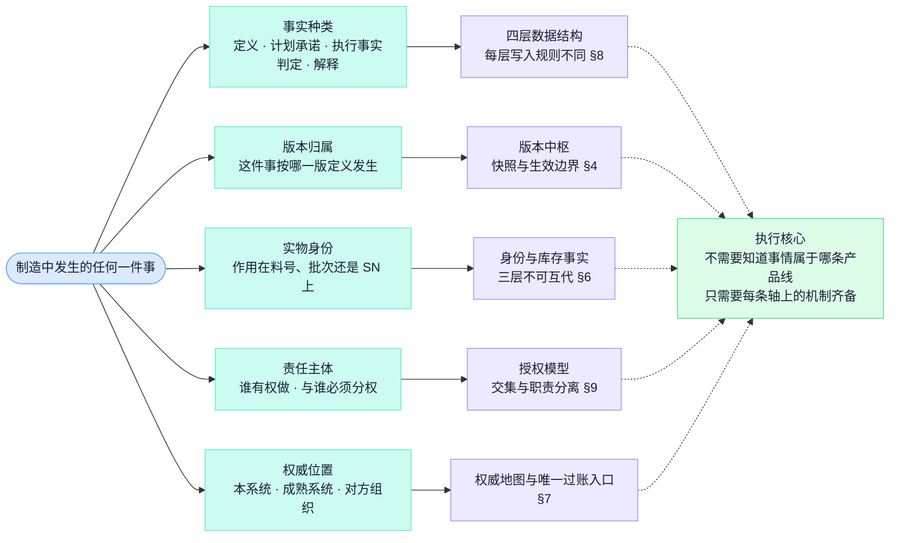
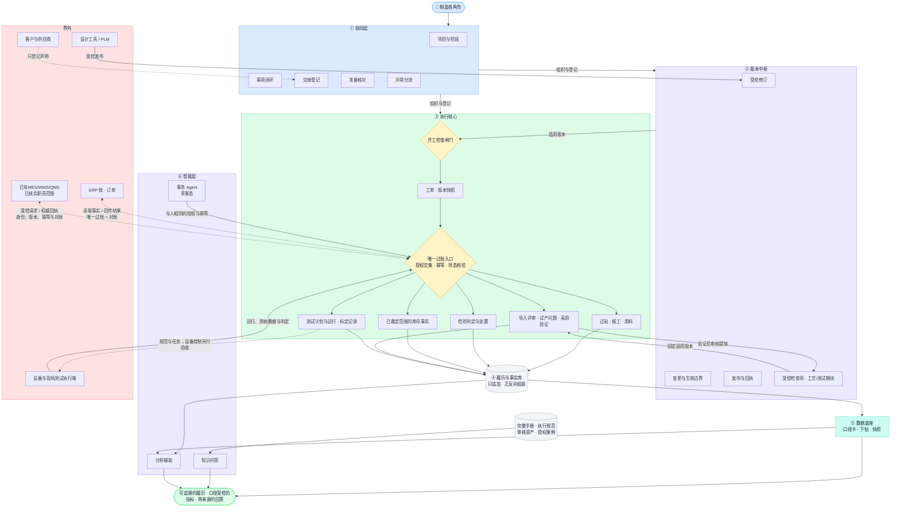
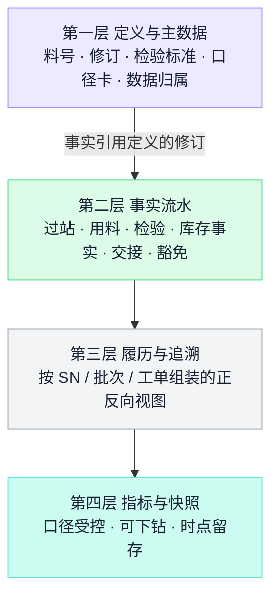
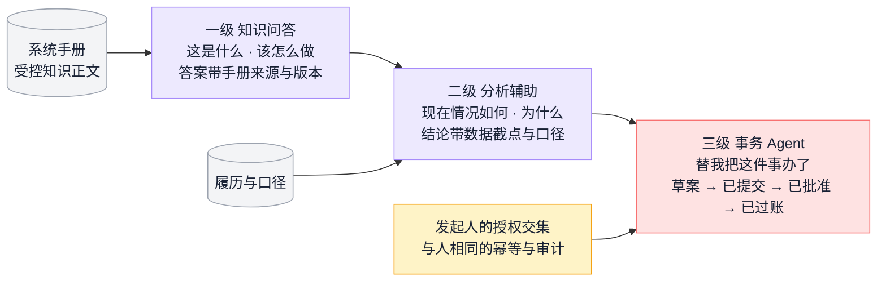
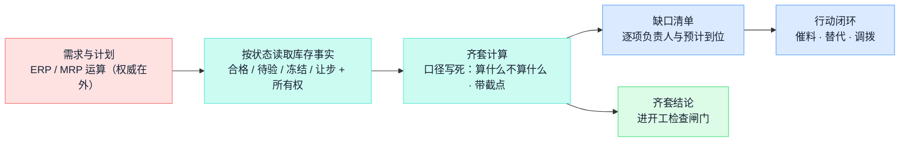
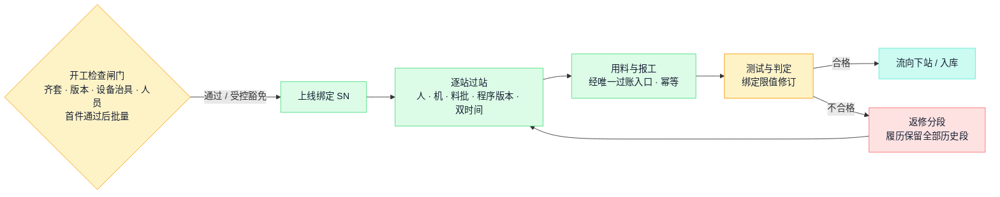
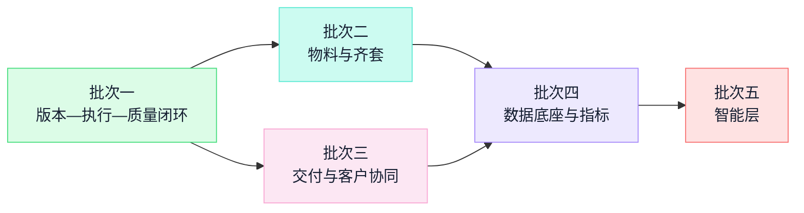

# 大制造系统总体架构设计

> **目标架构，未实施。** 本文是大制造系统的总体设计，整理日期 2026-10-28。第一部分定义系统的分层、边界与关键决策；第二部分沿 S1—S9 描述真实制造场景与工作流纪律；第三部分是对象语义、建设次序与决策点等落地治理内容。本文从制造业务场景推导目标设计，**不受当前任何实现约束**；现有工作台、已购系统与 Agent 平台作为实施时的可复用资产参考。正文描述的是设计意图，不代表功能已经实现或通过验证。
>
> 配套文档分工：[大制造数字化系统手册](manufacturing-system-handbook.md)维护业务知识正文、系统功能地图与自研边界；[制造流程总览](workflows/manufacturing-process-overview.md)维护业务现状底稿。原《制造系统开发手册》及其通用实现模式（表结构、算法细节、部署手册）撤回，不作为设计依据；其中属于架构承诺的原则已收敛进本文。各发布记录保留历史事实，不构成对本设计的约束或授权。
>
> 第一部分不按产品线或部门组织，而是从五条分化轴推导结构。**每张图都承载一条可检验的不变式**，写在图后。实现里出现了图上不该有的那条边，就说明对应条目被违反了。

## 目录

**第一部分：架构**——读完这一部分即可理解系统形状

- 1\. 系统要解决的问题
- 2\. 问题在架构上的五条分化轴
- 3\. 架构总览：分层与跨界契约 · 构件与连线
- 4\. 版本中枢：先回答"按哪一版做"
- 5\. 执行核心：事实接入、执行与过账纪律
- 6\. 实物身份与库存事实
- 7\. 权威与共存：逐对象裁定与受控共存
- 8\. 数据结构：四层事实与口径
- 9\. 授权模型
- 10\. 执行事实的可信度
- 11\. 智能层：问答、分析与受控事务
- 12\. 验收分层与失败归因
- 13\. 边界清单

**第二部分：场景与工作流**——用户要完成什么，一条制造链上发生什么

- 14\. 业务场景地图 · 15. S1 交付承诺与评审 · 16. S2 版本到现场与工程变更
- 17\. S3—S4 计划与齐套 · 18. S5—S6 开工与执行留痕 · 19. S7 测试放行与不合格处置
- 20\. S8 交付与客户协同 · 21. S9 结案与反馈闭环
- 22\. 内部与 OEM 的差异在哪里收敛 · 23. 主流程之外的三条支线：试产 · 返修退货 · 委外
- 24\. 角色视角：每类人与系统的交换 · 25. 系统怎么进厂：产线导入与旧习惯退役
- 26\. 业务验收样本怎么记

**第三部分：落地治理**——止步于语义层，更深的属于实施规格阶段

- 附录 A 对象目录与四契约 · 附录 B 分阶段建设与知识准备 · 附录 C 决策点与交付门槛 · 来源与维护

# 第一部分：架构

## 1. 系统要解决的问题

系统服务奥比大制造方向的制造负责人、计划与采购、工程与工艺、现场与测试、质量、项目与客户接口。内部自研相机（含数采相机）、3D 打印机与外部 OEM 代工代料共用一条制造管理主流程（S1—S9）。制造交付的本质是一条承诺链：**接下承诺 → 准备版本与物料 → 执行并留痕 → 判定与放行 → 交付与结案**。这条链今天在运转，但大量判断靠人脑、微信和个人表格维持——能转，却不可传递、不可追问、不可复盘。系统的使命一句话：**把制造承诺链上的每一个判断，变成有对象、有状态、有责任、可追溯的事实。** 价值判准沿用手册前言：让决定有正确输入、状态能够传递、责任明确、结果可追溯，而不是增加软件。

这句话带出三个常被低估的后果，它们决定了全部结构。

**制造事实不能重算。** 代码错了可以重跑，报表错了可以重出，但一台已经装错的整机不能重装历史，一批已经发走的货不能重新过站。制造事实只有一次发生机会，错过当场留痕，事后补写的"历史"就只是转述。所以事实必须在发生的那一刻、在发生的那个位置进入系统，而且进入之后不可变——这是执行留痕契约（§5）和四层数据结构（§8）的来源。

**错误的代价不对称。** 多拦一台合格品，损失一次效率、一次解释；放走一台不合格品、按旧版资料做了一批货，损失的是客户信任、召回成本和追查不出来的责任，而且事后很难发现。制造场景的底线是：**误拦截可以接受，误放行一票否决。** 所以"能不能开工、能不能领用、能不能放行、能不能发运"必须由证据授权——由开工检查、库存状态、检验判定这些结构化事实决定，不能由人的印象、页面上的绿色勾或"一直都是这么做的"决定（§5.5、§9）。

**账与物是两个世界。** ERP 的账是协议世界的事实：订单、应付、账面库存，按单据与会计规则运转；车间是物理世界的事实：这箱料实际在哪个货位、这台整机实际过了哪些站。两个世界永远存在时差与偏差，历史上试图让一边实时等于另一边的项目都失败在对账的泥潭里。本设计的回答是：**不建第二本账，但物理世界的事实必须自己站得住**——账的权威留给成熟系统；收货、库位、过站、用料与检验逐对象核实已有 WMS/MES/QMS 的能力。核实由已有系统承担的事实继续由其产生，自建仅承担明确缺口。每类事实在明确业务范围内有唯一权威与受控过账路径，偏差作为显式对象管理（§7）。

## 2. 问题在架构上的五条分化轴

结构不是为产品线、部门或已购系统搭建的。制造中发生的每一件事——一次开工、一次过站、一次收货、一次判定、一次改期、一次发运——在架构上只沿五条轴分化，每条轴都要求系统里有一处对应的结构。其余差异，比如相机还是打印机、内部还是 OEM、哪个车间、用 PDA 还是工位机，都只是内容差异，不产生新的结构。



**不变式：共用管理机制，显式保留产品工艺差异。** 业务来源（内部/外部）、产品族与制造场景（首次导入/重复生产/变更验证/返修）是独立维度。相机、3D 打印机和 OEM 共用身份、版本、授权、执行与追溯契约；具体路线、测试层级、标定算法、工装和批准要求由受控模板、模块与适配器表达。独立业务工作区可以复用同一机制，禁止按业务线复制整套系统。

**推论：新增业务构件必须有明确对象、生命周期和契约。** 五轴用于检查语义完整性，不限制工程导入、测试运行、标定和复用资产成为独立业务对象；这些对象仍满足身份、受控定义、责任与权威的共同约束。

**这个空间可以被证伪。** 任何真实的制造事件都应当能落在五轴上的一个点，落不上说明轴选错了，这是修改本设计的信号。举例：

- "操作工在 AA 工位给某台 SN 过站" =（执行事实，该工单快照的测试程序修订，SN，操作工本人，本系统权威）；
- "采购下了一张 2000 片传感器的订单" =（计划承诺，—，料号，采购员，ERP 权威，本系统只读取）；
- "质量工程师判某批来料让步接收" =（判定，该料号当前检验标准修订，批次，质量角色且与解冻分权，本系统权威）；
- "客户确认验收上月交付的 500 台" =（判定，合同约定的验收标准版本，SN 集合，客户组织，对方权威，本系统只登记）。

五条轴之间没有约束关系，取值组合不需要枚举。它们分别作用于不同构件，这就是一个执行核心能承载全部产品线与全部环节的原因。

## 3. 架构总览

下面两张图描述同一个静态结构，分工不同。**文本图**给出分层与跨界契约；契约写在层与层之间，因为它是双方共同的承诺。**Mermaid 图**给出构件与连线，五条轴各自逼出的结构都能在图上指出来。

有一处必须先说明：本图**没有按产品线或车间划分的并列子系统，也没有"集成总线"式的中间层**。§2 的五轴已经解释了前者；后者的原因是：集成的难点从来不在通道，而在每条接口的权威方向、幂等与对账责任——这些在 §7 逐条立约，不是一个总线构件能统一吸收的。

### 3.1 分层与跨界契约

```text
┌─────────────────────────────────────────────────────────────────────────┐
│   👤 制造负责人 · 计划采购 · 工程工艺 · 现场测试 · 质量 · 项目/客户接口 │
│      建项目 · 分派事项 · 交接资料 · 核对准备 · 过站报工 · 判定处置      │
└───────────────────────────────────┬─────────────────────────────────────┘
                                    ↕
┌───────────────────────────────────┴─────────────────────────────────────┐
│                     ① 协同层 —— 组织人，不生产制造事实                  │
│        项目与阶段（S1—S9 模板）· 事项闭环 · 交接登记 · 准备核对         │
│        异常分流与有效性验证 · 客户与供应商登记协同                      │
└───────────────────────────────────┬─────────────────────────────────────┘
   跨界契约：核对完成 ≠ 外部正式批准 · 交接登记 ≠ 对方系统过账
             事项负责人与交接接收方是业务登记，不授予系统访问权
                                    ↕
┌───────────────────────────────────┴─────────────────────────────────────┐
│               ② 版本中枢 —— 回答"现场此刻按哪一版做"                    │
│     受控修订（发布即冻结）· 客户版本与厂内版本映射                      │
│     变更影响盘点 · 可重现的生效边界 · 发布与接收回执 · 旧料在制处置     │
├─────────────────────────────────────────────────────────────────────────┤
│               ③ 执行核心 —— 受控事实接入与执行                        │
│     工单（版本快照 · 受控状态迁移）· 开工检查闸门                       │
│     过站与报工（人机料法 · 双时间）· 用料与所有权                       │
│     检验判定与处置（分权）· 库存事实（不可变 · 状态 · 所有权）          │
└───────────────────────────────────┬─────────────────────────────────────┘
   跨界契约：版本不明不开工 · 同一业务事实只有一个过账入口并携带幂等身份
             事实只增不改，更正以反向事实表达 · 迟到写入触发显式重评
                                    ↕
┌───────────────────────────────────┴─────────────────────────────────────┐
│          🗄 ④ 履历与事实库 —— 不可变留痕 · 正反向追溯（只组装）         │
├─────────────────────────────────────────────────────────────────────────┤
│          📊 ⑤ 数据底座 —— 口径卡 · 指标下钻 · 时点快照（只解释）        │
├─────────────────────────────────────────────────────────────────────────┤
│          🤖 ⑥ 智能层 —— 知识问答 → 分析辅助 → 事务 Agent（分级）        │
│              知识底座 = 系统手册（受控正文）＋ 履历与口径（带截点）     │
└───────────────────────────────────┬─────────────────────────────────────┘
   跨界契约：解释不改写事实 · 无口径卡的指标不发布 · 回答不等于过账
             事务动作走与人相同的授权、幂等与审计路径，停在草案态待批准
                                    ↕
┌───────────────────────────────────┴─────────────────────────────────────┐
│   🌐 界外（权威在外 · 显式契约 · 核实前只登记）                         │
│   成熟系统：ERP 账 · 财务 · 订单 · 采购 —— 唯一过账入口 + 对账          │
│   设计工具 / PLM：设计数据权威 —— 受控发布进版本中枢                    │
│   客户与供应商：订单 · 供料 · 验收 —— 只登记对方声称，不推断对方状态    │
│   现场设备与测试台：采集数据经执行核心的同一过账入口进入                │
└─────────────────────────────────────────────────────────────────────────┘
```

**不变式一：跨界契约写在层与层之间，不写在任何一层内部。** 每条契约都是双方共同的承诺，任何一方单独"加强"它都会破坏另一方。比如协同层为了"好用"替执行核心把人工核对自动转成放行，表面是打通了，实际是把分权拦截悄悄换成了单人操作，而且从输出上观察不到。

**不变式二：制造事实按唯一权威产生，经受控契约进入履历。** 协同层组织人、版本中枢供给定义、履历只组装、数据底座只解释、智能层只辅助。执行核心校验本地操作与权威回执，不把接收外部有效事实改造成第二次人工制造同一事实。登记、核实与真实回执分别表达；未知结果不被推定成功。

**不变式三：④ 与 ⑤ 是两层，不能合并。** 履历是事实的组装视图，数据底座是口径化的解释。合并它们，就等于允许"为了指标好看"的口径调整反向触达事实组装，粉饰的门就开了（§8.3）。

层表示职责，不代表新增独立部署；一个部分可以是一个服务，也可以是同一进程里一组受纪律约束的模块。

### 3.2 构件与连线



图上有八处是刻意的，每一处对应一条可检验的不变式。**实现里出现了图上不该有的那条边，就是对应条目被违反了：**

| # | 图上的事实 | 违反它意味着什么 |
| --- | --- | --- |
| 1 | 过站、检验、库存事实的入边都来自唯一过账入口，没有绕过它的边 | 出现第二个写入口，幂等与授权形同虚设，重复账与越权写入不可避免（§5.2） |
| 2 | 面向生产的版本应用先经开工检查；受控资产按固定修订进入NPI采用与验证，采用不等于允许生产 | 现场使用版本不明，或把资产采用当成开工批准，"按哪版做"与批准边界不可回答（§4.3、§27.1） |
| 3 | 履历只有入边来自执行核心，没有来自数据底座或智能层的入边 | 解释层改写事实，复盘与审计失效（§8.1） |
| 4 | 协同层到执行核心没有"自动转过账"的边，核对与交接止步于登记 | 人工核对冒充正式批准，分权被单人操作替代（§3.1 不变式一） |
| 5 | ERP 与执行核心之间是双向虚线且必经过账入口，没有直写库存事实或直改余额的边 | 第二本账出现，从此每天都在对账（§7.2） |
| 6 | 客户与供应商只有到交接登记的虚线，没有进入执行核心的边 | 对方声称被当成本系统核实的事实（§10.4） |
| 7 | 事务 Agent 的出边指向过账入口并标注"与人相同"，没有专用捷径 | Agent 获得人没有的权限，审计出现双重标准（§11.2） |
| 8 | 设备与测试台的采集经同一过账入口，没有旁路直达履历 | 设备数据不经幂等与校验直接落账，坏数据以"机器说的"身份免检入史（§10.1） |

另外两处结构性事实：开工检查是闸门形状（菱形）而不是提示框——它的否决有效力（§5.5）；系统手册到智能层只有读边，回答路径不写知识正文，知识修订走手册自身的受控流程（§11.4）。

### 3.3 层的职责与承诺

| 层 | 拥有什么 | 向上承诺 | 向下要求 |
| --- | --- | --- | --- |
| ① 协同 | 项目、阶段、事项、交接、核对、异常分流 | 登记的都是真实发生的操作；核对与批准、登记与连接分得清 | 执行核心提供真实状态供核对，不要求协同层猜 |
| ② 版本 | 受控修订、变更、生效边界、发布回执；已裁定本地维护的检查项与工艺/测试模块 | 适用版本可查询、可重现；资产发布冻结，采用引用准确修订 | 设计源与已有PLM/MES的有效定义按契约受控接入，不重复维护权威 |
| ③ 执行 | 本地工程导入、问题验证、资产采用、测试任务/记录及已裁定自建执行范围；已有MES/WMS/QMS的权威回执 | 同一事实不重复过账，身份/版本/状态/幂等受控；来源与确认状态清楚 | 版本中枢提供定义，授权提供当前范围；外部权威提供有效契约与回执 |
| ④ 履历 | 本地与外部有效事实的正反向视图，测试曲线、标定参数与组件装拆关联 | 只组装不新增；装拆保留历史；原始内容可核对摘要与来源 | 每个权威来源按契约携带完整身份、适用修订与双时间 |
| ⑤ 数据 | 口径卡、指标、快照 | 任何汇总可回到单据；口径有版本，历史不重写 | 履历与事实库只读 |
| ⑥ 智能 | 问答、分析、事务草案 | 回答带来源与版本；分析带截点；动作停在草案态 | 知识底座受控；授权模型可代入计算 |

与手册第2章分层对应：ERP、财务和经营订单属于L4；已有MES/WMS/QMS与本平台核实后的制造运营范围共同覆盖L3，不能将整层预设为自建。版本中枢引用或维护已裁定的受控定义；本地工程导入、复用资产、跨系统履历与辅助分析补齐业务缺口。设备与现场测试执行端按采集、规范与判定契约对接；管理任务、原始运行、业务放行分别有明确责任。

## 4. 版本中枢：先回答"按哪一版做"

**版本归属轴**是相机类产品的命门所在。一台深度相机的"版本"不是一个号，而是**五个轴的组合**：硬件（BOM 修订）、固件、测试程序与限值、标定流程与参数集、工艺文件（SOP）——轴的口径与手册第 6 章"版本的多个轴"一致。任何一轴错位——新固件配旧测试限值、新结构配旧治具——产品就错了，而且在产线上看不出来，要到客户现场才暴露。版本中枢存在的理由就是让"现场此刻按哪一版做"在任何时点、对任何一台产品都可机械回答。

### 4.1 版本五轴与工单快照

| 轴 | 定义的是什么 | 错位的典型事故 |
| --- | --- | --- |
| 硬件（BOM 修订） | 结构、PCBA、替代料与关键器件 | 换镜座未同步扭矩与治具，光轴偏移；替代传感器未联动标定 |
| 固件 | 烧录镜像与配置 | 新固件默认参数与测试程序假设不符 |
| 测试程序与限值 | 测什么、怎么判、阈值多少 | 用旧限值放行了本应收紧的指标 |
| 标定流程与参数集 | 标定步骤、治具、环境条件与补偿模型 | 换治具后沿用旧补偿模型 |
| 工艺文件（SOP） | 工序顺序、作业方法、关键参数 | 现场贴的还是旧版 SOP，发布无回执 |

**工单下达时冻结的是五轴的组合快照，不是五个独立的号。** 只快照其中一轴（常见的做法是只记 BOM 版本），等于声称其余四轴"反正不会变"——而变更恰恰最常发生在固件与测试限值上。快照之后，任何一轴的变更都只能经 §4.2 的生效边界进入，不存在"顺手刷一下固件"的合法路径。

### 4.2 生效边界的四种形态与可重现性

变更的生效边界只有四种形态：**按日期切、按工单切、按批次切、按 SN 切**。选哪种是业务决定（旧料用完再切还是立即切、在制品返工还是放行），但无论选哪种，都必须满足同一条判准：

**可重现性判准：给定任何一台产品的身份，不询问任何人，就能机械判定它适用哪一版。** "大概十月中旬切的""老王知道哪批是新版"都不满足判准。满足判准的边界才有资格生效；边界不可重现的变更，文件批准了也不生效。

变更关闭的条件同样是结构化的：文件批准≠变更关闭，**旧料处置完、在制品处置完、现场确认收到新版，三件事都留痕之后才关闭**。今天最容易丢的留痕恰好在批准与关闭之间的这段距离里。

### 4.3 为什么发布是"推送＋回执"而不是现场自取

一个看似更轻的方案是：资料放在共享位置，现场"用的时候自己拿最新的"。这个方案被否定，原因有三：

- **自取的失败是静默的。** 工位机缓存了旧文件、打印的 SOP 没换、收藏夹里存着上一版链接——每一种都让现场以为自己在用最新版，而系统对此一无所知。
- **"谁还没切换"变成不可查询的问题。** 推送＋回执之下，发布方随时能列出未回执的工位；自取之下，这个问题只能靠巡线。
- **生效边界需要接收时刻。** "按日期切"的日期必须是现场可以执行的日期，而不是文件上传的日期；回执就是这个时刻的证据。

**判错条件：** 如果回执沦为"现场随手点确认、实际仍在打印旧 SOP"，说明回执绑定的对象错了——它应当绑定实际使用的载体（工位显示、烧录服务器上的镜像、测试台加载的程序），而不是绑定"某人看过通知"。出现这种漂移时要重设计回执对象，而不是加一条"请认真确认"的规定。

### 4.4 定义与事实的分界

版本中枢只管**定义**："这一版应当怎么做、判什么限值"。每一台产品实际测出的值、实际写入的标定参数，是**事实**，归履历（§8）。这条分界画错的两种后果都已知：

- 把每台的标定参数当"版本"管理，版本号按台爆炸，受控发布流程被海量机器数据压垮；
- 把测试限值塞进履历层按台存储，限值失去受控修订，"当时按什么标准判的"重新不可回答。

正确的连接方式是：每条测试事实**引用**它所依据的限值修订（§5.2 的过账携带项），定义与事实各在其位、互相指认。

### 4.5 OEM 的双版本映射

OEM 业务里同一份资料有两个受控身份：客户版本（客户的图纸号与版次，批准权在客户）与厂内版本（本厂的修订，批准权在本厂工程）。两者**并存且映射可查**，不允许用"反正内容一样"合并成一个号——客户升版而厂内未切、厂内优化而客户未批，是 OEM 最常见的两类版本事故，合并身份之后这两类事故都无法表达，更无法拦截。映射关系本身是受控对象：谁在何时确认了"客户 B 版对应厂内 Rev3"，留痕。

## 5. 执行核心：事实接入、执行与过账纪律

### 5.1 职责边界

| 角色 | 负责 | 不负责 |
| --- | --- | --- |
| 操作者（人） | 真实执行动作并当场提交；对提交内容的真实性负责 | 判断版本对不对（闸门负责）、算余额、替别人提交 |
| 执行核心 | 过账入口的授权、幂等、状态与版本校验；拒绝时给出可执行的原因 | 替操作者补全参数、把人工核对转成批准、猜测迟到数据的归属 |
| 设备与测试执行端 | 按采集契约记录原始读数、程序/限值/算法/设备与运行上下文；受控引擎可以产生测试判定 | 代替质量放行或客户批准；绕过限值、执行与设备有效性检查 |
| 协同层 | 组织核对与交接、登记外部声称 | 产生任何过站、库存、检验事实 |
| 成熟系统 | 账、订单、采购及经核实由已有 MES/WMS/QMS 承担的执行事实 | 未裁定范围内的事实；未经来源、版本和回执核验的状态不能直接升级为已确认事实 |

越界的后果不对称，所以不能靠"两边都小心"了事：执行核心替操作者补全参数，坏数据以合法过账的身份进入履历，事后无法与真实数据区分；操作者替系统判断版本（"我知道这版能用"），闸门形同虚设。**代码只做可以机械判定的事（授权交集、幂等命中、状态允许、版本引用存在），人只做需要现场判断的事（这台机器实际装没装好）。**

### 5.2 一次过账的合法结束

一次过账要合法结束，必须同时满足四点：

1. **身份完整**：携带对象身份（工单/SN/批次）、适用版本引用、真实操作主体、双时间（发生时刻与录入时刻）、关联单据；
2. **授权通过**：§9 的四项交集全部成立；
3. **幂等判定**：携带的幂等身份未命中已有事实——命中时**返回原回执，不产生新事实**；同一幂等身份但内容不同，是冲突，拒绝并报告，不覆盖；
4. **状态允许**：目标对象当前状态允许此操作（已关闭工单不收报工、冻结批次不可领用、未放行品不可发运）。

四点有一点不满足，过账不发生、不留半截事实；拒绝本身记录在审计里（谁、何时、被什么规则拒绝），因为**被拒绝的尝试也是管理信号**——同一规则反复拒绝同一工位，说明流程或培训有问题，而不是系统该放宽。

### 5.3 补录是一等公民

车间总有断网、设备死机、PDA 没电、先干活后扫码。把补录当异常的系统，会在上线三个月后发现一半的"实时数据"其实是晚上补的，而系统无法区分。本设计把补录定为一等公民：

- **双时间是必填结构**，不是备注：发生时刻由操作者声明，录入时刻由系统记录，两者的差距本身可统计、可考核；
- **补录走同一过账入口**，经同样的授权、幂等与状态校验；
- **迟到的事实不得改写已经做出的判定。** 齐套结论、放行决定是基于"当时已知事实"做出的；补录进来的事实如果推翻了它们的依据，正确行为是**触发一个显式的重评事件**（"该放行所依据的库存事实已变化，请复核"），而不是静默地让历史判定"变得不对"。判定与它的依据一起冻结，这是复盘能成立的前提。

补录窗口多长、超窗怎么办，是决策点（附录 C）；但"补录必须显式区分于实时"不是决策点，是契约。

### 5.4 为什么更正只能以反向事实表达

库存多记了 10 片，最直接的冲动是把那条记录改成正确的数。本设计禁止一切对已过账事实的修改与删除，更正必须以新的反向事实表达（红冲），原因有三：

- **"曾经错过"本身是事实。** 改掉原记录，错误率、错误来源、错误发现时长这些管理信号全部消失；留着原记录加红冲，它们免费可得。
- **下游已经消费了原事实。** 齐套计算、MRP 读取、放行判定可能已经基于它发生；原记录被改写后，这些判定与其依据的对应关系断裂，复盘变成猜谜。
- **修改权是最危险的权限。** 允许改，就要定义谁能改、改多久以内的、改了通知谁——每一条都是新的攻击面；不允许改，这些问题整体消失，审计只需要盯一个问题：反向事实是谁、凭什么过的。

### 5.5 为什么开工检查是闸门而不是提醒

开工检查核对的内容与手册第 9 章一致：物料齐套、版本有效且已接收、设备与治具状态及校准有效期、人员资质到位；批量之前另有首件（FAI）闸门，换线、换版、换批次重新触发。把它做成"提醒"的系统，在第一个赶工的晚上就会被跳过，然后永远被跳过——提醒的边际成本是零，忽略它的边际成本也是零。

闸门的含义：**不通过就不能对该工单过账。** 同时，真实工厂需要豁免通道——客户催货、缺一项非关键核对，业务可以决定带险开工。豁免的设计是：**有权者显式豁免、豁免理由与范围留痕、豁免本身进入履历**。于是"带险开工"从一句口头默许变成一条可统计的事实：谁豁免的、豁免了什么、后来出没出事。闸门加受控豁免，既不堵死业务，也不让纪律静默蒸发。

## 6. 实物身份与库存事实

### 6.1 三层身份：各自能证明什么

**实物身份轴**要求料号、修订、批次/SN 三层不可互代。每一层都有它不能证明的东西，这一点比它能证明什么更重要：

| 层 | 能证明 | 不能证明 |
| --- | --- | --- |
| 料号 | "是哪种东西"：采购、计划、定价的单位 | 是按哪一版定义造的；是哪一件实物 |
| 修订 | "按哪一版定义"：形位、器件、工艺的差异 | 库房里哪箱是新版——修订不是实物标识 |
| 批次 | "同一次生产/采购的一群实物"：共享来源与风险 | 群内个体差异；批内一台坏不等于批内全坏，但要能圈出全批 |
| SN | "这一台"：唯一个体，逐台履历的锚点 | 同型号其他个体的状态 |
| 供应商批号 | 供应商声称的生产批次，收货时留存 | 本厂批次划分；两者映射要留，不互相替代 |

典型的混层事故，每一条都对应一层误代另一层：用料号领料不记批次，追溯断在仓库门口；用修订当批次，"新版来料"和"旧版库存"混放混用；客诉圈范围时只有料号，被迫全量召回。**追溯等级（批次级还是 SN 级，按产品族裁定）决定建模颗粒度，上线后从批次级升到 SN 级等于重建履历，所以这是最迟批次一建模前必须裁定的决策点（附录 C），宁严勿松。**

### 6.2 待验不等于合格：状态下沉到协议里

库存数量永远带五维身份——所有权、位置、质量状态、分配状态、批次（口径与手册第 8 章一致；料号是批次之上的基础身份）。其中**状态**这一维必须下沉到数据协议里，不能靠纪律维持，原因与 FAE 场景"缺失不等于否定"同构：人总会把"仓库里有"读成"可以用"。

- 状态是枚举且互斥：**待验、合格、冻结、让步**。查询接口在协议上就按状态返回，不存在一个含糊的"总数"；
- **参与齐套与计划的只有明确纳入口径的状态**（合格必然纳入，让步与待验是否纳入是口径决定，冻结必然排除）；
- 没有检验判定的来料停在待验，**待验不因放久了自动变合格**；
- 冻结由判定驱动（§19），解冻与判定分权。

**所有权**维度同理：自有、客供、委外在外三态互斥。客供料的消耗进追溯与对账，不进本厂成本；委外在外的料在本厂账上存在、在本厂库里不存在——这两类如果不在协议上区分，OEM 业务的每次对账都是一场考古。

### 6.3 余额是推导，永远不可直写

库存余额 = 该五维身份下全部不可变事实的代数和。系统可以缓存这个和，但**缓存错了修缓存，事实错了红冲事实，永远不存在"把余额改成对的数"这个操作**。直改余额在本设计里不是被劝阻，而是在结构上不存在这条边（§3.2 不变式 5 的内侧版本）。盘点也不例外：盘点产生的是"盘盈/盘亏事实"，带盘点单据与双人确认，余额随之推导变化。

## 7. 权威与共存：逐对象裁定与受控共存

### 7.1 权威地图

**权威位置轴**要求每类对象有且只有一个权威，逐对象裁定并公示。目标态的权威地图：

| 对象 | 权威 | 本系统的角色 |
| --- | --- | --- |
| 销售订单、价格、应收应付、总账 | ERP / 财务 | 只读取；承诺与交付引用订单身份 |
| 采购订单与供应商主数据 | ERP / SRM | 读取采购承诺用于齐套 |
| 账面库存（会计口径） | ERP | 读取；本系统的库存事实回传后由 ERP 过账 |
| 设计源文件、设计 BOM | 设计工具 / PLM | 经受控发布进版本中枢；设计怎么画不管 |
| 制造修订、生效边界、发布回执 | 核实已有 PLM/MES 后裁定；缺口由本系统承担 | 提供统一受控引用与发布回执，避免两套有效修订 |
| 工单执行、过站、用料、检验 | 已有 MES/QMS 或明确自建范围逐项裁定 | 对接权威事实、保留来源；自建范围走相同授权、状态与幂等规则 |
| 单台履历与组件关系 | 对原始事实只读组装；新增组件动作按范围裁定 | 关联实际 SN、批次、装拆与测试历史，不复制过账 |
| 实物库存事实（物理口径） | 已有 WMS 或已裁定自建范围 | 展示可用状态与截点，引用权威回执并对账，不另造一套可任意修改的余额 |
| 测试标定运行、曲线与参数 | 受控测试执行端；按采集和判定契约接收 | 管理任务、适用规范与原始证据；质量放行独立 |
| 工程导入、适用检查与复用资产 | 本系统的受控业务对象 | 问题验证后形成审核资产，采用时固定版本与适用范围 |
| 指标口径与快照 | 本系统（数据底座） | 唯一权威 |
| 客户验收、客户库存、客户端数据 | 客户组织 | 只登记对方声称与凭据 |
| 仓储自动化与搬运调度（WCS / AGV-RCS） | 自动化设备配套系统 | 不自建、不接管；任务结果经采集契约进入留痕 |
| 质量体系文控、通用审批 | 轻量文控工具 / OA | 只登记并引用批准结果，不承载权威 |

这张地图按手册第 3 章的三区边界应用到实际系统：财税、WCS与体系文控沿用成熟系统；ERP/MES/WMS/QMS 的实际覆盖逐对象核实；自建聚焦明确缺口、跨系统履历、工程导入和复用资产。系统名称不自动决定权威，配置登记不自动连接或切换已有事实来源。

已购系统的产品与实际范围核实之前，上表中涉及它的行只是**假设**，一切关系仅为登记——不展示连接状态、不调用、不推断（附录 C 决策点）。

### 7.2 唯一过账入口

与 ERP 的每一次数据交换，先立四件事再谈通道：**业务唯一标识**（哪个单据、哪次事实）、**成功语义**（对方返回什么才算过账完成）、**重试与去重**（超时重发由幂等身份保证不重复记账）、**对账责任**（谁、按什么周期、比对什么粒度）。四件事没立，接口不开发——通道永远是四件事里最便宜的那件。接口契约的完整九项（另含顺序、四个时间戳、单位精度、责任人）与"没有 API 也要有契约"的纪律见手册第 14.3 节；设备接入的协议形态见手册第 14.4 节——它们是立约时的检查清单，不在本文展开。

### 7.3 对账是兜底设计，不是补救手段

两个世界必有偏差（§1），所以对账不是"出了问题才做的事"，而是每条接口关系自带的常设机制（对账粒度与周期在立约时一并裁定，§7.2）。对账发现的差异是**显式对象**：有身份、有责任人、有处置状态，挂在看板上直到关闭。藏起来的差异不会消失，只会在月底财务关账时集中爆炸。

### 7.4 登记不等于连接

系统协同关系有三个严格递进的状态：**已登记**（知道有这个系统、归属已裁定）→ **已核实**（产品与范围经真实核对）→ **已连接**（契约已立、真实调用、对账在跑）。页面上永远展示真实状态，不因为"反正要连"就提前显示连接；没有真实数据时呈现空态，不虚构示例数字。这条纪律的价值在第一次对账时兑现：所有人都知道哪些数字是系统核实的、哪些只是登记来的。

## 8. 数据结构：四层事实与口径

### 8.1 四层与写入规则

**事实种类轴**把数据分为四层，每层写入规则不同；一切数据争议先问"它在哪一层"。



| 层 | 写入规则 | 违约的典型形态 |
| --- | --- | --- |
| 定义与主数据 | 受控修订：发布即冻结，变更走新修订；申请与批准分权 | 直接改已发布定义；两处各有一份"权威" |
| 事实流水 | 只增不改：更正以反向事实表达；每条带幂等身份与双时间；分权写入 | 改余额、删记录、补录冒充实时 |
| 履历与追溯 | 只组装不新增：装配关系只关闭不删除，返修保留全部历史段 | 在履历层手工"修正"事实 |
| 指标与快照 | 只解释不改写：口径有版本，快照留存取数范围 | 为了数字好看在汇总层调整、绕过口径出数 |

**不变式：箭头只从上往下。** 第二层引用第一层的修订，第三层组装第二层，第四层解释第三层；不存在任何反向写入的边。指标难看，修的是流程或事实质量，永远不是修组装逻辑或口径的适用范围。

### 8.2 双时间贯穿全部事实

每条事实携带**发生时刻**（业务声明）与**录入时刻**（系统记录）。它们支撑三件分开的事：追溯按发生时刻排列（履历要还原物理顺序）；审计按录入时刻排列（要还原谁何时知道了什么）；补录质量 = 两者差距的分布（管理信号）。只存一个时间的系统，三件事里至少坏两件。

### 8.3 口径与指标：把粉饰封堵在结构里

每个发布的指标有**口径卡**：分母、截点、排除项、责任人、版本。口径卡的设计方法是逆向的——先列出这个指标最常见的操纵手法，再逐条封堵：

| 常见操纵 | 口径卡的封堵 |
| --- | --- |
| 缩分母（"特殊订单不算"） | 排除项显式枚举且有版本，新增排除走口径变更留痕 |
| 挪截点（月底的货算下月） | 截点规则写死在口径里，按发生时刻归期 |
| 返工不计（FPY 只算最后一次） | 口径明确首次通过定义，重测在履历上无法伪装成首测 |
| 口径悄悄改（环比突然变好） | 口径有版本，跨版本对比必须明示 |
| 绕过口径出数（汇报用手工表） | 任何发布数字可下钻到单据；下钻不通的数字没有发布资格 |

**无口径卡的指标不发布**不是文风要求，是把"数字可信"从依赖人品变成依赖结构。

### 8.4 快照与补录的关系

时点报表（月度质量报告、给客户的批次报告）在发布时留存**取数范围**。此后补录改变了当前数字，不改写已发布快照；两者的差异本身可查询（"报告发布后又补录了什么"）。给客户的数字与给自己的数字同源同口径，差异只能来自截点——否则客诉对数时先输一局（§20）。

### 8.5 三条贯穿数据流在目标结构中的走法

手册第 4 章把三条数据流画在成熟系统上（PLM→ERP→MES）；同样三条流在本设计的目标结构中走法如下，两张图一一对应，便于从"现状系统"切换到"目标结构"时核对没有断点：

| 数据流 | 起点 | 经过 | 落点 |
| --- | --- | --- | --- |
| 产品定义流 | 设计工具 / PLM 的受控发布 | 版本中枢（修订、双版本映射、生效边界）→ 发布回执 → 工单版本快照 → 开工检查 | 每条过站与测试留痕里的资料与程序版本引用 |
| 订单—计划—执行流 | 制造需求 / 承诺（订单或内部计划） | 成熟系统（MRP、采购）→ 齐套结论 → 工单 → 过站 / 用料 / 报工 → 唯一过账入口回传 | ERP 的账与本系统的履历各自闭合，定期对账 |
| 质量—追溯流 | 检验判定与库存状态联动 | 履历正反向组装 → 异常分流（协同层）→ 变更或标准修订（版本中枢） | 可回答"这台发生过什么、同批还有谁"的追溯视图 |

## 9. 授权模型

### 9.1 交集公式与单次写入

**一次操作的有效范围 = 企业有效身份 ∩ 角色允许的动作 ∩ 组织与对象的归属范围 ∩ 对象当前状态允许的操作。**

四个交集缺一不可：有身份没角色不能动，有角色超归属不能动（相机产线的角色不能给打印机工单过账），归属之内对象状态不允许（已关闭、已冻结、已发布）仍不能动。校验发生在**服务端的每一次写入**，页面禁用只是交互礼貌。

为什么作用于单次写入而不是会话：对象状态在变。登录时有权处置的那个批次，十分钟后可能已被另一位质量工程师判定并冻结；会话级授权会让第一次校验的结论带着过期的状态活到会话结束。登录只解决身份，每次写入重新算交集——这也是幂等回执能可信的前提：回执上记录的是**过账那一刻**的授权事实。

### 9.2 三条固定的职责分离

| 分离 | 理由 |
| --- | --- |
| 检验判定 与 库存解冻 不同角色 | 判定者若可解冻，拦截形同虚设——判错了自己放，没人看见 |
| 主数据申请 与 批准 不同角色 | 定义层被单人改写会污染全部下游事实，而且以"权威定义"的身份污染 |
| 放行 与 发运操作 不同角色 | 未放行品进发运是对客户的违约，必须双人才能发生 |

分离是**结构性**的：不是"建议由不同人做"，而是同一主体对同一对象做了前一个动作，后一个动作的授权交集就为空。急单时人手不够怎么办——走 §5.5 同款的受控豁免，豁免留痕，而不是把分离降级为建议。

### 9.3 登记身份与访问身份分开

事项负责人、交接接收方、阶段负责人是**业务责任登记**，不因此获得系统访问权；反过来，有系统账号也不自动成为任何业务的责任人。两者混同的后果是：为了给某人派活就得开账号（访问面失控），或者为了控制访问就不敢登记真实责任人（责任失真）。

### 9.4 智能层代入同一公式

事务 Agent 代入**发起人**的身份计算同一交集，Agent 自身不拥有独立于人的业务权限；它起草的动作停在草案态，批准者的交集在批准时刻再算一次。审计上，"人做的"与"Agent 起草、人批准的"可区分（§11.2）。

### 9.5 平台管理员完整业务权限与普通角色

经可信宿主确认的平台所有者、平台管理员默认拥有全部现有及未来项目和全部注册业务动作，包含相应业务角色与资格；这是用户确认的长期产品规则，不逐项目生成虚假授权或资格记录。当前身份、只读、CSRF、版本、幂等、来源、实物状态和业务前置条件仍逐次核验，审计记录真实操作者。管理员降权后立即回到普通成员规则，动作变体的当前权限也在幂等重放前核验。

普通项目成员可按明确业务范围分配多角色，后续角色细分只针对普通成员配置，不取消平台管理员的完整动作权限。职责分离属于具体业务条件，必须明确适用规则及实际实施状态；不能把角色登记、全局权限与已实现的双人签核混为一谈。

## 10. 执行事实的可信度

这一章只有一个设计决定：**系统对外呈现的每一个运行事实，都必须真实发生过，而不能是推测出来的。** 下面各节都从它推出。

### 10.1 不知道结果时不假装知道

跨系统调用（向 ERP 回传完工、向设备下发程序）有三种结局：成功、失败、**未知**（超时、断连）。未知是独立状态，两个方向都不能并掉：

- 当失败重发——若对方其实已处理，重复记账；
- 当成功记账——若对方其实没收到，两边从此漂移。

正确行为：未知进入**待确认**状态，由幂等身份保证重试安全（对方若已处理，重试命中原回执），由对账兜底（§7.3）。设备采集同理：测试台断连期间的数据，恢复后按原发生时刻经同一过账入口补入，缺失区间显式存在，不用插值或复制邻值填平——**填平的曲线在复盘时会撒谎**。

### 10.2 车间断网不是系统故障的借口

产线不能因为网络抖动停线，所以离线暂存是必须能力；但离线数据的身份必须诚实：

- 暂存记录显式标记**未过账**，不混入已过账事实；
- 恢复后经同一过账入口、带原发生时刻提交，幂等身份在离线侧生成（重复上传不重复记账）；
- 暂存期间现场看到的余额、齐套结论显式标注"截至断网时刻"，不冒充实时。

**判错条件：** 如果上线后发现大量数据以"离线补传"身份进入而车间网络其实正常，说明现场在用离线通道逃避实时校验——这是流程问题，要修的是现场管理，而不是放宽在线校验去"适应现状"。

### 10.3 渠道故障不算业务拒绝

扫码枪没电、PDA 死机、网络超时，与"过账被拒绝"（越权、状态不允许、版本过期）是两类事实，分开记录、分开监控：前者是运维指标，后者是流程信号（§5.2）。混在一起的后果是，运维忙着给"拒绝率"背锅，而真正的越权尝试淹没在设备故障里。

### 10.4 外部声称的信任边界

供应商的 COA（出厂检验报告）、客户的签收回执、ERP 的账面数——都是**对方声称**。本系统记录声称的内容、来源与凭据，但不把它升级为本系统核实的事实：

| 外部输入 | 登记为 | 不能当作 |
| --- | --- | --- |
| 供应商 COA | 该批次附带的供方声称 + 凭据 | IQC 判定（本厂检验仍按抽样方案决定做不做、做多少） |
| 客户签收 | 客户组织的接收声称 + 时间 | 约定验收通过（验收按合同条款另行登记） |
| ERP 账面库存 | 协议世界的数，带读取截点 | 实物在场的证明（齐套结论引用它时要标注来源与截点） |
| 设备自检通过 | 设备声称自身状态正常 | 校准有效期内的证明（计量校准是独立的定义层事实） |

这与 FAE 场景"用户附件只证明用户现场"同构：**声称可以补充核实，不能替代核实**。

## 11. 智能层：问答、分析与受控事务

### 11.1 三级能力，逐级解锁



**不变式：三级的解锁顺序不可跳。** 问答的价值依赖手册受控（否则答的是过时做法），分析的价值依赖留痕与口径可信（否则分析的是粉饰后的数），事务的安全依赖前两级已经证明"它理解这个厂"。数据底座（批次四）就绪之前就上事务 Agent，等于让一个没看过账本的助理直接开支票。

手册 15.2 节还有第四层——**工业 AI 与闭环控制**（视觉检测、预测性维护、工艺优化）。它不在这条三级演进线上：按手册的裁定另立专业工程项目，有自己的测量与控制要求、失效策略和现场安全责任——"能解释报警"推不出"能安全动设备"。本设计的智能层止步于第三级。

### 11.2 为什么事务动作停在草案态

事务 Agent 的错误代价 = 误过账，与人为误过账同级；但 Agent 可以在一分钟内把同一类错误犯一百次。所以：

- Agent 的输出**永远停在草案态**，向后的每一态（提交、批准、过账）都需要真实授权主体；
- 草案携带它的依据（引用的事实、口径、手册条目），批准者看得到"它凭什么这么填"；
- 某类动作能否从"人批准"放宽到"自动过账"，以该类动作的真实错误率与回滚成本为据，是逐类裁定的决策点（附录 C），不是默认演进。

### 11.3 回答可追责

每个答案能回放：引用的手册版本、数据截点、口径版本。答错时能定位是**知识旧了**（手册该修订）、**数据断了**（留痕缺失）还是**模型错了**（证据齐全仍推理错误）——三种失败修在三个地方，混在一起哪个都修不好（§12.3 同款归因纪律）。

### 11.4 知识与事实分开存储维护

系统手册是通识知识的完整连续正文；执行标准（SOP、检验和测试规范）、复用资产（检查项、工艺/测试模块）与项目案例分别受控。公司事实（履历、留痕、裁定）另行存储。案例经过原因和对策验证及审核才形成适用资产，客户专属资料不自动公开。回答携带来源、修订、适用条件与数据截点；规则辅助明确标识规则与草案，不宣称已经调用模型、确认根因或执行业务。

## 12. 验收分层与失败归因

### 12.1 五个独立的判定轴

"谁来定义完成"必须在一处回答清楚，否则它会散落成逐场景的争论。五个轴独立判定，任何一轴通过不代表其他轴通过：

| 轴 | 判定什么 | 由谁判定 |
| --- | --- | --- |
| 运行可靠性 | 写入是否幂等、重启后数据是否保持、异常场景是否被拒绝（越权、过期版本、重复提交） | 自动化证据，阻断交付 |
| 契约一致性 | 过账携带项、状态迁移、分权是否与附录 A 的契约语义相符 | 自动化核对，单独告警 |
| 展示质量 | 页面、报表、空态是否如实（不虚构示例数字、不显示未核实的连接） | 用户按既有约定验收 |
| 业务事实质量 | 留痕是否与现场一致：系统说齐套、现场是否真齐；履历是否与实物对得上 | 真实业务样本走查，产品负责人组织 |
| 业务闭环 | 真实的一单、一次变更、一次客诉是否全程在案并解决 | 按附录 B 各批次的验收判准 |

接口通过数、测试数量、服务健康都不出现在任何一轴里——它们是工程中间证据，不是验收结论。

### 12.2 判定规则

1. **验收样本是真实业务，含异常场景。** 功能点清单证明"做了"，真实样本证明"能用"；一批未达业务验收不进入下一批（附录 B）。
2. **评审方不能是建设方。** 建设方自证"追溯走通"无效；由业务角色实际执行走查（任取一台 SN、任选一次变更）。
3. **回放材料不足不算产品失败。** 上线前的历史数据查不到追溯，是事实边界，不是缺陷；但要显式标注"履历自某时点起"。
4. **不只报通过率。** 每批验收给出代表性走查记录（§26）、被拒绝的尝试样本、仍然失败的场景。
5. **修复在隔离环境验证后再上产线。** 不在生产数据上做实验。

### 12.3 失败归因

每个失败先归因到债务类型，再做类别检查（这一类还有多少例？什么机制防止复发？）：

| 债务类型 | 表现 | 修在哪里 |
| --- | --- | --- |
| 主数据债 | 料号混用、BOM 错漏、身份三层互代 | 修定义层与归属裁定，不在执行层打补丁 |
| 流程债 | 线下绕过系统、先干后补成风、豁免常态化 | 修现场管理与激励，不放宽闸门去"适应" |
| 契约债 | 接口无幂等、状态可旁路、分权缺位 | 修结构；临时的人工纪律必须登记删除条件 |
| 外部债 | ERP 账不准、供应商数据缺失、客户口径多变 | 修对账与登记边界，不把外部问题内化成本系统改数 |

只修单个样本、不建立类别级机制的修复是不允许的。"把那条库存改对"不是修复，查清它为什么错、同类还有几条、哪个契约没拦住，才是。

## 13. 边界清单

一组"A 不等于 B"，是全部契约的否定式表达——出现混同即是设计被突破：

- 记录存在不等于记录可信，可信不等于足以决策——时点、口径、版本、状态单独核对。
- 系统关系登记不等于已核实，核实不等于已连接；人工核对不等于外部正式批准；未知保持未知。
- 待验不等于合格；仓库里有不等于可以领用；账面有不等于实物在场。
- 文件批准不等于变更关闭；发布不等于现场已切换；回执不等于正确执行。
- 接口返回成功不等于业务一致；看板可见不等于闭环；服务健康不等于业务验收。
- 对方声称不等于本厂核实；设备自检不等于校准有效；COA 不等于免检。
- 智能层的回答不等于过账；草案不等于已批准；"Agent 确认"不是任何放行的依据。
- 活动只记录已发生的操作；不伪造外部同步、审批或生产回执；没有真实数据时呈现空态。
- 公司事实与通用知识分开存储维护；已发生的事实只增不改，更正留痕。

# 第二部分：场景与工作流

本部分沿 S1—S9 展开真实制造场景。每章给出典型业务时刻、流程图、工作纪律与"检验的契约"；各章节点编号与制造流程总览及系统手册第二部分一致。这些场景会在一条真实订单上交叉出现——一次 OEM 订单从评审走到发运，途中可能两次变更、一次缺料、一次批退。系统不为每个场景造独立模块，场景由 §2 五轴对应的机制共同承载。

## 14. 业务场景地图

### 14.1 八大核心场景

用户可从任一场景进入，不以完整建档为前置。

| 场景 | 要解决的问题 | 可用输入 | 需要留下的结果 |
| --- | --- | --- | --- |
| 交付承诺 | 这一单能不能接、何时能交、条件是什么 | 需求、库存与在途、产能占用、提前期 | 有依据、带条件的承诺；条件被跟踪到闭环 |
| 版本到现场 | 现场此刻按哪一版做，变更何时切、切到哪一台 | EBOM/MBOM、SOP、固件、测试程序与限值、变更申请 | 受控发布与接收回执；可重现的生效边界 |
| 物料齐套 | 料齐没齐、缺什么、谁在办、何时能齐 | 计划需求、采购承诺、按状态的库存 | 缺口清单与行动闭环；开工前的齐套结论 |
| 执行留痕 | 实际是谁、在哪台设备、用哪批料、按哪版程序做的 | 工单、过站、用料、报工 | 每台产品可正反向追溯的履历 |
| 质量拦截与放行 | 不合格被真实锁住；放行有权、有据、分得清主体 | 检验标准与结果、不合格处置 | 状态真实联动库存；制造/质量/客户放行分别留痕 |
| 交付与客户协同 | 哪台发给了谁；OEM 的验收、数据回传办到哪一步 | 放行结果、订单、包装标识 | SN 出货关联；约定验收的留痕与遗留项跟踪 |
| 异常与变更闭环 | 问题回到正确的环节并被验证有效 | S1—S9 反馈边、客诉、8D、ECO | 分流记录与有效性验证 |
| 经营可见 | 交付、质量、库存的数字可信、可下钻 | 执行留痕、口径定义 | 口径受控的指标；任何汇总可回到单据 |

前七个**生产**事实，第八个**消费**事实——先有可信的留痕，才有可信的数字，这是附录 B 分阶段的根本依据。

### 14.2 每个制造动作都带着的六个维度

| 维度 | 要弄清的事实 | 常见误解 |
| --- | --- | --- |
| 对象身份 | 作用在料号、批次还是 SN 上；是哪一个 | 扫了外箱码当作扫了 SN；用料号代批次领料 |
| 适用版本 | 按哪一版定义做、判、测 | "用最新的"——最新不等于本工单快照的那一版 |
| 数量与状态 | 多少、处于什么状态、归谁所有 | 把待验数当可用数；客供料进了自有成本 |
| 责任主体 | 谁做的、是否需要与谁分权 | 代打卡、代判定；一个人从判定做到解冻 |
| 双时间 | 实际发生何时、录入何时 | 补录冒充实时；按录入时间算产出归期 |
| 单据关联 | 挂在哪张工单/订单/检验单上 | 无单据的"顺手处理"，事后挂不回任何链条 |

### 14.3 断点家族

断点家族是**需求覆盖清单**，用于走查、漏项检查与复审交流，不用于决定结构（结构由 §2 五轴决定）。任何断点都应能落回某条轴与某个契约；落不回去的断点是修改第一部分的信号。

| 家族 | 典型表现 | 对应机制 | 要警惕的失败形态 |
| --- | --- | --- | --- |
| B01 版本错位 | 现场按旧 SOP / 旧限值 / 旧固件做 | 版本快照 + 发布回执（§4） | 回执点了、载体没换；"顺手刷新版" |
| B02 变更不闭环 | 文件批了，旧料在制没人管 | 生效边界 + 关闭条件（§4.2） | 边界写成日期却无人能执行 |
| B03 齐套误判 | 系统说齐、现场缺；冻结料被算进去 | 状态协议 + 齐套口径（§6.2、§17） | 口径没写死，每个计划员一个算法 |
| B04 留痕缺失 | 完工了查不到谁做的、用了哪批料 | 过账携带项（§5.2） | 为赶产量放宽必填项 |
| B05 重复账 | 同一次报工记了两遍，产量虚高 | 幂等身份（§5.2） | 重试逻辑绕开幂等直接插入 |
| B06 状态旁路 | 不合格品被领走、未放行品发了货 | 状态校验 + 分权（§6、§9.2） | 豁免从受控例外变成日常通道 |
| B07 身份混层 | 批次当 SN、修订当批次 | 三层身份（§6.1） | 编码规则里一个号身兼三义 |
| B08 双账漂移 | 本系统与 ERP 的数对不上且无人负责 | 唯一过账入口 + 对账（§7） | 差异没人认领，月底集中爆炸 |
| B09 补录冒充实时 | 晚上补一天的数据，报表当实时看 | 双时间（§8.2） | 只存一个时间字段 |
| B10 指标粉饰 | FPY 靠改分母变好看 | 口径卡（§8.3） | 汇报体系绕过口径用手工表 |
| B11 登记当连接 | 页面显示"已对接 ERP"，实际是人工导表 | 三态关系（§7.4） | 为了演示好看预显连接状态 |
| B12 声称当核实 | COA 当免检、客户签收当验收 | 信任边界（§10.4） | 登记字段与核实字段共用一个 |

## 15. S1 交付承诺与评审

**典型时刻：** 客户问"5000 台，8 周能不能交？"销售想当场答应；计划知道一颗关键传感器的提前期是 10 周。


| 情况 | 正确行为 | 不应该做 |
| --- | --- | --- |
| 依据不全就要答复 | 给带条件的承诺："8 周可交，前提是传感器 2 周内到位"，条件登记为事项 | 拍脑袋承诺；或因依据不全拒绝回答 |
| 客户改量改期 | 新承诺作为新事实，原承诺保留 | 覆盖原承诺——复盘时"当初答应的是什么"消失 |
| 承诺条件失效 | 显式触发复核，通知承诺责任人 | 条件黄了没人知道，交期到了才发现 |
| 询价 / 预测 / 订单 | 承诺程度分级，预测不占正式产能承诺 | 把预测当订单备料，把订单当预测怠慢 |

OEM 差异：合同评审必须额外裁定供料模式（代工代料的责任分界）、验收标准版本与**追溯等级承诺**——客户要求 SN 级追溯而产线按批次级建的，接单那一刻就注定违约。检验的契约：承诺对象的不可覆盖语义（附录 A）。

## 16. S2 版本到现场与工程变更

**典型时刻：** 客户升版了一个结构件图纸；厂内还有 800 件旧料、两张在制工单。


| 情况 | 正确行为 | 不应该做 |
| --- | --- | --- |
| 变更很急 | 急可以压缩评审时长，不能跳过影响盘点与边界裁定 | "先改了再补单"——补的单永远对不上实际切换点 |
| 旧料用完再切 | 边界按批次/数量写死，耗尽事实触发切换 | 口头约定"用完就换"，没人知道何时用完 |
| 在制工单跨边界 | 逐单裁定：按旧版做完 / 返工到新版，留痕 | 静默换版——同一工单前后两版，履历无法解释 |
| 客户版与厂内版 | 双身份并存、映射留痕（§4.5） | 合并成一个号，升版时序对不上 |

检验的契约：版本生效（附录 A 四契约）。事后问"这次变更切在哪一台"，答案必须可机械重现（§4.2 判准）——这正是附录 B 批次一的验收走查之一。

## 17. S3—S4 计划与齐套

**典型时刻：** 工单计划下周一开工；ERP 说料够，仓库说有两箱还在待验，产线说上次就是这么缺的料。



| 情况 | 正确行为 | 不应该做 |
| --- | --- | --- |
| 待验料在途 | 按口径决定算不算，齐套结论标注"含待验 X 件，依赖 IQC 周一通过" | 默认算合格；或一刀切不算导致天天误报缺料 |
| ERP 账与实物有偏差 | 齐套引用账面数时标注来源与截点；偏差登记为对账差异对象 | 现场手工改一个"实际数"盖过去 |
| 齐套算完库存又变 | 结论带截点；开工检查核对的是开工那一刻 | 拿三天前的齐套结论直接开工 |
| 替代料 | 替代关系来自定义层（受控），用了替代在履历留痕 | 现场自行"差不多就用它" |
| 客供料短缺（OEM） | 缺口责任挂客户侧，协同层跟踪客户到料声称 | 把客供缺口混进自购缺口，催错对象 |

检验的契约：库存事实（附录 A 四契约）。MRP 运算本身留在成熟系统——本系统供给它可信的实物事实，消费它的计划结果（§7.1）。

## 18. S5—S6 开工与执行留痕

**典型时刻：** 周一早上，线长要开工；一台 SN 从上线走到包装，中途一台返修。



| 情况 | 正确行为 | 不应该做 |
| --- | --- | --- |
| 急单缺一项核对 | 有权者显式豁免，范围与理由留痕（§5.5） | 偷偷放行；或死板到业务绕过整个系统 |
| 扫码重复 / 网络重试 | 幂等命中返回原回执，不产生第二条过站 | 当新事实插入，产量翻倍 |
| 先干活后补扫 | 补录带真实发生时刻，区别于实时（§5.3） | 补录冒充实时；或禁止补录逼出线下台账 |
| 返修 | 新履历段，原失败记录保留 | 覆盖原记录，"这台机器从没坏过" |
| 测试台自动数据 | 经同一过账入口，带设备身份与限值修订引用 | 旁路直写履历，坏数据免检入史 |

检验的契约：执行留痕（附录 A 四契约）。这一章的走查判准：任取一台 SN，正向从料批到整机去向、反向从整机到用料与过站，全程走通。

## 19. S7 测试放行与不合格处置

**典型时刻：** FQC 抽到一台深度精度超限；同批 200 台已经包装完等发货。


| 情况 | 正确行为 | 不应该做 |
| --- | --- | --- |
| 复测通过了 | 首测失败保留，复测作为新事实并列；按口径 FPY 仍计失败 | 覆盖首测，"测到通过为止" |
| 同批已包装待发 | 冻结按批次圈定全批，发运对冻结状态硬拦截 | 只锁手里这一台，其余 200 台照发 |
| 让步接收 | 有权角色裁定、限定范围与期限、客户要求时取得客户让步 | 口头让步；让步无期限变成永久标准 |
| 判定与解冻 | 两个角色（§9.2），各自留痕 | 质量工程师自判自放 |
| 制造 / 质量 / 客户放行 | 三种放行分别记录，缺一不可冒充另一 | 制造放行当质量放行用；客户未验收就清尾款流程 |

检验的契约：质量放行（附录 A 四契约）。"锁住"必须是库存状态的真实联动——冻结的实物在齐套计算里消失、在领用与发运时被拒，而不是货架上的一张红纸。

## 20. S8 交付与客户协同

**典型时刻：** OEM 客户要求发货同时回传全部 SN 的测试数据；三个月后客诉一台，问同批还有多少台在外面。


| 情况 | 正确行为 | 不应该做 |
| --- | --- | --- |
| 拆箱并箱 | 关联随实物移动更新，层级事实留痕 | 箱单与实物脱节，客诉时查无此机 |
| 客户签收 | 登记为客户声称＋凭据（§10.4） | 当作验收通过；验收按合同条款另行登记 |
| 回传数据 | 与内部同源同口径，带截点 | 给客户一套"好看的数"，对数时崩塌 |
| 验收遗留项 | 显式对象、负责人、期限，跟踪到闭环 | 口头"下批改"，下批没人记得 |
| 客诉定位 | 凭 SN 反查批次与用料，正向圈出同批全部去向 | 凭印象圈范围；或只有料号被迫全量召回 |

检验的契约：执行留痕 + 质量放行。这一章就是附录 B 批次三的验收内容：一次真实发运的箱—SN—客户链路可查，一次客诉凭履历定位到批次。

## 21. S9 结案与反馈闭环

**典型时刻：** 月底结案，一张工单实际用料超 BOM 定额 6%；同型号客诉率连续两月抬头。

| 情况 | 正确行为 | 不应该做 |
| --- | --- | --- |
| 成本差异 | 差异从履历推导（实际用料/工时 vs 定额），逐项可下钻 | 月底一个总差异数，没人知道差在哪 |
| 结案后补录 | 不改写已结案快照，差异另行可查（§8.4） | 悄悄重算上月报表 |
| 质量反馈 | 分流到正确环节（设计/工艺/供应商/标准），处置后**验证有效性** | 8D 写完归档，三个月后同样问题再来 |
| 反馈改标准 | 走检验标准的受控修订（定义层） | 口头收紧，每个检验员一个尺度 |
| 经验沉淀 | 个案保留证据，经验证审核形成适用标准或复用资产；通识变化才修订完整手册 | 将未经验证个案直接当通用规律，或把可执行检查项只写进手册 |

检验的契约：口径与快照语义（§8.3—8.4）。结案是消费事实的场景——它的质量上限由前八个环节的留痕质量决定，这正是"先有留痕、后有数字"的闭环印证。

## 22. 内部与 OEM 的差异在哪里收敛

两类业务共用一条主流程与一套结构（§2 不变式），差异逐项收敛到对象字段、授权范围或契约参数上——每一行都能指出收敛位置，这就是"差异保留在业务对象上"的可检验表达：

| 差异维度 | 内部自有 | 外部 OEM | 收敛位置 |
| --- | --- | --- | --- |
| 工程版本 | 厂内单一版本链 | 客户版本 + 厂内版本并存映射 | 工程资料对象的双身份字段（§4.5） |
| 供料责任 | 自行采购，所有权=自有 | 代料/客供混合，所有权三态 | 库存事实的所有权维度（§6.2） |
| 测试标准 | 自定限值 | 合同约定限值版本，客户批准 | 检验标准修订的批准责任字段 |
| 放行 | 制造+质量两种 | 追加客户放行/约定验收 | 放行事实的主体枚举（附录 A 四契约） |
| 数据回传 | 内部消费 | 按合同回传，带截点口径 | 接口契约（§7.2） |
| 追溯等级 | 按产品族自定 | 合同承诺，接单时裁定 | 决策点（附录 C），对象建模参数 |
| 成本归集 | 全成本 | 代工费口径，客供料不进成本 | 成本归集身份的口径参数 |

**判错条件：** 如果某个差异无法收敛到上表三类位置（字段、授权、契约参数），而需要分叉流程或新建模块，说明要么差异理解错了，要么 §2 的轴需要修订——两者都值得停下来，而不是顺手开一条 OEM 专用链路。

OEM 特有的管理动作同样收敛到已有结构：**审厂**是协同层的一个项目（事项、证据、整改闭环俱全）；**APQP** 的各阶段交付物是工程资料对象的集合，按修订受控；**PPAP 文件包**是一次面向客户的受控发布，客户批准登记为客户放行的一种；**年度复审**是带周期的事项模板。它们都不需要新模块，需要的是上述对象用得足够诚实。

## 23. 主流程之外的三条支线：试产、返修退货、委外

S1—S9 共用于制造交付；工程导入、返修退货与委外是具有独立生命周期的业务过程。工程导入可以拥有独立工作区和评审、试产、问题、转阶段结论，同时复用现有修订、工单、检验和履历；成熟产品重复订单核对有效条件，不强制重走完整导入。

### 23.1 试产与量产的分界

新产品导入（NPI）阶段的小批试产，与量产共用同一套过站、检验与履历，但有四条分界必须从第一台就划清：

- **试产工单显式标记。** 试产的产量、良率进履历，但不进量产指标的口径（口径卡的排除项显式写明"试产工单"）——否则 NPI 密集期的报表永远难看，大家就学会不建试产工单，教训随之丢失。
- **试产恰恰是版本变更最频繁的时期。** 一天改三版是常态，生效边界的纪律在试产期不是放松而是收紧：那台"改了线序的样机"后来流到哪里去了，是 NPI 最经典的事故。
- **试产放行标准与量产分开受控。** 试产可以用宽限值，但宽限值也是受控修订，不是"先不管限值"。
- **"试产通过"是一个留痕的门，不是一种感觉。** 进入量产的依据（多少台、良率多少、遗留问题几项、谁拍板）记录在案——这是 S2 工程准备的出口条件，也是日后追问"当时为什么敢量产"的唯一答案。

### 23.2 返修与退货：回来的机器带着历史

RMA（客户退回）与厂内返修共用一个基本事实：**这台机器有履历，第一步是认出它。**

| 情况 | 正确行为 | 不应该做 |
| --- | --- | --- |
| 客户退回一台机器 | 扫 SN，调出全部履历：哪批料、哪版固件、谁测的、何时发的 | 当一台新来的陌生机器从零检查 |
| 返修换了主板 | 装配关系旧的关闭、新的建立，换下的板有自己的去向 | 履历上看不出换过件，故障分析指错方向 |
| 返修后复测 | 新履历段，与出厂测试并列保留 | 覆盖出厂数据，"这台机器一直是好的" |
| 退货入库 | 库存事实带状态（待检/待返修）与责任归属（在保/客损） | 混入合格库存，被下一张工单领走 |
| 翻新再售 | 翻新身份显式保留，客户版本与保修期按翻新规则 | 翻新机当新机发货——这是商誉事故不是库存事故 |

退货与返修的数据还有第二重价值：它们是 S9 质量反馈的最重要输入——同一故障模式在 RMA 里聚集，是设计或工艺问题最早的可见信号。RMA 数据进不了履历体系的工厂，等于把最贵的质量情报扔掉。

### 23.3 委外加工：实物出厂，账与责任不出厂

部分工序委外（镀膜、灌胶、老化）时，实物离开本厂，但三件事必须留在系统里：

- **所有权与位置照实表达**：库存事实的所有权转为"委外在外"，数量没有消失、也没有被消耗，它在供应商那里（§6.2 的三态就是为此设计的）；
- **委外工序在履历上是显式一段**：发出的批次、供应商声称的加工记录（登记为声称）、回厂的检验判定——委外不等于履历断一截；
- **回厂检验是硬节点**：供应商的出货报告是声称，本厂按抽样方案核实（§10.4），委外质量问题的责任界定全靠这一段留痕。

## 24. 角色视角：每类人与系统的交换

架构最终要落到每个角色的日常。下表是检验设计是否"替真实的人解决真实的事"的清单：每个角色每天问系统的问题必须有答案，每个角色供给的事实必须有入口，每个角色最怕的时刻系统必须接得住。

| 角色 | 每天问系统的问题 | 向系统供给的事实 | 最怕的时刻与系统的回答 |
| --- | --- | --- | --- |
| 制造负责人 | 哪些项目受阻、哪些承诺有风险、昨天的异常办到哪了 | 阶段推进确认、豁免裁定 | 客户高层来电问延期——打开项目，受阻原因、责任人、预计恢复一屏可见 |
| 计划员 | 下周工单的料齐不齐、缺口谁在办 | 齐套口径的裁定、工单计划 | 开工当天发现缺料——齐套结论带截点与依据，能说清是料变了还是算错了 |
| 采购 | 哪些缺口等我的到货承诺、供应商批次有没有被批退 | 采购承诺登记、到货声称 | 供应商批退波及在产——按供应商批号圈出全部受影响工单 |
| 工程与工艺 | 我发布的版本现场收到没有、旧版还有几单在制 | 修订发布、生效边界、SOP 与限值 | 变更后出问题——生效边界可重现，能证明问题批次在边界内还是外 |
| 线长 | 今天能不能开工、差哪一项 | 开工检查执行、现场异常上报 | 赶工遇到闸门——申请受控豁免，责任与范围写清，不用偷偷绕 |
| 操作工 | 这一站按哪版做、这台机器下一步去哪 | 过站、用料、报工（扫码即供给） | 扫码重复/断网——幂等与补录兜住，不用担心"多扫了一下"背锅 |
| 质量工程师 | 判定等我处理的有几单、让步到期了没有 | 检验判定、处置裁定、标准修订提案 | 客诉定位——SN 反查批次、正向圈同批，范围一次圈准不扩大 |
| 仓管 | 待验区压了多少、冻结料有没有人来领 | 收发存事实、盘点事实 | 盘点差异——差异是显式对象走流程，不用自己"想办法抹平" |
| 项目/客户接口 | 客户的验收遗留项还剩几条、回传数据备齐没有 | 客户声称登记、验收条款跟踪 | 客户对数——给客户的数与内部同源同口径，只需解释截点 |
| 财务（结案） | 工单成本差异从哪来、能不能下钻 | 口径卡会签 | 审计抽凭——任何汇总回到单据，一条链拉到底 |

**判错条件：** 某个角色的日常问题在系统里没有答案、或供给事实的入口比微信还麻烦，这个角色就会回到微信和 Excel——一旦回去，上下游的事实链就断在这一环。角色清单上任何一行不成立，都是设计要修的信号。

## 25. 系统怎么进厂：一条产线的导入路径

系统上线失败很少败在软件，多数败在导入。导入路径本身是设计的一部分：

1. **主数据先行。** 料号、BOM、检验标准先清洗再进系统——垃圾进垃圾出，而且是以"权威定义"的身份出。清洗的责任在业务（数据归属裁定，附录 C），不在实施方。
2. **标识物理落地。** 编码规则裁定后，打码、标签、扫码点要真实布到工位上。扫码比手输快，纪律才维持得住；扫码点设计得让操作工多走三步，三周后一定回到手输。
3. **影子运行期。** 系统与旧表格并行一段，每天比对差异——差异大多暴露的是旧表格的问题，这正是建立信任的素材。影子期的数据不考核，否则没人敢录真数。
4. **切换日纪律。** 定一天，旧表格封存只读，从此单一事实来源。"再并行一阵"没有尽头——并行期越长，两边都不认真。
5. **防影子 Excel 回潮。** 回潮的原因永远是系统比 Excel 难用，修系统，别怪人。每发现一张私建表格，都当作一条可归因的设计缺陷处理（§12.3 的流程债与契约债要分清）。
6. **第一个月看行为指标，不看产量。** 补录比例在降吗、过账被拒绝的分布合理吗、豁免在收敛吗——这三条曲线比产量更早说明系统活没活。

这条路径与附录 B 的批次节奏配套：每个批次在一条产线走完 1—6，验收通过再横向铺开，不同时在全厂开影子期。

## 26. 业务验收样本怎么记

一条走查记录只保留：**业务时刻与原始诉求 → 走查路径上逐步的系统事实（带身份与时间）→ 现场实物核对结果 → 结论（通过 / 失败所在环节与债务类型）→ 执行人与日期。**

| 记录项 | 要写清楚 | 不要写成 |
| --- | --- | --- |
| 样本 | 真实订单/真实 SN/真实变更的身份 | 造一条测试数据走一遍 |
| 路径 | 每一步查到的系统事实原样 | "追溯功能正常" |
| 实物核对 | 系统说的与现场看到的是否一致 | 只看系统不下车间 |
| 失败 | 断在哪一步、归因到哪类债务（§12.3） | 一个笼统的"待优化" |
| 结论 | 五个判定轴分列（§12.1） | 一个总的通过/失败 |

走查样本含异常场景（一次被拒绝的越权、一次幂等命中、一次豁免）；全绿的走查记录本身可疑——说明没有测到边界。


## 27. 工程导入、测试标定与能力复用的业务构件

本节将[机器人OEM汇报原文](robot-oem-manufacturing-ceo-presentation.md)中的需求落实为对象和边界，配套[本轮开发规格](superpowers/specs/2026-10-29-oem-manufacturing-capabilities-design.md)。本文仍为目标架构；软件验证和真实系统接入分别记载，原稿的市场与竞品判断不升级为事实。

### 27.1 工程导入与复用

工程导入绑定同项目的受控修订，包含资料完整性与DFM可制造性评审、必需检查、实际试产轮次、问题处置和批准。DFM发现关联准确图纸/BOM修订及问题证据，制造工程提出建议，OEM客户保留设计决策权；客户处置/批准沿现有客户批准与工程变更对象登记，厂内评审通过不代替客户同意或直接修改设计。已批准的历史结论保留；当前新增问题、阻断评审或失效试产证据必须阻断新的批量开工。显式绑定导入的工单受此条件约束，历史未绑定工单继续使用原有条件。

已验证问题可形成带适用产品族、修订、执行内容和验证方法的资产。资产默认项目专属；公共资产仅公开经审核整理的通用内容。采用记录归目标项目，固定源版本和内容快照，验证结论独立留痕。不能以源资产公开为由开放源项目或原始客户资料。

### 27.2 现场执行与质量

管理平台负责规范、任务、查询、证据与业务放行；现场执行端负责设备适配、程序运行、采集和原始数据。测试运行引用工程修订与现有执行依据；原始数据保存单位、采样顺序、内容摘要和运行关联。中断、无效、待确认与合格/不合格分别表达。

标定记录保存实际参数和算法版本；写入确认独立保存来源和匹配回读。人工登记与隔离模拟不得显示为设备自动执行。组件安装与拆除维护历史有效段，父SN、组件身份与批次来源明确；装拆事件不能绕过原有领料和库存规则。

### 27.3 权威配置与辅助分析

现场到料观察是非记账事实：已知责任项目的包裹可在物料/采购身份核实前登记，后续关联同项目实际收货。观察、正式收货、IQC与库存分别留痕；关联纠正追加历史，不能通过扫码或关联制造库存或合格数量。

权威映射登记对象范围、来源系统、责任和契约依据。登记与核实不产生连接；真实连接必须有实际受控适配器和验证证据，隔离模拟始终显示模拟。来源切换应有明确生效范围与对账，不能改写旧事实或自动切换在制品。

辅助分析只读取当前授权资料，输出带对象引用的缺项、阻断、变更关联与适用知识。规则分析明确标识规则，信息不足明确标识未知；无模型调用时不声称AI生成。建议、人工决定与实际执行各自留痕。


# 第三部分：落地治理

本部分维护对象语义、建设次序与决策点。**有意止步于语义层**：接口字段、回执协议、错误处理矩阵、表结构属于实施规格阶段的产物——到那个阶段按批次另立实施规格并映射回本文，不进入本设计。现在把它们写出来没有意义，只会在业务尚未裁定时假装精确。

## 附录 A 对象目录与四契约

### A.1 对象目录

下面的共同对象与新增业务对象构成系统的语义底盘。只定义到"最小语义"——不这样定义业务就会出错的程度；每个对象同时写明它**不承担什么**，防止一个对象被悄悄用成三个。

| 对象 | 最小语义 | 它不承担什么 |
| --- | --- | --- |
| 制造需求 / 承诺 | 稳定身份；来源（内部计划或客户订单）与承诺程度（询价/预测/订单）分级；原始承诺永久保留，改期是新事实不是覆盖 | 不是订单本身（订单权威在 ERP）；不承担产能运算 |
| 工程资料与修订 | 资料身份与受控修订分开；修订一经发布内容固定；OEM 客户版本与厂内版本并存且映射可查 | 不是设计源文件（设计权威在设计工具）；不存每台机器的实测数据 |
| 工程变更 | 带影响盘点与可重现的生效边界（日期/工单/批次/SN）；旧料与在制处置完才关闭 | 不是审批流本身；文件批准不等于它关闭 |
| 工单 | 数量任务 + 下达时的版本快照 + 成本归集身份三重语义；状态只经受控迁移改变 | 不是排产算法的载体；不承担财务过账 |
| 物料 / 批次 / SN | 料号是身份、修订是定义、批次与 SN 是实物，三层不可互代；供应商批号收货时留存 | 任何一层不代理另一层（§6.1） |
| 库存事实 | 每次实物变化是一条不可变事实，带数量、状态（待验/合格/冻结/让步）、所有权（自有/客供/委外在外）与关联单据；余额永远是推导 | 不是会计账（账在 ERP）；不接受直改余额 |
| 检验与处置 | 判定绑定标准修订与原始结果；首次失败不可覆盖；处置分权并驱动库存状态 | 不替代体系文件；不是供应商 COA 的存档柜（声称另行登记） |
| 履历 | 过站绑定人、机、料批、程序版本与双时间；装配关系只关闭不删除，返修与翻新保留全部历史段 | 只组装不新增；不承担任何判定 |
| 交接 | 绑定准确修订；交出、接收、退回各自留痕；只登记事实 | 不推断对方系统状态；不等于对方批准 |
| 数据归属 | 按业务线与对象裁定的唯一权威与修改入口；关系三态：已登记→已核实→已连接 | 登记不等于连接；归属不等于访问权 |
| 指标口径 | 分母、截点、排除项受控有版本；口径变更不追溯改写历史 | 不是报表本身；不承担"让数字好看"的任务 |
| 方法与知识 | 系统手册保持完整连续；执行规范、受控资产与项目案例分别维护 | 不自动成为公司事实；个案结论不经验证审核不升级为资产 |
| 工程导入与试产问题 | 固定修订、评审检查、实际试产依据、问题解决与转阶段结论；当前阻断重新核验 | 不代替开工检查、实际试产或客户批准 |
| 复用资产与采用实例 | 发布即冻结；适用条件、审核与来源清楚；采用绑定版本快照并独立验证 | 公共内容不暴露客户专属资料；发布不静默更改在制品 |
| 测试计划、运行与原始数据 | 规范定义与实际运行分开；保留尝试、曲线、日志、设备与依据 | 中断和缺失不冒充通过；测试通过不等于质量放行 |
| 标定与组件关系 | 实际参数、算法与回读独立记录；装拆关系按有效段保留 | 人工凭据不冒充设备自动写入；拆换不删除历史或改写库存 |

### A.2 四个必须成立的契约

四条契约是全部验收的依据：任何实现，不论技术形态，必须逐条给出满足证据。

| 契约 | 必须保证的内容 | 不满足时 |
| --- | --- | --- |
| 版本生效 | 任何开工、过站、测试动作携带其适用的资料修订；变更携带可重现的生效边界与影响处置 | 版本不明不开工；边界不可重现的变更不生效；旧版执行中的工单不被静默换版 |
| 库存事实 | 每次实物变化成为一条不可变事实，带状态、所有权与关联单据；更正以反向事实表达 | 状态不明的数量不参与计划与齐套；被冻结的实物不可领用；直接改余额视为违约 |
| 执行留痕 | 过站与报工绑定真实主体、设备、料批、程序版本与双时间；同一业务事实只有一个过账入口 | 重复与迟到写入被拒；补录区分发生与录入；无留痕的完工不进入履历与指标 |
| 质量放行 | 判定绑定标准修订；判定、处置、解冻、放行分权留痕；制造、质量、客户三种放行分别记录 | 首次失败不可覆盖；无权处置不生效；未放行品不得进入发运 |

## 附录 B 分阶段建设与知识准备

次序由"先有留痕、后有数字"推导（§14.1），与系统手册第 16 章依赖链同构。**首批闭环选择"版本—执行—质量"**：三者是相机类产品的命门（版本咬合、逐台标定、追溯），数据密度与价值最高，且不被外部系统的数据质量绑架；物料齐套依赖 ERP 库存账的可信度，列为第二批。



每批用**真实业务样本**验收（含异常场景，记法见 §26），不用功能点清单；一批未达业务验收不进入下一批，但允许并行准备。**进入条件包含知识门槛**：下面每批的知识准备表，是该批设计开工前团队必须能回答的问题——答不上来就不开工，与"版本不明不开工"是同一条纪律。本文只维护"要懂什么"，"是什么"的正文在系统手册对应章节；造系统的人必须先懂用系统的人。

### B.1 批次一：版本—执行—质量闭环

**要造什么**：版本中枢的受控发布与生效边界、执行核心的工单/开工检查/过站/用料/检验/库存状态联动，以及由此组装的履历。这一批把 §16、§18、§19 的三条走查从图变成真实运行——它是整个系统的事实地基，后面四批全部站在它上面。

| 知识域 | 开工前必须能回答的问题 | 深读 |
| --- | --- | --- |
| 工程数据 | EBOM 与 MBOM 差在哪里、为什么不能用一份；"按哪版做"对相机类产品是哪五个轴的组合，任何一轴错位会发生什么 | 手册第 6 章（S2） |
| 工程变更 | ECO 的影响盘点要盘哪些范围；生效边界四种形态各适用什么情形；"用完旧料再切"和"立即切"在管理上分别意味着什么 | 手册第 6 章 |
| 工单与开工 | 工单为什么同时是数量任务、版本快照和成本归集身份；开工检查拦哪些问题（料、版本、设备治具、人员）；首件为什么单列且换线换版重新触发 | 手册第 9 章（S5） |
| 执行留痕 | 过站的进出站语义；上料防错防的是什么；报工为什么必须双时间；返修为什么是新分段而不是覆盖 | 手册第 10 章（S6） |
| 质量 | IQC/IPQC/FQC/OQA 各站在流程哪个位置、拦什么；四条处置路径各由谁有权裁定；为什么首次失败不可覆盖 | 手册第 10—11 章 |
| 追溯 | 三层身份为什么不可互代；批次级与 SN 级的代价差在哪里、为什么上线后升级代价极大 | 手册第 11 章、附录 A |
| 工艺现场 | 本厂产线的站点形态（SMT、AA 主动对准、标定、老化、气密等）各自产生什么数据——站点形态直接决定过站建模 | 手册附录 C |
| 成熟系统参照 | 成熟 MES 的功能地图：它靠哪些机制防做错、防漏做；SFC 过站在别人家长什么样 | 手册第 3 章 |

进入条件：选定一个产品族/一条产线；追溯等级已裁定。业务验收：真实订单上，§16/§18/§19 三条走查全部走通——任取一台 SN 正反向追溯、一次真实变更的生效边界可重现、一次不合格被真实锁住。

### B.2 批次二：物料与齐套

**要造什么**：按状态与所有权读取库存事实、缺口清单与行动闭环、齐套结论接入批次一的开工检查。这一批开始与 ERP 真实交界。

| 知识域 | 开工前必须能回答的问题 | 深读 |
| --- | --- | --- |
| 计划逻辑 | MRP 从毛需求到净需求怎么算、提前期与批量策略怎么影响结果；为什么库存与 BOM 准确率不过门槛时 MRP 输出是垃圾 | 手册第 7 章（S3） |
| 库存语义 | 库存五维；四种状态各自能不能领用、能不能算齐套；客供与委外的所有权怎么跟实物走 | 手册第 8 章（S4） |
| 齐套口径 | 冻结量、在途量、替代料、已分配量——每一项算或不算都是业务决定，要在口径里写死 | 手册第 8—9 章 |
| 收货与来料 | 供应商批号为什么必须收货时留存；IQC 怎么联动库存状态；FIFO 与效期管理防的是什么 | 手册第 8 章 |
| 成熟系统参照 | ERP 库存账的过账语义；已购 ERP/MRP 的实际功能范围；WMS 与库存账的边界 | 手册第 3、14 章 |

进入条件：ERP 库存口径核实；数据归属裁定。业务验收：一次真实缺料从发现到闭环全程在案；齐套结论与现场一致。

### B.3 批次三：交付与客户协同

**要造什么**：SN 出货关联、OEM 验收与数据回传留痕、客诉凭履历定位（§20 的全部场景）。

| 知识域 | 开工前必须能回答的问题 | 深读 |
| --- | --- | --- |
| 包装与发运 | SN—盒—箱—托层级怎么建；拆箱并箱后关联怎么维持 | 手册第 12 章（S8） |
| 约定验收 | OEM 客户的验收形态；回传数据通常包含什么、以什么截点为准 | 手册第 12 章、手册第 5 章（S1） |
| 客诉闭环 | 客诉怎么从一台 SN 反查到批次与嫌疑范围；8D 的留痕要素；反馈怎么回流到变更或标准修订 | 手册第 13 章（S9） |
| 客户版本 | 客户版本与厂内版本的映射在发运标识和回传数据上怎么体现 | 手册第 6 章 |

进入条件：批次一的履历稳定运行。业务验收：一次真实发运的箱—SN—客户链路可查；一次客诉凭履历定位到批次。

### B.4 批次四：数据底座与指标

**要造什么**：口径卡、指标发布与下钻、时点快照。这一批不产生新事实，全部难度在"数字可信"。

| 知识域 | 开工前必须能回答的问题 | 深读 |
| --- | --- | --- |
| 指标口径 | FPY/直通率的分母陷阱在哪里；OEE 三因子各自怎么被操纵；OTD 按承诺期还是要求期算 | 手册附录 B |
| 数字粉饰 | 常见粉饰手法长什么样——设计口径卡就是在逐条封堵它们（§8.3） | 手册附录 B |
| 成本结案 | 标准成本与实际归集的差异从哪里来、差异分析看什么 | 手册第 13 章 |
| 下钻与快照 | 一个汇总数字回到单据要经过哪几层；补录发生后快照与当前数字的关系怎么表达 | 手册第 15 章、附录 B |

进入条件：前三批留痕可信。业务验收：任一指标可下钻到单据；口径变更留版本。

### B.5 批次五：智能层

**要造什么**：知识问答、分析辅助、事务 Agent 三级能力（§11），逐级解锁。

| 知识域 | 开工前必须能回答的问题 | 深读 |
| --- | --- | --- |
| 能力分级 | 三级各自的输入、输出与风险差异；为什么事务级必须最后开 | 手册第 15 章 |
| 知识底座 | 通识手册、执行标准、受控资产与项目案例如何分工；知识更新后已给出的回答与新版本的关系怎么表达 | 手册第 15 章 |
| 授权代入 | Agent 代入发起人计算授权意味着什么；草案到过账的四态各卡在谁手里 | 本文 §9、§11 |
| 评价方法 | 按完整任务评价的五个维度怎么取证；为什么回答流畅不是验收标准 | 手册第 15 章 |

进入条件：第四批就绪；事务动作授权边界已裁定（附录 C）。业务验收：按完整任务评价（引用、事实、权限、回执、完整度）。

## 附录 C 决策点与交付门槛

决策点同时是对设计的压力测试：每一项"未定时行为"都在检验前文的边界是否真的守得住。"负责人"是角色责任分配；产品负责人指用户或其指定人，工程负责人指实施方。

| 事项 | 决策 / 核对责任 | 最迟时间与未定时行为 |
| --- | --- | --- |
| 首批产品族与产线 | 产品负责人会同制造 | 批次一设计前；未定不铺开全厂 |
| 追溯等级（批次级 / SN 级，按产品族） | 产品负责人 + 质量 | 批次一建模前；上线后升级代价极大，宁严勿松 |
| 标识与编码规则（料号 / SN / 批次 / 客户映射） | 工程负责人提案，产品负责人确认 | 首批留痕开始前；未定不生成正式标识 |
| 数据归属逐对象裁定 | 产品负责人召集相关职能 | 对象进入系统管理前；未裁定不声称唯一权威 |
| 已购 ERP/MRP 产品与范围核实 | 产品负责人组织 IT 与业务 | 批次二设计前；未核实前只登记不连接 |
| 外部接入授权与接口契约 | 产品负责人授权，工程负责人立契约 | 任何真实调用前 |
| 角色与分权清单 | 产品负责人 | 向宽角色之外开放前；未定不扩大访问（§9.5 影子模式先行） |
| 补录窗口与超窗处理 | 产品负责人 + 制造 | 批次一上线前；未定按"补录显式区分于实时"的最低纪律执行 |
| 齐套口径（冻结/在途/待验/替代怎么算） | 产品负责人 + 计划 | 批次二设计前；未定不出齐套结论 |
| 指标口径卡清单 | 产品负责人 + 财务/业务 | 批次四之前；无口径卡的指标不发布 |
| 现场设备与测试台接入范围 | 工程负责人提案，产品负责人确认 | 涉及设备数据的留痕前；未定以人工扫码为准 |
| AI 事务动作授权边界 | 产品负责人 | 批次五的事务能力前；未定智能层止步于问答与分析 |

开发交付的通用门槛：真实身份与授权证据、重复与冲突行为证据、重启后数据保持证据、异常场景拒绝证据（越权、过期版本、重复提交）。页面验收由用户按既有约定完成；接口通过与测试数量不证明业务验收（§12.1）。

## 来源与维护

本设计自制造业务场景（S1—S9）与系统手册的知识推导而来；现有工作台、已购系统与 Agent 平台是实施时的可复用资产，不构成设计前提。后续：五条分化轴、层与契约、对象语义、授权或阶段边界变化时更新本文；实施规格按批次另立文档并映射回本文对应章节，不自称新的总体架构；历史发布记录保留当时事实，未勾选的历史事项不自动成为待办。
