# 大制造数字化系统手册

以制造工作流为主线的系统手册：先看整体架构，再沿 S1—S9 工作流逐节点讲清**这一步在干什么、要懂什么知识、涉及什么系统、数据怎么流**。节点编号与[《内部业务与外部 OEM 制造流程总览》](workflows/manufacturing-process-overview.md)保持一致。整理日期：2026-10-27。

---

## 前言：这本手册怎么用

本手册的主线是**工作流**。制造企业的一切系统、数据和缩写，都挂在"需求怎么变成交付"这条流程上；脱离流程背系统名词，学了也不会用。因此全书三个部分：

- **第一部分 全景**：端到端工作流总图、工厂系统整体架构图、系统缩写辞典、三条贯穿的数据流——先建立整体骨架。
- **第二部分 工作流逐节点（S1—S9）**：每个节点按统一结构展开——干什么、节点流程、要懂的知识、涉及的系统、核心数据对象、自有产品与 OEM 的差异、常见断点。
- **第三部分 整体集成**：系统之间怎么连、数字化平台和 AI 放在哪里、建设的先后次序。

公司背景（已确认）：内部业务为自研相机（含数采相机）与 3D 打印机，外部业务为 OEM 代工代料；两类业务共用一条制造管理主流程。本手册讲通用知识与系统概念；公司实际用哪些系统、各节点由谁负责，以现场核实为准。

---

# 第一部分 全景

## 1. 端到端工作流总图

两个业务入口，汇入共用的制造管理主流程（S1—S9），异常与变更沿反馈边回流：

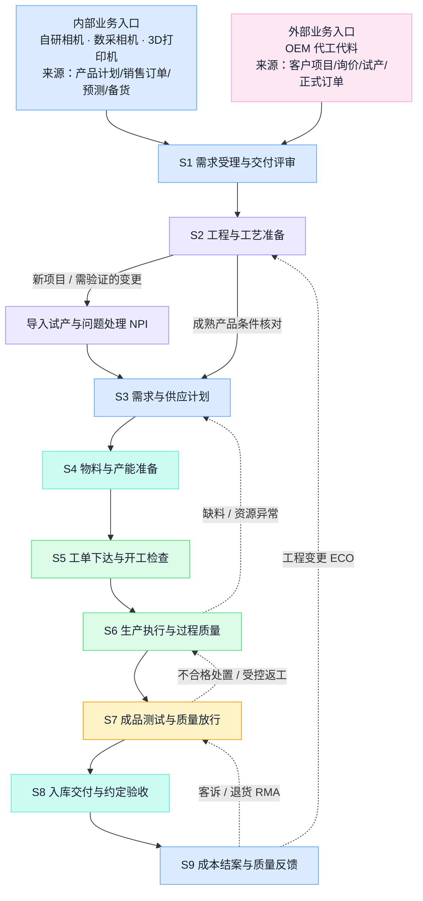

**配色约定（全书一致）**：蓝＝经营与计划，紫＝工程与产品定义，青＝物料与流转，绿＝执行与通过，琥珀＝质量与判定，红＝异常与变更，粉＝客户/OEM 触点，灰＝数据与中性环节。

读这张图的三个要点：

1. **箭头是业务交接，不是软件边界。** 一个节点可能跨几个系统，一个系统也可能服务几个节点——节点与系统的对应关系在第二部分逐一展开。
2. **虚线（反馈边）与实线同等重要。** 缺料回计划、不合格回执行、变更回工程、客诉回放行——信息化做得好不好，恰恰看这些"往回走"的路通不通。
3. **两个入口带着差异贯穿全程。** 自有产品与 OEM 在产品定义与变更、物料来源与所有权、工艺与资源、测试与放行、包装与追溯、成本与交付责任六个维度不同，到每个节点都会再次出现，不是入口处理一次就完。

## 2. 工厂系统整体架构

把一座工厂的系统按"管什么时间尺度的事"分层（参照 ISA-95 的分层思想：L4 经营计划、L3 制造运营、L2 监视控制、L1/L0 设备与物理过程），再加一条纵向的数据与智能底座：

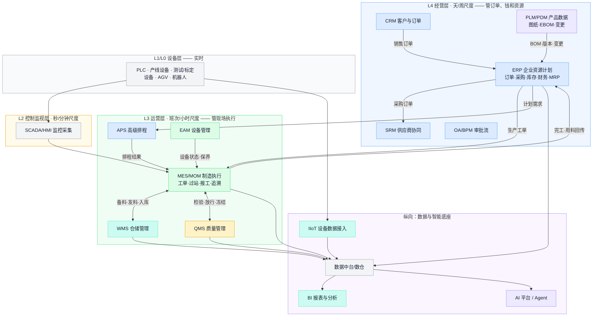

这张图的用法：**往上走管承诺，往下走管执行，横着看管交接。** 三条贯穿性的认知：

- **层级越低，时间越细、数据越多、容错越低。** ERP 以单据为对象、以天为粒度；MES 以"这一台、这一站、这一分钟"为粒度——这就是为什么 ERP 管不了车间、MES 替不了总账，两者必须分工。
- **分层是逻辑模型，不是部署规定。** "MES 必须在本地、每层一台服务器、数据必须逐层上传"都推不出来；云、边缘、混合部署另行设计。
- **没有一家工厂拥有全图。** 典型中型工厂的现实是：ERP 在用一半模块、排产靠 Excel、车间靠纸质流转卡、测试数据躺在设备本地。架构图的价值不是照着买，而是**判断断在哪、先补哪**（见第 16 章）。

## 3. 系统辞典：缩写、全称与一句话职责

按架构图从上到下排列。"典型对象"是该系统的权威数据——判断两个系统谁说了算，看对象归谁。

| 缩写 | 全称 | 管什么（一句话） | 典型权威对象 | 主要使用者 |
| --- | --- | --- | --- | --- |
| ERP | Enterprise Resource Planning 企业资源计划 | 企业的"总账本"：订单、采购、库存、成本、财务一体记账 | 销售/采购订单、库存账、成本、凭证 | 财务、计划、采购、仓储 |
| MRP | Material Requirements Planning 物料需求计划 | 按 BOM 和提前期把需求算成"何时买/做什么"（通常是 ERP 的一个模块） | 计划订单、缺料例外 | 计划员、采购 |
| MRPII | Manufacturing Resource Planning 制造资源计划 | MRP 的闭环扩展：加产能核对与财务集成（历史概念，已融入 ERP） | — | — |
| APS | Advanced Planning & Scheduling 高级计划排程 | 在产能、换型、人员等约束下算"先做哪个、排在哪台" | 排程方案 | 计划员 |
| PLM | Product Lifecycle Management 产品生命周期管理 | 产品定义的权威库：图纸、EBOM、版本、工程变更流程 | EBOM、图纸、ECO | 研发、工艺 |
| PDM | Product Data Management 产品数据管理 | PLM 的核心子集：设计文件与版本管控 | CAD 文件、版本 | 研发 |
| MES | Manufacturing Execution System 制造执行系统 | 车间的"黑匣子"：工单执行、过站、用料、报工、追溯 | 工单执行记录、SN 履历 | 生产、工艺、质量 |
| MOM | Manufacturing Operations Management 制造运营管理 | 比 MES 更宽的范畴：生产+质量+维护+库存运营的统称 | — | 工厂管理 |
| SFC | Shop Floor Control 车间作业控制 | MES 的早期/轻量形态：派工与过站 | 过站记录 | 生产 |
| WMS | Warehouse Management System 仓储管理系统 | 仓内执行：收货、上架、拣配、移库、盘点 | 库位、批次、仓内任务 | 仓储、物流 |
| WCS | Warehouse Control System 仓储控制系统 | 指挥立体库、输送线、AGV 等仓储设备 | 设备任务 | 自动化 |
| SRM | Supplier Relationship Management 供应商关系管理 | 供应商准入、询报价、交期协同、绩效 | 供应商档案、报价、交期承诺 | 采购、SQE |
| CRM | Customer Relationship Management 客户关系管理 | 客户、商机、报价、订单入口 | 客户档案、商机 | 销售 |
| QMS | Quality Management System 质量管理系统 | 检验标准、来料/过程/出货检验、不合格处置、CAPA | 检验记录、不合格单 | 质量 |
| LIMS | Laboratory Information Management System 实验室管理 | 实验室检测的样品、方法、结果管理 | 检测报告 | 实验室 |
| SPC | Statistical Process Control 统计过程控制 | 用控制图监控过程稳定性（常为 QMS/MES 模块） | 控制图、判异记录 | 质量、工艺 |
| EAM / CMMS | Enterprise Asset Management / 计算机化维护管理 | 设备台账、保养计划、维修工单、备件 | 设备档案、维护记录 | 设备 |
| SCADA | Supervisory Control And Data Acquisition 监控与数据采集 | 产线设备的实时监视、报警、趋势 | 实时信号、报警 | 自动化、设备 |
| PLC | Programmable Logic Controller 可编程逻辑控制器 | 设备级实时控制 | 控制程序 | 自动化 |
| HMI | Human-Machine Interface 人机界面 | 设备旁的操作屏 | — | 操作员 |
| DNC | Distributed Numerical Control 程序传输 | 向数控/烧录设备下发受控程序 | 设备程序版本 | 工艺 |
| IIoT | Industrial Internet of Things 工业物联网平台 | 多源设备数据的接入、建模、转发 | 设备数据流 | OT/IT |
| AGV / RCS | Automated Guided Vehicle / Robot Control System | 搬运机器人及其调度 | 搬运任务 | 物流、自动化 |
| BI | Business Intelligence 商业智能 | 跨系统指标的报表、看板与下钻 | 指标与报表（非记账权威） | 管理层、分析 |
| MDM | Master Data Management 主数据管理 | 物料、客户、供应商等主数据的统一治理 | 主数据标准与映射 | 主数据负责人 |
| OA / BPM | Office Automation / Business Process Management | 通用审批流（签呈、费用、通用流程） | 审批记录 | 全员 |
| EDI / API | Electronic Data Interchange / 接口 | 企业间/系统间的数据交换通道 | 报文、接口契约 | IT |
| AI 平台 / Agent | — | 知识问答、分析辅助、受控业务动作（见第 15 章） | 知识库、任务记录 | 全员 |

两条使用纪律：**名称不等于能力**——叫 MES 的产品未必能追溯，叫 MRP 的未必会算产能，判断看它管什么对象、谁在用；**功能重叠是常态**——ERP 带生产模块、MES 带仓储功能很普遍，关键不是买哪个，而是**裁定每类对象的唯一权威和唯一过账入口**（第 14 章）。

**各类系统的代表产品（示例，帮助建立印象，不是推荐名单；选型方法见第 16 章）：**

| 类别 | 国际常见 | 国内常见 |
| --- | --- | --- |
| ERP | SAP、Oracle、Microsoft Dynamics | 用友、金蝶、鼎捷 |
| PLM/PDM | 西门子 Teamcenter、PTC Windchill、达索 3DEXPERIENCE | CAXA、华天软件、用友 PLM |
| MES/MOM | 西门子 Opcenter、罗克韦尔、AVEVA | 黑湖、鼎捷、赛意、摩尔 |
| APS | Asprova、西门子 Opcenter APS（原 Preactor） | 永凯、安达发 |
| WMS | Manhattan、Blue Yonder | 富勒、科箭、唯智 |
| SRM | SAP Ariba、Coupa | 甄云、企企通 |
| QMS | ETQ、Sparta；或 ERP/MES 内置质量模块 | 多随 MES/ERP 一体交付 |
| BI | Power BI、Tableau、Qlik | 帆软、观远、永洪 |
| IIoT 平台 | PTC ThingWorx、AWS/Azure IoT | 树根互联、卡奥斯、阿里云/华为云 IoT |

## 4. 三条贯穿全厂的数据流

系统架构是静态的，真正要盯住的是三条动态数据流——几乎所有跨部门扯皮，都发生在这三条流的断点上。

**① 产品定义流（主数据流）：设计怎么变成车间能执行的资料**

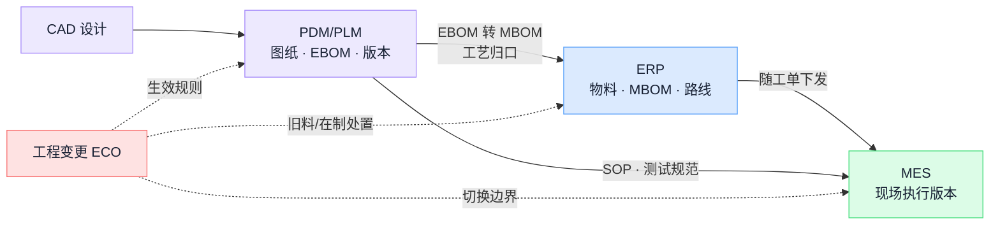

要点：工程 BOM（EBOM，按设计功能组织）和制造 BOM（MBOM，按装配顺序组织，含包材辅料）是**受控转换**的两张表；变更（ECO）必须带着生效规则（按日期/工单/批次/序列号切换）走完全程，只改 PLM 里的图纸不算变更完成。OEM 业务多一层：**客户的设计资料和变更批准权**要并入这条流，客户版本与厂内版本的对应关系必须可查。

**② 订单—计划—执行流（事务流）：承诺怎么变成交付**

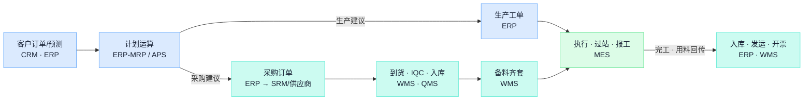

要点：这条流上**每一次交接都是一次过账**，重复过账（MES 和 ERP 各记一次完工）和漏过账（领料没录）是账实不符的两大来源；每个对象只能有一个过账入口。回传方向（执行 → 账务）与下发方向同等重要——报工不回传，ERP 的库存和成本就是盲的。

**③ 质量—追溯流：问题怎么被拦住、怎么找回去**

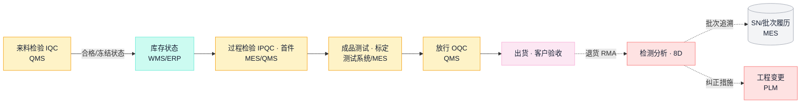

要点：质量状态（待验/合格/冻结/让步）必须**真实锁住库存**——QMS 里判了冻结、WMS 里照常发料，等于没有质量系统；追溯依赖执行环节逐站留下的批次/SN 关联，**履历是生产时记出来的，不是出事后补出来的**。OEM 业务在这条流上多两件事：客户测试规范与数据回传、客户见证或放行节点。

---

# 第二部分 工作流逐节点（S1—S9）

每节统一结构：**干什么 → 节点流程 → 要懂的知识 → 涉及的系统 → 核心数据对象 → 自有产品与 OEM 的差异 → 常见断点**。按需翻查，不必顺序读。

**总览矩阵（翻查入口）**：

| 节点 | 核心产出 | 主要系统 | 参与角色 |
| --- | --- | --- | --- |
| S1 需求受理与交付评审 | 经评审的订单 / 立项，含条件与责任 | CRM · ERP · PLM · OA | 销售/客户项目、计划、工程、质量、制造 |
| S2 工程与工艺准备 | MBOM · 路线 · SOP · 测试规范 · ECO · 试产结论 | PLM · ERP · MES · DNC · QMS | 研发/客户技术接口、制造工程、质量、生产 |
| S3 需求与供应计划 | 采购/生产建议 · 例外消息 · 排产方案 | ERP-MRP · APS · SRM | 计划、采购、生产、项目 |
| S4 物料与产能准备 | 可用物料（状态/所有权清楚）· 齐套 · 资源就绪 | ERP · SRM · WMS · QMS · EAM | 采购、仓储、IQC、设备、生产 |
| S5 工单下达与开工检查 | 允许执行的工单（版本绑定）· 首件通过 | ERP · MES · WMS · QMS · DNC | 计划、生产、工艺、仓储、质量 |
| S6 生产执行与过程质量 | 过站 · 报工 · 实际用料 · 异常与返工记录 | MES · SCADA · QMS · EAM · WMS | 生产、工艺、质量、设备 |
| S7 成品测试与质量放行 | 测试数据（关联 SN 与版本）· 放行记录 | 测试系统 · MES · QMS · LIMS | 测试、质量、工程、（按约定客户） |
| S8 入库交付与约定验收 | 发运 · 签收 · 验收记录 · SN 出货关联 | WMS · ERP · TMS · CRM | 仓储、物流、销售/客户项目、质量 |
| S9 成本结案与质量反馈 | 成本与差异 · 8D · 改进任务分流 | ERP · BI · QMS · PLM · MES | 财务、制造、计划、质量、工程 |

## 5. S1 需求受理与交付评审

**干什么**：把内部需求或客户需求，变成一条"做什么、做多少、何时交、责任边界清楚、承诺状态明确"的制造需求。输入是需求线索，输出是经过评审的订单或立项。

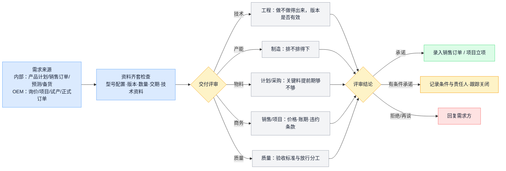

**要懂的知识**

| 概念 | 要点 |
| --- | --- |
| 需求的承诺程度 | 询价 < 预测 < 意向 < 正式订单，承诺程度不同，允许触发的动作不同（询价不触发采购，预测可触发长周期备料需审批）。受理需求 ≠ 批准投产 |
| 订单评审 | 技术、产能、物料、商务、质量五个维度缺一不可；评审结论必须回写订单并留痕，"有条件承诺"的条件要有人跟踪 |
| 订单分离点（MTS/MTO/ATO/ETO） | 客户订单到达时哪些工作已完成：备库销售（MTS）、按单生产（MTO）、按单装配/配置（ATO）、按单设计（ETO）。同一家公司不同产品线可以不同；它决定交期承诺的依据和库存放在哪一层 |
| 交期承诺依据（ATP/CTP） | ATP（Available to Promise）按现有库存和已排供应承诺；CTP（Capable to Promise）进一步核算力。没有这两者，交期就是拍脑袋 |
| OEM / ODM / JDM 与供料模式 | OEM＝按客户设计代工；ODM＝代工方设计、客户贴牌；JDM＝双方联合设计。供料分包工包料（代工方采购）、来料加工（客户供料）、混合供料——它决定采购范围、库存所有权和结算口径，评审时必须写进责任边界 |
| 需求变更 | 改期、增减、取消都要回到本节点重新确认，并评估已触发的采购、工单、在制和交付（见第 1 章总图的反馈边） |

**涉及的系统**

| 系统 | 在本节点干什么 |
| --- | --- |
| CRM | 商机、询价、报价、客户档案；OEM 项目的客户接口记录 |
| ERP | 正式销售订单（行项目、交期、价格）；ATP 核查的库存与供应数据 |
| PLM | 评审时核对产品版本是否有效、技术资料是否齐套 |
| OA/BPM | 评审会签与特殊条款审批 |

**核心数据对象**：销售订单（抬头 + 行项目：型号/数量/交期/价格/交付条款）、客户档案、OEM 项目档案、评审记录（结论 + 条件 + 责任人）、需求变更记录（原始承诺永久保留）。

**自有产品 vs OEM**

| 维度 | 自有产品 | OEM 代工代料 |
| --- | --- | --- |
| 需求依据 | 产品规划、预测、经销订单 | 客户项目与订单；可能有滚动预测 |
| 评审附加项 | 新旧版本切换计划 | 代工范围、设计与采购责任、供料方式、验收分工、模具治具归属、知识产权、保密 |
| 承诺主体 | 对市场/渠道 | 对具体客户合同，违约条款更硬 |

**常见断点**：口头承诺不入系统，事后无法对质；评审结论不回写订单；预测与正式订单重复计算需求；"有条件承诺"的条件无人跟踪，到期直接变成延期事故。

## 6. S2 工程与工艺准备

**干什么**：把产品定义（图纸、EBOM）变成工厂可执行的制造资料（MBOM、工艺路线、SOP、测试规范），新产品或重大变更先走导入试产（NPI），变更走受控的 ECO 流程。

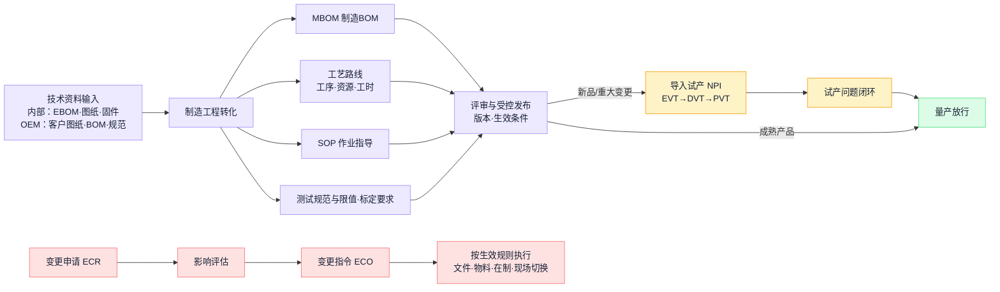

**要懂的知识**

| 概念 | 要点 |
| --- | --- |
| EBOM / MBOM / 工艺路线 / SOP | 四份资料回答四个问题：按设计由什么组成 / 工厂实际准备和装配什么（含包材辅料、虚拟件）/ 工序按什么顺序用哪些资源和工时 / 每道工序具体怎么干。EBOM→MBOM 是受控转换，不是复制后各改各的 |
| 虚拟件 | MBOM 里只为展开方便而设、不产生实际库存的层级；影响 MRP 展开，不影响仓库 |
| 版本的多个轴 | 硬件（BOM 修订）、固件、测试程序与限值、标定参数、工艺文件——任何一轴变动都要评估其他轴要不要联动；光学/电子类产品尤其如此 |
| 料号 / 修订 / 批次三层身份 | 料号=哪种东西，修订=哪个受控定义，批次/SN=哪个实物。"系统里当前版本是 B"不代表库房里的实物都是 B。变化定义成新料号还是修订，看互换性和追踪要求 |
| NPI 阶段（EVT/DVT/PVT） | 工程验证（技术行不行）→设计验证（设计+材料稳不稳定）→生产验证（人机料法能否按节拍重复）。每阶段的转阶段批准要留证据；设计改版后旧验证证据是否仍有效必须有人判断，不能默认沿用 |
| ECR / ECO / ECN | 变更申请 / 变更指令 / 变更通知。缩写职责没有跨企业统一边界，先定义本公司的状态和批准权 |
| 变更影响盘点 | 一次换料至少盘：未执行的计划采购、已收旧料、在途、在制工单、新工单起点、治具、固件与测试限值、客户通知、售后兼容。文件批准完成 ≠ 变更完成，旧料处置完才算关闭 |
| 生效方式 | 按日期 / 按工单 / 按批次 / 按序列号切换；旧料用尽（use-up）vs 硬切换（隔离报废）vs 按客户区分。生效边界必须可重现（记录切换工单号/SN 段） |
| 替代料与 AVL | 替代要定方向（单向/双向）、范围（产品/工厂/订单/客户是否允许）、层级（永久/订单级/一次性偏离）、附加验证；AVL=同一内部料号下的合格制造商清单，批准新供应商 ≠ 允许替换任意器件 |

**涉及的系统**

| 系统 | 在本节点干什么 |
| --- | --- |
| PLM/PDM | 图纸、EBOM、版本、ECO 流程的权威库 |
| CAD/CAE | 设计与仿真文件来源 |
| ERP | 物料主数据、MBOM、工艺路线（计划与成本用） |
| MES | 接收版本下发，控制现场按有效版本执行 |
| DNC | 向烧录/数控设备下发受控程序 |
| QMS | 检验标准、控制计划随版本发布 |

**核心数据对象**：物料主数据（身份/规格/单位换算/供应/质量追踪/财务六组字段）、EBOM、MBOM、工艺路线、SOP、测试规范与限值、ECO（含影响盘点与生效规则）、试产报告与转阶段批准、AVL/替代料关系。

**自有产品 vs OEM**：自有产品的版本批准权在内部研发；OEM 的图纸、BOM、关键变更的批准权可能在客户——必须明确哪些资料客户批、哪些奥比批、客户版本号与厂内版本号如何对应，客户变更到达后的厂内评估流程与内部 ECO 合流。

**常见断点**：研发改了 EBOM、MBOM 没人同步；现场贴的 SOP 是旧版（发布无回执）；变更只发了文件、旧料在途在制没处置；固件升了版、测试限值没跟着改；OEM 客户资料版本与厂内执行版本对不上。

## 7. S3 需求与供应计划

**干什么**：把确认的需求展开成"何时买什么、何时做什么"的行动，并核对产能，形成可执行、可追踪的计划。

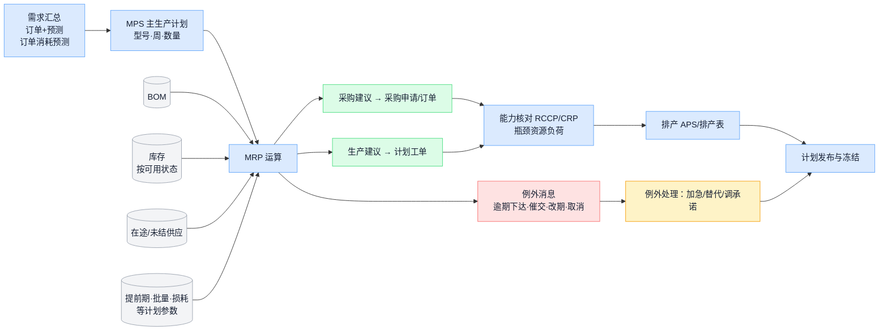

**要懂的知识**

| 概念 | 要点 |
| --- | --- |
| 独立需求 vs 相关需求 | 整机卖多少要预测（独立需求）；物料用多少由 BOM 算出来（相关需求）。MRP 的核心思想：**能算的不要预测**。相关需求成块出现，订货点法失效，这是 MRP 存在的理由 |
| 计划层级 | S&OP（产品族/月度，经营平衡与长周期料决策）→ MPS（型号/周）→ MRP（料号/日周）→ 排程（班次/小时）。每层看是否有人做、有批准版本、能传到下一层——层级可以合并，决策不能缺位 |
| MRP 的输入与输出 | 四输入：需求、BOM、库存与未结供应、计划参数；三输出：采购建议、生产建议、例外消息。**例外消息是最有价值的输出**——管理的对象是"哪些例外阻止计划实现、谁行动、是否闭环" |
| 净算与倒推 | 毛需求 − 可用库存 − 在途 = 净需求；净需求按提前期倒推出"必须下达的时间"。倒推落到过去 = 逾期例外，正确反应是加急/替代/调承诺，不是改日期装没事 |
| 计划参数 | 提前期、MOQ、批量规则、安全库存、损耗率。参数失真的典型后果：提前期虚长 = 把缺料藏成库存；MOQ 没维护 = 建议无法执行；状态错的库存参与净算 = 整张计划作废。参数要有人定期复核 |
| 需求与供给的纪律 | 订单消耗预测，不得两者相加；待验/冻结库存不算可用；部分收货要从在途中扣除 |
| 冻结期与重排 | 近期计划冻结：变更须显式评估已发生的采购/在制/交付影响并经人批准，不是系统每晚悄悄重排。"计划达成率"必须写明和哪一版计划比 |
| 物料与产能是两张表 | 料齐了产能未必够，设备闲着也补不了缺料；MRP 默认产能无限，必须单独做能力核对（RCCP 对主计划和关键资源，CRP 对展开后的工单负荷） |
| 长周期料决策 | 提前期超过客户容忍交期的物料，必须在订单之前按预测/风险备料——这是经营决策（押库存 vs 丢订单），应升级到 S&OP 拍板，不能让 MRP 的沉默掩盖 |

**涉及的系统**

| 系统 | 在本节点干什么 |
| --- | --- |
| ERP（MRP 模块） | 需求展开、净算、建议与例外 |
| APS | 约束排程（效果取决于日历、工时、占用数据是否真实） |
| SRM | 采购建议转订单后的供应商交期确认回写 |
| Excel | 多数工厂的现实排产工具——纳入管理（版本、责任人、数据来源）比假装不存在更有用 |

**核心数据对象**：需求计划/预测、MPS、计划订单、采购申请、例外消息清单、排程方案、计划参数表（按料号维护）。

**自有产品 vs OEM**：自有产品的需求风险在预测准确性；OEM 的需求以客户订单/滚动预测为准，但要核对合同是否允许按预测备料、呆滞风险归谁；客供料不参与采购建议但参与齐套检查。

**常见断点**：库存状态失真让 MRP 全盘算错；建议生成没人执行（计划体外循环）；供应商确认交期不回写系统；排程结果悄悄覆盖对客户的原始承诺。

## 8. S4 物料与产能准备

**干什么**：把计划变成**可用**的物料（买到、验过、入对地方、能领出来）和**可用**的资源（设备、治具、人员就绪）。

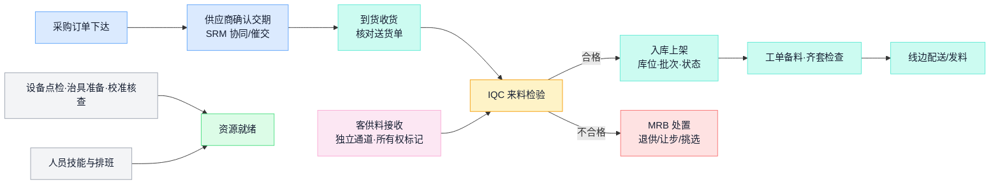

**要懂的知识**

| 概念 | 要点 |
| --- | --- |
| P2P 各步是独立事实 | 订了多少、到了多少、合格多少、开票多少、付了多少——五个数可以不同，必须分别留痕。为结账做假收货、把不良悄悄入合格库，都会在计划与追溯上加倍还债 |
| 三方匹配 | 采购单（价/量）× 收货入库（实收/合格）× 发票（请款）互相核对，超容差必须有人处理；容差只定义何时人工介入，不代表差异没有业务原因 |
| 库存五维 | 任何一批料同时回答：所有权（自有/客供/寄售/委外在外）、位置（库位/线边/在途/隔离）、质量状态（待验/合格/冻结/让步）、分配状态（可用/已预留/已拣配）、批次身份。"仓库还有 N"回答不了"新工单能领多少" |
| 质量状态流转 | 待验→合格 / 冻结→退供 / 让步（特采，批准限定使用）。状态必须真实锁库存——QMS 判冻结、WMS 照发料，等于没有质量控制 |
| 齐套 | 工单所需物料全部到位才叫齐套，缺一颗螺丝也不齐套；齐套检查是开工的前置（S5） |
| FIFO 与效期 | 先进先出防止旧料沉底；锡膏、胶水等效期物料按效期先出，过期自动冻结、复验或报废——效期字段和到期动作都要落在系统里 |
| 客供料 | 客户所有权、独立台账、与自有料物理或账务隔离；损耗与不良的责任和补料方式按合同；定期与客户对账 |
| 委外在外 | 发给外协厂的料仍是自己的资产（"自有但在外"）；发料、回货、在外在制余额要有台账并定期对账 |
| 盘点 | 循环盘点优于一年一次大盘；差异重点是查原因（漏记/错发/状态错/换算错），不是调平数字；正负差不得抵消后宣称准确 |
| 呆滞料 | 长期无需求消耗的库存，多来自变更、取消、超买；定期评审处置（折价/改用/报废），越拖越不值钱 |

**涉及的系统**

| 系统 | 在本节点干什么 |
| --- | --- |
| ERP | 采购订单、库存账、三方匹配、应付 |
| SRM | 供应商交期确认、送货协同、对账 |
| WMS | 收货、上架、库位批次、拣配备料、盘点 |
| QMS | IQC 检验、不合格处置、状态判定 |
| MES | 工单备料需求、线边收料确认 |
| EAM | 设备点检保养、治具台账、校准有效期 |

**核心数据对象**：采购订单、供应商交期承诺、收货单、检验单、批次档案（供应商批号必须在收货时记录——事后补不回来）、库位账、备料/齐套检查单、客供料台账、委外发料与回货单。

**自有产品 vs OEM**：OEM 多一条客供料通道（所有权、不良责任、余料退还、对账），以及"包工包料 / 来料加工"等不同供料约定对采购范围和结算的影响；需求计算时客供料不生成采购建议但占齐套。

**常见断点**：到货不录系统（账上缺料、现场有货）；不良料没锁住被产线领用；线边仓变成账外之地；客供料与自有料混账；供应商承诺日期只存在于聊天工具里。

## 9. S5 工单下达与开工检查

**干什么**：把排产任务落实成一张"数量明确、版本绑定、条件满足才允许执行"的工单。这是计划世界和物理世界的交接闸口。

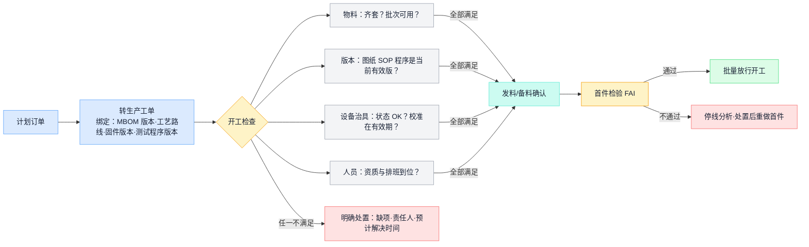

**要懂的知识**

| 概念 | 要点 |
| --- | --- |
| 工单的三重身份 | ① 数量任务（做多少）② 版本快照（按哪一版 BOM/路线/固件/测试程序做——变更管理靠它锚定"边界前后"）③ 成本归集对象（这批的料工费都记在它名下） |
| 版本快照 vs 重新展开 | 主数据变更后，已下达工单是保持下达时的快照、还是跟随新版重新展开？必须显式定义，不能让现场执行时悄悄变了版本 |
| 开工检查清单 | 料齐、版本对、设备好、治具在（且在校准有效期内）、人到位、文件新——任一不满足就不开工，缺项要有责任人和预计时间，而不是"先干着" |
| 首件检验（FAI） | 批量前先做一台按全要求核实；换线、换版本、换批次后同样触发。首件没过就批量生产是重大违规 |
| 批次 / SN 的生成与绑定 | 在哪个工序生成序列号、何时与工单/物料批次绑定，决定了追溯链从哪里开始。越早绑定，履历越完整 |
| 发料方式 | 按单发料（逐单扫码，账最准）、倒冲（完工反推扣料，省事但掩盖超耗——必须保留超领/补料/报废的显式通道）、线边补给（适合低值辅料） |

**涉及的系统**

| 系统 | 在本节点干什么 |
| --- | --- |
| ERP | 工单创建与下达、发料过账 |
| MES | 开工条件校验、版本防错（扫码核对程序/SOP 版本）、SN 生成 |
| WMS | 按工单拣配发料 |
| QMS | 首件检验记录与判定 |
| DNC | 按工单版本下发烧录/加工程序 |

**核心数据对象**：生产工单（数量 + 版本快照 + 计划工期）、领料单、齐套检查记录、首件记录、SN 池与绑定关系。

**自有产品 vs OEM**：OEM 工单要额外核对客户指定的版本/批次要求、客供料占用、客户要求的标识规则是否已配置；某些客户要求首件或制程变更须客户确认后才能批量。

**常见断点**：没有开工检查、来了料就干；工单没绑版本，出问题说不清按哪版做的；首件流于形式（做了不判、判了不停）；倒冲长期掩盖超耗，月底盘点集中爆雷。

## 10. S6 生产执行与过程质量

**干什么**：按工艺路线完成加工、装配和过程检查，让每一步都留下真实、及时、可追溯的记录。这是整个数字化里数据密度最高、也最容易失真的节点。

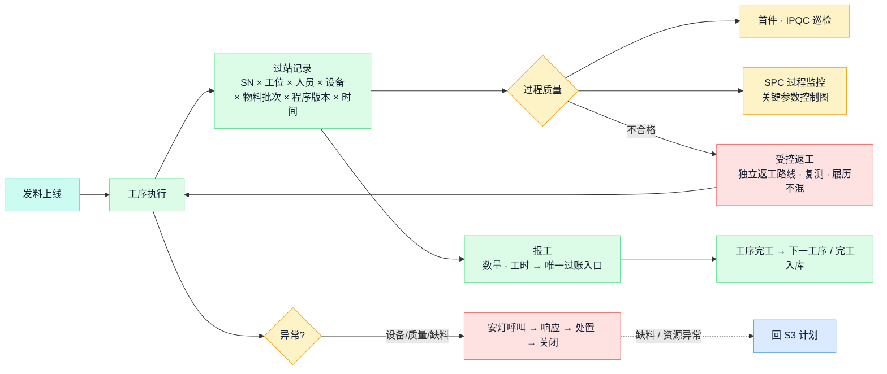

**要懂的知识**

| 概念 | 要点 |
| --- | --- |
| 过站记录绑定什么 | 一次过站至少关联：SN/批次、工位、操作人、设备与治具、投入物料批次、程序/SOP 版本、时间。追溯履历就是这些记录串起来的——**履历是生产时记出来的，不是出事后补出来的** |
| 在发生点记录 | 数据在动作发生的时间和地点录入；不得不补录时，必须区分"发生时间"和"录入时间"两个字段，否则统计和追溯全部失真 |
| 报工与唯一过账入口 | 报工（数量、工时）只能有一个有效入口（通常 MES），由它单向过账给 ERP；两边都能报 = 必然重复记账。月底突击报工是数据失真的头号来源，根源多为考核压力 |
| 异常闭环 | 安灯/呼叫 → 响应（谁、多久）→ 处置 → 关闭 → 统计。异常没人接走，现场就会停止上报——上报通道的生死取决于响应速度 |
| 返工 vs 返修 | 返工＝重做某道工序使其合格；返修＝修复缺陷（可能偏离原工艺，需批准）。两者都走**受控路线**：独立的返工工艺、强制复测、履历保留原始失败记录，绝不允许悄悄混回良品流 |
| 倒冲的边界 | 倒冲扣料只适合用量稳定的低值料；超耗、报废、替代必须有显式补录通道，否则账实差异月底集中爆发且无法归因 |
| WIP 管理 | 在制品是占用资金和场地的"隐形库存"；在制数量、停留位置、停留时长要可见，长期滞留的 WIP 往往挂着没人处理的异常 |
| 防错（Poka-yoke） | 优先靠机制防错（扫码校验料号版本、治具不匹配装不进、程序自动核对），少靠"要求员工细心" |

**涉及的系统**

| 系统 | 在本节点干什么 |
| --- | --- |
| MES | 本节点的核心：派工、过站、防错校验、报工、异常、追溯履历 |
| SCADA / 设备采集 | 设备状态、工艺参数自动上传（替代人工抄表） |
| QMS | IPQC 判定、SPC 控制图、不合格发起 |
| EAM | 设备故障报修与状态联动（设备停机影响排产） |
| WMS | 线边补料、工序间转运 |
| ERP | 接收完工与用料回传，更新库存与在制账 |

**核心数据对象**：过站记录、报工单、实际用料记录（含超耗/补料/报废）、异常单（发生—响应—关闭全程时间戳）、返工单、WIP 台账。

**自有产品 vs OEM**：共同工序可复用，但各产品的工艺路线和作业条件分别维护——相机的装调与标定、3D 打印机的装配调试、代工品的部件装配与整机测试，各自按实际核实，不能互相复制；OEM 客户可能要求特定过程记录、制程参数回传或驻厂检验，这些要求要落到过站与检验模板里。

**常见断点**：纸质流转卡与系统双轨，系统沦为事后抄录；报工滞后数天，账面在制与现场对不上；返工品绕过复测混回正常流；异常只在微信群喊，无记录无闭环。

## 11. S7 成品测试与质量放行

**干什么**：用测试和检验证明产品满足要求，处置不合格品，完成制造方放行；OEM 业务还要满足客户的测试规范、数据回传与放行约定。

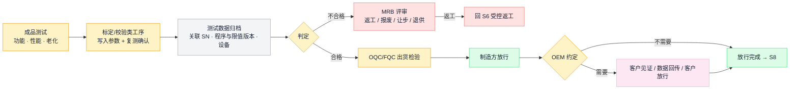

**要懂的知识**

| 概念 | 要点 |
| --- | --- |
| 检测 / 校准 / 调整三分 | 调整＝改变产品（如标定写入补偿参数）；检测＝判断产品（写入后复测是否达标——参数写入成功 ≠ 性能合格）；校准＝判断测量系统（测试设备自己准不准）。三件事分别记录，不能互相冒充 |
| 测量系统本身要受控 | 测试/标定设备有计量校准周期和溯源要求；设备超期或漂移时，所有"通过"都不可信，而且系统里看不出来——校准有效期要进开工检查（S5）和设备台账（EAM） |
| 测试数据存什么 | 五类：对象（SN/批次/工单/关键件）、版本（硬件/固件/测试程序/限值/参数集）、环境资源（时间/工位/设备/治具/环境条件）、测量（特性、实测值、单位、上下限、原始文件）、结论（原始失败、复测、返工、最终处置）。**只存 PASS/FAIL 的测试系统等于没有数据** |
| 失败记录不可覆盖 | 维修后"再测通过"必须保留此前的失败与拆换记录，否则无法区分制造缺陷、误测与返修掩盖，良率分析失去根基 |
| FPY 与最终良率 | 一次通过率（不经返工直接通过的比例）反映过程能力；最终良率（最终合格的比例）反映交付能力。两个数回答两个问题，返工负荷只在前者里可见——看良率先问分母 |
| MRB 与让步 | 不合格品处置（返工/报废/让步/退供）要有明确的评审权限；让步接收（特采）必须限定范围和数量、留批准记录，OEM 产品的让步通常需要客户批准 |
| 追溯等级 | 批次级（能查到一批）与序列号级（能查到一台）成本和颗粒度不同，按产品风险和客户要求选定；无论哪级，正向（从物料批查到产品和客户）与逆向（从一台产品查回物料、工艺、测试）两个方向都要走得通 |
| 放行的三种主体 | 制造方放行、质量放行、客户放行是三个独立决定，分别记录；合同约定客户发运前验收的，客户确认是发运的前置条件 |

**涉及的系统**

| 系统 | 在本节点干什么 |
| --- | --- |
| 测试/标定系统 | 执行测试程序、产出原始数据（必须按上表五类归档，关联 SN） |
| MES | 过站判定、测试站防错（程序版本校验）、不良品流向控制 |
| QMS | OQC 检验、MRB 处置、放行记录、让步审批 |
| LIMS | 实验室类检测（可靠性、环境试验）的样品与报告管理 |
| PLM | 测试规范与限值的版本来源 |

**核心数据对象**：测试记录（五类字段）、标定参数档案、不合格单与 MRB 结论、OQC 记录、放行单、OEM 客户测试报告/数据回传包。

**自有产品 vs OEM**：自有产品按内部规格与出厂标准放行；OEM 按客户测试规范执行，可能要求数据按客户格式回传、关键站客户见证、客户签放行——"测试通过、制造方放行、客户确认"三件事分别留痕，不能合并成一个勾。

**常见断点**：测试数据散在设备本地不归档、不关联 SN；测试程序和限值版本不受控，整批误判；维修后旧失败记录被覆盖；设备超校准期无人拦截。

## 12. S8 入库交付与约定验收

**干什么**：放行的产品完成包装标识、入库、发运、签收和约定的客户验收。放行、入库、发运、签收、验收是**五个独立时点**，分别留证。

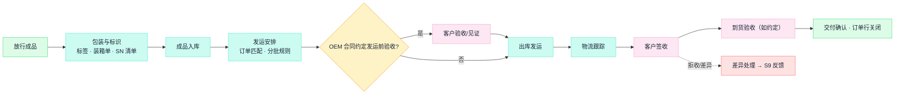

**要懂的知识**

| 概念 | 要点 |
| --- | --- |
| 五个时点分开 | 质量放行 ≠ 入库 ≠ 发运 ≠ 签收 ≠ 验收。统计交付、确认收入、启动质保期，各挂在不同时点上，混用会让交付率和财务都失真 |
| 包装与标识 | 外箱标签、装箱单与箱内实物 SN 必须一致并留电子记录——召回和客诉定位全靠"哪台在哪箱、发给了谁"。OEM 按客户料号、标签规范、条码规则执行，错标是高频客诉 |
| SN 出货关联 | 序列号与销售订单/客户/发运批的关联在出库时建立，是售后追溯（S9、质量—追溯流）的最后一环 |
| 分批交付 | 订单行要支持分批履约：发了 600 不能把剩余 400 自动关闭；每批独立记录发运与签收 |
| 验收位置 | 合同定在发运前的验收（见证/抽检）必须成为发运前置条件；定在到货后的验收要跟踪关闭，验收遗留项有责任人 |
| 交付与结算分离 | 发运、开票、收款、质保各自独立推进；工单成本结案、客户验收、付款不能合并成一个"完成"标记 |

**涉及的系统**

| 系统 | 在本节点干什么 |
| --- | --- |
| WMS | 包装、装箱、SN 关联、拣货出库 |
| ERP | 发运单、出库过账、开票、应收、订单行状态 |
| TMS（如有） | 运输计划与物流跟踪 |
| CRM | 交付确认、客户签收与验收沟通记录 |

**核心数据对象**：装箱单（箱—SN 对应）、发运单、出库记录、签收/验收记录、订单行状态、交付差异单。

**自有产品 vs OEM**：自有产品多为标准包装与渠道发运；OEM 按客户标签/料号/包装规范执行，验收位置与方式按合同，部分客户要求随货质量报告或测试数据包。

**常见断点**：箱单与实物 SN 不符；未放行品被先行发货；"有条件验收"的遗留项无人跟踪；分批发货后订单行被错误关闭或永不关闭。

## 13. S9 成本结案与质量反馈

**干什么**：核对这张工单/这笔订单的实际消耗与产出，结清成本账；处理交付后的质量反馈（客诉、退货），把问题分流回正确的上游节点。这是闭环的"扣环"。

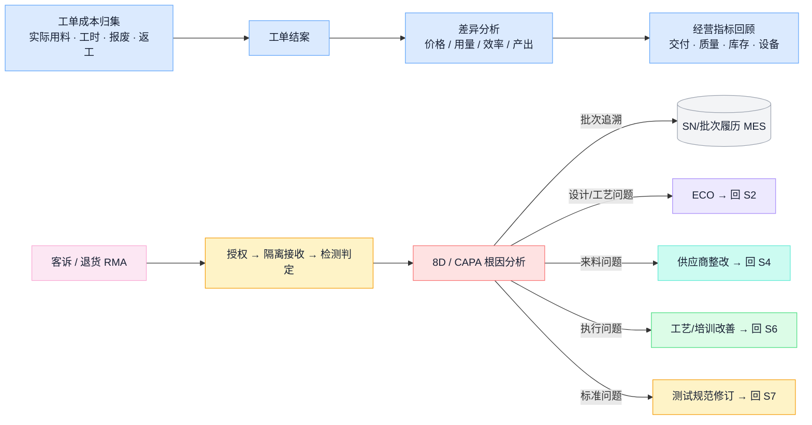

**要懂的知识**

| 概念 | 要点 |
| --- | --- |
| 标准成本与实际成本 | 标准成本＝按 BOM、路线、标准价核算的"应该花多少"（版本变了要重算）；实际成本＝工单归集的真实消耗。差异按价格、用量、效率、产出四类拆解后再归因，不要第一反应"系统算错" |
| 工单结案 ≠ 质量结案 | 成本结案、质量问题关闭、客户验收、收款是互相独立的状态；用一个"完成"糊过去，遗留问题就失踪了 |
| 指标口径纪律 | 任何指标先问**分母和口径**再看数字：交付率按订单/行/台数/金额算结果不同，比较原始承诺还是最新承诺结果不同；良率分首次通过与最终合格；设备效率的时间模型（哪些停机算进去）必须事先约定。口径变更要受控留版本，原始承诺和首次失败记录永久保留 |
| RMA 流程 | 退货授权 → 隔离接收（不混入正常库存）→ 逐台检测 → 分别处置（维修/换新/退回）。NTF（检测无故障）要留案底观察批次趋势，不等于客户错了 |
| 8D / CAPA | 结构化解决重大质量问题：围堵 → 根因 → 纠正措施 → 效果验证 → 预防推广。没有"效果验证"一步的 8D 只是文书 |
| 反馈分流 | 根因决定去向：设计/工艺问题走 ECO 回 S2，来料问题走供应商整改回 S4，执行问题改 SOP/培训回 S6，标准问题修订规范回 S7——这正是第 1 章总图上那几条虚线的内容 |

**涉及的系统**

| 系统 | 在本节点干什么 |
| --- | --- |
| ERP | 成本归集、工单结案、差异报表、应收核销 |
| BI | 跨系统经营指标（口径受控、可下钻到单据明细） |
| QMS | 客诉、8D/CAPA、供应商质量整改 |
| MES | 提供追溯履历（根因分析的证据源） |
| PLM | 承接 ECO（改进落到版本） |

**核心数据对象**：工单成本与差异报告、指标口径卡、客诉单、RMA 记录、8D 报告、改进措施跟踪表。

**自有产品 vs OEM**：自有产品核算完整产品成本并对库存与销售毛利负责；OEM 按合同模式结算（包工包料 / 来料加工费），客供料消耗与损耗按约定对账，客诉责任与赔付按合同划分——实际消耗记录共用，核算口径分开。

**常见断点**：指标口径随人随月变，改善无法证明；客诉处理不做批次追溯，同批风险产品继续出货；纠正措施没有验证环节；工单长期不结案，成本分析失去时效。

---

# 第三部分 整体集成与平台

## 14. 集成架构：系统之间怎么连

### 14.1 数据权威表：每类对象谁说了算

多系统并存的第一裁决是"权威"——每类对象只认一个正式来源和一个修改入口，其他系统只存副本：

| 对象 | 权威系统 | 关键规则 |
| --- | --- | --- |
| 客户订单与承诺交期 | ERP（入口可在 CRM） | 排程结果不自动覆盖客户承诺；原始承诺永久保留 |
| 物料主数据 | ERP（或 MDM） | 创建收口：申请—批准—查重一个入口 |
| 图纸、EBOM、版本、ECO | PLM/PDM | 工程受控发布，下游接收有回执 |
| MBOM、工艺路线、工时 | ERP 或 PLM（二选一，明确） | EBOM→MBOM 转换受控 |
| 计划与排程版本 | ERP-MRP / APS | 区分试算、批准、已下达 |
| 工单 | ERP 创建，MES 执行 | 执行系统不另造无主工单 |
| 过站、用料、报工等执行事实 | MES | 在发生点记录；纠错留原记录，不覆盖历史 |
| 库位、批次、仓内移动 | WMS | 与 ERP 库存账有明确过账与对账关系 |
| 检验、不合格、放行 | QMS | 判定、处置、解冻分权留痕 |
| 设备台账、保养、校准 | EAM | 校准有效期联动开工检查 |
| 成本与会计凭证 | ERP 财务 | 结账权威不由 BI/MES 报表替代 |

**唯一过账入口**是权威表的执行手段：同一业务事实（如完工入库）只允许从一个系统过账，另一侧禁止手工过账——这是消灭重复记账的根本办法。

### 14.2 典型接口清单

对照第 2 章架构图，一座工厂的骨干接口大致如下：

| 接口 | 方向 | 内容 | 触发 |
| --- | --- | --- | --- |
| BOM/物料同步 | PLM → ERP | 物料、EBOM/MBOM、版本、ECO 生效 | 发布事件 |
| 版本与程序下发 | PLM/DNC → MES/设备 | SOP、测试程序、烧录程序 | 发布/工单绑定 |
| 销售订单 | CRM → ERP | 订单与变更 | 订单确认 |
| 采购协同 | ERP ↔ SRM | 订单、交期确认、送货计划 | 下单/确认 |
| 工单下发 | ERP → MES | 工单、数量、版本、计划期 | 工单下达 |
| 排程结果 | APS → MES | 顺序与工位安排 | 排程发布 |
| 备料与发料 | MES ↔ WMS | 备料需求、拣配、发料确认 | 齐套/领料 |
| 检验与状态 | QMS ↔ WMS/MES | 检验任务、判定、冻结/放行状态 | 收货/过站/完工 |
| 完工与用料回传 | MES → ERP | 报工、完工入库、实际用料 | 报工/完工 |
| 设备数据 | 设备 → SCADA/IIoT → MES/数仓 | 状态、参数、报警 | 实时/定时 |
| 经营数据入仓 | 各系统 → 数据中台 → BI/AI | 主数据+事实表 | 定时/CDC |

### 14.3 接口设计的最小纪律

每条接口是一份**写下来的契约**，至少回答：

| 契约项 | 要回答的问题 |
| --- | --- |
| 业务唯一标识 | 靠什么识别"同一笔业务"（报工单号、收货单号——不是消息 ID） |
| 成功的含义 | 返回"成功"代表收到、校验通过，还是已过账 |
| 幂等与去重 | 同一标识重复到达不重复过账；同标识不同内容显式报错。网络只保证"至少一次"，"恰好一次"是接收方用去重实现的 |
| 超时处理 | 超时 ≠ 失败：先查询对方处理结果，再决定重发；盲目重发＝重复过账事故 |
| 顺序 | 冻结/解冻、创建/取消乱序到达怎么办——对象带版本号或业务序号，旧的拒绝 |
| 时间 | 区分事件发生、采集、接收、过账四个时间戳；补传保留原发生时间（跨午夜班次的归属靠它） |
| 单位与精度 | 换算关系跟物料主数据走；接口写明单位、精度、舍入 |
| 对账 | 按单据/工单定期核对两边合计与明细；"异常队列为空"可能只是错误被静默丢弃 |
| 责任人 | 接口坏了谁修、业务积压谁清 |

两条补充：**没有 API 也要有契约**——和委外厂、供应商靠邮件 Excel 协同时，同样约定固定模板、唯一批号、回执和对账周期，集成的本质是契约不是技术；**权限最小化**——集成账号按对象和动作分别授权，密钥有生命周期，共享超级账号等于不设防。接口验收至少演练：断连、重复、乱序、越权、过期版本、单位错误、跨期更正。

### 14.4 设备接入的常用方式

| 方式/协议 | 用在哪 |
| --- | --- |
| OPC UA | 工业设备互操作的主流标准：数据 + 信息建模 + 内置安全（认证/加密）。选了它不等于语义自动统一，点位含义仍要逐台确认 |
| Modbus（RTU/TCP） | 老设备最常见的简单读写协议，无安全机制，常经网关接入 |
| PLC 专有协议 | 西门子 S7、三菱 MC、欧姆龙 FINS 等各家自有协议，通常由采集网关做转换 |
| MQTT | 轻量发布/订阅协议，设备数据上平台/上云的常用通道 |
| 文件/串口采集 | 老测试设备的兜底方式：解析本地 CSV/报文；要解决好文件完整性、时间戳和重复采集 |
| 条码 / RFID | 人与物的身份输入通道——扫码枪也是"设备接入"的一部分，且往往是性价比最高的那部分 |

离线与缓存的三条规矩：边缘侧缓存要定上限和磁盘满策略；断网期间允许继续哪些作业由工艺/质量/生产共同裁定并写进规程；恢复后补传必须保留**原发生时间**，不能都打成恢复时刻。

## 15. 数字化平台与 AI 的位置

### 15.1 平台架构

业务系统之上的数据与智能层，自下而上：

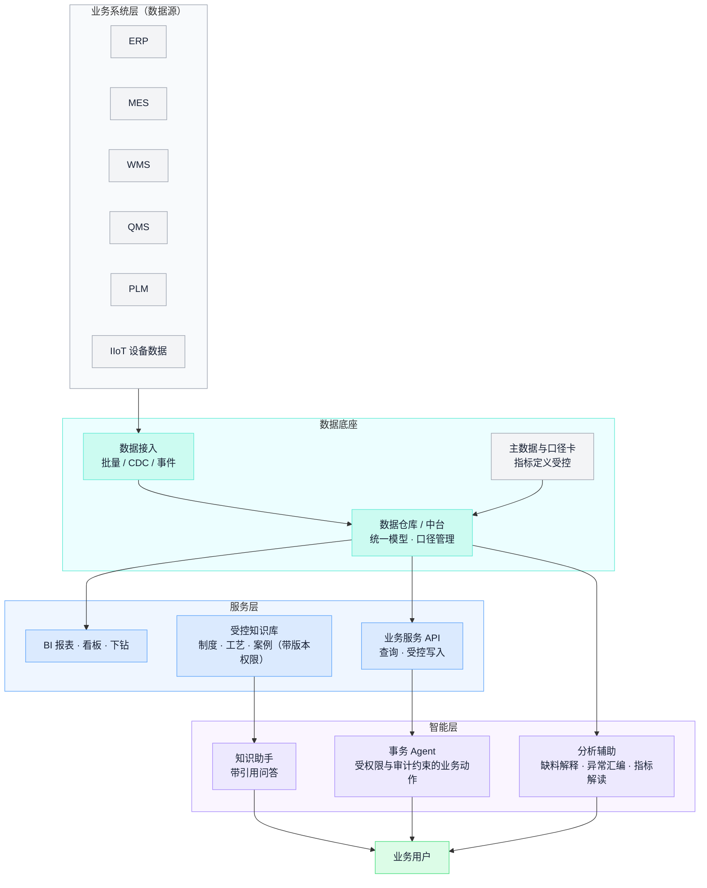

### 15.2 AI 的四层能力与边界

| 层 | 典型任务 | 上线前必须建立的边界 |
| --- | --- | --- |
| 知识助手 | 带引用的制度/工艺问答、术语解释、交接材料 | 文档权限、版本与生效性校验；无证据明确说"未知" |
| 分析辅助 | 缺料原因归纳、质量异常汇编、指标口径解释 | 标注来源与截点；计算交给工具；事实与推断分开 |
| 事务 Agent | 创建待审申请、按授权更新业务记录 | 身份、权限、参数校验、确认、幂等、回执与审计 |
| 工业 AI 与闭环控制 | 视觉检测、预测性维护、工艺优化 | 另立专业工程项目：测量与控制要求、失效策略、现场安全责任——"能解释报警"推不出"能安全动设备" |

四条不可逾越的边界：**检索到的文字 ≠ 有效指令**（回答"这批按哪个工艺做"需要订单执行时点的适用版本，索引权限跟随源文档权限）；**模型判断 ≠ 服务端授权**（权限与参数校验由业务系统执行边界承担）；**确定性计算与 AI 解释分工**（MRP、成本、OEE 由规则计算且可复现，AI 负责收集条件、调用服务、解释结果，不"猜数"）；**超时 ≠ 失败、回答 ≠ 过账**（事务动作复用业务唯一标识，回复区分：草案已生成 / 已提交 / 审批通过 / 已过账）。

起步选"能交付证据、能衡量价值"的场景：受控知识问答、带证据链的缺料解释、异常材料汇编、指标口径解读、调研与验收脚本协助。不从自动改 BOM、自动放行、自动改承诺、自动调设备起步——先定哪些决定必须由有资格的业务角色做出，再谈 AI 替他们省什么。

## 16. 建设次序：先修哪里

数字化建设的依赖链，不能跳步：

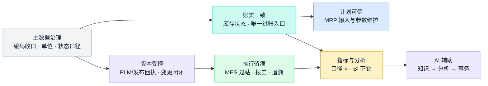

配套要点（翻查用）：

- **现状评估**：按能力清单盘点，每项保留四态——已购未用 / 已用但绕行 / 无系统但有效 / 确实缺失；为主要业务画一张"步骤 × 记录载体 × 录入人 × 断点"的泳道表，断点即建设候选项。
- **问题分类**：同一现象七种病根，药不同——流程规则不清（开会裁定即可）、数据错误、参数失当、权限不足、系统缺陷、集成断点、能力缺失（最后才轮到买系统）。
- **试点**：限定产品族/产线，含真实交接与异常，预写扩展条件与停止条件；只连一台设备的看板验证不了业务闭环。
- **选型**：配置已有 / 采购 / 扩展 / 自建四条路径，比较规则稳定性、差异化程度、接口开放性、长期维护；供应商按**本公司业务剧本**（含异常场景）演示，合同写明数据导出与退出迁移。
- **闸口**：范围签认 → 数据就绪 → 方案边界 → 端到端含异常测试 → 用户实操 → 切换回退安排 → 试点业务验收；双轨期必须有退出日。
- **验收三层**：数据正确（可复现）→ 流程闭环（含异常场景）→ 业务改善（同口径基线对比）——前两层不能替代第三层。
- **上线后 90 天**盯三件事：绕行率、补录延迟、人工对账工作量。
- **影子 Excel**：承认（纳入台账）→ 收编（版本、责任人、唯一数据源）→ 替换（宣布退役）；直接禁用只会把表格赶进更深的文件夹。

---

# 附录 A 车间行话速查

**物料与库存**

| 行话 | 意思 |
| --- | --- |
| 料号 | 物料的身份证号。名称可以叫错，料号不能错 |
| BOM / 展开 | 产品用料清单；"展开"指按 BOM 逐层算出每种料需要多少 |
| 齐套 | 工单所需物料全部到位。缺一颗螺丝也叫不齐套 |
| 欠料 / 缺料 | 需求已确定但料不够。缺料表是 PMC 每天的核心作业 |
| 提前期（L/T） | 从下单到可用要等多久。采购、生产提前期分开维护 |
| MOQ | 最小起订量 |
| 安全库存 | 为应对波动刻意多备的量。多了呆滞，少了白备 |
| 呆滞料 | 长期无需求消耗的库存，多来自变更、取消、超买 |
| 在途 | 已下单未到货的量。算供应要带上，但别重复算 |
| 客供料 | 客户提供的物料。不是自己资产，但要替客户管好账 |
| 线边仓 | 产线旁小库存区，最易变成账外之地 |
| 备料 / 发料 / 退料 | 按工单配料、发线、退回，三个动作都要留账 |
| 批次（Lot）/ SN | 一批料 / 一台产品的身份，追溯全靠它们 |
| 待验 / 冻结 / 让步接收 | 未检验 / 禁用 / 批准限定使用（特采） |
| 盘点 / 盘盈盘亏 | 数实物对账；重点查原因，不是调平 |
| 委外在外 | 发给外协厂的自有物料，"自有但在外" |

**生产与执行**

| 行话 | 意思 |
| --- | --- |
| 工单（WO/MO） | 一次生产任务：做什么、做多少、按哪个版本 |
| 排产 / 派工 | 哪条线哪天做哪张工单 / 任务到工位和人 |
| 插单 / 飞单 | 紧急订单强行插队 |
| 过站 / 跳站 | 工序完成并记录 / 未按顺序，多为违规或异常 |
| 报工 | 向系统报完成数量和工时 |
| 倒冲 | 完工按 BOM 反推扣料。省事，但掩盖超耗 |
| 节拍 | 每多少时间产出一台；瓶颈节拍决定整线产出 |
| 换线 / 换型 | 产品切换，耗时易错，排产要计入 |
| 治具 / 工装 | 生产测试的专用辅助器具，版本错则结果不可信 |
| SOP / 作业指导书 | 工位作业的受控文件 |
| WIP / 在制 | 投料未完工的半成品 |
| 首件（FAI） | 批量前先做一台全要求确认 |
| 返工 / 返修 | 不合格品重新加工/修复，须走受控路线留独立记录 |
| 直通率 / FPY | 一次通过不返工的比例；FPY 与整线直通率的口径区分见附录 B |
| 委外 / 外协 | 工序或部件交外厂，账与料跨厂跟踪 |
| 流转卡 | 跟实物走的纸卡；许多工厂的"真系统" |
| 安灯（Andon） | 现场异常呼叫与响应机制 |

**质量与变更**

| 行话 | 意思 |
| --- | --- |
| IQC / IPQC / OQC / FQC | 来料 / 制程 / 出货 / 最终检验 |
| SQE | 供应商质量工程师 |
| 全检 / 抽检 | 每台检 / 抽样判整批；抽检合格≠每台合格 |
| MRB | 不合格品处置评审（报废/返工/让步/退供谁拍板） |
| ECR / ECO / ECN | 变更申请 / 指令 / 通知 |
| 8D / CAPA | 结构化质量问题解决 / 纠正预防措施 |
| RMA | 客户退货授权，独立流程不混正常库存 |
| NTF | 退货检测无故障；留案底观察趋势 |
| FAI | 首件检验 |
| AVL | 合格制造商/供应商清单 |

---

# 附录 B 常用指标速查

只给含义和口径要点。**读任何指标，先问分母和口径，再看数字**；口径写进受控的"口径卡"（用途、粒度、公式、截点、排除项、来源、责任人），改口径要留版本，原始承诺与首次失败记录永久保留。

| 指标 | 回答什么 | 口径要点（翻查必看） |
| --- | --- | --- |
| OTD 准时交付率 | 交付承诺是否兑现 | 按订单 / 订单行 / 台数 / 金额，四种算法结果不同；比"原始承诺日"还是"最新承诺日"结果不同（只看最新承诺＝自欺）；"交付"指发运还是客户签收要定死 |
| OTIF 准时足量率 | 准时**且**足量 | 部分交付不计分，比 OTD 严，更接近客户感受 |
| FPY 一次通过率 | 过程能力 | 不经返工返修直接通过的比例；返工后合格不算 |
| 最终良率 | 交付能力 | 最终合格 ÷ 投入；返工负荷在这里不可见——和 FPY 一起看 |
| 直通率 RTY | 整线一次通过 | 必须追踪**同一批对象**穿过全部工序；各工序本月通过率直接相乘是经典错误 |
| OEE 设备综合效率 | 设备利用质量 | 可用率 × 性能率 × 质量率（相乘，不是平均）；时间模型（休息、换型、待料算哪段）必须事先约定；性能率＞100% 先查理想周期和计数 |
| 库存周转 / 库存天数 | 资金效率 | 销货成本 ÷ 平均库存；期末库存不能冒充平均，收入不能代替销货成本 |
| 库存准确率 | 账实一致 | 粒度固定为物料＋库位＋批次＋状态；正负差不得抵消；它不等于金额误差 |
| 齐套率 | 开工条件满足度 | 按工单全料齐套计，缺一项即不齐套 |
| 计划达成率 | 计划可信度 | 必须写明和**哪一版**计划比；每天重排后和最新版比，数字永远好看 |
| 异常关闭时长 | 现场响应能力 | 发生、响应、关闭三个时间戳分开统计 |
| 客诉率 / 退货率 | 市场质量 | 分母（出货量、期间）和缺陷定义固定；NTF 单独统计 |

指标防粉饰的七种常见手法（识破用）：改承诺日、换分母、剔除"特殊情况"、挪库存（移仓不减量）、截时点（月底突击发货报工）、选样本、换口径后直接同比。对策三件：口径卡受控、汇总可下钻到单据、原始事实不可改写。

# 附录 C 常见工艺环节速查（电子/光学类）

帮助看懂工艺路线和车间话题；**具体产品的工序、参数、判定以各产品的工艺文件和控制计划为准**，不同产品不能互相照搬。

| 工艺环节 | 干什么 | 质量与数据关注点 |
| --- | --- | --- |
| SMT 贴片 | 锡膏印刷 → 贴装 → 回流焊 | 钢网状态、锡膏效期与回温、炉温曲线、SPI/AOI 检查、批次与程序版本 |
| THT / DIP 插件 | 通孔插装 + 波峰焊/手焊 | 焊点质量、防错与极性方向 |
| ICT 在线测试 | 针床电测元件与连通 | 治具状态、测试程序版本 |
| 烧录 | 写入固件/程序 | 固件版本防错、写入校验、与测试限值联动 |
| FCT 功能测试 | 半成品/整机功能验证 | 测试程序与限值版本、数据关联 SN |
| 点胶 / 灌封 | 粘接、密封、加固 | 胶水效期与储存条件、胶量、固化温湿度与时间 |
| AA 主动对准 | 光学器件通电实时对位后固定 | 对位精度、UV 固化能量、设备标定状态 |
| 标定 / 校准工序 | 逐台测偏差、写入补偿参数并复测 | 靶标与设备的量值溯源、参数档案关联 SN、写入成功≠性能合格 |
| 老化 Burn-in | 通电运行筛除早期失效 | 时长与温度条件、老化前后数据对比 |
| 气密 / 环境测试 | 密封性与环境耐受验证 | 方法与判定标准版本、设备校准 |
| 镭雕 / 丝印 | 打标识（SN、Logo、客户标识） | 可读性、与系统 SN 一致、OEM 按客户标识规范 |
| 装配 / 装调 | 结构与模组组装、机械调整 | 扭力等关键参数、防错、过站绑定批次 |
| 包装 | 成品保护与标识 | 箱单与 SN 一致、ESD/防潮要求、客户包装规范 |

---

（完。本手册为通用制造知识与系统概念的翻查参考，节点编号与公司制造流程底稿 S1—S9 一致；各节点的实际单据、角色、在用系统以现场核实为准，按《流程总览》"下一轮细化顺序"逐节点补充公司专属事实。）
