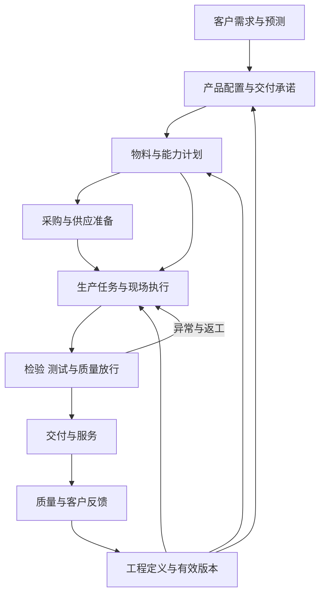

# 大制造数字化系统手册

一本自足的手册：从走进工厂的第一天，到能够独立判断计划、事务、数据、系统、集成、指标与建设决策。整理日期：2026-10-27。

---

## 前言

**这本手册写给谁。** 从零开始负责制造信息化、数字化的人。读完它，你应当能看懂制造业务链、用每个职能自己的语言和他们沟通、判断一套系统到底解决了什么问题、组织调研与建设，并对结果做出业务验收。

**这本手册怎么写。** 全书虚构了一家教学公司——**澄光科技**，约三百人，生产 3D 深度相机模组 DC-100；并用**一张贯穿全书的订单**（北辰机器人 1,000 台，六周交付）把计划、采购、变更、集成事故、指标争议全部串起来。所有公司、人物、编号、数字均为教学虚构，与任何真实公司无关，也不代表本公司现状；凡属真实厂商与标准（如 Oracle、Microsoft、SAP、ISA-95、NIST、WEF 灯塔工厂）均据其公开资料提炼，只说明概念与机制，不构成对任何产品能力的认证。

**三条贯穿全书的纪律**，每一章都会反复出现：

- **公共知识与公司事实分开。** 手册讲通用逻辑与公开案例；你所在公司的组织、产线、系统现状必须由现场调研取证（方法在第九章），不由行业案例或公开年报推定。
- **记录存在不等于记录可信，可信也不等于足以决策。** "系统里有数"只证明有人录入过；时点、口径、版本、状态是否一致要单独核对。
- **名称不等于能力。** 叫 MRP 的产品不必然会算产能，叫 MES 的产品不必然留下可追溯的过程证据。判断系统永远从业务对象、责任人和证据入手，不从缩写入手。

**大制造的范围。** 本书把"大制造"理解为与制造交付相关的完整范围：研发工程、计划、采购、供应商、仓储、生产、设备、质量、物流和售后。它不是一个所有企业边界一致的标准部门名称。理解这一切的入口是**交付承诺**：客户需求形成订单或预测，企业决定产品配置与交付承诺，再把承诺转换成工程、物料、产能和现场工作；合格产品进入交付，质量与售后反馈又可能改变产品、工艺或供应选择。



这条链不是单向流水线。工程变更、供应延期、设备故障、质量异常和客户改期都会引发重新决策。信息化的价值在于让决定有正确输入、状态能够传递、责任明确、结果可追溯——而不是单纯增加软件。任何一条连接缺少对象、状态或责任，都会影响后续判断。本书十一章，就是把这张图上的每一条边拆开讲透。

---

# 第一章 走进工厂：角色、行话与一张订单的旅程

## 1.1 为什么从"人"开始学

多数制造信息化教材从系统架构图开始，这是错的。工厂首先是一群人按分工协作，系统只是他们留下记录、传递状态的工具。你如果不理解计划员为什么半夜改排产表、仓管员为什么坚持手写台账、线长为什么月底突击报工，就永远看不懂系统里的数据为什么长那个样子。

全书的教学设定总表如下，各章数字与此一致，方便前后对照：

| 设定对象 | 内容 |
| --- | --- |
| 公司 | 澄光科技（虚构），约 300 人，深圳某工业园 |
| 产品 | DC-100 深度相机模组；定制变体 DC-100N（定制固件 + 丝印） |
| 关键物料 | PCBA-M 主板组件（委外 SMT，提前期 3 周）；OPT-1 光学组件（外购 4 周）；CASE-1 结构件（外购 2 周）；CONN-07 连接器（外购 6 周）；IC-D 深度芯片（客供给委外厂，提前期 12 周） |
| 工艺路线 | 组装 → 固件烧录 → 功能测试 → 深度标定 → 老化 → 外观检验（FQC）→ 包装 |
| 瓶颈 | 深度标定工位：每台 6 分钟，2 个工位，每周合计 70 小时 |
| 贯穿订单 | SO-2412：北辰机器人（虚构客户）订 1,000 台，第 1 周下单，要求第 6 周周五发货；其中 200 台为 DC-100N |
| 关键单据 | 工单 WO-885（900 台）、采购单 PO-3301（500 颗 OPT-1）、变更单 ECO-2088、退货单 RMA-077 |

这个设定刻意贴近一家中等规模的光学电子企业：不大到有完整系统体系，不小到没有管理问题。你将以"新任制造信息化负责人"的身份入职这家公司，跟着这张订单走完全书。

## 1.2 工厂的一天

想象你入职第一天，早上 7:50 跟着厂长走进车间。

早会上，**PMC**（生产计划与物料控制）的计划员念今天的排产：三条线各做什么型号、多少台。念到一半，**采购员**插话：OPT-1 镜头供应商说下周的货要延两天。计划员皱眉——这意味着第三条线周四可能停线待料，她得回去改排产表，还要通知销售某张订单可能延期。**线长**接着报昨天的产量和一个异常：夜班有 12 台功能测试不过，初判是烧录版本问题，**测试工程师**今天上午确认。**质量主管**补充：有一批来料连接器 IQC 抽检发现引脚氧化，先冻结在待验区，等供应商回复。厂长最后问了一句所有人都紧张的问题："北辰那一千台，第六周能不能走？"

会后你跟着物流走一遍：收料区堆着昨天到的纸箱，仓管员逐箱核对送货单、贴内部标签、录系统；合格的上架，待验的放隔离区。线边有个小仓，备料员按今天的工单把物料配成套（这叫**齐套**）送到线头。产线尾部，每台装好的模组被扫码**过站**，进入烧录、测试；标定房里两台设备前各坐一个操作员，节奏明显比别处慢——这就是瓶颈。包装区在打托，下午有一批货要发。

下午你旁听了月度对账会：**财务**的成本会计拿着一张差异表问生产：为什么系统里这张工单领了 905 套料只报了 897 台良品，8 台去哪了？线长翻纸质记录解释：3 台报废走了报废单，5 台还在维修区没结案。会计在表上记了一笔"待查"。

这一天里没有出现任何系统架构名词，但制造信息化的全部课题都已经出现了：**承诺怎么算（第三章）、料怎么跟（第四章）、版本怎么控（第二、五章）、状态怎么传（第六、七章）、数字怎么信（第八章）**。

## 1.3 认识每个角色：他们在乎什么、害怕什么

理解一个角色，最快的办法是搞清他的 KPI 和他最怕的事。**数据失真的根源几乎都是考核压力**：怕被问责，就会美化报工、推迟记录坏消息、在表格之外私藏"真账"。你以后看到任何可疑数据，先想想录入它的人当时在怕什么。

| 角色 | 每天在做什么 | 最怕什么 | 对信息化的真实期待 |
| --- | --- | --- | --- |
| 销售 / 客户经理 | 接单、报交期、追订单进度、安抚客户 | 答应了客户却交不出货 | 随口就能查"这单到哪了"，承诺交期有依据 |
| PMC 计划员 | 排产、算缺料、协调插单、催齐套 | 缺料停线；排好的计划被插单打乱 | 库存和在途数字可信，变更能及时传到她这里 |
| PMC 物控 / 采购 | 下采购单、催交、处理来料异常 | 关键料断供；买多了变呆滞被追责 | 需求建议准确，供应商承诺有记录可对 |
| 仓管员 | 收发存、上架拣配、盘点 | 盘亏说不清；发错料背责任 | 账实一致省得被查；少做重复录入 |
| 线长 / 车间主任 | 派工、盯产量、处理现场异常 | 停线；月底产量不达标 | 报工别太繁琐；异常有人接走而不是全怪产线 |
| 操作员 | 按 SOP 作业、扫码过站、报工 | 做错被罚；扫码耽误手上活 | 操作越少越好，最好扫一下全自动 |
| 工艺工程师（PE） | 维护工艺文件、处理工艺异常、改善 | 现场用了旧版作业指导出批量事故 | 版本发布能到现场，现场执行可查证 |
| 测试工程师（TE） | 维护测试程序与限值、分析不良 | 测试程序版本错放，整批误判 | 测试数据带版本可追溯，不只留 PASS/FAIL |
| 质量（IQC/IPQC/OQC/SQE） | 检验、判定、隔离、推动纠正 | 放行错货流到客户；背"质量部为什么没拦住" | 冻结能真正锁住库存，处置有权限留痕 |
| 设备工程师 | 保养、修机、管治具和校准 | 设备带病运行出批量问题却没记录 | 设备状态和校准期限有人提醒、有据可查 |
| 研发（RD） | 设计、改版、处理设计类不良 | 改了设计但工厂还在做旧版 | 变更发出去有回执，知道切换到哪一台 |
| 财务 / 成本会计 | 记账、月结、算成本差异 | 账实不符说不清；审计查出问题 | 每笔实物移动有对应单据，差异能追到原因 |
| IT / 信息化负责人（你） | 维护系统、接需求、被各方抱怨 | 系统背了业务的锅；上了系统没人用 | ——这正是本书要回答的 |

注意最后一行。你的处境很特殊：**每个角色都会把自己的问题描述成"系统问题"拿给你**——"系统算得不准"可能是采购没维护提前期，"系统里查不到"可能是现场根本没录。你的第一项专业能力，就是把"系统不好用"翻译回具体的业务事实（谁、哪张单、哪一步、什么证据），这个方法在第九章展开。

## 1.4 车间行话速查表

这些词会议上没人解释，但不懂就插不上话。按场景分组，用大白话给出定义。

**物料与库存**

| 行话 | 意思 |
| --- | --- |
| 料号 | 物料的身份证号。名称可以叫错，料号不能错 |
| BOM / 展开 | 产品的用料清单；"展开"指按 BOM 逐层算出每种料需要多少 |
| 齐套 | 一张工单需要的料全部到位。缺一颗螺丝也叫不齐套 |
| 欠料 / 缺料 | 需求已确定但料还不够。缺料表是 PMC 每天的核心作业 |
| 提前期（L/T） | 从下单到可用要等多久。采购提前期、生产提前期分开算 |
| MOQ | 最小起订量。你只要 50 颗，供应商说一盘 3,000 颗起卖 |
| 安全库存 | 为应对波动刻意多备的量。备多了变呆滞，备少了白备 |
| 呆滞料 | 长期没有需求消耗的库存。常来自变更、取消和买多 |
| 在途 | 已下单未到货的量。算可用供应时要带上它，但别重复算 |
| 客供料 | 客户提供的物料。不是你的资产，但要替客户管好账 |
| 线边仓 | 放在产线旁边的小库存区。最容易变成账外之地 |
| 备料 / 发料 / 退料 | 按工单配料、发给产线、用不完退回。三个动作都要留账 |
| 批次（Lot）/ SN | 一批料的身份 / 一台产品的身份。追溯全靠它们 |
| 待验 / 冻结 / 让步接收 | 还没检验 / 禁止使用 / 不完全合格但批准限定使用（也叫特采） |
| 盘点 / 盘盈盘亏 | 数实物对账。差异叫盘盈/盘亏，重点不是调平而是查原因 |

**生产与执行**

| 行话 | 意思 |
| --- | --- |
| 工单（WO/MO） | 一次生产任务：做什么、做多少、按哪个版本 |
| 排产 / 派工 | 决定哪条线哪天做哪张工单 / 把任务分到具体工位和人 |
| 插单 / 飞单 | 紧急订单强行插队。计划员最恨的词 |
| 过站 | 产品在某工序完成并记录。"跳站"指没按顺序做，通常是违规或异常 |
| 报工 | 向系统报告完成数量和工时。月底突击报工是常见病 |
| 倒冲 | 不逐次记领料，完工时按 BOM 用量反推扣库存。省事，但掩盖实际用量偏差 |
| 节拍 | 每多少时间产出一台。瓶颈工位的节拍决定整线产出 |
| 换线 / 换型 | 从做 A 产品切换到做 B 产品。耗时且易出错，排产要考虑 |
| 治具 / 工装 | 辅助生产测试的专用器具。治具版本错了，测试结果就不可信 |
| SOP / 作业指导书 | 这个工位该怎么干的受控文件。"现场贴的是哪一版"是永恒问题 |
| WIP / 在制 | 投了料还没完工的半成品。既占钱又占地方，还最难盘 |
| 首件 | 批量开工前先做一台全检确认。首件没过就批量生产是重大违规 |
| 返工 / 返修 | 没通过的产品重新加工。要有独立记录，不能悄悄混回好品 |
| 直通率 | 一次通过所有工序不返工的比例。第八章细讲它的分母陷阱 |
| 委外 / 外协 | 把某道工序或部件交给外厂做。账和料都要跨厂跟踪 |
| 流转卡 / 标识卡 | 跟着实物走的纸卡，记录批次和工序。很多厂的"真系统"其实是它 |

**质量与变更**

| 行话 | 意思 |
| --- | --- |
| IQC / IPQC / OQC / FQC | 来料检验 / 制程巡检 / 出货检验 / 最终检验。位置不同，问题归属不同 |
| SQE | 供应商质量工程师，管供应商来料质量和整改 |
| 全检 / 抽检 | 每台都检 / 按方案抽样判整批。抽检合格不等于每台合格 |
| 不合格品 / MRB | 判定不合格的品 / 处置评审（报废、返工、让步、退供由谁拍板） |
| ECR / ECO / ECN | 变更申请 / 变更指令 / 变更通知。第五章用一个完整案例讲 |
| 8D / CAPA | 处理客诉和重大质量问题的结构化方法 / 纠正预防措施 |
| RMA | 客户退货授权。退回来的货走独立流程，不能直接混入库存 |

## 1.5 一张订单的旅程

现在把 SO-2412 这张订单从头走一遍。每一步括号里标注本书哪一章展开。这个旅程是全书的骨架，读完后面各章再回来看这一节，你会看到完全不同的深度。

**第 1 周周一**，北辰机器人的采购发来订单：1,000 台 DC-100，第 6 周周五前到货，其中 200 台要定制固件和外壳丝印（记为 DC-100N）。销售把订单拿到**订单评审**：研发确认定制固件两周内可提供（第二章：版本从此多了一个分叉）；PMC 要回答能不能按期交（第三章：这个回答需要算，不能拍脑袋）。

PMC 的计算结论是：成品库存 100 台可用，还需生产 900 台；委外的 PCBA-M 加上在途够用，但**镜头 OPT-1 缺 500 颗，供应商提前期 4 周，本周不下单就来不及**；深度标定工位那两周已有其他订单占用，要协调。于是当天下午，采购单 PO-3301（500 颗 OPT-1）发出，委外厂收到 550 套 PCBA-M 的加工通知，计划上预留了第 5—6 周的标定产能（第三章完整演算这笔账）。

**第 2—4 周**，采购跟催，委外厂领走了澄光库存的 550 颗客供芯片 IC-D——物控顺手记了一笔：IC-D 库存只剩 50 颗，而这颗芯片提前期 12 周，下一张订单来了就是大麻烦（第三章：长周期料的风险决策）。研发同期发布了 DC-100N 的定制固件 FW-2.4N 和对应测试限值（第二章：五个版本轴）。

**第 5 周**，PO-3301 第一批 300 颗镜头到货，IQC 抽检通过入库；工单 WO-885（900 台）下达、备料、开线。周四第二批 200 颗到货，IQC 发现 8 颗镜片有划伤，判退供应商补货（第四章：订了 500、到了 500、能用 492，三个数字都要留下来）。

**第 6 周**，产线连轴转，标定工位加了晚班。截至周五，897 台良品入库，3 台报废（补投了一张 3 台的小工单），返修区还压着几台（第四章：完工、良品、报废、在修是四本账）。因为那 8 颗镜头，最后 100 多台凑不齐——周五按时发出 **600 台**，剩余 400 台下周补（第八章：这张订单的"准时交付率"该怎么算，四种口径四个答案）。

**第 7 周**，补发的 8 颗镜头到货，剩余 400 台完工发出。同一周，财务月结发现系统里 WO-885 的完工数是 **1,010 台**——比工单数量还多 110 台。追查发现是报工接口重发了一批消息（第七章：这起事故值得完整解剖）。

**第 8 周**，连接器供应商通知 CONN-07 年底停产。工程师发起变更 ECO-2088 换用 CONN-09：仓库还有 2,300 颗旧料、在途订单 5,000 颗、3 张在制工单——这个变更远不是"换个料号"（第五章：一步步做完这个变更）。

**第 10 周**，北辰退回 5 台（RMA-077），其中 1 台深度图异常。质量工程师要从这台的序列号查回：哪张工单、哪批 PCBA、哪颗芯片批次、当时的固件和测试数据、同批次还有多少台发给了谁（第五章：追溯演练）。复盘会上，大家把这张订单暴露的所有问题列成清单——而这张清单，正是信息化建设该从哪里开始的答案（第九章）。

## 1.6 你的第一周该做什么

不要在第一周评价任何系统，更不要承诺任何方案。做五件事：

1. **拿到三张清单**：组织架构（谁管什么）、产品清单（卖什么、哪些在产）、在用系统与关键 Excel 清单（包括微信群里传的那几张表）。
2. **让人带你物理走一遍厂**：收料 → 仓库 → 备料 → 产线 → 测试 → 包装 → 发货。在每个交接点问一句："这里的记录记在哪？"
3. **挑一张已完成的工单做双向追踪**：从工单正向走到出货，再从一台出货序列号逆向查回物料批次和测试记录。卡住的每一处都是真实的断点，记下来。这是本书反复使用的方法。
4. **建立问题本**：格式固定为"日期 / 谁说的 / 原话 / 涉及哪张单据 / 证据在哪 / 待核实"。只记事实，不记结论。
5. **约齐 1.3 节那张表里的每个角色各聊一小时**：问什么、怎么追证据，用第九章的访谈问题清单。

三条心法，供你贴在工位上：**现场永远比报表诚实；不懂就问编号（"给我看看那张单"）；每个抱怨背后都有一个没被记录的事实。**

# 第二章 产品如何诞生：NPI、BOM 与版本

## 2.1 先搞懂你的产品本身

信息化负责人不需要会设计产品，但必须知道自己产品"难在哪"，否则无法判断哪些数据值得花钱管。以 DC-100 为例（教学构造）：它向场景投射红外结构光，接收反射后计算每个像素的距离，输出深度图。这决定了它的三个制造特点：

1. **光学器件娇贵**：镜头怕划伤、怕灰，对装配应力敏感——所以来料检验和装配环境是质量重点。
2. **每台都要标定**：投射器和接收器的相对位置存在制造公差，必须逐台用标准靶标测出偏差、算出补偿参数写入设备。这道工序慢（6 分钟/台）且依赖设备精度——所以它是产能瓶颈，也是数据最密集的工位。
3. **硬件、固件、算法、测试互相咬合**：换一版固件可能改变深度计算，测试限值就得跟着换——所以"版本一致性"是这类产品的命门。

你自己公司的产品也要做同样的分析：**找出最娇贵的料、最慢的工序、咬合最紧的版本关系**，信息化的优先级就藏在这三个答案里。

另外要辨认制造类型。离散制造围绕可辨认的零部件和装配件组织（按件计数、按装配层级描述）；流程制造关注配方、物料转化、批次与产出关系（按千克、升计量，关心配比和转化损失）。这不是按行业贴的永久标签：DC-100 的装配按离散订单管理，但点胶、固化又涉及配方用量和工艺条件；外购镜头、委外贴片和厂内校准共同构成一条链。按实际生产单元辨认，不能看到"电子行业"就认定所有物料按整数件管理。

## 2.2 NPI：一个产品的成长故事

NPI（新产品导入）是把设计逐步变成可重复生产、检验、交付的产品的过程。消费电子惯用 EVT/DVT/PVT 划分阶段，但各公司对边界的定义并不统一——名字不重要，**每个阶段要回答什么问题、留下什么证据**才重要。看 DC-100 当年的历程（教学虚构）：

**EVT（工程验证，3 台手工样机）**。要回答的问题是"关键技术行不行"。工程师手工装了 3 台，验证深度精度能达标。过程中发现投射器连续工作发热导致精度漂移——这是设计问题，改了散热方案。留下的证据：样机配置记录、精度测试原始数据、问题清单及关闭情况。

**DVT（设计验证，30 台小批量）**。要回答"这个设计加上选定的材料，能不能稳定满足全部要求"。做了高低温、跌落、老化等可靠性试验。期间结构件 CASE-1 从 v0.3 改到 v1.0（加强了镜头固定结构）。这里出现第一个经典判断题：**结构件改版之后，EVT 阶段用旧结构件做的跌落测试还算数吗？** 答案是"必须有人判断，不能默认算数"——跌落恰恰和结构强度直接相关，所以这项要重测；而与结构无关的光学参数测试可以经评审后沿用。把阶段名从 EVT 改成 DVT，不会自动让旧证据覆盖新配置。

**PVT（生产验证，200 台上产线）**。要回答"人、机、料、法能不能按目标节奏重复生产"。设计没问题不等于能量产：PVT 发现标定实测节拍 9 分钟/台，远高于 6 分钟的目标——靠优化标定算法和新增一个工位解决。留下的证据：工艺验证记录、节拍实测、直通率、操作员培训记录。

**爬坡与量产（MP）**。规模扩大后是否仍稳定：良率趋势、供应稳定性、异常升级机制。到这里，产品才拥有了第一章里那条工艺路线和那套提前期参数。

这个故事给信息化负责人的启示：**每个阶段的"转阶段批准"是一个决策记录，背后挂着一堆证据**。你的系统（哪怕只是规范的文件夹）要能回答"当时凭什么批准转阶段、测试的是哪版硬件哪版固件"。多数公司的 NPI 资料散落在个人电脑和邮件里，等量产出问题回头找证据时才发现找不到——这是成本极低、价值极高的治理起点。

## 2.3 版本是制造的第一公民

一台 DC-100 的"版本"不是一个号，而是**五个轴的组合**：

| 版本轴 | 例（教学） | 谁维护 | 改错的后果 |
| --- | --- | --- | --- |
| 硬件版本（BOM 修订） | DC-100 Rev B | 研发/工艺 | 装错料、混料 |
| 固件版本 | FW-2.3 / 定制 FW-2.4N | 研发（软件） | 功能异常、客户现场批量升级 |
| 测试程序与限值版本 | TP-1.7（限值表 v5） | 测试工程师 | 整批误判：好品当坏品，或坏品流出 |
| 标定程序与参数版本 | CAL-3.1 | 算法/测试 | 深度精度不达标但测试"通过" |
| 工艺/作业指导版本 | SOP-装配-v12 | 工艺工程师 | 现场按旧方法作业 |

北辰订单里的 200 台 DC-100N 正是一次五轴联动：定制固件 FW-2.4N 上线，测试限值也要配套改（定制固件改了输出格式，旧测试程序会误判），丝印属于结构件/包装变化，BOM 上则表现为一个新的成品料号。**任何一轴动了，都要问其他四轴要不要跟着动**——这是版本管理的核心习惯，比任何 PLM 软件都重要。

落到单台产品，就是"版本矩阵"：给定一台 SN，能查出它的完整配置。这是售后分析的生命线：

| SN：CL24W6-0583（教学例） | 值 |
| --- | --- |
| 成品料号 / 硬件版本 | DC-100N / Rev B |
| 工单 | WO-885 |
| PCBA-M 批次 | SMT 厂批 L2405-07 |
| OPT-1 批次 | PO-3301 第一批（W5 到货批） |
| 烧录固件 | FW-2.4N |
| 测试程序 / 限值 | TP-1.7 / 限值表 v5 |
| 标定参数文件 | CAL-3.1 输出，存档编号 C-0583 |
| 最终判定 | FQC 通过，W6 周四 |

第十周北辰退回那台深度图异常的设备，质量工程师的第一个动作就是调这张矩阵。如果公司回答不出其中任何一行，说明那条数据链是断的——你未来的建设清单上就多了一项，且优先级可以用"断了会怎样"来排。

## 2.4 料号、修订、实物：三层身份不能互相替代

- **料号**说"这是哪种东西"（OPT-1）；
- **修订**说"这种东西的哪个受控定义"（CASE-1 v1.0）；
- **批次/序列号**说"具体哪一批/哪一台实物"（PO-3301 第一批）。

三者相关但不可互换。最常见的错误推理是："系统里 CASE-1 当前版本是 v1.0，所以仓库里的 CASE-1 都是 v1.0。" 错——DVT 时期的 v0.3 库存可能还躺在货架上。是否把一次变化定义成**新料号、新修订还是属性更新**，判断依据是互换性和追踪要求：新旧件可以随便混用 → 修订即可；不能混用或客户要求区分 → 应考虑新料号；只是改了描述文字 → 属性更新。不能凭"改动看起来大不大"拍脑袋。

## 2.5 EBOM 到 MBOM：同一个产品的两种视图

研发交付的是**工程 BOM（EBOM）**——按设计功能组织：光学模组、主板模组、结构模组。工厂需要的是**制造 BOM（MBOM）**——按装配顺序和实际备料组织。对照看一眼就明白两者为什么不能是同一张表：

| EBOM（按功能，研发维护） | MBOM（按制造，工艺维护） |
| --- | --- |
| 光学模组：OPT-1 | 工序 10 组装：PCBA-M、OPT-1、CASE-1、CONN-07、导热垫、螺钉 ×4 |
| 主板模组：PCBA-M（含 IC-D 等） | 工序 20 烧录：（无物料，消耗固件版本 FW-x） |
| 结构模组：CASE-1、CONN-07 | 工序 60 FQC：（无物料） |
| —— | 工序 70 包装：彩盒、说明书、标签、缓冲棉 |

注意 MBOM 多出的东西：包装材料、辅料（导热垫、螺钉）、按工序挂料的位置信息；而 EBOM 的"模组"层级在 MBOM 里可能根本不单独存在（装配时一次装完，不产生可入库的半成品——这类层级叫**虚拟件**，它影响 MRP 展开但不产生库存）。与 MBOM 配套的还有**工艺路线**（工序顺序、各工序用什么资源、准备时间和单件工时——排程和成本都靠它）和**作业指导（BOP/SOP）**（每道工序具体怎么干）。

EBOM 转 MBOM 不是复制表格各改各的，而是一个**受控的转换**：能说清哪些是制造新增项、哪些层级被重组了、两边如何对应。转换没人管的公司，迟早出现"研发改了 EBOM，工厂的 MBOM 三个月后才发现"的事故。

## 2.6 检测、校准、调整：三个容易混淆的动作

深度相机把这组概念演示得特别清楚：

- **调整**：标定工序给每台设备算出补偿参数并写入——这是在**改变产品**。
- **检测**：写入后再测一次深度精度是否达标——这是在**判断产品**。参数写入成功 ≠ 精度合格，两步缺一不可。
- **校准**（计量意义）：标定房那套靶标和导轨自己准不准？——这是在**判断测量系统**。设备贴了"校准合格"标签不等于溯源成立；量值溯源属于测量结果，需要连续的校准链、记录和不确定度。如果靶标距离漂了 2 毫米，所有"通过"的产品其实都没通过，而且系统里完全看不出来。

所以一条 PASS/FAIL 记录不足以复核故障。测试与标定数据应围绕"哪个对象、在什么配置和条件下、用什么方法、产生什么原始结果、谁作了什么判定"组织：

| 数据类别 | 应保存的内容 |
| --- | --- |
| 对象 | 产品、序列号、批次、工单、关键部件及关联关系 |
| 版本 | 硬件、固件、算法、测试程序、参数集、判定规则 |
| 环境与资源 | 时间、地点、工位、设备、治具、必要环境条件 |
| 测量 | 特性名、测量值、单位、上下限、必要的原始文件 |
| 结论 | 原始失败、复测、返工、最终处置、批准与放行 |

维修后"再测通过"的产品，此前的失败记录和拆换记录必须保留——否则改进团队永远分不清制造缺陷、误测与返修掩盖。

# 第三章 计划的逻辑：从一句承诺到一张 MRP 表

## 3.1 销售的问题："六周交一千台，行不行？"

第 1 周周一上午，销售把北辰的订单拍在 PMC 桌上。注意：这个问题**没有"拍脑袋答案"**，任何负责任的回答都由四个小问题组成：

1. **要做多少？** 需求 1,000 台，减去可用成品库存 100 台，净需求 900 台。
2. **料够不够、什么时候能够？** 每种物料逐层算：现有库存 + 已下单在途，够不够盖住需求；不够的部分，按供应商提前期倒推，现在下单来不来得及。
3. **产能排不排得下？** 瓶颈工位（标定）那两周的负荷，加上这 900 台还放不放得下。
4. **有什么条件和风险？** 回答必须是"能，条件是……"或"不能，除非……"，而不是光秃秃的"能"。

计划的本质由此可见：**计划不是一次算出"正确答案"，而是在需求会变、资源有限的条件下，形成可执行的承诺，再用实际反馈不断修正承诺。** 下面把这四个小问题逐个算完。

## 3.2 为什么需要 MRP：订货点法的失败

先回答一个"为什么"。最朴素的补货方法是**订货点法**：库存低于某个水位就补一批——家里酱油快用完就买，超市一直在用。它对**独立需求**（直接来自市场、无法推算只能预测的需求，比如 DC-100 整机卖多少）勉强可行。

但工厂里绝大多数物料是**相关需求**：镜头的需求完全由整机计划决定。相关需求有两个特点，让订货点法彻底失效：它是**成块出现**的——整机不排产时镜头需求为零，一排产就是 900 颗，不存在"平均每天消耗"；它是**可以精确计算**的——根本不需要预测。对能算出来的东西做预测，结果就是常备一堆不需要的库存，同时在需要的时点缺货。

上世纪六七十年代形成的 MRP（物料需求计划）就是这个洞见的产物：**独立需求做预测和承诺，相关需求做计算**。公式只有一层：用 BOM 把上层计划逐层展开成下层需求，扣掉现有库存和在途，差多少补多少，再按提前期倒推什么时候必须下单。所有后来的 ERP、APS，内核都站在这个逻辑上。

## 3.3 计划是逐级收敛的体系

在"销售一句话"和"今天这条线做什么"之间，隔着好几层决策。成熟的说法是一套层级，每层回答不同粒度的问题：

| 层级 | 核心问题 | 粒度与节奏 | 在澄光的对应物（教学） |
| --- | --- | --- | --- |
| S&OP 销售与运营计划 | 未来几个季度，产品族的需求和供给怎么平衡？要不要扩产、备长周期料？ | 产品族，月度滚动 | 月度产销协调会：DC 系列下季度预计 2 万台，IC-D 芯片要不要再订一批 |
| MPS 主生产计划 | 哪些型号、哪几周、各供应多少？ | 型号，周 | 周计划表：DC-100 第 5—6 周产出 900 |
| MRP 物料需求计划 | 这些供应需要哪些下层物料？扣掉已有供给还缺多少、何时下单？ | 料号，日/周 | 本章 3.4 节那组表 |
| 能力核对（RCCP/CRP） | 关键资源装不装得下？ | 工位/线体 | 3.5 节的标定工位算术 |
| 排程与派工 | 今天、这条线、先做哪张工单？ | 班次/小时 | 排产表与早会 |

两个提醒。第一，**实际企业未必每层都有独立的模块或会议**，先看这些决策是否有人做、有没有批准的版本、能不能传到下一层，再去对软件名称。第二，**MPS 不等于预测**：预测是需求的声明，MPS 是企业打算怎么供应的声明，两者之间隔着一次决策（接不接、何时交、备多少）。

还要认识**订单分离点**——客户订单到达时，哪些工作已经完成：

| 模式 | 订单前准备什么 | 订单后做什么 | 承担的主要风险 |
| --- | --- | --- | --- |
| MTS 面向库存 | 按预测把成品做出来 | 分配库存、发货 | 做出来卖不掉，或缺对的型号 |
| MTO 面向订单生产 | 产能、通用料 | 按订单制造 | 客户要等整个制造周期 |
| ATO 面向订单装配 | 通用模块、半成品 | 按选项完成总装/配置 | 模块组合与需求不匹配 |
| ETO 面向订单设计 | 技术平台与工程能力 | 设计、采购、制造 | 需求、设计、工期、成本一起变 |

澄光同时是三种：标准 DC-100 备 100 台库存（MTS 成分），大单按订单生产（MTO 成分），DC-100N 用标准硬件加定制固件丝印（ATO 成分）。**ATO 的短交期来自订单前的准备**，不能理解成"所有料都可以等订单来了再买"——北辰这单恰恰证明：镜头必须第 1 周就下单。

## 3.4 把北辰的订单亲手算一遍

现在做 MRP 的完整演算。先固定假设，否则每个人会算出不同结果：以周为期间（W1—W6），需求和接收都发生在期初；提前期 L 周表示 Wt 期初下达、W(t+L) 期初可用；逐批订货（缺多少订多少）；不考虑安全库存、损耗、MOQ 和产能（产能在 3.5 节单独算）。

四个计算动作，每种物料都重复这套：

```text
净需求 NR(t)   = max(0, 毛需求 GR(t) − 上期末可用 PAB(t−1) − 预计到货 SR(t))
计划接收 PORc(t) = NR(t)                       （逐批订货时）
期末可用 PAB(t) = PAB(t−1) + SR(t) + PORc(t) − GR(t)
计划下达 PORl(t−L) = PORc(t)                   （按提前期倒推）
子件毛需求 = 父件"计划下达量 × BOM 单耗"逐期合计
```

最后一行最容易错：**父件开工时就要领料，所以子件需求按父件的"下达期"展开，不是按父件完工期展开。**

**第一层：成品 DC-100。** 需求 1,000 台在 W6，期初库存 100，装配提前期 1 周：

| DC-100（台） | W1 | W2 | W3 | W4 | W5 | W6 |
|---|---:|---:|---:|---:|---:|---:|
| 毛需求 GR | 0 | 0 | 0 | 0 | 0 | 1,000 |
| 净需求 NR | 0 | 0 | 0 | 0 | 0 | 900 |
| 计划接收 PORc | 0 | 0 | 0 | 0 | 0 | 900 |
| 期末可用 PAB | 100 | 100 | 100 | 100 | 100 | 0 |
| 计划下达 PORl | 0 | 0 | 0 | 0 | 900 | 0 |

W5 下达 900 台——这就是工单 WO-885 的来历。库存那 100 台**只抵成品需求，不再向下展开**：下层物料的需求从 900 算，不是 1,000。

**第二层：四种直接物料。** 毛需求都是 W5 的 900（×各自单耗 1）：

| 物料 | 期初库存 | 预计到货 SR | W5 可用合计 | 净需求 | 提前期 | 必须下达的周 | 判定 |
|---|---:|---|---:|---:|---|---|---|
| PCBA-M 主板 | 150 | 200（W3 到，之前已下的委外单） | 350 | 550 | 3 周 | **W2** | 来得及，下周通知委外厂 |
| OPT-1 镜头 | 400 | 无 | 400 | 500 | 4 周 | **W1（本周！）** | 今天就得下单 → PO-3301 |
| CASE-1 结构件 | 100 | 无 | 100 | 800 | 2 周 | W3 | 从容 |
| CONN-07 连接器 | 3,200 | 无 | 3,200 | 0 | 6 周 | 不需要 | 用掉 900 后还剩 2,300（记住这个数，第五章它有戏份） |

**第三层：委外厂需要的芯片 IC-D。** PCBA-M 在 W2 下达委外 550 套，芯片由澄光客供，W2 就要发给委外厂 550 颗。库存 600 颗，够——但**用完只剩 50 颗，而这颗芯片提前期 12 周**。MRP 本身只会说"本单无缺口"；有经验的物控会追加一个判断：12 周意味着下一张像样的订单必然赶不上，要不要现在就按预测补货？补多少？这是一个**风险决策**（押预测的资金风险 vs 断料丢单的风险），该升级到 S&OP 层面拍板，不该让 MRP 的沉默掩盖它。

**守恒自检**（算完必做）：成品 100 + 900 = 1,000 ✓；每种物料的计划接收合计 = 按提前期倒推后的下达合计 ✓。

**如果客户要的是第 5 周交货呢？** 成品下达提到 W4，镜头下达就要倒推到 **W0——上周，已经过去了**。真实 MRP 会生成一条"逾期下达"的例外消息。正确反应不是把日期改成本周然后装作没事（提前期没变，货不会快到），而是逐项评估：供应商能不能加急？别处能不能调货？有没有经批准的替代镜头？都不行，就回头谈交期或分批。**例外消息是 MRP 最有价值的输出**——真正值得管理的不是那张漂亮的计划表，而是哪些例外阻止计划实现、谁负责行动、行动之后是否重新闭合。

**再看参数的威力。** 假设 OPT-1 有 MOQ 600 颗：净需求 500 也得买 600，多出的 100 进库存，改变后续每一期的可用量——批量规则一变，整张表跟着变。假设把提前期从 4 周"保险起见"改成 6 周：MRP 会提前两周下单，表面缺料减少了，实际是**把缺料藏成了多两周的库存资金**。提前期、批量、安全库存这些参数没人维护的公司，MRP 算得越勤，错得越整齐。

## 3.5 物料齐套之外：产能是另一张约束表

经典 MRP 假设产能无限，物料算完必须单独核对能力。瓶颈是标定工位：

```text
需求：900 台 × 6 分钟/台 = 90 工位小时
供给：2 个工位 × 7 小时/天 × 5 天 = 70 小时/周
```

一周放不下（差 20 小时），两周（140 小时）放得下——但第 5—6 周标定工位已有其他订单占用约 60 小时，9 0 + 60 = 150 > 140，**超负荷 10 小时**。解决选项：加班（10 小时加班费）、让其他订单让位（影响另一个客户）、外协标定（本例不可行，设备特殊）。注意两个不对称：**增加普通装配工解决不了标定瓶颈**（能力不是通用的）；**设备空闲也弥补不了缺一颗镜头**（物料和能力是两张表，必须都过）。

于是 PMC 给销售的正式答复是："**能交。条件：一、镜头采购单今天下达且供应商确认 4 周交期；二、第 5—6 周标定工位加班约 10 小时，费用计入本单；三、芯片库存将见底，若北辰后续有追单意向请提前 12 周告知。**"——这就是 3.1 节说的"有条件的承诺"。把条件写出来还有一个作用：将来复盘延期时，能分清是当初判断错了，还是条件没被兑现。

## 3.6 让计划保持可信的纪律

计划算一次不难，难的是周复一周保持可信。四条纪律：

- **每轮计划固定回答四问**：本轮用的是什么时点的数据快照？相对上一版改了哪些需求和参数？上一版的建议哪些已转成正式订单？剩余缺口由谁承诺何时解决？
- **需求不重复计算**。预测和订单同时存在时，订单要**消耗**预测（北辰这 1,000 台如果本来就在月度预测里，不能预测照算、订单再加一遍）。销售订单、备件需求、研发试制共用物料时同理。
- **供给不重复、不虚计**。已收货但待验的数量不是可用库存；采购单已部分收货，预计到货里要扣掉已收部分；被冻结的库存参与净算就会把真实缺口藏起来。
- **冻结期和重排要有规矩**。最近一两周的计划冻结，不是需求不许变，而是**变更必须显式评估已发生的采购、在制和交付影响**，由人批准，而不是系统每晚悄悄重排。"计划达成率"必须写明比较的是哪一版计划——每天重排后和最新版比较，数字永远好看，却说明不了任何承诺。

最后认识两个常被混淆的角色：**MRP 管物料齐套，APS（高级排程）管约束下的顺序**。APS 把设备日历、换型时间、人员技能、治具数量等约束建进模型，求一个更优的排产顺序。它有价值，但效果完全取决于约束数据是否真实——日历不准、工时虚报、维护计划缺失时，APS 只是把错误排得更精确。**先让输入可信，再谈算法先进**，这个顺序不可逆。

# 第四章 钱、货、账：ERP 事务与库存成本

## 4.1 三流一致：ERP 到底在记什么

把 ERP 想成"企业对业务事实的共同记录"：谁向谁承诺了什么（订单）、哪些货实际移动了（实物流）、哪些单据跟着走（单据流）、哪些钱和成本发生了（价值流）。一个按钮往往同时改动三样东西——点一下"收货"，库存加了、采购单关了一行、应付暂估生成了。但现实中这三件事**可能在不同时间发生**：货到了单没录、单录了货在待验区、发票来了货还没齐。制造 ERP 的全部难点，就是让三流在时间差中保持可解释的一致。

掌握任何一个事务，看三件事：**触发条件**（什么事实发生了才能做）、**前后状态**（做完后哪些对象变成了什么）、**更正路径**（做错了怎么改，原始记录保不保留）。下面用北辰订单的三条链逐一演示。

## 4.2 采购到付款（P2P）：跟着 PO-3301 走

镜头采购这条链，每一步是一个独立事实。把它排开看（金额为教学值，OPT-1 单价 85 元）：

| 时点 | 发生的事实 | 单据/记录 | 库存变化 | 账务含义 |
| --- | --- | --- | --- | --- |
| W1 | 同意向供应商买 500 颗、85 元/颗、4 周到货 | 采购单 PO-3301 | 在途 +500 | 承诺，未发生成本 |
| W5 周一 | 第一批 300 颗到厂 | 收货单（关联 PO） | 待验 +300 | 暂估应付 25,500 元 |
| W5 周二 | IQC 抽检通过 | 检验记录、合格入库单 | 待验 −300，可用 +300 | — |
| W6 周四 | 第二批 200 颗到厂 | 收货单 | 待验 +200 | 暂估应付 17,000 元 |
| W6 周五 | IQC 发现 8 颗镜片划伤 | 检验记录、不合格处置单（判退供） | 待验 −200，可用 +192，冻结 +8 | — |
| W7 | 8 颗退回供应商，补发 8 颗到厂检验合格 | 退货单、新收货单、检验记录 | 冻结 −8，可用 +8 | 退补对冲 |
| W7 | 供应商发票 500 颗 42,500 元到达 | 发票校验 | — | 应付确认 |
| W8 | 按账期付款 | 付款单、核销 | — | 应付清零 |

三个要点。**第一，"订了 500、到了 500、能用 492（后补到 500）"是三个必须分别留下的数字**——为了结账方便把没到的货先做假收货、或把不良悄悄当合格入库，都会在后面的计划和追溯里加倍还债。**第二，三方匹配**：把采购单（价格、数量）、收货/入库（实际收到多少、合格多少）、发票（对方要求结算多少）互相核对，差异超出容差就必须有人处理。本例发票 500 对合格入库 492 时（补发未到的时点）就会卡住——这不是系统故障，是控制在起作用；容差只定义"何时需要人出面"，不代表差异没有业务原因。**第三，每个数量差异都有归属**：短交是供应商问题、验退是质量问题、收货漏录是仓库问题，混在一个"差异"里就谁也不用负责了。

## 4.3 订单到收款（O2C）：跟着 SO-2412 走

销售这条链的事实分解（教学单价 680 元/台）：

| 事实 | 单据/记录 | 容易混淆的地方 |
| --- | --- | --- |
| 客户接受数量、规格、交期 | 销售订单 SO-2412 及变更记录 | 口头意向和预测不是订单 |
| 库存留给这张订单 | 预留/分配记录 | 预留≠已拣货，更≠已出库 |
| W6 发出 600 台 | 出库单、发运单、签收回执 | 发货≠已开票≠已收款；剩余 400 台不能被自动关闭 |
| W7 发出 400 台 | 第二张出库单 | 订单行必须支持分批履约 |
| 开票 1,000 台 68 万元 | 发票、应收 | 开票是结算请求，不证明实物全部交付 |
| 收款并核销 | 收款记录 | 到账也不等于所有争议已了结 |

第 10 周的退货 RMA-077 把这条链的"逆向"也演示了一遍：北辰退回 5 台。正确处理是**退货授权（RMA）→ 实物接收进隔离区（不混入正常库存）→ 逐台检测与判定 → 分别处置**。本例结果：2 台确认故障，换新发出并走维修分析；3 台检测无异常（行话叫 NTF，no trouble found——可能是客户使用问题，也可能是未复现的间歇故障，要留案底观察批次趋势）。结算上对应换货或贷项，**不能用一条负数出库把原始交付历史抹掉**——半年后分析"北辰这个客户的真实退货率"，靠的全是这些没被抹掉的记录。

## 4.4 计划到生产：跟着 WO-885 走

工单是三流交汇最密集的地方。WO-885 的一生：

1. **下达**：900 台，绑定 BOM Rev B、工艺路线、FW-2.3/2.4N 两个固件版本段。工单不只是数量任务，**它固定了"按哪个版本做"**——第五章的变更管理全靠这一点。
2. **领料**：按 BOM 发 900 套到产线。生产中 5 片导热垫撕坏报废，产线**补领 5 片并登记超耗**。这 5 片就是"实际用量 ≠ BOM 标准用量"的证据，成本差异分析和 BOM 修正都从这里来。
3. **报工与过站**：每台扫码过站，烧录、测试、标定逐站留下记录。
4. **完工**：855 台一次通过全部测试；45 台进返修，其中 42 台修复通过、3 台报废。**良品入库 897、报废 3、超耗 5 片辅料**——这是三本账，不是一个"完工 900"能概括的。补数的 3 台另开小工单 WO-885B，不混入原工单。
5. **结算**：工单关闭，归集实际成本，与标准成本比差异。

两个高频陷阱。**倒冲**：很多工厂不逐次记领料，完工时按"完工数 × BOM 用量"反推扣库存——省了扫码，但那 5 片导热垫的超耗就永远不会被记录，账实差异会在月底盘点时集中爆发且无法归因。用倒冲可以，但必须给超耗、报废、替代留显式的补录通道。**"完工"的四重含义**：完成了加工、报了产出、通过了质量、完成了成本结算，是四个独立事实。把最后一站扫描当作四件事同时成立，库存、交期、成本就会一起失真——第一章对账会上"领 905 报 897"的质问，答案正是这几本账各自的余额。

## 4.5 库存不是一个数字

同一批实物要同时回答五个问题。以 W6 周二的 OPT-1 为例（教学数字）：

| 维度 | 问题 | 此刻的 OPT-1 |
| --- | --- | --- |
| 所有权 | 属于谁、谁保管？ | 全部自有（对比：IC-D 发给委外厂的 550 颗是"自有但在外"，北辰若提供物料则是"客供"） |
| 位置 | 在哪里？ | 产线线边 600、仓库 284、冻结区 8 |
| 质量状态 | 能不能用？ | 可用 884、冻结 8（划伤待退） |
| 分配状态 | 已承诺给谁？ | 可用的 884 已全部预留给 WO-885 |
| 身份 | 哪一批？ | 旧库存批、PO-3301 第一批、第二批，三个批次并存 |

此刻如果新来一张急单问"镜头还有没有"，正确答案是：**实物 892，可自由支配 0**。仓库台账报"还有 292"（仓内数）、ERP 报"在库 892"，都没错，但都回答不了那个问题。跨系统对库存，必须锁定同一物料、同一组织、同一状态口径、同一时间截点，先解释差异来源（最常见是时间差和状态口径差），再谈调账。**待验、冻结、预留的集合可能重叠，不能不加分析地连环相减。**

## 4.6 成本：数量的影子，但不是附属

DC-100 的标准成本（教学值）：

| 构成 | 金额（元/台） | 内容 |
| --- | ---: | --- |
| 材料 | 310 | PCBA-M 180 + OPT-1 85 + CASE-1 20 + CONN-07 3 + 辅料包材 22 |
| 人工 | 25 | 按路线标准工时 × 费率 |
| 制造费用 | 40 | 设备折旧、水电、间接人工的分摊 |
| **合计** | **375** | 基于特定 BOM 版本、工艺版本、价格版本——版本变，成本就该重算 |

WO-885 结算时，实际成本比标准高了一截，拆开看每项都有去处：5 片导热垫超耗（用量差异）、3 台报废（产出差异——投入的材料和工时摊到更少的良品上）、42 台返修的额外工时（效率差异）、标定工位加班费（费率差异）。**看成本差异的纪律是先拆解再归因**：价格、用量、效率、产出、版本五个因素分开，而不是第一反应"系统算错了"。一个常见的管理盲区：只盯采购降价（价格差异），却看不见低良率和返修在悄悄吃掉更多（产出与效率差异）——因为前者有报表，后者的数据根本没被记录。

月结时财务还要处理已收货未到票的暂估、未结工单的在制品、跨期的更正。**财务是你天然的盟友**：全公司只有他们每个月被迫把三流对一遍账，他们手里那张"对不上"的清单，就是现成的数据质量问题地图。接手信息化，先去找成本会计聊一个下午，价值超过读十份方案。

## 4.7 怎么验证业务闭环真正打通

不要问"接口通了没有"，做三个实验：挑一笔**分批交付的销售订单**、一笔**部分收货且有验退的采购单**、一张**发生过返工的工单**，分别核查：原单、后续单据、余额与更正记录能否互相解释？重复导入会不会重复记账？撤销一步之后下游状态怎么处理？历史版本还能不能重现？实物和责任人找不找得到？——五问全过，才叫闭环；接口返回"成功"只证明某一步被接受过。

# 第五章 主数据与工程变更：工厂的宪法

## 5.1 一个教学事故：三个料号的同一颗镜头

澄光曾经发生过这样的事（教学虚构）：研发建了料号 LENS-IR-01 画进 BOM；采购嫌名字难记，自己建了 OPT-1 下采购单；旧系统里还躺着历史遗留的 M00123。同一颗镜头，三个身份。后果是全方位的：MRP 按 LENS-IR-01 展开需求，发现没库存，天天报缺料；仓库里 OPT-1 躺着 400 颗，因为没有需求，被呆滞料报表点名；成本取的是 M00123 上一次过时的价格；追溯时三条记录彼此看不见。**计划不准、领错料、追不到——表象千奇百怪，病根是"同一个东西说不清楚"。**

处理一物多码的标准动作：选定存活料号（通常选交易历史最全的）→ 其余料号冻结禁用（不是删除——历史单据还挂着它们）→ 建立新旧映射表 → 库存和未结单据逐张转挂 → 向所有相关方公告。比处理更重要的是预防：**料号的创建必须收口**——谁可以申请、谁有权批准、按什么规则命名查重，三件事定下来，一张申请单就够，不需要先买主数据平台。

## 5.2 物料主数据的字段纪律

一条物料主数据要养六组字段，每组都有经典陷阱：

| 字段组 | 要说清的内容 | 经典陷阱 |
| --- | --- | --- |
| 身份 | 料号、类别、状态、适用组织 | 名称相同就合并；一物多码无人负责 |
| 描述与规格 | 参数、图纸、规格书的批准版本 | 关键要求埋在不可检索的附件里 |
| 单位与换算 | 库存、采购、生产、计价单位及换算关系 | "一卷"没定义多少片；千件价被当单件价 |
| 供应 | 自制/外购/委外、提前期、批量规则 | 不同来源被强行共用一个提前期 |
| 质量与追踪 | 批次/SN 管控、效期、检验与存储要求 | 到货时漏记供应商批号，事后补不回来 |
| 财务 | 成本与计价分类 | 随意改分类，历史成本失去连续性 |

单位换算值得单独敲黑板。澄光的导热垫按**片**消耗、按**卷**采购（1 卷 = 500 片）；导热胶按**克**消耗、按**支**采购（1 支 = 30 克）。换算关系必须作为主数据显式维护——"按卷记库存、按片发料"而换算没定义，盘点永远盘不平；更隐蔽的是换算错误会**成倍放大**：MRP 把"需要 450 片"算成"需要 450 卷"，采购金额直接放大五百倍，而系统不会觉得哪里不对。

## 5.3 变更管理：ECO-2088 全程演练

第 8 周，连接器供应商通知：CONN-07 年底停产（EOL）。这是制造业最日常的变更类型，把它完整做一遍，你就掌握了变更管理的全部骨架。

**第一步，变更申请（ECR-312）。** 工程师提出换用 CONN-09：电气参数兼容、脚位相同，但本体高 0.4 毫米。评估结论：结构间隙足够，测试治具的压块需要改。注意申请阶段就要回答"为什么"和"影响谁"，而不是只说"换成这个"。

**第二步，影响盘点。** 这是变更管理的灵魂。"换料"二字背后牵着一串实物和单据，逐项盘、逐项定处置：

| 受影响对象 | 现状（教学数字） | 处置决定 |
| --- | --- | --- |
| 旧料库存 | CONN-07 可用 2,300 颗（北辰订单用掉 900 后的余额） | 用尽（use-up）：新旧电气兼容，允许旧料消耗完 |
| 在途采购 | EOL 前最后一批 5,000 颗，第 12 周到 | 照收，并入用尽池；预计明年一季度耗尽 |
| 在制工单 | 3 张按旧版 BOM 下达的工单 | 维持旧版做完，不中途换料 |
| 未来工单 | — | 旧料耗尽后的首张工单起用 CONN-09；以**工单**为生效边界，记录切换起点的工单号与 SN 段 |
| BOM 与文件 | DC-100 Rev B | 升 Rev C：BOM 换料号、SOP 更新插装手法、发布需有现场回执 |
| 测试治具 | 压块高度不匹配 | 改造 2 套治具，改后用标准件验证 |
| 固件/测试限值 | 评估结论：无关联 | 不变（评估记录也要留——"确认过没影响"和"没想到"是两回事） |
| 新料验证 | — | CONN-09 首批做首件检验 + 插拔寿命抽测 |
| 客户 | 北辰合同含关键物料变更通知条款 | 书面通知并取得确认后才能对其订单切换 |
| 供应商 | 新增 CONN-09 的合格供应商与价格 | 走供应商准入，更新采购信息 |

**第三步，定生效规则。** "明年 1 月 1 日起换料"是无效表述——这个日期指工单**下达**、**开工**、**完工**还是**发运**？本例选择的规则是"旧料耗尽后的首张新工单"，并约定：生效边界必须**可重现**（记录切换工单号和 SN 范围，边界前后不漏号、不混配）。生效方式的选择逻辑：新旧完全互换 → 用尽最省钱；涉及安全或客户强制 → 硬切换（旧料隔离报废）；需要区分市场或客户 → 按批次/订单切换。

**第四步，执行与关闭。** 切换当天做首件，治具改造验证留记录，北辰确认函归档。关闭条件写清楚：旧料清零（或余料报废处置完）、所有文件切换、客户确认在案。**文件批准完成不等于变更完成**——2,300+5,000 颗旧料的去向没有着落之前，这个变更就没有关闭。

## 5.4 替代料：不是"参数差不多就行"

替代关系要维护成结构化规则，而不是口头共识：

| 要素 | 必须写清 |
| --- | --- |
| 方向 | 单向替代（新代旧）还是双向互换 |
| 范围 | 适用哪些产品/工厂/订单；客户是否允许（有的客户锁定 BOM） |
| 层级 | 工程永久允许 / 特定订单允许 / 一次性偏离批准（有效期和数量上限） |
| 条件 | 是否需要附加测试或首件 |
| 留痕 | 实际投料的批次和批准依据进生产履历 |

与替代料相邻的概念是**制造商料号（AVL）**：同一个内部料号下可能有两三家合格制造商，内部码与各家制造商料号的映射要清楚——批准了一家新供应商，不等于允许它替换你图纸上的任意器件。

## 5.5 追溯演练：从 RMA-077 的一台设备说起

北辰退回的那台深度图异常设备（SN：CL24W6-0583），质量工程师的完整追查路径：

**逆向（从产品回物料）**：SN → 第二章的版本矩阵 → 它的 OPT-1 来自 PO-3301 第一批、PCBA-M 来自委外批 L2405-07、固件 FW-2.4N、标定参数档案 C-0583 → 调出它的功能测试和标定原始数据（不是只看 PASS），发现标定残差虽在限值内但偏高 → 结合拆机发现镜头微小位移，初判装配应力问题。

**正向（从可疑批次回产品）**：如果结论升级为"PO-3301 第一批镜头装配应力敏感"，立刻要回答：这批 300 颗装进了哪些 SN？各发给哪些客户？库存和在制还有多少？——冻结在库在制、评估已出货范围，是否通知客户由风险评估决定。

这条演练揭示追溯的本质：**BOM 说明"应该用什么"，生产履历说明"实际用了什么"，追溯连接的是后者。** 所以维修换件时必须结束旧的装配关系、建立新关系、保留原关系及发生时间——否则这台设备返修一次，履历就断一次。"系统有追溯按钮"不等于数据链完整：链条上任何一环（收料没记批号、投料没扫码、测试数据没关联 SN）缺失，按钮点下去就是一片空白。

## 5.6 小公司的最简主数据治理

不需要先买平台，四件事就能把主数据管起来：**一个负责人**（每类主数据有唯一的批准人，哪怕是兼职）；**一张申请单**（新建和修改走表单留痕，拒绝口头和聊天群）；**一套命名与查重规则**（建码前先查重，规格描述有模板）；**一次月度抽查**（每月抽 20 条，核单位、提前期、状态是否还符合实际）。再配四个常问的入口问题：谁有权建立和批准定义？哪个时点的哪个版本是权威？这次变更影响哪些未结清的业务对象？能否从一台实物还原当时的定义与实际执行？——这四问随时问得出答案，主数据就及格了。

<!-- HANDBOOK-CONT -->
