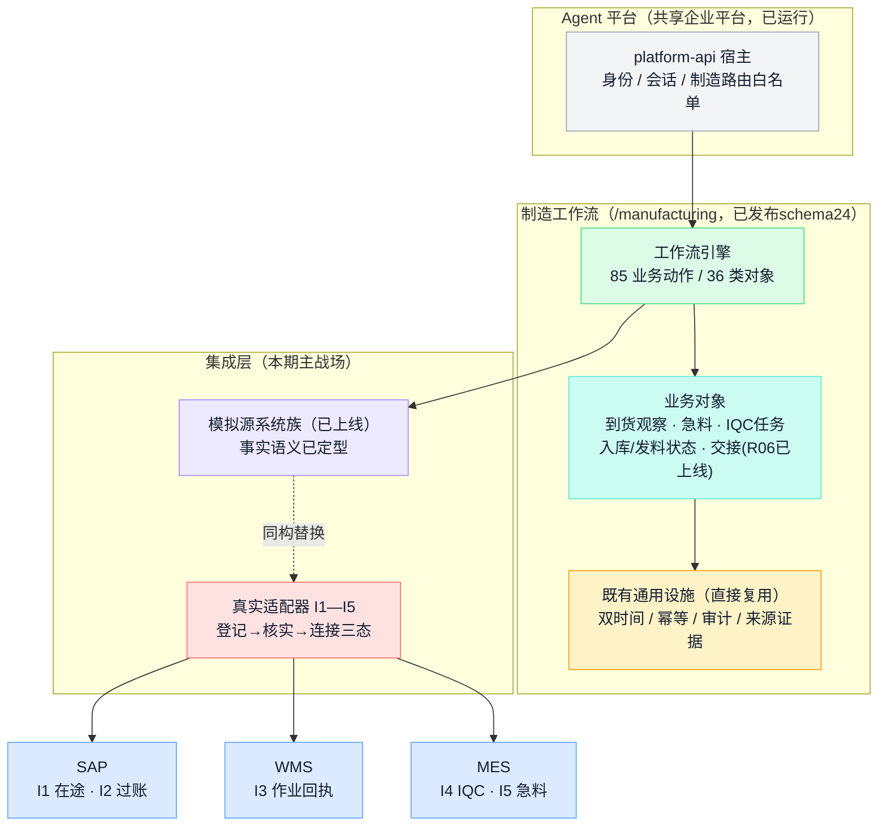
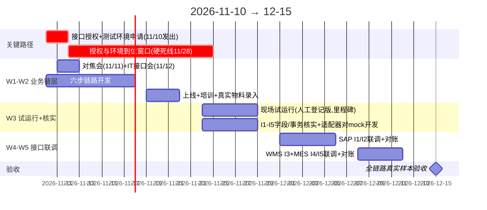

# 平台开发启动计划：2026-11-10 → 12-15，物料主线系统打通

日期：2026-11-09。本阶段目标：**12 月 15 日，物料主线的系统完全打通**——SAP/WMS/MES 的真实事实自动流入平台，急料从到货到上线全程在真实数据上可见、可追责、可对账。OEM 试点试运行（11 月底）保留为中途里程碑：它验证业务链形状，并为接口联调提供真实对账样本。前提：架构设计与开发为一人（Neo）＋ AI 结对；接口授权与源系统配合是关键路径，不是开发量。依据：[业务讨论](oem-ai-manufacturing-platform-discussion.md)（P01—P15、R01—R13）、[总体架构](manufacturing-platform-architecture.md)（§7 权威与共存、附录 B 批次路线）、[资料与权限对接清单](manufacturing-system-information-and-access-request.md)、[交接迭代复盘](oem-material-handoff-iteration-2026-11-03.md)、[模拟集成发布](release-it-mock-integrations-2026-11-04.md)、《OEM业务物料痛点.xlsx》。

本文件是**待确认的计划**；范围冻结以 11/11 对焦会与 11/12 IT 接口会纪要为准。

2026-11-09 开发修订：用户授权继续开发并以 mock 补齐尚未打通的系统。近期交付是“平台真实服务＋实际 HTTP 数据流＋未连接源系统的类型化 mock”，与 12/15 的真实外部接口目标分别验收。mock 来源和 manual 来源持续可见，不标为真实生产连接。

本轮 I1—I5 的 mock 覆盖、分阶段成功含义、R13 七项及真实接入门槛见[数据流与接口验证契约](material-dataflow-interface-contract-2026-11-09.md)。

2026-11-09 发布进展：按用户追加上线授权，急料与发料协同后端已发布（制造 `455fe48`、schema24、85 动作／36 类对象），既有平台与业务数据保留；前端及真实外部接口仍按各自范围验收。见[发布记录](release-oem-expedite-2026-11-09.md)。

---

## 1. 目标定义："系统完全打通"到底指什么

"打通"不定义清楚，12/15 就没法验收。本计划按**物料主线五条接口**与**三级深度**定义：

### 1.1 五条接口（范围）

| # | 接口 | 方向 | 替代的人肉环节 | 对应痛点 |
| --- | --- | --- | --- | --- |
| I1 | SAP 采购订单/在途 | SAP→平台（读） | 人工追踪到料计划 | P02 |
| I2 | SAP 收货/过账状态 | SAP→平台（读） | 账实靠人对 | P11 的核实基础 |
| I3 | WMS 收料上架/下架回执 | WMS→平台（读） | 入库/发料状态靠刷靠喊 | P10、P12、P13 |
| I4 | MES IQC 检验结果 | MES→平台（读） | 检验状态人工传递 | P08 |
| I5 | MES 工单欠料/急料 | MES→平台（读） | MC 人工整理急料表 | P03、P04 |

I1 须分供料模式核实：代采优先核实 SAP 采购与在途，SRM 可用后按其实际范围接入；客供计划来自客户，先以带来源的登记跟踪，不推断 SAP 已覆盖。客户供料计划未核实覆盖前，不宣称 P02 已全部解决。P04 的待检位置仍归 WMS 现状核实，I5 急料事实本身不建立库位。

### 1.2 三级深度（验收标尺）

| 级 | 含义 | 12/15 要求 |
| --- | --- | --- |
| **L1 事实流入** | 源系统事实自动进平台，带来源证据（谁的系统、什么时间、哪条记录） | **五条接口全部达到** |
| **L2 对账闭环** | 平台登记的业务动作与源系统回执核对，差异自动可见 | **急料主线跑通 ≥1 笔真实样本**（到货→IQC→入库→发料四段账实核对） |
| **L3 写回源系统** | 平台动作触发 SAP 过账/WMS 作业 | **本期不做**。P11"打单即过账"要先核实 SAP 事务配置才能裁定写回方式，贸然写回是账实事故源；列为 12 月下旬决策点 |

**12/15 验收口径**：五条接口 L1 全通＋急料主线 L2 一笔真实样本，且每条接口能按 R13 回答七件事——身份与授权、对象范围、成功含义、幂等、异常处理、对账方式、责任人。达到即为本阶段的"系统完全打通"。全公司十系统全对象打通不在本期承诺内。

### 1.3 三个明确不做

1. **不写回源系统（L3）。** 理由见上表；对账差异本期由人处置，平台负责让差异可见。
2. **不替代 WMS/MES/SAP，不双录。** 权威分工按架构文档 §7 逐对象裁定；接口打通后，此前人工登记的同类事实**停录**，由接口事实接管——双轨只允许存在于联调对账期（W4—W5）。
3. **AI 不进必经步骤。** 本期 AI 只做辅助呈现，分析逻辑是确定性规则。

---

## 2. 架构：打通落在什么上面

制造平台托管在公司 Agent 平台（agent.orbbec.com.cn）内；11-04 上线的模拟源系统族已经定义了"源操作→因果投递→消费回执→来源证据"的事实语义，**接口联调＝同构替换**：同一套事实语义，mock 源换真实适配器，对象详情的来源证据展示不变。这是五周单人能做接口的架构原因。

替换前必须单列生产只读接入规格：系统身份与授权、原始事实持久化、内部/外部对象映射、增量游标与重启恢复、历史导入、同事实重放与不同事实冲突、差异责任及人工停录切换。现有集成注册表只允许 demo/test；不能通过取消守卫或直接开放源操作实现真实连接，L3 仍不在本期范围。

状态验收分开：到货观察≠受控收货，IQC 出结果≠IQC 合格，IQC 合格≠WMS 上架，交接登记≠产线实收。本轮“已检验”责任待办只是 P10 的协同准备；真实入库提醒须以 I3 的 WMS 回执验收。

与架构文档附录 B 的对齐：本期＝**批次零（物料链路现状核实）＋批次一（物料闭环试点）做到真实接口完成态**。发布固定动作：每个新路由同步 Agent 平台宿主白名单，漏了用户报 403。

---

## 3. 关键路径：授权先行，代码让路

五周计划里唯一不受我控制的是**接口授权、接口文档/字段口径、测试环境**。公司有前科：EX001 测试环境晚到 18 天。所以：

- **11/10（第一天）**：按[资料与权限对接清单](manufacturing-system-information-and-access-request.md)发出 I1—I5 的接口授权与测试环境申请——这是全计划第一个动作，在写任何代码之前。
- **11/12**：IT 接口会，SAP/WMS/MES 接口人到场，逐条确认 I1—I5 的实际事务/表/接口形态、授权审批人、预计到位时间。
- **11/28（硬死线）**：授权与测试环境必须到位。到不了位即触发 §7 降级预案，并立即向上同步——那时距 12/15 还有 11 天，还来得及调整承诺。

授权等待期不空转：业务链层开发、试运行、适配器对 mock 先行开发（接口形态按 11/12 会议纪要仿真）都不依赖授权。

---

## 4. 五周日程

| 周 | 主线 | 出口判据 |
| --- | --- | --- |
| **W1** 11/10–14 | 授权申请发出（D1）；对焦会＋IT 接口会；开发到货观察/急料标识/IQC 任务/入库状态；R06 三样本现场验证 | 11/14 四步候选连通；两份会议纪要（范围冻结＋接口形态确认） |
| **W2** 11/17–21 | 发料状态＋等待分解看板；切换上线（含宿主白名单同步）；试点项目真实物料录入；四场培训各 30 分钟＋一页纸 SOP | 11/21 真实人员完成第一笔完整链路 |
| **W3** 11/24–28 | **双轨**：现场试运行（人工登记版，每日站会）‖ I1—I5 适配器对 mock 开发＋字段核实收尾；**11/28 授权硬死线** | ≥10 笔链路＋急料四段等待数据；适配器在 mock 上全绿；授权到位 |
| **W4** 12/1–5 | SAP I1/I2 切真实源联调：身份、幂等、异常、对账，用 W3 试运行的真实单据做对账样本 | I1/I2 达 L1，对账差异清单产出 |
| **W5** 12/8–12 | WMS I3、MES I4/I5 联调；急料主线 L2 全程走查（一笔真实急料，四段账实核对）；人工登记停录切换 | 五条接口 L1 全通；L2 样本跑通 |
| **12/15（二）** | 验收：按 §1.2 口径逐条过；每条接口 R13 七问留档 | 验收报告＋12 月下旬 L3 决策建议 |

单人纪律不变：会议集中排；每周四候选、周五切换；每日纪要防在手状态丢失。W4 起每条接口联调预留"接口人响应等待"半天缓冲——真实联调的节奏由对方日历决定。

---

## 5. 卷入的人（IT 从"知情"变"交付方"）

| 角色 | 人数 | 出场 | 缺席后果 |
| --- | --- | --- | --- |
| 业务发起人（可拍板者） | 1 | 11/11 对焦会、11/28 授权死线同步、12/15 验收 | 范围冻不住、授权推不动 |
| **IT 负责人（授权审批）** | 1 | 11/10 收申请、11/12 接口会 | **关键路径直接断** |
| **SAP 接口人** | 1 | 11/12 接口会＋W3 字段核实 2h＋W4 联调 2–3 个半天 | I1/I2 延期 |
| **WMS / MES 接口人** | 各 1 | 同上，联调在 W5 | I3—I5 延期 |
| MC 物控 | 1 | 对焦会＋W3 每日使用＋W5 急料样本确认 | 急料口径对不上 |
| 仓库主管＋收料员 | 2 | 对焦会＋培训＋W3 实操 | 链路起点断 |
| IQC 工程师 | 1 | 同上 | 检验状态进不来 |
| 产线组长/物料员 | 1–2 | 培训＋W3 实操 | 最后一米断 |
| 开发（Neo＋AI 结对） | 1 | 全程 | — |

与上版计划的最大区别：**SAP/WMS/MES 接口人不再是"来一次会即可"，而是 W4—W5 的联调交付方**，每人约 3–4 个半天；这个成本要在 11/12 接口会上当面锁定到对方日历。

---

## 6. 试运行（11/24–28）作为中途里程碑

试运行的痛点映射见附 C（14 条 ↔ P01—P15 的 ●/◑/○ 分类）；三项判据：**≥10 笔**真实物料走完六步链路、**≥3 笔**急料四段等待（到货/身份/检验/仓配）可分解、MC 人工通知次数有前后对比。试运行只登记事实与状态，不产生库存、合格量、预留或过账。在本计划中它的角色为两个：

1. **验证业务链形状**：接口打通前，先证明六步链路的字段口径、责任划分在现场站得住——否则接口联调会把错的口径自动化。
2. **生产对账样本**：W3 人工登记的每一笔，就是 W4—W5 真实接口的对账基准（同一单据，人工记录 vs 接口事实，差异即适配器缺陷或口径错误）。

---

## 7. 风险与降级预案

| 风险 | 征兆 | 预案 |
| --- | --- | --- |
| **授权/测试环境晚到（头号风险，有 18 天前科）** | 11/28 未到位 | 分系统降级：哪个系统到位先联调哪个；12/15 验收改为"到位系统 L1＋未到位系统适配器对 mock 全绿＋授权阻塞责任留档"，提前两周向上同步，不临期才说 |
| 接口形态与预期不符（如 SAP 无现成接口只能导表） | 11/12 接口会或 W3 核实发现 | 定时拉取文件/中间表也算 L1（事实自动流入即可），实时性降级记录在接口档案；不为实时性临时造中间件 |
| W1 业务链开发超限 | 11/14 四步未连通 | 砍发料状态（P13 降级），保到货→急料→IQC→入库→交接；接口范围不动 |
| 接口人日历约不上 | W4 联调响应超一天 | 升级到 IT 负责人；单接口联调压缩为"一次 2h 共同在线＋异步对账单" |
| 现场弃用（双录感） | W3 登记量趋零 | 当天到现场跟班，砍字段到最少必填；并向现场明示"12 月接口上了这几步就自动化" |
| 单人突发 | — | 每日纪要＋周四候选节奏，任意一天中断可恢复 |

降级的底线承诺：**12/15 无论授权情况如何，业务链层在现场真实运行、适配器全部存在（对 mock 或对真实源）、每条接口的 R13 七问有书面答案**——差的只是"真实源"三个字，且责任在哪一环清清楚楚。

---

## 8. 12/15 之后（本期只登记）

1. **L3 写回决策**：基于 I2 核实结果裁定 P11"打单即过账"的改造方式（WMS 先发料再扣账是原表建议，需 SAP owner 裁定）。
2. **扫码/PDA 驱动**：人工登记换扫码事实，先确认不与 WMS/PDA 重录。
3. **卡控与制度**：P05/P06 绕行，系统卡控与例外批准制度一起定。
4. **第二项目复制＋批次二**：版本—工程导入—质量链路，按架构文档附录 B 推进。

---

## 附 A：对焦会（11/11）议程草案

1. 痛点表 14 条逐条过映射，确认 ●/◑/○ 分类，○ 类当场转交（30 分钟）
2. 冻结六步链路字段口径：急料定义与标记权、IQC 优先级规则、入库推送对象（30 分钟）
3. R06 三样本现场验证：准确接收/短收错位/同批分笔（45 分钟，仓库现场）
4. 确认试点项目、W3 排班、11/21 培训时间（15 分钟）

## 附 B：IT 接口会（11/12）议程草案

1. I1—I5 逐条确认：源系统实际事务/表/接口形态、字段清单获取方式、测试环境、授权审批人与预计到位日（60 分钟）
2. 锁定接口人 W3 核实 2h 与 W4/W5 联调半天场次到日历（15 分钟）
3. 转交 ○ 类痛点（P09 库位模型、P11/P12 账实衔接）并明确"12 月下旬 L3 决策需要 SAP 事务配置核实结果"（15 分钟）

产出：接口档案五份（每条接口一页：形态、字段、授权状态、责任人、到位日）——这是 R13"登记"态的首批登记。

## 附 C：痛点映射（xlsx 14 条 ↔ P01—P15）

xlsx 行号有两个"9"，分别对应 P09、P10；会议统一用 P 编号。●＝业务链层核心（5 条）；◑＝留痕/接口覆盖（9 条）；○＝转交不做（1 条）。**转交不是遗忘**：○ 类在验收报告中列明去向，向提出人回话。本计划与上版的区别：P02/P10/P11/P12/P13 中接口可解的部分，已进入 §1.1 的 I1—I5 范围。

| xlsx 行 | 痛点 | P 编号 | 处理 |
| --- | --- | --- | --- |
| 1 | 送货地点/单据异常无法收货 | P01 | ◑ 到货观察异常留痕；物流规范属制度，转业务 |
| 2 | 客供到料计划不准，人工追踪 | P02 | ◑→I1：到料计划登记＋SAP 在途自动核销 |
| 3 | 仓库急料信息靠 MC 人工传递 | P03 | ●→I5：急料标识→仓库任务，接口期自动化 |
| 4 | 待检区无库位，找料难 | P04 | ◑ 暂存位文本字段；库位主数据属 WMS，转 IT |
| 5 | 客户带料上线绕系统 | P05 | ◑ 例外留痕；卡控需制度配套，12 月后立项 |
| 6 | 生产直接拿料不经仓库 | P06 | ◑ 同 P05 |
| 7 | 无编码不能入库，借料生产 | P07 | ◑ 无码留痕＋建码待办；建码在 SAP，不代建 |
| 8 | IQC 急料信息靠 MC 传递 | P08 | ●→I4：急料标识→检验优先级 |
| 9 | 一库位一批次，找料难 | P09 | ○ WMS 库位模型问题，转 IT |
| 9' | 产线不知入库信息，靠刷/靠喊 | P10 | ●→I3：入库状态自动推送 |
| 10 | SAP 打单即过账，账实脱节 | P11 | ◑→I2 核实基础；改造方式属 L3 决策（§8） |
| 11 | 人工扫描漏下架 | P12 | ◑→I3：下架回执与登记对账可暴露漏扫 |
| 12 | 配料进度不透明 | P13 | ◑→I3：四状态（打印/作业/回执/过账）逐步由接口喂 |
| 13 | 手工交接不知是否领走 | P14 | ● 已交付（R06，11-03 上线），W1 现场验证 |
| 14 | 手工交接难定位物料 | P15 | ● 已交付（R06），同上 |
