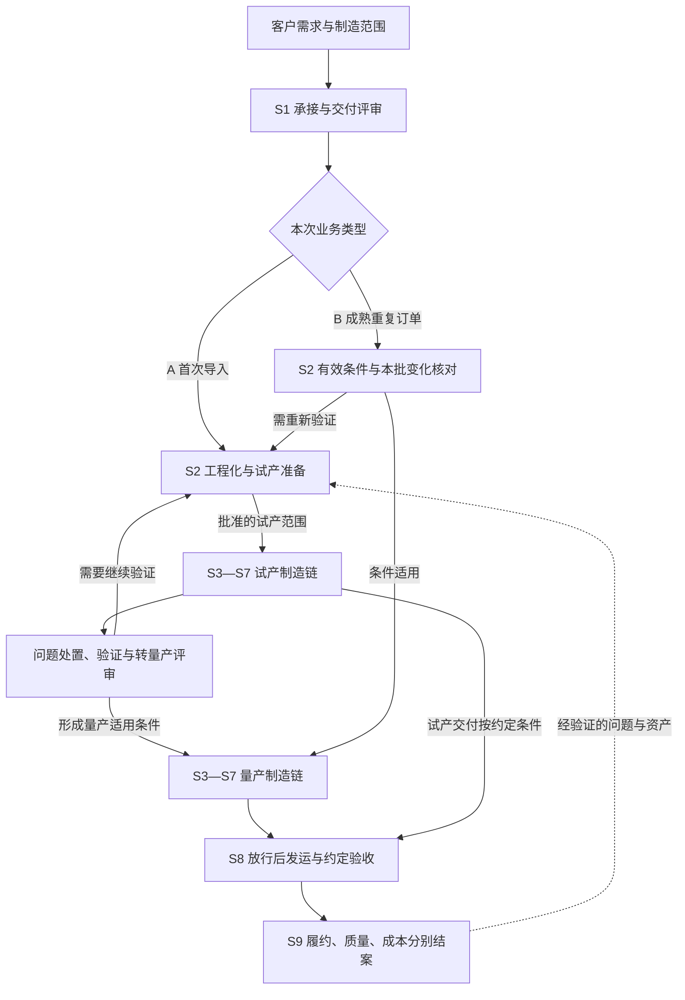

# 机器人 OEM 项目现状与物料协同需求底稿

日期：2026-11-11。状态：产品讨论稿，尚未冻结需求与实施范围。

页面、岗位状态与分批重构方案见[物料协同工作台设计](../superpowers/specs/2026-11-11-robot-oem-material-workbench-design.md)。MES 联调采用本轮用户指定的测试环境 http://10.10.80.177，凭据只保存在本机私有配置；连接与业务数据尚未实测。

首期围绕**当前已承接的机器人 OEM 项目**，让负责人和现场岗位掌握项目现状、判断物料是否满足计划、识别急料、推动 IQC 接手，并追到仓库发料后的线边实收。用户已明确这些是急迫场景。首期从项目的实际在制状态接入，不要求先重新走完承接和导入流程。

业务面向机器人 OEM **代工代料**，同时覆盖两类业务：A，客户已有样机与设计资料，由我方完成制造工程化、试产验证并转入量产；B，成熟产品与制造工艺的重复订单，由我方采购、生产、测试及交付。两类范围及 MRP 属于 SAP 内部能力，由本轮用户明确。

本文沿用已有 S1—S9 流程和 R01—R13 需求编号。第1节定义本轮首期场景；后续完整流程为需求关联及扩展背景。急料判定、岗位接手和寻料办理规则为本轮产品提案，具体岗位权限和时限结合现行业务规则确定。

## 1. 首期项目现状与物料闭环

### 1.1 用户每天需要得到的五个答案

| 场景 | 用户要完成的事 | 产品必须给出的结果 |
| --- | --- | --- |
| 看项目现状 | 负责人了解当前订单和在制进度，判断哪些计划有风险 | 交付承诺、计划与实际数量、当前工单、物料/版本/资源/质量阻断，以及每项事实的更新时间和缺失情况 |
| 判断物料储备 | 计划/MC 判断指定工单、工序及数量的剩余需求能否按时满足 | 需求与实际可用、已分配、预计供应、检验及到线状态逐项核对，明确缺口和影响，避免只看账面库存 |
| 识别和推进急料 | MC 找到影响当前或临近生产的缺口，组织对应岗位处理 | 急料原因、需要时间、影响工单与数量、当前卡点、责任人、预计完成时间和解决条件 |
| 让 IQC 接手 | IQC 知道哪批物料影响什么计划，安排实际检验并反馈 | 关联实际到货/检验对象的协同待办，区分通知送达、人员接手、检验进展和有效结果 |
| 发料后找得到 | 仓库、物流和产线明确物料到了哪一步；缺少接收时能追查 | 同一发料对象的分笔数量、最后确认节点/位置/经手人/时间、待接收与差异、明确的追查责任和处理结果 |

项目总览可以下钻到工单，再进入具体物料及其流转记录；岗位待办也能直接进入同一对象。原始事实、分析结论和下一步任务相互关联。看见问题后能交给人办理，接手人能回到同一事实继续工作。

### 1.2 如何判断物料是否齐全

判断范围明确到项目、工单/工序、适用版本、计划数量和需要时间，以尚未满足的物料需求为依据。已消耗、已分配和剩余需求需要对应，避免生产已经消耗的料再次被当成缺口。

| 核对内容 | 用户应看到什么 |
| --- | --- |
| 需求依据 | 生效 BOM/工单组件、需求及剩余数量、单位、需要时间；替代料适用批准 |
| 现有储备 | 物料、批次、地点、所有权和质量状态；账面量与对本单可用量的区别 |
| 分配与占用 | 已分配给本单、已被其他需求占用、尚未明确归属的数量；共享库存不重复承诺 |
| 后续供应 | 采购及供方承诺、预计到货、检验与仓配完成预期，分别标明来源；预计供应保留为预计 |
| 到线事实 | 实际发出、物流接手、线边接收及差异数量；缺记录时显示待确认 |
| 结论与影响 | 按核实规则满足的范围、剩余缺口、最早影响的工单/工序和需要时间，以及待补证据 |

质量状态、分配状态和流转里程碑是不同维度，不能直接相加。例如，已合格数量可能包含已预留量，发料与线边实收可能是同一批物料的前后记录。数据不足时，对相应物料显示“待核实”及缺什么，不能以零缺口或绿色齐套表示未知。

仅在需求、状态、数量及可用时间足够完整时，按业务认可规则判断可支持的料套/生产数量；实际开工仍核对版本、人员、设备、测试等其他条件。SAP MRP 结果、MES 欠料和到线缺口分别保留来源与含义。

### 1.3 急料如何形成和解除

**本轮建议的判断原则**：物料无法在已确认的生产需要时间前，以适用数量、质量和到线条件满足需求，或已实际阻断生产，即应进入急料判断和处置。缺口及时间影响是依据，不固定套用“缺料即急料”或“提前几天一律急料”。

- 保留现有 MES 急料标识、MC 人工标急及其原因；系统依据需求时间和供应状态给出风险建议，来源分别可查。
- 数量尚有缺口但按有依据的供应计划可及时满足时，继续跟踪缺口；已逾期、预计无法及时满足及现场停线分别说明影响。
- 需要时间、可用时间或数量不完整时，分派核实任务；信息不全不能推断“不急”。人工紧急处置仍可保留事实和理由。
- 急料记录关联需求、工单、物料、缺口/影响数量、需要时间、当前卡点、责任人与处理进展。多个需求竞争同一物料时，分配和优先级由有权岗位确认。
- 按同一工单的适用解决条件核实数量、质量、分配与接收，保留剩余未满足部分。误报、取消或需求替代可有原因关闭；通知已发、IQC 已检或仓库已出料均不单独证明实际缺料已解决。

### 1.4 急料怎样交给 IQC

MC 识别急料后，IQC 可以提前看到检验需求和影响；在实物到货且检验对象可核实时，关联具体收货批次及现行检验单，进入可执行的检验协同。MES 已有检验任务时直接关联，不要求 IQC 重建同一份检验记录。

1. **交到岗位**：待办展示项目/工单、物料及批次、待检数量、需要时间、影响、实际待检位置及可联系的现场人员；缺少身份或位置先交给相应岗位核实。
2. **明确接手**：IQC 由实际有权人员接手或按现行职责分派，记录预计检验完成时间。通知送达和接手分别可见；对象不符或无法办理时，说明原因并返回处理。
3. **办理并反馈**：显示检验中、阻断及实际结果，合格、不合格、待处理数量分别引用正式记录。急料不降低检验标准，也不自动取得质量批准。
4. **传到下一岗位**：结果更新通知仓库及 MC，产线可查看对该工单的影响。合格后继续跟踪上架、可分配及到线状态，部分合格保留剩余任务。
5. **跟进滞留**：待接手或预计无法赶上需要时间的任务，交给对应负责人协调。提醒与升级时间采用现行排班和响应规则，不凭空设定固定小时数。

平台待办作为可追问的办理记录。企业消息渠道承担提醒时，关联同一对象并按实际可用通道接入；消息渠道不能代替人员接手和正式检验结果。

### 1.5 仓库已出料，线边没收到，怎样追查

先核清“出料”的依据：打印、SAP 过账、仓库实际拣配/交出以及接收回执分别呈现。实际流转按有证据的节点关联：**仓库实物交出 → 物流领取 → 线边送达 → 指定接收人实收**。现场若采用直接交接，按实际路径记录，不强制新增物流步骤。

对每笔物料数量保留最后确认节点、位置、经手人、时间和凭据，并显示期望送达位置及未完成接收。计划目的地与实际位置分别表达；一批多次分发、分笔签收时分别追踪。

出现缺少接收、短收、错位或双方记录不一致时，按下面的流程办理：

1. 展示“仓库已交出，物流领取未确认”或“物流已领，线边实收未确认”等准确断点，同时显示缺少或不一致的数量。
2. 形成关联原发料/交接对象的追查任务，指定按项目规则负责的物料协调人员，并联系最后经手岗位与预期接收岗位核对。**追查负责人和实物保管人分别记录**；没有保管证据就显示待核实。
3. 对照作业、交接、实际单据及现场实物，记录找到的数量、实际位置、核实人和核实时间。补录保留实际发生与登记时间，不能改写原交出或实收事实。
4. 由当前有权的接收人确认相应实收；部分找到保留剩余追查。误关联、退回、转交或真实缺失形成对应处置及凭据。
5. 依据实物核实、接收及差异处理结果关闭该项追查。持续找不到时保留差异、工单影响与责任跟进，不能靠补写签收或库存调整使页面变绿。

本产品可保证已取得证据的去向可追问；没有定位设备或当前确认记录时，展示最后确认位置及其时间，不声称实时知道物料所在位置。

### 1.6 与原始痛点逐项对齐

已只读核对[原始痛点表][painpoints]的“问题痛点”工作表，F 列为问题，I 列为原改善建议。共15条非空问题，原编号“9”重复，沿用既有 P01—P15 映射。

| 首期需求 | 原始单元格与问题编号 | 对应的办理闭环 |
| --- | --- | --- |
| 到货与供应异常可追问 | F3/F4，P01/P02 | 单据或地点异常有人处理；计划承诺和实际到料分别跟踪，代采与客供责任分开 |
| 急料传到仓库和 IQC | F8/F19，P03/P08 | 同一工单缺口进入岗位待办，明确接手、办理和反馈 |
| 待检和仓储物料可定位 | F9/F24，P04/P09 | 实际位置及来源可查；库位模型改动按现有能力核实，原表“一库位多料”仍是候选建议 |
| 绕库和无身份来料可留痕 | F10/F11/F12，P05/P06/P07 | 身份、来源及责任核实；例外处理不虚增库存或合格量 |
| 入库及配料状态传到产线 | F34/F41，P10/P13 | 来源变化更新同一工单料况和下一动作，减少 MC 重复传话 |
| 发料作业与原账能核对 | F35/F40，P11/P12 | 打印、实物作业、回执、过账四状态及差异；不直接把原表建议变成 SAP 事务改造方案 |
| 领料及线边接收可追查 | F45/F49，P14/P15 | 最后确认节点、分笔数量、接手/实收、寻料与差异处理 |

### 1.7 首期必须走通的业务样本

| 样本 | 验收要点 |
| --- | --- |
| 同一物料供多个工单，部分已占用 | 同一数量不重复计入多个工单可用量；缺少分配依据时明确待核实 |
| 账上有料，但待检、冻结或身份不明 | 分别指出为什么不能按当前需求使用，数量和责任可追问 |
| 普通缺口、预计迟到和已停线急料 | 保留需要时间、预计可用及来源，说明不同影响；缺时间信息时不判为无风险 |
| 急料尚未到厂，随后到厂待检 | IQC 可提前准备；实际检验关联到货对象，通知、接手和结果分别保留 |
| IQC 未接手、检验受阻或部分合格 | MC 能跟进当前卡点；合格数量传给仓库，剩余未解决数量继续可见 |
| 单据已打印/已过账，实际交出未确认 | 准确显示作业待核实，不能仅凭原账认定物流已领或线边已收 |
| 仓库实物交出，物流领取无确认 | 展示最后确认记录及缺失环节，能指定追查并留下现场核实结果 |
| 物流已领，线边未收；查到部分物料 | 找到的数量、实际位置和接收有据，剩余差异继续追查；不得替接收人签收 |
| 正常实收或更正误关联 | 各岗位能追到同一需求和原始记录，相关追查按条件关闭，工单料况依据事实重新核对 |

A/B 全流程设计继续保留，首期以这些当前项目场景决定数据和交互优先级。具体页面、消息渠道、标急权限和跟进时限在对应场景细化时裁定，不重开已明确的业务范围。

## 2. 已有依据与业务边界

| 业务基线 | 依据 | 对产品需求的约束 |
| --- | --- | --- |
| 我们做 OEM 代工代料，客户提供产品定义，我方负责制造与采购 | 用户本轮明确；[业务设计 §1.1][business] | 需求必须覆盖供应计划、采购跟进、收检入库、生产消耗与损耗核对，不能只覆盖组装 |
| 客户保留设计决策与批准权，我方提出 DFM 建议并组织制造 | [业务设计 §1.1、§9][business]；[手册 §6][handbook] | 客户设计批准、厂内制造批准和质量放行分别记录 |
| 客供料、客户直接带料属于合同约定的例外 | [业务设计 §1.1][business] | 主旅程按代料展开，例外记录所有权、身份、检验及损耗责任 |
| 首次导入与成熟重复生产共享制造主线，进入条件不同 | 用户本轮明确；[流程总览“业务入口与承诺程度”][process]；[机器人全流程 §8][lifecycle] | A 需要导入及验证；B 核对有效条件，不机械重走全部 NPI |
| 物料跨岗位断点已有 P01—P15 报告 | [业务设计 §3.2][business]；[修订交接单 §4.4][handover] | 覆盖缺单、无码、急料、待检定位、配料、交接及账实差异；不直接把原改善建议定为 SOP |
| EX001 汇总记录了后段达成不足、物料及测试准备问题 | [OEM 汇报转存第5—6页][presentation] | 准备检查包括适用的测试与老化环境；试产问题必须关联证据并回流 |
| 现有 MES 已有 SN、组件追溯、检验和隔离能力材料 | [业务设计 §2.2—2.3、§14.5][business] | 单台档案应贯通已有事实，不能以“现有系统只有批次”为建设前提 |
| 现有软件、真实接口与现场使用是不同状态 | [产品设计“实现状态”][product]；[交接复盘][handoff] | 需求成立不等于软件已实现，软件通过测试不等于生产业务已验收 |

EX001 的 89 项问题和 40 站排布在现有材料中有汇总，逐条原始明细及完整工站定义尚未取得。它们支持导入、测试准备及问题复用的需求方向，不能据此生成未经核实的 89 条检查项或固定所有机器人都走 40 站。

## 3. 产品要帮助用户完成什么

项目负责人应能解释这笔订单的交付承诺是否仍有依据，以及当前缺什么、影响哪些数量、下一步由谁处理。岗位人员应从具体对象接手工作，完成后留下下一岗位可以继续使用的结果。工程与质量应能回答一台机器实际使用哪个配置、装过哪些组件、经历哪些测试标定及处置，凭什么允许交付。依据：[业务设计 §6—7][business]、[交接复盘“整体 OEM 产品”][handoff]。

对产品组织方式，已有设计比较过三条路径：[业务设计 §13.1][business]。

| 路径 | 能提供的结果 | 取舍 |
| --- | --- | --- |
| 跨系统协同与明确缺口建设，作为本轮推荐基线 | 在统一事实基础上处理准备缺项、岗位交接、异常、交付与经验复用 | 对应已有业务问题，保留既有执行能力；需要明确每类动作的承担方 |
| 统一查询与 AI 入口 | 查状态、报表与资料 | 可改善查找，岗位接手与业务处理仍要另外完成 |
| 逐领域改造或新建执行能力 | 解决核实后的执行缺口 | 涉及现场作业、设备、迁移和运维，按领域另外论证 |

本轮先设计业务结果和办理闭环；具体接口、字段、数据库及设备协议由后续实施设计承接。

## 4. 两条业务旅程

### A. 从客户样机到可重复制造

客户委托与资料交接 → 承接评审 → 工程化与试产准备 → 实际试产 → 问题处置与验证 → 确认量产适用条件 → 按订单组织量产与交付。

实际试产自身使用完整制造链：需求与供应计划 → 采购及备料 → 收货检验 → 配料与开工 → 装配与过程控制 → 测试标定与放行。每轮绑定实际资料修订、工单、试产对象和证据。阶段名称按项目约定采用，不强制每个客户完整套用 EVT、DVT、PVT。

进入量产的依据是适用问题的处置及验证、制造和测试准备、有效版本和相应批准。进入试产的依据是已批准的试产范围及该范围的准备条件，不能把尚未取得的量产资格反过来作为试产前提。依据：[手册 §6][handbook]、[产品设计“制造导入”][product]、[机器人全流程 §8][lifecycle]。

### B. 从成熟产品到重复交付

收到重复订单 → 核对有效产品配置、已有制造资格及本批要求 → 供应与产能核对 → 采购备料 → 生产与测试 → 放行与分批交付 → 验收及结案。

复用的是有适用范围和版本的已批准条件。本批仍须核对变更、物料、资源、测试与首件要求；涉及需要重新验证的变化时，按影响范围进入 A 的验证环节。依据：[流程总览“业务入口与承诺程度”][process]、[机器人全流程 §8][lifecycle]、[产品设计“资料与版本”][product]。

制造链不是完全串行的日程表。工程准备、长周期采购及资源准备可按各自批准范围并行，依赖条件须可查；受理询价不自动授权采购，预测备料须有授权和风险归属。

## 5. 串起旅程的业务对象

| 对象 | 用户需要回答的问题 | 与其他对象的关系 |
| --- | --- | --- |
| 客户项目 | 为谁承接什么，双方责任是什么？ | 关联客户、产品与承接条件，可承接多笔订单 |
| 产品及受控制造配置 | 这一型按什么定义制造？ | 客户版与厂内版映射；BOM、工艺、固件、测试程序与限值、标定流程分别有受控版本 |
| 订单与交付安排 | 要交多少、何时交、何处验收？ | 保留原始与变更承诺，可分批交付 |
| 生产工单 | 这一批按哪个配置做多少，准备是否满足？ | 引用适用配置及需求，关联用料、资源、执行和 SN |
| 物料、批次与供应记录 | 缺什么、何时到、现在在哪、能否用于本工单？ | 关联采购、收货、质量、库存、分配和交接；数量保留单位、状态、所有权及时间 |
| 整机与组件 SN | 这一台实际做成了什么样？ | 关联实际配置、组件装拆有效关系、测试、标定、放行及交付 |
| 问题、变更与岗位待办 | 什么阻止下一步，谁接手，如何完成？ | 必须关联受影响对象、处置依据、责任、时限和完成条件 |

这些是产品关联关系，不预设全部在平台新建主数据。采购物料批次、生产工单和发运批分别表达。标定流程及算法是版本对象，单台实际参数及回读是该 SN 的事实。依据：[手册 §5—13][handbook]、[产品设计“资料与版本”“测试与标定”][product]。

## 6. 用户旅程与岗位交接

以下角色表示业务职责，具体员工、部门名称和批准权限沿用企业及项目实际授权。

### J01 项目负责人接住客户委托

**入口**：一笔询价、试产委托、正式订单或滚动预测。

1. 核对客户、产品、数量、期望交期、资料修订及需求的承诺程度。
2. 组织工程、计划采购、制造、质量核对可制造性、关键料、产能、测试准备及验收要求。
3. 记录承诺依据、报价与结算约定、采购及损耗责任、追溯等级、数据交付范围，以及未决条件的责任人与期限。

**交给下一岗位**：明确范围的承接结果、A/B 类型及有来源的条件清单。询价可继续评估；试产及采购动作须有相应授权。有条件承诺持续显示条件，需求改期、取消或增减保留原始承诺并评估已采购、在制和交付影响。

**依据**：手册 §5；流程总览“业务入口与承诺程度”；R01。

### J02 工程把客户定义变成工厂可执行条件

**入口**：A 类导入；B 类的有效条件核对；或受影响的变更。

1. 按制造范围核对资料包：BOM、图纸、固件、工艺输入、检验与测试要求、标定要求，以及合同约定资料。
2. 建立客户版与厂内版映射，形成适用 MBOM、路线、SOP、测试规范、限值、程序和工装要求。
3. 采用经过验证且适用的检查项进行评审；DFM 发现引用准确资料，由客户作设计处置。
4. A 类形成试产范围及准备条件；B 类记录原条件是否继续适用，变化是否需要验证。

**交给下一岗位**：可执行的受控配置、适用批准、未决问题及试产/量产准备要求。厂内批准不代替客户设计批准；升版不覆盖已有工单和 SN 的实际历史。

**依据**：手册 §6；产品设计“工程与导入”；R02、R11。

### J03 计划与采购把需求变成有依据的供应和生产安排

**入口**：已授权的订单、试产需求或预测备料范围，以及有效物料与产品定义。

1. 核对需求来源、范围和时间，识别预测与订单的重复计算风险。
2. 引用 SAP 内 MRP 的需求、供给、建议及例外结果，保留对应范围和时点。平台不另用简化公式冒充现行 SAP 计算。
3. 核对采购需求是否已形成采购执行、供应商确认交期及预计到货，识别逾期与部分到货；供应商回复保留来源。
4. 同时核对生产、测试、标定与老化资源，形成排产依据。缺料及瓶颈分派到责任岗位，必要时重评交付承诺。

**交给下一岗位**：工单相关的物料需求、供货安排、计划与实际差异，以及责任明确的缺口。采购建议、采购订单、供方承诺、实际到货分别呈现。客供例外的催办对象为客户接口人，不混入代采供应商催料。

**依据**：业务设计 §1.1、§7、§9；手册 §7；R03、R04。采购跟进是本轮对代工代料旅程的明确展开。

### J04 仓储与 IQC 把到厂物料推进到适用状态

**入口**：实际到货，关联采购、物料需求及预计收货信息。

1. 仓储核对物料、单据、数量、批次及位置；无编码、缺单或带料先留痕并交给身份核实责任人。
2. 正式收货后，IQC 接到对应检验对象、适用标准和急料影响，记录实际检验及处置数量。
3. 仓储依正式检验及作业条件完成相应上架、定位和库存处理，原账回执独立核对。

**交给下一岗位**：身份和状态可核实的数量、位置、所有权、来源及时间。部分合格、待检和冻结分别保留；到货观察不生成库存，检验结果不直接证明已上架或已可分配。

**依据**：P01、P04—P09；手册 §8；R03、R07。

### J05 MC 推进一项缺料，直到满足该工单的解决条件

**入口**：有实际需求和工单影响的缺料，包含数量、单位、需要时间及来源。

1. 查看当前卡在采购到货、身份核实、检验、仓储作业、分配还是交接。
2. 将可办理的任务交给采购、仓储、IQC、物流或产线；接手人能看到同一需求、当前事实与期限。
3. 从岗位处理进入状态核对，按实际数量、适用质量、分配及接收要求确认该项是否已解决。

**交给下一岗位**：更新后的物料条件和剩余缺口；未解决部分继续有人负责。到货、检验完成、上架和签收分别是里程碑；任一单独发生都不自动表示整单齐套，急料任务关闭也不自动产生生产许可。

**依据**：P03、P08、P10、P13；交接复盘“事实边界”；R04。

### J06 仓库、物流和产线完成配料交接并核对开工条件

**入口**：明确版本与数量的工单及其物料需求。

1. 仓储办理实际配料，分别核对打印、实物作业、回执和 SAP 过账；部分完成与差异独立保留。
2. 物流及产线办理交接；指定接收人核对交出与实收数量、位置和时间。数量或位置不同，进入差异处理。
3. 生产负责人核对版本、物料、人员资格、设备工装、测试与老化等适用准备条件，以及本批首件要求。

**交给下一岗位**：满足适用开工条件的生产任务，或可追问的阻断及责任人。交接登记只证明交接事实；正式作业与生产许可由相应承担方确认。管理员不能替指定接收人签收。

**依据**：P11—P15；手册 §9；交接复盘；R05、R06、R07、R08。

### J07 生产与工程完成装配，并处理在制异常

**入口**：允许执行的工单、准确作业版本与实际物料。

1. 操作人员按适用工艺执行，记录 SN、组件、物料批次、工位、人员、设备工装及时间等要求的履历。
2. 缺料、资源、制程或质量异常关联实际在制对象，责任岗位接手，保留停留与恢复依据。
3. 替代、拆换及返工按批准范围执行，保留原装配和失败历史；换件后的复测及重标定范围按适用规范裁定。

**交给下一岗位**：实际制造状态、用料与装配关系、异常处置及待完成测试要求。不得用计划进度或人工勾选代替工序完成事实。

**依据**：手册 §10；产品设计“工单与执行”；机器人全流程 §12—14；R02、R07、R09。

### J08 测试与质量证明这一台是否满足放行条件

**入口**：适用 SN、测试与标定规范、程序限值、设备工装和执行上下文。

1. 执行产品适用的测试及标定，关联测量、曲线或日志等实际证据，保留程序、限值、固件与算法版本。
2. 标定参数关联实际 SN，写入、匹配回读及适用复测分别确认；失败、中断、无效和缺失分别呈现。
3. 不合格转入隔离及处置；返工后重新测试，原尝试保留。质量核对适用证据和冻结状态，形成放行结论。

**交给下一岗位**：可放行范围与依据，或明确的阻断。测试通过、制造批准、质量放行及合同适用的客户前置批准独立记录。具体四级测试或工站数按客户与机型裁剪。

**依据**：手册 §11；OEM 汇报第10页；产品设计“测试与标定”；R07、R08、R09。

### J09 项目、质量与物流交付准确的机器和数据

**入口**：待履约订单、拟发 SN、放行状态，以及合同约定的包装和数据要求。

1. 核对本批可发数量、箱—SN—订单关系及适用客户前置批准；数据包逐项关联厂内同源证据。
2. 完成包装、入库及发运的各自作业，记录实际发运，再跟进客户签收、约定验收及遗留项。
3. 分批交付持续保留已交和剩余数量；拒收、短装或有条件验收转入有责任人的处置。

**交给下一岗位**：准确的实际交付范围、数据交付凭据及尚未履行事项。缺失的数据明确列项，不能用文件链接存在推断客户已收到。客户验收位置按合同决定。

**依据**：手册 §12；业务设计 §9 的 R10；产品设计“订单与交付”。

### J10 项目、财务与质量分别完成结案和反馈

**入口**：交付、实际耗料和产出、返工报废、质量问题及合同结算要求。

1. 项目核对数量、验收及遗留项，形成履约结论。
2. 质量核对问题处置与验证，形成质量结论；售后反馈继续接回原 SN。
3. 财务及相关责任人引用正式采购、收货及财务记录，核对实际成本、代料采购与消耗、损耗和呆滞归属；采购单、收货与发票差异交给相应责任方，客供例外独立对账。
4. 工程将验证有效的问题整理为适用检查项、工艺或测试资产，经审核后供后续项目采用。

**交给下一岗位**：独立的履约、质量和成本结案记录，以及可用于下一项目的受控资产。不能以发运或工单关闭替代全部结案；B 类重复订单采用历史条件时仍核对适用性。

**依据**：手册 §8、§13；业务设计 §1.1、§22；R10、R11。成本按代工代料合同核对，财务核算及结算保留原承担方。

## 7. 贯穿 A、B 的事件旅程

| 事件 | 谁接手及如何走 | 完成时要留下什么 | 依据 |
| --- | --- | --- | --- |
| 客户改 BOM、固件、图纸或测试要求 | 工程登记正式依据，盘点采购在途、库存、在制、已交产品及资源，取得适用批准，裁定生效范围并组织接收 | 可重现的版本断点、旧料与在制处置、现场接收证据；需要重新验证时回 A | 业务设计 §21；R02 |
| 改期、增减量或取消 | 项目与计划重评承诺、采购、库存、在制及已交范围，按合同处理损耗和呆滞 | 原承诺、变化依据、处置责任与新承诺分别保留 | 手册 §5、§7；R01、R04 |
| 客诉或返修换件 | 质量从客户 SN 关联厂内档案，反查嫌疑组件或批次，再圈定在制、在库及已交范围；维修接回原履历 | 影响范围及查询截点、隔离处置、拆换历史、适用重标定和复测、重新放行 | 业务设计 §24；R07—R09 |
| 委外加工 | 采购、仓储及质量核对委外发料、在外数量、回货检验与损耗责任 | 发出、回货、在外余额及处置证据；所有权按原约定保持 | 机器人全流程 §17.3；属于已有流程支线，实际适用范围按项目 |
| 验证过的问题进入下一项目 | 工程审核适用范围和版本，发布方法资产，采用方独立核对及验证 | 原问题和验证依据、资产版本、采用与效果；客户资料保留原权限 | 业务设计 §22；R11 |

异常处理须明确“接手”和“验证完成”，消息发送或有人查看不是业务闭环。一个事件可同时影响工程、供应与交付，关联同一影响范围，避免各岗位各自维护互不相认的结论。

## 8. R01—R13 的产品需求展开

保留原编号以便与痛点、既有软件和后续实现核对。下表描述目标需求，不重用旧文档中的软件数量或把历史实现状态升级为现状。

| 需求 | 本轮明确的产品结果 | 关联旅程与来源 |
| --- | --- | --- |
| R01 承接与承诺 | A/B 业务类型、代工代料范围、承诺依据及未决条件可查；需求变更保留历史 | J01、J09、J10；业务设计 §1、§9；手册 §5 |
| R02 工程与变更 | 客户定义转制造配置；双版本、DFM、导入验证、适用批准和 ECN 生效范围可追问 | J02、J07、事件旅程；手册 §6 |
| R03 到货与身份 | 代采供应与实际到货关联；异常到货有承办人，正式收货、检验、上架分别有依据 | J03、J04；代料责任、P01/P04—P07、原 R03；采购跟进为本轮展开 |
| R04 计划、缺料与协同 | 引用 SAP MRP 及实际供应，关联工单和交付；缺口能交给责任岗位并按业务条件验证解决 | J03、J05；P02/P03/P08/P10/P13；手册 §7 |
| R05 配料及账实核对 | 打印、实物作业、回执、过账分别可查；部分作业和数量差异可办理 | J06；P09/P11—P13 |
| R06 交接确认 | 交出、实收、位置、双方及差异完整；一批分笔保留，待接收不冒充已到达 | J06；P14/P15；交接复盘 |
| R07 质量状态与放行 | 待检、冻结、处置、有效数量及解除依据传到受影响对象，适用放行独立记录 | J04、J06—J09；手册 §8—12 |
| R08 测试与标定 | 准备条件、运行、原始证据、程序限值、单台参数及匹配回读贯通 | J02、J08；EX001 测试准备教训；手册 §11 |
| R09 单台与批次履历 | 客户 SN、厂内 SN、实际版本、组件装拆、测试标定及发运可正反向查询 | J07—J09、客诉事件；业务设计 §14.5、§24 |
| R10 交付与结案 | 分批履约，箱/SN/证据对应；数据交付、签收、验收、遗留项和三类结案分别办理 | J09、J10；手册 §12—13 |
| R11 经验复用 | 已验证问题转受控资产，A 类导入和 B 类条件核对可采用，并独立验证适用性 | J02、J10；业务设计 §22 |
| R12 AI 辅助 | 在评审、缺料、变更、测试和复盘对象上整理依据及草案；计算使用明确规则，结论由有权人员核对 | 业务设计 §10；候选辅助能力，深度按评估决定 |
| R13 来源与协同治理 | 每类事实及动作可说明来源与责任；未连接、未知、失败和差异可见，越权不能办理 | 支撑全部旅程；业务设计 §9、§17—18 |

## 9. 用户在产品中如何接续工作

本轮交互提案沿用已有“工作台、项目上下文、业务台账和详情”的基础，先定义办理方式，导航布局另行细化。依据：[产品设计“工作台与导航”][product]、[交接复盘“整体 OEM 产品”][handoff]。

- **工作台**显示当前用户可以接手的待办与交付阻断，能进入准确订单、工单、物料、SN 或问题。
- **项目上下文**保留客户、产品、适用配置、订单承诺、A/B 制造场景及责任；可分别查看准备、供应、执行、质量和交付，不能用一个阶段百分比代替所有状态。
- **办理详情**首先说明发生了什么、影响什么、依据在哪里、下一步由谁完成；操作使用业务字段，复用已知对象和上一步输入。
- **接收方入口**能直接打开交给自己的对象，核对输入、办理或说明差异，保留上下文返回；交出方能看到是否被接手及尚缺什么。
- **单台档案**从实际 SN 聚合已有记录，显示覆盖和缺失；客户报告引用同源证据，按权限及合同确定可见范围。

同一来源事实无需在平台和原系统各录一次。原系统已承担的办理复用其入口和回执；平台承担的评审、责任跟踪及缺口办理保留自身记录。是否跳转、嵌入或在平台直接办理，在对象责任及接口确认后决定。

## 10. 用全流程业务样本验收需求

以下是待准备的走查样本，不是已执行结果；不给未经基线验证的工期、节拍、准确率或收益目标。

| 样本 | 用户必须走通的结果 |
| --- | --- |
| A 类首次导入，资料不完整 | 缺项回到客户或厂内责任人；能继续允许的准备，但不能把资料未决标成全部就绪 |
| A 类试产，测试或老化环境未就绪 | 对适用试产范围显示阻断、影响和责任；环境就绪后才能按条件推进，不能只勾选阶段完成 |
| A 类实际试产出现问题后转量产 | 问题绑定实际版本和对象，处置经验证；量产决定能引用证据，未解决项按批准规则处理 |
| B 类无实质变化的重复订单 | 能复用适用条件，不重复建立全套导入；本批物料、资源、首件与交期仍核对 |
| B 类订单发现需要重新验证的变更 | 保留原条件，按影响范围回到验证；已开工与未开工对象有明确处置，历史不静默换版 |
| 代采物料晚到或部分到货 | 从需求追到采购、供方承诺及实到数量，显示剩余缺口和交付影响，处理后可核实结果 |
| 来料无编码、缺单或客户带料 | 留下实物观察及责任，身份核实和正式处理有依据，不虚增库存、合格量或齐套量 |
| 部分合格、冻结或库存有占用 | 分状态及数量呈现；不能只因账上有数或 IQC 有结果就判定可用于该工单 |
| 配料已打印但作业或回执不全 | 四状态分别显示，差异有人承接，不把打印或账务状态替代实际发料 |
| 短收、错位或同批分笔交接 | 接收人核实，保留双方事实与分笔位置；签收不自动解除全部缺料或开工阻断 |
| 测试失败、换件及标定回读不符 | 原失败和装拆历史保留，按适用要求重标/复测，放行结论独立有据 |
| 分批发货、合同前置批准或有条件验收 | 仅发适用范围，剩余数量和遗留项继续跟踪；数据包与实发 SN 相符 |
| 客诉从客户 SN 反查并圈定影响 | 能关联原档案、嫌疑来源及在制/在库/已交范围，资料缺失明确显示 |
| 已验证问题在第二项目采用 | 方法资产有适用版本和验证，不泄露源客户资料；实际采用效果可核对 |

业务效果按已有指标框架记录：准备缺项的发现与处理、人工催办工作量、急料各段等待、交接差异、约定 SN 数据覆盖、交付达成及问题复发。每项明确对象范围、来源、截点、分母、基线和责任后再设目标。[依据：业务设计 §27。][business]

## 11. 本轮对旧资料的口径整理

| 原资料中的表达或状态 | 本轮处理 |
| --- | --- |
| 机器人范围、代料责任和首次/重复生产曾列为待明确 | 本轮以用户明确的机器人 OEM 代工代料、A/B 同时覆盖作为需求范围；首批客户与产线仍按实际项目确认 |
| 手册个别工单与结案段落使用“代工费口径” | 按已确认的代工代料覆盖材料采购、消耗、损耗及呆滞，结合实际合同核对；来料加工费口径只用于相应例外合同 |
| 旧总图把 NPI 画在 S3 计划之前 | 将其展开为含 S3—S7 的试产循环；试产同样需要实际供应、准备、执行和测试证据 |
| 旧急料场景图在“产线接收”后直接画“急料关闭、阻断解除” | 依据交接复盘，先核对本工单数量、质量、分配及适用接收要求；交接签收不自动证明齐套或生产许可 |
| 多份材料将仓储职责画成独立 WMS 系统框 | 产品继续表达仓储职责，不据系统框判断独立部署；当前接口定位与后续责任裁定单独核实 |
| 手册介绍了 MRP 标准机制和净需求简式 | MRP 明确为 SAP 内能力；现行企业参数、运行方式及可用量规则以真实业务证据为准，不把通识公式写成平台验收算法 |
| 汇报中的导入周期、复用率、标定节拍及组织预算 | 保留为原汇报目标和建议，不成为本轮已批准指标或计划 |
| P01—P15 原表编号有重复，启动计划标题曾写“14条” | 沿用业务设计及交接单的 15 条 P 编号，保留原表对应，不按编号重复删掉问题 |
| 旧发布记录、模拟链路和已实现对象数量 | 保留历史状态；本轮按产品结果设计，不据旧数字宣称当前现场覆盖或真实接入完成 |

## 12. 后续细化所需的证据

已有资料足以展开上述产品旅程。以下影响具体落地的内容由项目证据补齐，不把它们重新变成对已明确业务模式的猜测：

| 证据 | 谁提供或核对 | 用来确定什么 |
| --- | --- | --- |
| A 类导入与 B 类重复订单的实际资料、工单和交付记录 | 项目、工程、计划、质量 | 每段输入、适用批准、必需字段及真正的岗位交接 |
| 承接、预测备料、替代、让步和变更的现行权限及合同条件 | 项目、商务、计划、工程、质量 | 允许的动作、批准主体和例外边界 |
| 现行 SAP MRP 结果、采购及供应承诺样本 | 计划、采购、SAP 负责人 | 需求与供应关联、状态语义、现行计算范围及采购跟进来源 |
| 收货、IQC、上架、配料、交接及账务对应记录 | 仓储、IQC、物流、产线、IT | 每类事实的承担方、有效数量口径、完成条件与差异办理 |
| 产品适用工艺、测试标定规范及真实 SN 数据 | 工程、测试、质量、MES/产测负责人 | 路线与工站裁剪、参数回读、数据覆盖及放行依据 |
| 客户数据包与验收实例 | 客户接口、质量、项目负责人 | 必交内容、格式、截点、接收凭据及遗留项规则 |

首期业务重点已按用户明确收敛为当前项目现状与物料闭环。场景细化优先核对工单需求/需要时间、库存状态与占用、IQC 接手、发料及线边接收证据；原计划中的物料路线作为依赖参考，旧排期不直接成为本轮承诺。

## 来源索引

- [OEM 业务物料痛点原表][painpoints]：“问题痛点”F3:F49 的15条非空问题及 I 列候选建议，本轮已直接只读核对；具体映射见第1.6节。
- [OEM AI 制造平台设计][business]：业务定位 §1；P01—P15 §3；角色与 R01—R13 §7—9；建设路径 §13.1；场景 §19—24；指标与待决策 §27—28。
- [OEM 制造业务流程总览][process]：需求承诺程度、S1—S9 交接、物料分支与异常回流。
- [OEM 制造数字化系统手册][handbook]：§5—13 的业务输入、输出、对象和 OEM 责任。
- [OEM 制造业务管理工作台产品设计][product]：既有目标、实现状态及交互约束；按文档日期理解历史状态。
- [OEM 物料交接迭代与核心需求复盘][handoff]：交接事实边界、任务组织及简化原则。
- [机器人代工制造 CEO 汇报转存][presentation]：第5—6页 EX001 汇总，第7—10页平台及测试方案；原稿观点和目标保留其性质。
- [机器人设计与制造全流程][lifecycle]：§7—9、§12—18、§20 的流程与模板，通识内容不作为本企业已运行证据。
- [制造手册与架构文档修订交接单][handover]：已确认边界、原材料性质与原表 P 编号定位。

[business]: ../oem-ai-manufacturing-platform-discussion.md
[process]: ../workflows/manufacturing-process-overview.md
[handbook]: ../manufacturing-system-handbook.md
[product]: ../manufacturing-workbench-product-design.md
[handoff]: ../oem-material-handoff-iteration-2026-11-03.md
[presentation]: ../robot-oem-manufacturing-ceo-presentation.md
[lifecycle]: ../robot-design-manufacturing-lifecycle.md
[handover]: ../oem-handbook-revision-handoff.md
[painpoints]: ../../OEM业务物料痛点.xlsx
