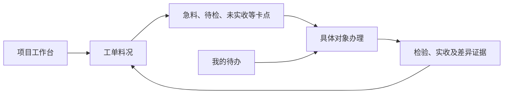

# 机器人OEM制造平台现状、目标与痛点场景评审材料

日期：2026-11-12。用途：交给Claude进行独立产品评审，再由用户确认产品收敛方向和开发优先级。

代码基线为本仓库本地`main`的`2f6900b`，不代表线上部署版本。本文区分已实现能力、源系统读取证据、尚未完成的工作和待评审建议；历史资料与用户最新决定冲突时，以本文列出的最新约束及根目录[AGENTS.md](../../AGENTS.md)为准。

## 1. 先读这一页

我们承接机器人OEM项目，主业务是**代工代料**。当前最急迫的目标，是让负责人和现场岗位沿同一工单完成：

**掌握项目现状 → 判断物料缺口和影响 → 把急料交给对应岗位 → 核对检验、仓配和接收结果 → 追到线边实收与剩余差异。**

用户反复强调的实际问题是：项目现在怎样、物料储备是否足够、什么是急料、怎样让IQC接手、仓库出了料而线边没收到时怎样追查。用户不希望产品堆积中间状态、技术说明和独立模块，要求围绕实际功能办理、完整工作流和数据闭环设计。

目前的主要矛盾：

- 已有不少订单、工程、物料、生产、质量、测试、交付和系统协同功能，但日常入口仍按模块和台账展开，核心旅程不够突出。用户已明确表示“功能多得看不过来”。
- 平台内料况、催料、IQC待办、签收、寻料和补收已有可执行代码与受控测试；正式源单据的关联仍有缺口，不能因此宣称生产同单闭环已经完成。
- 生产MES已取得只读业务数据；SAP当前只有测试接口和历史样本，后续SAP环境要等待。用户同意按测试SAP真实接口契约构造mock数据，先推进开发。
- **生产MES/WMS、SAP/MRP只能查询，禁止业务写入。** 本阶段通过观察真实源事实、准确关联和结果对账验证真实链路，不向生产源制造业务数据来跑通验收。

本次希望Claude重点评审：**产品是否抓住了真正急迫的问题，哪些入口和能力应收敛，首期怎样才能让用户完成工作，以及只读源系统与平台本地协同之间怎样分工。**

## 2. 业务背景和当前范围

### 2.1 两类机器人OEM业务

| 类型 | 业务过程 | 产品需要支持的差异 |
| --- | --- | --- |
| A：首次导入 | 客户已有样机和设计资料，我方完成制造工程化、试产验证，再进入量产 | 资料和版本、制造与测试准备、试产问题及验证必须可追问 |
| B：成熟重复生产 | 按有效产品配置和制造条件承接重复订单，由我方采购、生产、测试和交付 | 复用已批准条件，核对本批变更与准备，不机械重走全部导入流程 |

当前优先从**已经承接、正在执行的项目**进入，不要求用户先补录完整历史，也不要求先重新走一遍承接和NPI。客供料、客户带料作为合同约定下的例外处理，不替代代工代料主旅程。

完整业务范围仍包括承接、工程导入、供应与物料、制造执行、测试质量、交付与追溯；首期优先解决当前项目的料况与跨岗位断点，不要求这些领域都成为同级日常入口。

### 2.2 岗位要完成的工作

| 岗位 | 日常要得到的答案或完成的动作 |
| --- | --- |
| 项目/制造负责人 | 哪张订单、工单有风险；卡在哪；谁负责；交付承诺还缺哪些依据 |
| 计划/MC | 本工单缺什么、何时需要、影响多少；安排采购/供料、IQC或仓配跟进，并核对结果 |
| 采购或供料责任人 | 哪项供应未满足、已有何种到料承诺、目前受阻原因和下一步 |
| IQC | 具体检验哪个收货对象、数量和位置是什么、影响哪个工单；接手协同并引用正式检验结果 |
| 仓库及领料/物流岗位 | 哪笔料交给谁、实际交出多少、送往哪里、还缺什么确认 |
| 产线指定接收人 | 如实确认本人收到的数量、位置和用途；报告短收或错位 |
| 管理员 | 配置连接、授权、核对来源和开发联调，不替岗位代签或绕过业务条件 |

这里是产品职责划分；具体岗位名称、供料责任、排班和响应时限仍按现场制度及合同确认，不自行增加固定SLA。

## 3. 已实现什么，尚未完成什么

### 3.1 平台功能现状

| 能力 | 已有实现和验证范围 | 尚未完成或不能据此推出的结论 |
| --- | --- | --- |
| 项目与业务工作区 | 已有项目、订单、工程、供应、执行、质量、交付、追溯等工作区及岗位待办 | 入口仍偏模块/台账；面向当前项目问题的完整行动总览尚未完成收敛 |
| 工单料况 | 当前确认计划范围内，服务端先搜索/按工单与问题筛选再分页；并列显示急料、待检、未实收、待核实及负责人 | 生产SAP、MES与WMS尚未形成统一的真实同单料况；不能把平台口径当现场完整齐套结论 |
| 需要时间与风险 | 支持带依据设置需要时间、历史和重置；工单计划开始时间明确标为代理；时间风险与已发起急料分开 | 缺少实际需要时间时不能判定“不急”；尚无经过业务确认的通用齐套/交期预测算法 |
| 急料协同 | 发起、进展、已有案件复用；IQC与寻料任务可分派、接手、转交、反馈和核对 | 完整采购跟进类型、案件协调负责人转交等仍有剩余范围；平台待办不等于企业消息已送达 |
| IQC接续 | 已有平台收货/检验事实与任务；已有来源事实列表可引用准确匹配的检验结果 | 生产MES原生检验结果到准确收货批次的完整采集、映射与准入尚未完成；已有模拟事实列表不能冒充已接原生IQC |
| 交接与实收 | 每笔交出、指定人签收、实收数量/位置、用途及需求归属、差异、寻料和补收证据已有实现 | 原生发料单行、连续多段流转、分笔去向及正式差异处置尚未完整接续；只显示有证据的最后确认位置 |
| 急料结束核对 | 后台按当前需求、正式质量、有效预留及可归属实收重新核对，成功留存当时证据；20需/18收不能结束 | 首期支持唯一直接线边交接或独占寻料补收组；不能把任意独立交接或多段流转直接相加 |
| 原生MES工单 | 有带环境身份的工单绑定、完整分页观察、刷新与失败保留；生产源也已只读取得一张工单的12条完整组件 | 该生产样本未绑定为当前真实机器人OEM项目，也未与生产SAP核对；组件读取不自动生成平台计划或库存 |
| SAP MRP读取 | 已有`BAPI_MATERIAL_STOCK_REQ_LIST`物料＋工厂供需查询、真实WSDL及测试系统读取证据 | 不是按工单自动查询；生产SAP未接入；不能据此运行MRP、分配物料或生成过账 |
| SAP契约mock | 用户已同意以测试SAP真实接口契约和自建数据推进 | 本轮仅完成方案与实现前核对，新的契约mock功能尚未写入代码；已有业务模拟器与原生SAP接口结构不能混为一谈 |

现有入口中还包括本地登记到货、登记检验、发料阶段标记等功能。它们需要在产品收敛时明确用途：**平台本地记录、原生观察和正式源系统执行结果不能混称，不能要求用户长期重复维护两份正式原账。**

### 3.2 数据路径和环境现状

| 来源 | 当前证据与用途 | 必须保留的边界 |
| --- | --- | --- |
| 生产MES及其中的仓储能力 | 已有只读配置与受控查询。最新读取取得一张工单12条组件，3页收齐；没有源业务写入 | 一张样本不代表全项目覆盖或已核实为目标OEM项目；仓储职责和对象以实际部署核对，不预设必须新建独立WMS |
| MES测试库 | 保留既往工单、急料和IQC读取及代码回归证据 | 用户已决定不再将测试库样本作为真实生产闭环验收依据；软件隔离测试仍可使用合成数据 |
| SAP测试接口 | 本机保留S4D/Client 300的契约、历史真实响应和读取代码 | 不代表生产SAP；用户表示后续SAP环境暂时要等，当前没有生产SAP配置，也不把历史成功等同于现在在线可用 |
| SAP契约mock，待实施 | 按已核实契约构造可重复的供应/缺口/日期和失败场景，支持功能联调 | 所有模拟数据持续标识，不能进入真实库存、正式质量、权威预留或生产齐套结论 |
| 平台本地协同 | 受权用户记录案件、任务、交接和实际声明，保留责任与历史 | 平台记录不自动变成MES/WMS或SAP正式回执，不自动回写生产源 |

目前并存平台确认需求、原生工单观察、模拟系统事实等数据路径。它们尚未形成一条已验收的生产同单共同视图，这是需要评审的关键产品和实施问题。

### 3.3 关联问题已经知道什么

既往测试样本中，一张SAP工单在MES测试库查不到；反向选取MES工单，SAP虽有同号头记录，但MES12条组件与SAP31条组件没有匹配项。这证明当时样本未对上，不能直接判定系统无法关联，也不能直接认定根因就是测试库不同步。

最新生产MES读取还观察到，部分记录中的`SHOP_ORDER`与ERP引用字段`AUFNR`不同。用其中一个编号精确查询为空，使用ERP引用候选取得另一组完整12条组件；这只是候选核对线索，尚未证明通用字段映射或两个业务对象的等价关系。**不得仅凭编号相同、字段名或物料相同自动关联。**

真实接续需要核对的对象至少包括工单/工厂、组件、收货行与批次、检验对象、发料分笔及指定实收。IQC接收、仓库收货、线边实收也不能当成同一种接收。

## 4. 产品目标与首期成功标准

### 4.1 用户每天应得到的五个答案

1. 项目现在进行到哪，哪些工单和交付承诺受到影响。
2. 本工单需要哪些物料，本单能证明已满足多少，还差多少或缺什么核实依据。
3. 哪些是急料，急在哪里，何时需要，当前卡点和负责人是谁。
4. IQC/仓配有没有接手，当前办理结果是什么，剩余问题由谁继续处理。
5. 某笔料交给了谁、最后确认在哪里、线边实际收到多少，剩余差异怎样追查。

### 4.2 正确性与使用效果

- 同一对象可从项目或本人待办进入；办理后返回原工单、筛选和页码，不丢草稿。
- 用户不输入内部UUID、JSON或接口路径；已有项目、工单、批次、数量、单位和责任信息尽量带入。
- 一项需求可同时待检、短收或受分配限制，不能被一个串行阶段盖住其他问题。
- 库存、合格、预留、发料和实收分别表达；共享物料不重复承诺，未知不显示为零缺口或绿色齐套。
- 查明数量、通知送达、接手、检验完成、物料可用和线边实收分别有证据，不互相替代。
- 真实使用中记录切页次数、找人次数、重复录入、岗位等待与未结差异的处理过程；先取得基线，再确定效率目标，不先编收益或响应时限。

料况可支持准备判断，但不单独等于开工或交付许可；实际还须满足适用版本、资源、测试、质量及合同条件。

## 5. 原始15条痛点与产品应承担的结果

来源为[原始痛点表](../../OEM业务物料痛点.xlsx)的“问题痛点”工作表。F列为问题，I列为原改善建议；共15条非空问题，原编号“9”重复，以下沿用仓库既有P01—P15顺序。原建议是候选方案，不自动成为目标SOP。

| 编号及原单元格 | 已报告问题，归纳 | 产品需要帮助完成的结果 |
| --- | --- | --- |
| P01，F3 | 供应商送货地点或单据异常，无法收货 | 异常到料有对象、位置和责任人，能核实单据并跟进，不能被正常收货清单漏掉 |
| P02，F4 | 客供到料计划不准，需要人工追踪 | 计划承诺、预计到货和实际到料分开；代料采购与客供例外的责任分别明确 |
| P03，F8 | 仓库难以及时得到急料信息，依赖MC整理传递 | 仓库收到针对准确工单/物料的可办事项，MC能看是否被接手及仍缺什么 |
| P04，F9 | 收料区缺少库位信息，批量来料难找 | 入库前物料的最后确认位置、时间和联系人可追问；库位改造另核现场能力 |
| P05，F10 | 客户带料直接上线，绕过系统 | 例外用料有身份、来源、责任及适用批准；不能因为紧急而补造库存/合格事实 |
| P06，F11 | 生产直接拿料，未经过仓库 | 实际领取和接收可追问，明确绕行原因及制度；平台记录不替代仓储正式作业 |
| P07，F12 | 无物料编码无法入库，急用时借料 | 未知身份来料也能留痕并交人核实，推进编码/收检；不迫使用户虚构物料身份 |
| P08，F19 | IQC难以及时得到急料信息，依赖MC传递 | IQC能看到准确批次、待检数量、位置、需要时间和影响，并接手、反馈与引用正式结果 |
| P09，F24 | 已报告库位/物料/批次限制导致找料困难 | 找得到准确物料与批次，模型限制先核现行配置；不直接把“一库位多物料”定为最终方案 |
| P10，F34 | 产线不能及时获知入库信息，靠MC通知或反复刷新 | 产线从同一工单看到状态变化与下一步；入库不自动表示已经送到线边 |
| P11，F35 | 已报告“SAP打单即过账”与实际仓库作业脱节 | 打印、作业、回执、过账分别有依据，能解释差异；实际事务和触发点仍需核实，本阶段不改生产过账逻辑 |
| P12，F40 | 人工扫描下架存在漏下架风险 | 源作业、单据和实际交接可核对，漏回执能形成具体追查事项 |
| P13，F41 | 工单配料进度不透明，需要人工跟进 | 负责人和MC知道本工单哪些料仍在配、待交、待收，责任和剩余量可下钻 |
| P14，F45 | 手工交接，领料信息不透明，不知道是否领走 | 每笔交给谁、交多少、是否被指定人接收可确认，未接收可追查 |
| P15，F49 | 手工交接，物料不易定位 | 按分笔显示最后确认位置/经手人/时间，部分收到不能代表整批位置 |

P01、P05、P06还涉及送货约定、现场制度和责任。软件可以让例外留痕、责任可追问；是否限制现场作业及怎样执行制度，需要业务负责人确认，不能只增加软件卡控。

## 6. 用这些问题场景评审和验收

以下数量均为场景示意，不是生产经营数据。各场景最终应由真实岗位走查；当前已有工程验证的范围单列，避免把测试通过写成现场问题已经解决。

| 场景 | 触发与岗位动作 | 必须看到的结果 | 当前覆盖 |
| --- | --- | --- | --- |
| S01 从当前在制项目进入 | 负责人打开已承接项目，查看受影响工单并进入某条物料问题 | 不要求重录承接/NPI；能看到事实、更新时间、缺项、责任和下一动作 | 项目/料况基础已有；行动总览与入口收敛待完善 |
| S02 共享库存不能重复满足 | 两工单各需20，同一储备只有30；MC核对占用、质量与有效分配 | 同一数量不能同时满足两单；账上有料、待检、冻结、过期或归属不清分别解释 | 平台数量与权限边界有受控测试；生产同单尚未验收 |
| S03 缺口与急料分开 | 同一缺口，分别存在及时到货、晚于需要时间到货、需要时间未知；MC决定是否标急 | 显示需求时间和依据；未知不判不急；风险建议与确认急料分开 | 平台需要时间与案件已有；SAP契约mock场景待实施 |
| S04 急料进入IQC | 急料20到货，MC安排准确收货对象，IQC接手；比较“合格12/拒收8”和“合格12/待检8” | 前者可以完成本次20的检验协同但仍有补料缺口；后者保留8待检。通知、接手与正式结果分开 | 平台任务/检验规则已有；原生批次结果准入与通知渠道未完整接续 |
| S05 单据完成不等于物料到线 | 源系统有打印或过账记录，却没有实际交出或实收证据 | 明确缺哪一步及责任，不显示已到线；读取已有凭据，不为验收触发生产过账 | 平台有阶段记录；原生发料/回执/过账关联未完整接入 |
| S06 仓库出了料，后续没确认 | 仓库交出20，领料/物流是否接手或线边是否收到不清；MC发起查料 | 展示最后确认节点、双方、位置、时间及待确认量；追查负责人不冒充实物保管人 | 直接人工交接/寻料已有；连续多段与分笔关系待补 |
| S07 实收18，找到2仍未补签 | 需20，实收18，查料人登记找到2；之后指定人补签2并核实补收关系 | 找到不等于收到；18阶段不能已解决；补签及独占关联齐备后才可按证据结束，不生成库存/过账 | 当前受控完整API流程已通过；不是原生WMS现场闭环 |
| S08 同物料不同需求不能混签 | 同工单试产/量产均需相同物料20；实际接收人选择用途，管理员尝试代签 | 显示可区分的业务范围，绑定准确需求；管理员不能代签；未知归属不自动计入满足量 | 平台用例已有；原生工单/批次映射仍须逐对象核对 |
| S09 数据不完整与职责变化 | 查询失败、真实空结果、跨页变化、数据过时、撤权、岗位转交或切单时旧请求迟到 | 不伪装为无缺口，不覆盖新草稿；旧证据有时点；责任交接与真实结果分别保留 | 多项接口/组件回归已有；现场角色和实际效益待验收 |

## 7. 入口收敛建议，待本次评审

这部分是为回应“功能多得看不过来”的最新建议，**尚未实施导航改版，也不是已经确认的新设计结论**。

### 7.1 日常两个一级入口

| 入口 | 主要用户 | 页面只需优先回答什么 |
| --- | --- | --- |
| 项目工作台 | 负责人、计划/MC | 哪些项目/工单受影响，急料、待检、已发未收分别有什么问题，下一步交给谁 |
| 我的待办 | IQC、仓配、产线和其他责任岗位 | 我现在要处理哪个对象，需要核对什么，怎样接手、反馈、签收或说明差异 |

“工单料况”是项目内的核心工作页面，同一对象也可从岗位待办到达：



多个卡点可以并行，不要求采购、IQC、仓配依次走完同一串行状态。每项办理首先说明问题、影响、负责人和下一步，来源与详细历史按需查看。

### 7.2 其他能力放在哪里

- 工程版本、制造执行、测试质量、交付与追溯按项目阶段和当前任务进入；保留必需证据和适用授权，评审其是否需要独立一级入口。
- 详细台账服务于核实和追溯，不让用户从多个台账手工拼接一次业务办理。
- 连接配置、接口诊断、系统责任和mock场景选择进入管理员/开发联调区。业务视图仍须保留简洁、明确的模拟标识和事实更新时间。
- 日常主页面不以SAP、MES、WMS划菜单；用户按项目、工单、批次和具体事项办理，系统作为事实来源接续。

需要评审这一方案是否会妨碍现场人员跨项目办理、工程/质量的独立工作，以及完整制造业务的后续扩展，不能只以菜单数量少作为成功。

## 8. SAP等待期间的开发与验收边界

用户已同意：以测试SAP的真实接口契约为依据，自建mock数据推进。优先范围为SAP内部MRP的库存/需求清单，不自行实现一套SAP计划算法。

建议实现原则：

1. 复用已核实的请求结构、WSDL字段、数量精度、单位、日期及错误结构，模拟数据也经过契约校验。
2. 支持现货足够、缺料、预计到货晚于需要时间、部分到货、空结果、业务拒绝和超时等可重复场景。
3. SAP模拟、生产MES/WMS观察和平台本地记录保留各自身份；不得把模拟供应直接写成正式库存、质量、分配或生产齐套。
4. 使用隔离项目与明确的模拟边界验证产品办理流程；生产数据用于受控读取和对象核对，不向生产源执行写入。
5. 后续取得合适SAP环境后替换数据适配、核对同一输入输出和业务数量；契约模拟通过不等于实机或现场验收通过。

这条开发路径可以减少等待SAP环境的影响；真实源对象关系、质量/分配语义和现场职责仍需实际证据，不能全部用mock补成已解决。

## 9. 请Claude重点评审的问题

1. **首期目标是否足够聚焦？** 围绕当前机器人OEM项目，应优先解决哪些场景，哪些应从首期拿掉或延后？请说明业务理由。
2. **入口是否真正按岗位工作组织？** “项目工作台＋我的待办、工单内料况”是否合适；哪些能力需要独立入口，哪些可以合并或按需下钻？
3. **场景能否真正办完？** 从发现缺口到责任人接手，再到结果核对和实收，是否有关键断点、无依据结束或强迫重复录入？
4. **怎样落实生产只读？** 正式操作由源系统既有岗位完成时，平台应该观察什么、记录什么、怎样接续已有单据；哪些现有本地操作入口需要重新命名、调整或约束？
5. **数据来源怎样收敛？** 平台计划、原生工单观察和SAP模拟并存时，用户怎样知道所看范围和可办理动作，而不被中间状态淹没？
6. **数量与身份规则是否正确？** 共享储备、质量状态、同号异对象、试产/量产、多段交接、部分检验/实收及时间未知，是否会误算或误导？
7. **SAP契约mock是否足够支持本轮开发？** 哪些验证能先完成，哪些必须等待实机，是否会造成以后大面积返工或模拟事实污染？
8. **下一轮最小可用交付是什么？** 请给出一个能让实际岗位完整走通的交付范围和验收样本，不按模块数量规划完成度。

期望评审输出：

- 先给总体判断及最严重的三个问题；依据不足的地方明确指出。
- 区分必须修正、可后置和需要业务证据的问题；每项写清影响哪个岗位/场景、为什么、建议怎样改。
- 对现有功能给出保留、合并、后置或移出日常主界面的建议，指出新建议与既有能力怎样衔接。
- 说明仍需业务确认的关键事项，避免把所有工程工作都归为“等用户提供资料”。

## 10. 依据与复核入口

本文件可独立阅读。需要查证时再按下列顺序进入，不要求先通读所有历史设计：

| 依据 | 用途与范围 |
| --- | --- |
| [AGENTS.md](../../AGENTS.md) | 最新生产源系统只读规则 |
| [原始痛点表](../../OEM业务物料痛点.xlsx) | “问题痛点”工作表F列15条问题及I列原建议；单元格映射见第5节 |
| [需求底稿](2026-11-11-robot-oem-requirements-baseline.md) | A/B业务、岗位旅程、首期问题；其中旧测试环境口径须按本文最新决定解释 |
| [现行物料工作台设计](../superpowers/specs/2026-11-11-robot-oem-material-workbench-design.md) | 项目、工单料况、急料、IQC及寻料的已批准产品基线 |
| [后续任务书](../superpowers/plans/2026-11-11-oem-workflow-taskbooks.md) | T1—T6分工和各自剩余范围，不等同于全部已经交付 |
| [料况与实收验证](../verification/material-analysis-2026-11-12.md) | 当前主要本地交付、受控完整流程及边界 |
| [原生MES工单验证](../verification/oem-native-order-2026-11-11.md) | 绑定/采集实现与当时测试MES实际读取范围 |
| [既往联调记录](2026-11-11-robot-oem-material-integration.md) | 测试样本的具体不匹配事实，不能据此认定生产根因 |

截至本文基线，原目录相关后台196项、前端603项、构建及专用HTTP E30通过，另有相邻工程/执行66项回归证据。它们来自明确范围的工程验证，不是全仓库一次全绿、员工现场走查或完整生产同单验收。最新生产MES只读观察保存在本机受控证据目录，本文只引用非秘密结论，不包含凭据、原始响应或实际工单/物料编号。

当前界面与入口可查`webui/src/workflow/WorkflowApp.tsx`、`navigationContext.ts`、`WorkflowHome.tsx`、`SupplyWorkspace.tsx`；料况与对象办理位于`webui/src/workflow/materialControl/`。尚未执行本文第7节的导航收敛，也尚未实现第8节新的SAP契约mock。

## 11. 可直接复制给Claude的评审提示词

```text
请独立评审这份《机器人OEM制造平台现状、目标与痛点场景评审材料》。

我们是机器人OEM代工代料企业，已有SAP（MRP）、MES（含现有仓储能力）和制造平台。
用户最急迫的问题是掌握当前项目现状、判断缺料与急料、让IQC接手、追查仓库出料后未到线边的物料。
用户也明确感到功能和入口过多，希望产品围绕真实岗位办理，不要堆中间状态和技术说明。

请以本文事实和最新约束为基线，不把待评审建议或工程测试当成已经落地的现场能力。
本阶段生产MES/WMS、SAP/MRP只能查询，禁止业务写入；SAP环境等待期间，允许按测试SAP真实接口契约构造mock数据推进开发。

重点审查产品定位、首期范围、岗位旅程、信息架构、跨系统职责与数据边界。
请直接指出当前方案的错误、遗漏、重复建设和不能真正闭环的地方，也可以提出与当前收敛建议不同的方案。
本次只做评审，不修改代码或配置，不执行源系统调用；不要仅增加新的功能模块或用界面美化代替流程评审。

请输出：
1. 总体判断，以及最严重的三个问题；
2. 必须修正、可后置、需要业务证据的问题清单，说明对应岗位/场景和建议；
3. 功能保留、合并、后置或移出日常界面的建议；
4. 推荐的一级入口和一条完整用户旅程；
5. 下一轮最小可用交付范围、验收场景与仍需确认的关键问题。

如果可以访问仓库，按文末依据索引查证关键结论；无法访问时，区分基于本文的判断和需要另行核对的事实。
```
