# 机器人设计与制造全流程（通用版）

面向机器人类产品（机械臂、人形、轮式/复合移动机器人）的设计到制造通用知识文档：讲清从需求定义、系统设计，到试产验证、批量制造、交付与迭代的完整链路——每个阶段的思维方式、流程走向、架构结构，以及常见的失败方式。

- 本文是通用工程知识，不绑定任何公司现状与具体产品；举例均为教学示意。
- 阅读提示：**重点是阶段、思维、流程和架构**，每章三层：开头的「📌 本章要点」给结论，图承载骨架，文字是图的注解——只读要点和图即可建立全貌。
- 配套实战案例：[以开源人形机器人 Berkeley Humanoid Lite 为例的全流程实战](robot-design-manufacturing-walkthrough-bhl.md)——本文每章的通用机制，在那里都有一个真实项目的对应实例。

## 全流程总览

五个阶段、一条回流。每个阶段回答一个问题，产出一类资产：

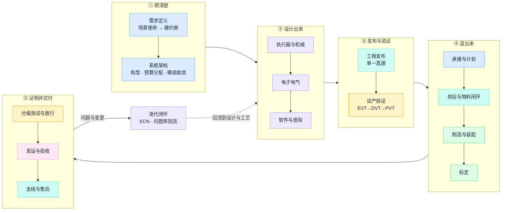

另有两条**横向能力**作用于全部阶段：度量（第 19 章，没有统一口径，闭环就没有仪表盘）与 AI 辅助（第 21 章，辅助起草、人工签核）。

贯穿全程、决定成败的四条主线——后面每章都在为其中至少一条服务：

| 主线 | 内容 | 断掉的后果 |
| --- | --- | --- |
| **版本线** | 需求基线 → 设计版本 → EBOM/MBOM → 工艺/固件/测试程序版本 → 实物配置 | 测试证据对不上实物，"测过"失去意义 |
| **证据线** | 每个阶段门的放行都有可审查的证据，不是靠阶段改名 | 带着未关闭的设计问题进量产 |
| **身份线** | 关键件批次/SN → 整机 SN → 现场设备履历 | 失效无法归因，召回范围无法圈定 |
| **反馈线** | 制造问题、测试数据、现场失效回流到设计与检查项 | 同一问题在下个项目重复发生 |

机器人产品相对一般消费电子的四个特殊性，决定了这条链的难点：**BOM 大而杂**（整机常见数百到上千项，机加、压铸、PCBA、线束、电机减速器混杂）；**单台一致性要求高**（每台的标定参数都不同，必须按 SN 管理而非批次）；**设计长期不冻结**（量产后 ECN 仍然频繁）；**测试与标定深**（放行是几十项功能/性能测试加标定，不是"点亮"）。

## 目录

1. [需求定义：用可验证的硬约束砍掉选项](#1-需求定义用可验证的硬约束砍掉选项)
2. [系统架构：构型、预算分配与模组收敛](#2-系统架构构型预算分配与模组收敛)
3. [关节执行器设计：一条典型的选型决策链](#3-关节执行器设计一条典型的选型决策链)
4. [机械与结构设计：刚度、公差与 DFM](#4-机械与结构设计刚度公差与-dfm)
5. [电子电气设计：电源树、总线与线束](#5-电子电气设计电源树总线与线束)
6. [软件、控制与感知](#6-软件控制与感知)
7. [工程发布：单一真源与数字线程](#7-工程发布单一真源与数字线程)
8. [试产验证：EVT→DVT→PVT](#8-试产验证evtdvtpvt)
9. [承接与计划：从订单到可执行的生产指令](#9-承接与计划从订单到可执行的生产指令)
10. [BOM 与供应链](#10-bom-与供应链)
11. [物料入厂闭环：从卸货到上线](#11-物料入厂闭环从卸货到上线)
12. [工艺与产线设计](#12-工艺与产线设计)
13. [装配与生产执行](#13-装配与生产执行)
14. [标定：参数属于个体，不属于型号](#14-标定参数属于个体不属于型号)
15. [测试体系：分级拦截与质量放行](#15-测试体系分级拦截与质量放行)
16. [交付：放行、发运与客户验收](#16-交付放行发运与客户验收)
17. [支线与售后：返修、委外与影响圈定](#17-支线与售后返修委外与影响圈定)
18. [变更管理与反馈闭环](#18-变更管理与反馈闭环)
19. [度量：用统一口径说这条链好不好](#19-度量用统一口径说这条链好不好)
20. [OEM 模式：设计与制造的分工](#20-oem-模式设计与制造的分工)
21. [AI 在全流程中的位置](#21-ai-在全流程中的位置)

---

## 1. 需求定义：用可验证的硬约束砍掉选项

> 📌 **本章要点**：需求定义的本质不是罗列愿望，而是**把场景使命展开成可验证的硬约束**，每条约束明确否决一批方案——指标必须与验证方法成对出现。

设计的起点不是画图，是回答"这台机器人在什么场景替代什么劳动，做到什么程度算可用"。一句场景使命展开成硬约束，每条约束都在替后面所有章节砍选项：

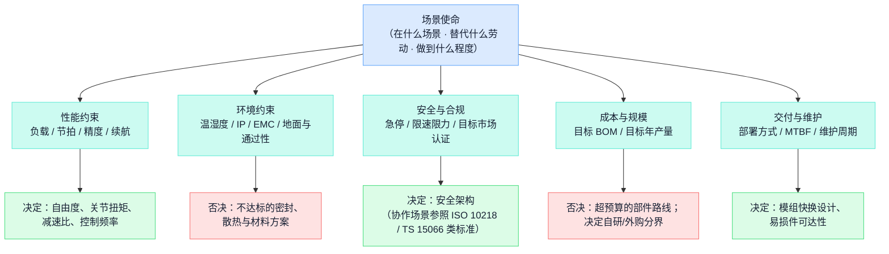

一份可用的机器人规格书至少覆盖这些维度，且**每条指标写明测试方法、条件与判定容差**：

| 维度 | 典型条目 |
| --- | --- |
| 几何与质量 | 整机尺寸/臂展/自重、工作空间、通过性（门宽、坡度、台阶） |
| 性能 | 各轴负载与速度、末端重复定位精度、行走/移动速度、续航 |
| 环境 | 工作温湿度、防护等级、EMC、运输振动/跌落条件 |
| 安全 | 急停、碰撞检测、限速限力、功能安全等级 |
| 接口 | 供电、通信、末端工具接口、充电方式 |
| 成本与量产 | 目标 BOM 成本、目标年产量、目标售价 |

最常见的失败方式：规格只写"正向指标"（能做什么），不写**验收方法**（在什么条件下测、用什么方法判、允许多大偏差）。没有验收方法的指标在设计验证阶段必然引发扯皮——测试团队和设计团队对"达标"的理解不同。另一类失败是**可制造性指标全空**：最大零件尺寸没有对照工艺能力、测试节拍没有对照产能目标、目标成本没有对照 BOM 实价——这一半通常要靠制造侧在导入评审时替设计方补上。

**一条指标的审讯**（把愿望变成指标的过程）：客户说"末端重复定位 ±0.5 mm"。审讯五问——①什么条件（负载多少、预热多久、环境温度）？②怎么测（激光跟踪仪还是千分表、测几个点位、各重复几次）？③怎么判（标准差还是极差、单台判还是抽批判）？④边界（满负载满速度下也要达标吗）？⑤与谁冲突（±0.5 要求的关节刚度会顶爆成本预算——冲突时让谁）？五问全部有答案，这条指标才算进入规格书；答不全的那部分，就是日后设计验证阶段扯皮的预定现场。

## 2. 系统架构：构型、预算分配与模组收敛

> 📌 **本章要点**：架构阶段做两件事：**把整机指标分解成子系统预算**（没人认领的指标必然超标），**把部件种类收敛成少数模组**（种类每减一种，后端 BOM/SOP/工装/备件按倍数减少）。

### 2.1 构型与自由度

- 机械臂：6 轴是通用操作基准，7 轴换取冗余避障；构型（串联/SCARA/并联）由任务空间决定。
- 移动平台：轮式（差速/全向/阿克曼）、履带、足式；人形是双足+双臂+头颈的整机自由度预算（常见 20—40+）。
- **自由度不是越多越好**：每个自由度就是一个关节模组 = 电机+减速器+编码器+驱动器+结构件+线缆，直接乘进成本、重量、故障率和装配工时。

### 2.2 整机拓扑的通用形态

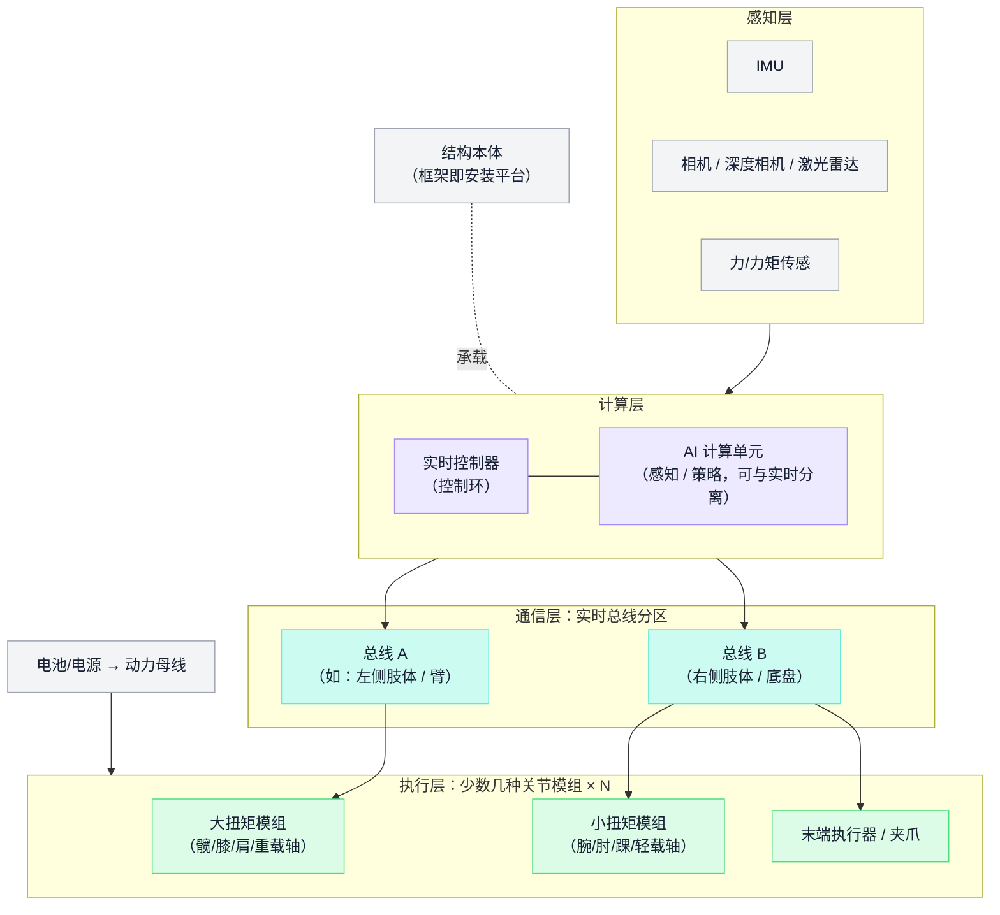

四个通用的架构思维：**模组收敛**（几十个关节收敛成两三种模组规格，共享驱动板/编码器/固件）；**对称切分**（总线按肢体/区域分区，故障隔离与装配分工同构）；**约定防错**（ID 分配、接插件选型等约定让"装错"在物理或协议层不可能发生）；**结构与功能分离**（精密件用精密工艺，平台件用型材/框架——安装平台要的是扩展性不是曲面）。

### 2.3 指标预算分配

整机指标必须分解成子系统预算，否则集成时没人对总账负责：

| 预算 | 分解方式 | 常见坑 |
| --- | --- | --- |
| 质量 | 整机自重 → 各部段 → 各零件 | 后期增重都发生在"没人认领"的线缆、紧固件、胶 |
| 功耗 | 电池容量 → 各关节峰值/持续 + 计算 + 感知 | 峰值同时率估计过乐观，电源树过载 |
| 精度 | 末端精度 → 各关节背隙/刚度/编码器分辨率 + 结构变形 | 只算几何误差，忽略温漂和负载变形 |
| 通信 | 控制周期 → 总线带宽、节点数、同步精度 | 节点数超出总线周期承载，控制频率被迫下调 |
| 热 | 各发热源 → 传导路径 → 表面温度/降额曲线 | 密闭外壳 + 长时间老化时才暴露 |

架构阶段还要输出**接口控制文档（ICD）**：机械接口（安装面、螺纹、定位）、电气接口（连接器、引脚、电压电流）、通信接口（协议、周期、数据定义）。接口冻结越早，子系统越能并行开发；接口反复变动是跨团队项目延期的第一大来源。

**平台化决策**也在架构阶段做：哪些做成跨机型的平台资产（关节模组、控制器、软件框架、测试体系），哪些是本代产品专属。平台化前期多花两三成设计工作量，换来后续机型的复用；但过早平台化会把未经验证的方案固化——通行节奏是**第一代以跑通为主，第二代开始抽平台**。

**一个新增自由度的代价清单**（架构评审的实用工具）：有人提议"腰部加一个旋转自由度，操作空间更大"。按清单核价：+1 个关节模组（BOM 成本）、+1 公斤级质量（连带电池扩容）、+峰值功耗（电源树重算）、+1 个故障点（MTBF 下降）、+装配与标定工时、+1 组过关节线缆（弯折寿命风险点）、+控制软件的冗余自由度处理。收益与这七项代价同桌对账，"操作空间更大"才从感觉变成决策——**架构评审的本质，是让每一个"加"都付得起账**。

> **教学示例（精度预算怎么分）**：目标末端重复定位 ±0.5 mm、臂展 700 mm 的六轴臂。先把总误差拆成三份额度——几何项（各关节背隙与编码器分辨率折算到末端）0.25、结构项（负载变形）0.15、温漂项 0.10 mm；再往下分：肩、肘两个长力臂关节分走几何额度的大头（折算系数约等于力臂长度），腕部三轴分小头。分完的直接后果是：肩肘必须选低背隙减速器加输出端编码器，腕部可以用便宜方案——**预算表就是选型依据，这就是"分解到子系统"的含义**。数字为教学示意。

## 3. 关节执行器设计：一条典型的选型决策链

> 📌 **本章要点**：执行器设计是**约束下的决策链**，每个分叉都有被否决的选项和否决理由；make-vs-buy 不是二选一——硬件、固件、算法可以拆开分别决策。

关节模组是机器人本体的核心：整机的性能、成本和可靠性大头都在这里（经验规律：**关节模组通常占整机 BOM 成本的一半以上**）。一条典型的决策链：

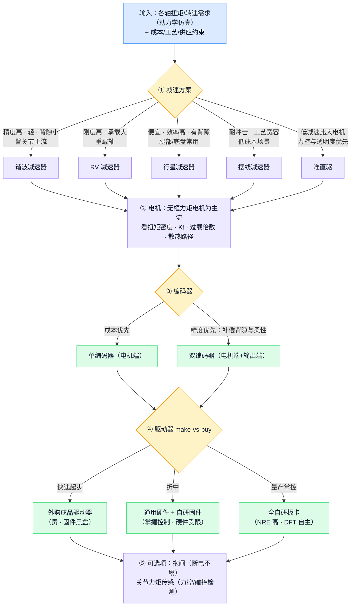

两个贯穿性的选型思维：

- **让工艺和供应链参与设计**：选型表里"供应可得性/交期"应作为显式一列（谐波/RV 交期常以月计）；优先围绕大路货件（标准轴承、常规电机）反推设计尺寸，而不是画完图再找特殊件。
- **整机模组自研 vs 外购是战略决策**：外购关节模组缩短开发周期，但受制供应商且成本降不下来；自研掌握性能与成本，但要承担电机驱动、减速器配合、测试标定的全部工程量。多数本体公司的路径是先外购跑通整机，再逐步自研高价值关节。

### 减速器横向对照（选型表的骨架）

| 型式 | 背隙 | 刚度 | 效率 | 扭矩密度 | 成本 | 供应交期 | 典型位置 |
| --- | --- | --- | --- | --- | --- | --- | --- |
| 谐波 | 极小 | 中 | 中（约 70–85%） | 高 | 高 | 长（月级） | 臂关节 |
| RV | 小 | 高 | 中高 | 高 | 高 | 长 | 重载底座 / 髋 |
| 行星 | 有（预紧可改善） | 中高 | 高（>90%） | 中 | 低 | 短 | 腿 / 底盘 / 轻载 |
| 摆线 | 小—中 | 中 | 高 | 中 | 低—中 | 短 | 低成本 / 耐冲击场景 |
| 准直驱（低减速比） | 近零 | — | 高 | 低（靠大电机补） | 中 | 中 | 力控优先的腿足 |

选型表的正确用法：先由第 2 章的预算分配定出每个轴的"必须项"（背隙上限、刚度下限、外形包络），再用此表筛出两三个候选，最后按成本 × 交期 × 二次开发量定案——**被否决选项的否决理由要可追溯，这比选中理由更重要**（下个项目复盘时，"当时为什么没选行星"必须有答案）。

电机侧的关键参数：Kt（扭矩常数）与绕组温升决定**持续扭矩**，磁路与过载倍数决定**峰值扭矩**，齿槽转矩影响力控平顺性，散热路径（机壳传导还是强迫风冷）决定降额曲线。一句经验：**持续扭矩看热、峰值扭矩看磁——标称值不写测试条件的电机规格书要打回**。

### 一只关节模组的内部架构

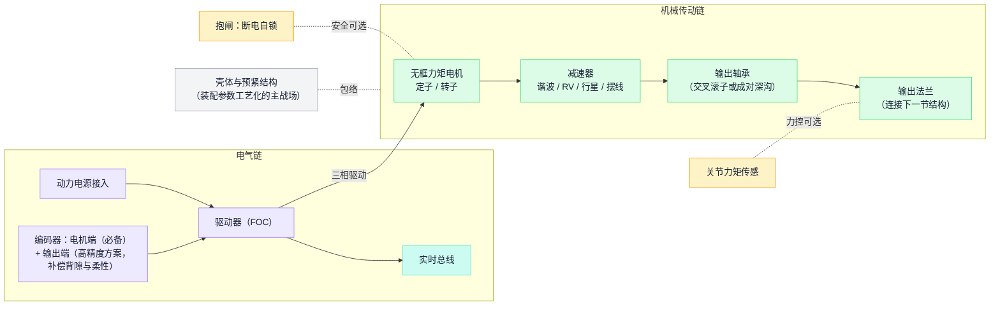

### 器件谱系速查（通识示例，不是推荐名单）

| 部件 | 国际代表 | 国内代表 | 选型注意 |
| --- | --- | --- | --- |
| 谐波减速器 | Harmonic Drive（哈默纳科） | 绿的谐波等 | 交期以月计；渠道真伪与批次一致性 |
| RV 减速器 | Nabtesco（纳博特斯克） | 双环传动、中大力德等 | 安装精度与预紧直接决定寿命 |
| 行星减速器 | Wittenstein、Neugart | 众多，按背隙等级分档 | 背隙分精密/标准档，别为用不到的档位付费 |
| 无框力矩电机 | Kollmorgen、TQ | 国产选择多 | 标称值核测试条件；按实测温升验证 |
| 编码器 | Heidenhain、Renishaw | 禹衡、昊志等 | 绝对值/多圈方案；协议（BiSS/EnDat）与驱动器匹配 |
| 驱动器 | Elmo、Copley | 清能德创等；或自研 | 总线协议、电流环带宽、安全功能（STO） |

谱系表的用法与系统选型一样：**名称不等于能力**——同一品类内按本项目的预算分配（第 2 章）核对关键参数与实测，而不是按品牌档次下单。

**拿到样件先测什么**（选型不靠规格书定案）：实测背隙（正反向加载读差值）与传动刚度曲线；空载电流与温升曲线（跑到热平衡，对照标称条件）；噪音与异响（新品和跑合后各听一次）；实测 Kt 与规格书的偏差；拆一只看内部（轴承品牌、润滑脂量、加工毛刺）。两家供应商规格书参数相同、样件实测差三成是常态——**选型表筛出候选，样件数据定生死，批量一致性靠来料检验守住（第 11 章）**。

### 执行器的制造与测试含义

设计关节时就要想清楚它在产线上怎么装、怎么测：

- **装配敏感参数工艺化**：谐波的波发生器装配、轴承预紧、编码器磁环间隙——这些直接决定关节性能的装配参数必须转化为工艺参数（拧紧力矩、压装力曲线、间隙规检），不能留给"老师傅手感"。
- **组件级测试前置**：关节模组装入整机前完成单体测试（空载电流、背隙、重复定位、温升、异响、堵转保护）——拆一个装好的关节意味着整段结构返工，拦在组件级的成本是整机级的十分之一。
- **关节标定随件走**：零位、电流—力矩、摩擦模型的标定参数属于这一只关节的身份数据，随 SN 入档案，换关节必须重标并更新档案（第 14 章）。

## 4. 机械与结构设计：刚度、公差与 DFM

> 📌 **本章要点**：机器人结构多数不是被压坏的，而是**刚度不足**导致精度、振动和控制带宽问题；制造性是设计属性——DFM 检查表的正确来源是试产问题的回流，不是教科书。

结构设计是一条带两个回退口的流程——刚度校核不过回布局，DFM 评审不过也回布局：

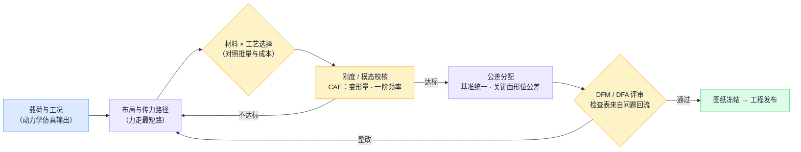

### 结构设计四要点

- **刚度优先于强度**：以变形量和一阶模态频率为约束，不只看安全系数。
- **轻量化**：拓扑优化、薄壁+加强筋、铝/镁/碳纤选择。移动机器人每省 1 kg 结构重量，连带节省电机扭矩、电池容量和续航。
- **公差与工艺能力匹配**：轴承位、减速器安装面、编码器安装的形位公差直接决定关节性能——图纸上标注了工厂做不到的公差等于没标；压铸件的气孔与变形、机加基准的选择都要在图纸阶段对齐工艺能力。
- **走线设计**：机器人是"会动的线束"。过关节线缆的弯曲半径、扭转寿命、滑环或中空走线方案必须在设计阶段做弯折寿命评估——线缆疲劳断裂是现场失效高发项，不能留给装配"想办法"。

### 可装配与可维护（DFA/DFS）

装配顺序能否单向进行、螺丝是否有操作空间、易损件（线缆、皮带、电池）能否不拆整机更换。装配性问题在图纸上改一条线，在产线上就是每台多十分钟工时或一个新的质量风险点。

### 材料与表面处理

| 材料 | 典型用途 | 要点 |
| --- | --- | --- |
| 6061/6082 铝 | 机加结构件主力 | 好加工、阳极氧化成熟；强度中等 |
| 7075 铝 | 高应力件 | 强度高；焊接性差、成本高 |
| 压铸铝（ADC12/A380 类） | 量产壳体 | 单件便宜、轻；气孔与变形需工艺管控，壁厚要均匀 |
| 镁合金 | 极致轻量化 | 减重显著；防腐处理与成本是门槛 |
| 碳纤维 | 臂管 / 腿管 | 比刚度极高；金属连接件的设计与粘接工艺是关键 |
| 钢（45#/40Cr 类） | 轴系、高磨损件 | 刚度硬度好；重，用在刀刃上 |

表面处理（阳极氧化、喷涂、化学镀镍）不只为外观：耐磨、绝缘、防腐都依赖它，必须写进图纸并纳入来料检验——来料"颜色不对"常常是"供应商换工艺了"的信号。

公差实践两条：**基准统一**——设计基准、工艺基准、检测基准三者一致，否则每换一道工序误差重新累积一次；**形位公差标给关键配合面**（轴承位同轴度、减速器安装面平面度/垂直度），普通尺寸走一般公差——全图纸撒 ±0.01 等于没有重点，加工报价还翻倍。

### DFM 评审

在设计冻结前做，输入是图纸和 BOM，输出是可执行的修改建议。典型检查维度：工艺可实现性（螺牙深度、壁厚、拔模角、刀具可达性）、公差合理性、材料与表面处理的供应可得性、紧固防松设计、装配可达性。实践中试产暴露的结构类问题（滑牙、螺牙深度不足、干涉）**大多数本可以在 DFM 评审用检查表拦截**——而检查表的每一条都应来自某次真实的试产教训（第 18 章的回流机制）。

**走读：一个关节壳体的工艺迁移**。EVT 用 CNC 件（一周一版，单件贵但随改随做）；DVT 后期上压铸软模，首批就暴露两类 CNC 阶段永远不会出现的问题——气孔集中在厚薄过渡处、脱模变形让轴承位同轴度超差。于是图纸补了三样东西：壁厚均匀化改型、"压铸后机加"的基准标注、轴承位首件全检（FAI）要求。这就是"验证结论不能跨工艺迁移"的具体样子，也是 DVT 必须引入量产工艺首件的原因（第 8 章）。

## 5. 电子电气设计：电源树、总线与线束

> 📌 **本章要点**：电源树层级越少越可靠；**安全要内建在协议与硬件层**（看门狗、断电抱闸、再生能量处理），不靠应用程序自觉；线束是正式零部件，不是"按实物配"。

### 电源架构

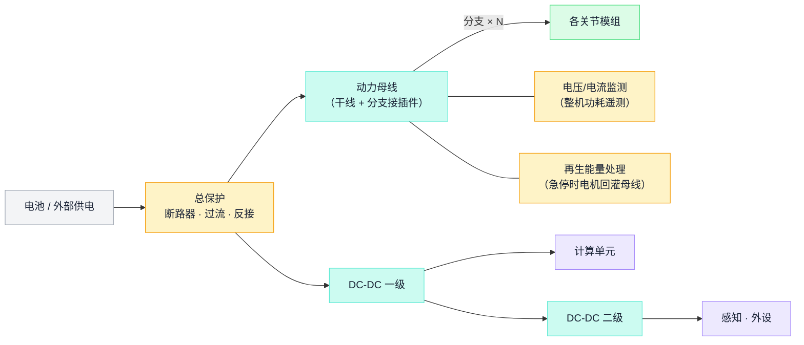

要点：峰值功率同时率分析（所有关节同时加速的最坏情况）、上下电时序、各路独立保护、**再生能量处理**（关节急停时电机发电回灌，母线过压是真实的烧板原因）。

### 通信总线选型

| 总线 | 特点 | 适用 |
| --- | --- | --- |
| EtherCAT | 高同步精度、拓扑灵活、带宽大 | 高性能臂/整机实时控制主流 |
| CAN / CAN-FD | 节点便宜、生态成熟、带宽有限 | 中小型整机、成本敏感场景 |
| 以太网 / USB | 大带宽非实时 | 感知数据、调试 |

协议设计的通用原则：**按用途分帧型**（模式切换/参数读写/周期控制/心跳各自独立），**安全内建协议层**——心跳看门狗超时自动失能、抱闸断电自锁，让"主机死机"的后果是停下而不是失控。总线拓扑要和机械走线一起定：菊花链过关节的连接器数量直接影响可靠性。

### 线束与 PCBA

- **线束是正式料号**：线表图纸、连接器选型（插拔次数、振动防松、相邻防呆）、长度公差、护套与标签。量产时委外线束厂，来料按图检验。
- **自研板卡的 DFT**（可测试性设计）：预留测试点、烧录接口，使产线能用针床/治具完成烧录与测试；关键元件核对生命周期状态并在 AVL 上准备替代来源；硬件版本、固件版本、测试程序版本的**兼容矩阵**显式维护。

### 自研板卡：从原理图到量产烧录

一块驱动板/接口板从零到量产的完整路径，通常要走两到三版：


**烧录方式随阶段升级**，研发手段直接搬上产线是节拍事故：

| 方式 | 阶段 | 要点 |
| --- | --- | --- |
| SWD/JTAG 调试器 | 研发调试 | 全功能（断点/单步），慢，手工操作 |
| 脱机烧录器 | 小批量试产 | 一键烧录不需电脑；固件版本锁定在烧录器里 |
| 针床 ISP / 一拖多 | 量产工位 | 烧录+测试+写 SN 一体，节拍秒级；结果直写系统 |
| Bootloader / 总线升级 | 装机之后 | 整机内升级单板，配合版本校验与回读 |
| OTA | 交付之后 | 带回滚机制；升级后同步更新该台的配置记录 |

两个容易踩的点：量产固件要**开读保护**（防止方案被整板复制），但开之前确认产线复测与返修流程不依赖回读代码；烧录动作本身要留痕——哪块板、哪版固件、哪个工位、什么时间，这是固件版本进"组合快照"（第 7 章）的数据来源。

**三类最常见的电气事故与设计根源**：

| 事故现象 | 常见根源 | 设计侧的防 |
| --- | --- | --- |
| 急停/快速减速时驱动器报过压，甚至烧管 | 再生能量回灌母线，无处泄放 | 母线泄放电阻或能量回馈；急停工况纳入电源树计算 |
| 整机偶发"抽风"：个别关节掉线又自愈 | 总线干扰——终端电阻缺失或装了双份、地环路、动力线与信号线并行走线 | 分离式终端＋共模抑制；走线隔离写进线束图纸而非口头交代 |
| 跑一段时间单关节失联，拍一下又好 | 接插件振动松脱、焊点疲劳 | 带锁扣连接器选型；振动试验进 DVT；插拔力/推拉力抽检进过站 |

三类事故的共同点：**台架上难复现、整机动起来之后高发**——这正是整机老化（第 15 章）必须带着运动跑、而不是静态通电的原因。

## 6. 软件、控制与感知

> 📌 **本章要点**：软件分层的边界即接口；**产测模式要在架构里预留**（后补的产测接口往往绕开安全框架）；策略/算法上实机前先换环境复验，是软件版的首件验证。

### 分层架构与验证流水线

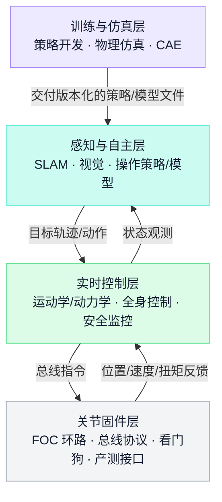

对制造重要的三个软件设计决策：

1. **产线软件 ≠ 产品软件的子集**。产线需要专门的产测模式（单轴点动、传感器读数直出、标定流程接口），必须在软件架构里一开始就留——后补的产测模式往往绕开安全框架，埋下风险。
2. **仿真复验是道工序**。控制策略/算法在开发环境验证后，先换一个独立环境（另一个物理引擎、硬件在环台架）复验，确认不是"过拟合某个仿真器"，再上实机——这是软件版的首件验证。
3. **配置与参数管理**。每台机器人出厂 = 软件版本 + 这台的标定参数包；参数写入后必须回读校验，"写入成功"不等于"性能达标"，放行判定依据复测结果而非写入回执。OTA 升级后，"这台设备的当前配置"记录必须同步更新。

算法与策略的交付流水线，中间那道"换环境复验"是强制工序：

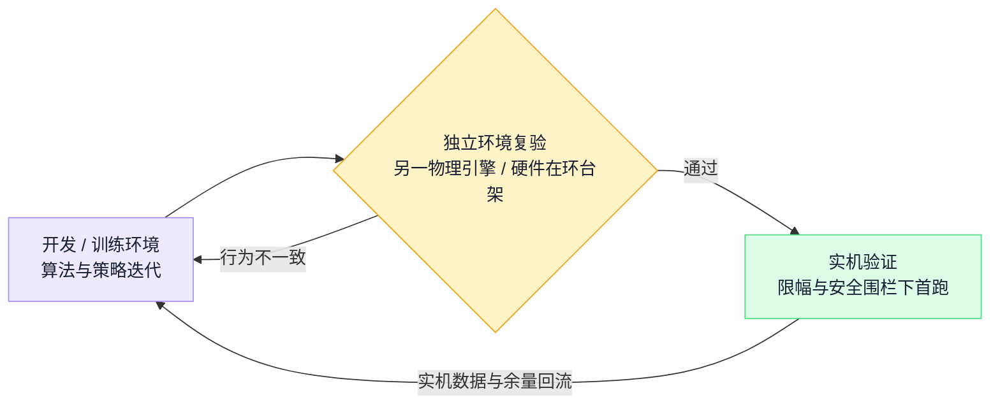

### 感知系统的标定链

感知子系统（相机、深度相机、激光雷达、IMU、力/触觉）的设计要点在于**标定链**：单传感器标定（内参、深度、IMU 零偏温补）→ 跨传感器外参标定（相机—IMU、传感器—本体坐标系）→ 整机级标定（手眼标定、运动学参数辨识）。关键认知：**结构设计决定标定难度**——传感器安装面的刚度与定位精度不够，标定结果随温度和振动漂移，再好的算法也救不回来。感知标定要求产线具备标定工站（靶标、运动台、受控光照）与结果判定标准，标定数据作为一等数据对象随 SN 归档。

### 运行数据与远程诊断

量产机器人要在设计阶段预留**数据回传与远程诊断**：关键状态量（关节温度/电流/错误码、电池健康度）周期性落盘与可配置回传；售后的第一动作是远程拉日志，而不是发返厂单。两条边界：回传内容与频率是**客户合同条款**（数据归属与隐私）；诊断接口与产测接口共用底层能力但**权限分级**——售后通道能读状态，不能写标定。

**一次 sim2real 失败的归因清单**（仿真里走得好好的，实机摔了）：按命中率排序排查——①仿真模型错（质量/惯量/摩擦与实物不符 → 用实测参数回填）；②标定没做对（零位偏了几度，策略看到的世界整体歪了）；③时序不对（控制周期抖动、总线延迟，仿真里不存在）；④传感器差异（IMU 噪声与延迟特性）；⑤执行器差异（扭矩带宽、死区）。**前两项占大头——摔机先查模型和标定，再怀疑算法**。把这张清单反过来，就是"上实机前检查单"。

## 7. 工程发布：单一真源与数字线程

> 📌 **本章要点**：设计数据管理只有一条原则：**一切发布物都是单一真源的自动导出产物**；"定义"按版本管理、"事实"按 SN 归档，这条分界画错任何一边都是灾难。

一台机器人的数字资产底层是一条**数字线程**：

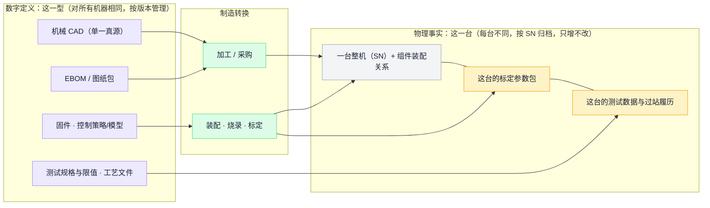

三条纪律：

- **单一真源 + 自动导出**：CAD、仿真模型、打印/加工文件、BOM 若是多套手工维护，必然漂移——"图纸 7.5 mm 实测 7.0 mm"类问题的源头常常就是多源维护。改设计只改源头。
- **版本是组合不是单号**：一台整机的"版本"是硬件 BOM × 固件（含策略/模型文件）× 测试程序与限值 × 标定流程 × 工艺文件的**组合快照**，工单下达时整体冻结。任何一轴错位（新固件配旧限值、新结构配旧治具），产品就错了，而且产线上看不出来。
- **定义与事实分界**：把每台的标定参数当版本管，版本号按台爆炸；把测试限值按台存进台账，"当时按什么标准判的"就没了答案。每条测试事实**引用**它依据的限值版本，各在其位。

完整的设计发布数据包清单（也是 OEM 模式下对客户数据包的要求模板，见第 20 章）：EBOM、2D 图纸包（含公差与关键尺寸检验方法）、3D 模型、电子资料（原理图/Gerber/坐标文件）、版本化的固件与产测程序、测试规格（项目+方法+限值）、关键装配工艺输入（拧紧力矩、点胶、压装参数）、仿真描述文件（可选，可用于测试台架与标定工站开发）。

**一桩事故的解剖：图纸 7.5 mm，实物 7.0 mm**。螺牙深度图纸标 7.5，试产实测 7.0，整批支架有滑牙风险。倒查发现：结构工程师为避让内部线缆改过一版 3D 模型（7.5→7.0），2D 图纸没同步——因为模型和图纸是两个人分别维护的两份文件。单一真源下这个事故**结构上不可能发生**：图纸由模型自动出图，改模型即改图。多源维护的每一份"副本"，都是一个等着错位的定时器。

发布也不是"把文件放上去"，是三个动作：**冻结**（版本号落定、不可再改）、**广播**（推送给所有使用方，不是等人来取）、**回执**（确认收到并完成切换——"谁还没切换"必须可查询）。缺回执的发布，等于把新旧版并存的风险交给运气。

## 8. 试产验证：EVT→DVT→PVT

> 📌 **本章要点**：阶段名称不能替代放行证据——每个阶段回答一个问题、留一组可审查的证据；**设计改版后，旧验证证据是否仍然有效必须有人显式判断**。

### 试产之前：仿真与原型的梯度

仿真在实物之前廉价地排除一类错误，但要清楚每种仿真验证什么、替代不了什么：

| 仿真 | 验证对象 | 不能替代 |
| --- | --- | --- |
| 结构 CAE（静力/模态/疲劳） | 刚度、强度、谐振 | 材料与工艺缺陷（气孔、焊缝、层间结合） |
| 运动学/动力学仿真 | 工作空间、干涉、扭矩需求 | 摩擦、背隙、柔性等真实非线性 |
| 热仿真 | 稳态温升、散热路径 | 实际装配的导热界面质量 |
| 控制/整机物理仿真 | 控制策略、步态、操作策略 | sim-to-real 差距，必须实机收口 |
| 公差分析 | 装配累积误差 | 实际工艺波动的真实分布 |

原型不是"做一台样机"，而是按问题分层的梯度：**POC**（单点技术验证：一个关节、一个抓取演示）→ **Mule／集成样机**（不管外观，验证子系统集成与接口）→ **EVT 样机**（接近设计意图的完整整机）。每一轮原型带着明确的问题清单去做，做完关闭清单——"又做了一轮样机"本身不是进展，**"关闭了哪些设计风险"才是**。

### 设计评审与冻结分层

冻结是分层的：架构冻结 → 接口冻结（ICD）→ 详细设计冻结（图纸/BOM 定版）→ 工艺冻结。每次冻结对应一次正式评审：输入文档、检查表、问题清单、批准人，缺一不可。机器人行业的现实是设计长期"冻不住"（客户与市场驱动的变更不断），所以冻结的真正含义不是"不再改"，而是**"此后任何变动都走受控变更，不再随手改"**（第 18 章）。

### 阶段门与退出证据

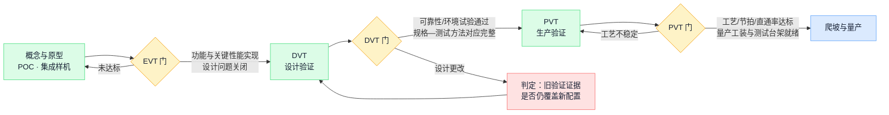

| 阶段 | 回答的问题 | 典型规模 | 退出应有的证据 |
| --- | --- | --- | --- |
| **EVT** 工程验证 | 功能与关键性能能否实现？ | 数台—数十台 | 功能全覆盖测试、关键性能记录、设计问题清单关闭状态、失效分析 |
| **DVT** 设计验证 | 该设计与选定材料能否**稳定**满足全部规格？ | 数十—数百台 | 可靠性/环境试验（高低温、振动、跌落、寿命）、规格—测试方法对应表、一致性数据 |
| **PVT** 生产验证 | 量产的人机料法能否按目标节拍重复生产？ | 小批量产规模 | 工艺验证（CPK/首件）、节拍与直通率、人员培训记录、量产工装/测试台架就绪 |

机器人试产的几条规律：

1. **问题沿产线向后累积**。前段组件装配可能全部达成，而半成品测试、整机装壳、成品测试的达成率逐站下滑——结构干涉、物料状态、测试环境的问题都在后段集中爆发。由此得出硬规则：**测试与老化环境就绪是试产启动的前置关卡**，不能与试产并行建设。
2. **试产的产出一半是机器，一半是问题库**。每阶段结束做正式复盘，问题逐条记录"问题/根因/对策/本可在哪个阶段拦截"，转化为下个阶段和下个项目的检查项（第 18 章）。
3. **工艺要随阶段切换**：EVT 用快速工艺（3D 打印/CNC/软模），DVT 引入量产工艺首件，PVT 必须全量产工艺——快速工艺件通过的验证**不能代表**量产工艺件（打印件的强度试验结论对压铸件不成立，压铸的气孔问题打印阶段根本不出现）。
4. **成熟项目不走全套 NPI**：重复生产或小改版走"条件核对 + 首件验证"直接进量产；哪些变更触发回到哪一级验证（改材料回 DVT、改工艺回 PVT），要有显式的判定规则，不靠临场争论。

**阶段门评审的灵魂拷问**（每道门用同一组问题，答案必须指向证据而不是形容词）：

| 拷问 | 合格的答案形态 |
| --- | --- |
| 问题清单关闭了吗？ | 逐条有处置与验证记录；未关闭项有风险评估和带责任人的计划 |
| 证据对应哪版配置？ | 每份报告标注硬件/固件/限值版本；改版后失效的证据已被识别 |
| 下阶段的前置就绪了吗？ | 量产工艺首件、测试台架、老化环境的**就绪证据**，不是就绪计划 |
| 这一阶段学到了什么？ | 问题库新增条目数及其回流去向（检查表/检验项/SOP） |
| 谁批准？基于什么？ | 批准人＋批准所依据的证据清单——"大家觉得差不多了"不是批准 |

## 9. 承接与计划：从订单到可执行的生产指令

> 📌 **本章要点**：接单时裁定的合同条款决定后面所有环节的形状；**承诺交期必须有计划依据**——订单经 MPS、MRP 与产能核对才变成可执行指令，缺口是显式的例外对象，不是背景噪音。

设计把产品定义做出来了，但工厂里的每一张工单都始于两个更早的决定：**接不接这一单（按什么条件接）**，以及**何时买什么、何时做多少**。

### 9.1 承接评审：合同裁定清单

| 裁定项 | 要定什么 | 不定的后果 |
| --- | --- | --- |
| 供料责任 | 客供 / 代采 / 客户直发，各自的所有权、检验责任、呆滞与损耗归属 | 对账扯皮、呆滞无人认领 |
| 验收 | 位置（发运前/到货后）、方式、是否需要客户前置批准 | 验收条件事后追加，款收不回 |
| **追溯等级** | 承诺到批次还是到 SN、保留哪些原始数据、保留多久 | 追溯等级决定数据成本——没约定就是无限责任 |
| 交期承诺 | 承诺的依据（产能与关键件交期）、改期规则 | 销售承诺快于供应实际能力 |
| 变更规则 | ECN 通道、响应时限、费用与呆滞分担 | 高频变更的成本全由制造方吞下 |
| 数据交付 | 随货数据包的范围、格式、截点 | 交付后被追讨"当时没说要"的数据 |
| 质量目标 | 口径明确的指标与罚则 | 口径不一致的永久争议 |

### 9.2 计划主线：承诺的依据

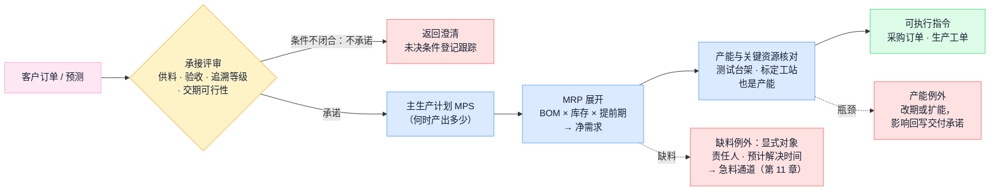

四条计划纪律：

- **长周期关键件决定计划地平线**：减速器、力矩电机的交期以月计，计划必须看到它们的采购提前期之外——这是第 10 章供应结构直接决定的。
- **测试与标定台架是最常被漏算的产能**：装配产能可以加人，老化房和标定工站的吞吐是刚性的；按节拍倒推台架数量是产能核对的一部分。
- **承诺可追**：每个交期承诺能追到它依据的计划版本与产能假设；假设变了，承诺要显式重评，不能静默失效。
- **计划是滚动的**：订单变更、到货延误、良率波动都回流重算；例外（缺料/瓶颈）是有责任人和解决时限的对象，不是日报里的一行灰字。

### 生产策略与 MRP 机制

先定**生产策略**，它决定库存放在哪一层：MTS（备成品库存——机器人几乎不用）、**MTO**（接单生产，整机主流）、**ATO**（模组备库存、接单总装——模组收敛做得好的厂商可以走）、ETO（按单工程，深度定制）。策略决定 MPS 排的对象是整机还是模组，也决定承诺交期从哪一层起算——ATO 厂商能承诺"总装周期"，MTO 厂商承诺的交期里躺着全部关键件提前期。

MRP 的机制一句话：**毛需求 − 在库 − 在途 ＝ 净需求，按提前期倒排下单时点，逐层穿透 BOM**。机器人场景的两个要点：共享模组的需求合并——两种机型共用同一关节模组时，模组毛需求是两条 MPS 之和，**这是模组收敛在计划端的红利**；例外消息（建议提前/推迟/取消）才是 MRP 的主要输出，没人处理例外的 MRP 等于没跑。

> **教学示例（倒排）**：整机 6 周后交付；总装需 1 周 → 第 5 周末模组必须齐套；模组装配+测试需 2 周 → 第 3 周末零件必须齐套；而谐波减速器交期 12 周 → **今天下单已经晚了 9 周，只能动用安全库存、找现货或改期**。"长周期件决定计划地平线"的全部道理就在这三行算式里。数字为教学示意。

承接评审的会议产物是一份**承诺书**，三要素缺一不可：承诺内容（数量、交期、质量与追溯等级）、承诺依据（引用的产能测算与关键件交期，版本可查）、未决条件清单（每条有责任人与期限——未决条件清零之前，承诺是条件式的）。日后交期出险，第一个翻开的就是依据那一页：它决定这是"计划失误"还是"假设变了"，两者的问责对象和改进方向完全不同。

## 10. BOM 与供应链

> 📌 **本章要点**：机器人 BOM 的供应结构决定计划逻辑——**长周期关键件是计划的第一约束**；关节模组通常占整机成本一半以上，降本主战场一目了然。

### 供应结构

| 物料类别 | 例子 | 供应特点 |
| --- | --- | --- |
| 长周期关键件 | 谐波/RV 减速器、力矩电机、高端传感器 | 交期以月计，常需提前下单甚至押产能 |
| 定制机加/压铸件 | 关节壳体、结构框架 | 开模周期长；改版时在途/在库料报废风险最大 |
| PCBA | 驱动板、电源板、接口板 | 委外 SMT；元器件缺货波动 |
| 线束 | 各段定制线束 | 图纸成熟度差时返工率高 |
| 标准件与辅料 | 紧固件、轴承、胶、包材 | 单价低但缺一颗就停线 |

### 关键机制

- **AVL 与第二来源**：关键件至少评估一个替代来源；替代料/替代供应商切换必须经验证与批准，不允许产线"先用着"。
- **来料检验项从问题库回流**：试产暴露的物料问题（压铸开裂挑料、来料螺牙不良）直接转为该料号的强制检验项与供应商整改项。
- **齐套管理**：工单开工前核对**全 BOM** 物料到位且状态可用——缺一颗螺丝和缺一个减速器对产线的阻塞效果相同；收货 ≠ 合格入库 ≠ 可投料。
- **成本结构意识**：读 BOM 先读结构——关节模组占大头意味着降本动作应集中在电机/减速器/驱动器的选型与自研路线上，而不是在包材上抠。

### 主数据与 BOM 治理

- **料号是身份，描述不是**：同物同号、一物一号；靠描述当身份（"M3×8 那种螺丝"）的系统迟早混料。无编码来料走例外留痕＋补建码，不能"先用再说"。
- **三张 BOM 各司其职**：EBOM（设计视图，按功能结构）、MBOM（制造视图，按领料与装配层级重排、补辅料包材）、BOP/工艺路线（工序视图，定义每道工序消耗什么、产出什么）。三者之间是**受控转换**，不是复制粘贴。
- **替代关系受控**：替代料的适用范围（全局/指定机型/指定工单）、优先级、生效条件显式维护——"产线自己知道能代"是一个追溯断点。
- **BOM 生效条件**：按日期/按 SN/按工单生效的结构变化，与第 18 章的变更断点是同一套机制。
- **呆滞三来源 + 一**：变更、取消、超买，OEM 再加一个——客户改版。呆滞责任归属在承接评审时约定（第 9 章），不是呆滞堆成山之后再谈。

三张 BOM 的受控转换关系：


**一颗替代料的事故链**（为什么"替代受控"值得较真）：某结构胶断供，产线用了"效果差不多"的另一款，没走替代审批——三个月后客户现场出现脱胶，影响圈定时发现：用了替代胶的机器**无法识别**（BOM 没变、工单没记、批次没分），只能把三个月的全部产量列为嫌疑对象。一次省事，换来一次全量追查。替代受控的全部意义就一句话：**让"哪些机器用了替代方案"永远是一个可查询的集合，而不是一段靠回忆的口述史。**

## 11. 物料入厂闭环：从卸货到上线

> 📌 **本章要点**：料到厂后的每一步交手都是有状态、有责任人的闸口；**例外通道的质量（无编码、带料、不合格怎么留痕锁定）决定整条链的可信度**；急料考验的是传递，不是能力。

原型作坊里"签收、看一眼、上货架、伸手拿"四个动作，在工厂被拆给仓库、IQC、物流、产线四拨人——每次交手都必须变成闸口：

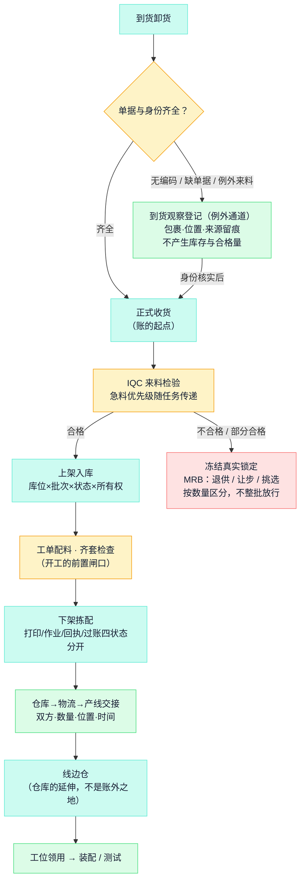

### 库存五维与状态流转

每一批料要同时回答五个维度，缺一个维度就有一类事故：**所有者**（自有/客供——混账就和客户对不上）、**位置**（库位/线边/在途/委外/隔离——缺了就账上有货现场找不到）、**质量状态**（待验/合格/冻结/让步——判了冻结照常发料等于没有质量控制）、**分配状态**（可用/预留/已拣配——缺了就两张工单抢一批料）、**批次身份**（供应商批号收货时留存——**事后补不回来**）。

状态流转是单行道加闸口，每一步都改变"这批料能不能动"：

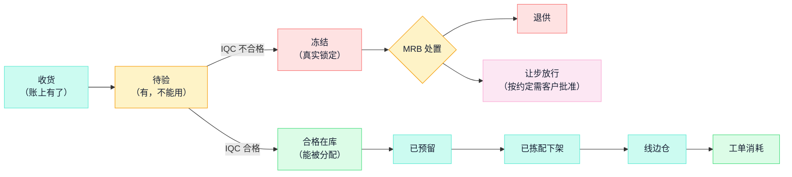

### 急料与线边

- **急料**=缺口已经或即将阻塞工单的料。难点不在哪个环节做不了，而在"急"的信息要穿过四拨人的交接：识别（MRP 缺口/齐套预警）→ 到货即知 → IQC 插队 → 入库即推送产线 → 优先上线。验收判准：**从识别到可用的总时长可分解成四段等待**（到货/身份/检验/仓配），能分解才知道优化哪段。
- **发料三方式**按料对号：高值关键件按单扫码发料；低值稳定耗材倒冲（超耗必须留显式补录通道）；通用辅料线边定额补给。
- **改制料要换身份**：上线前经过厂内改制工序的外购件（改配置、刷固件的模块），严格说已是新料号——"线边那盒有的改过有的没改"就是一台台标定异常的来源。
- 铁律：**未经仓库的料不能上线**。带料直接上线、生产直接拿料，绕行一次追溯链断一段；卡控要系统拦截 + 制度兜底（例外必须批准留痕），缺一边都拦不住。

## 12. 工艺与产线设计

> 📌 **本章要点**：工艺选择是**性能 × 工艺 × 批量成本**的三角权衡，切换时机绑定试产阶段；零件按功能定工艺等级，关键装配动作必须参数化。

### 工艺矩阵与切换节奏

| 工艺 | 适用阶段/场景 | 特点 |
| --- | --- | --- |
| 3D 打印 | 原型、EVT、复杂异形件 | 无模具、迭代快；强度一致性有限，单件成本不随量降 |
| CNC 机加 | 原型到中小批量、高精度件 | 精度高、材料性能好；单件贵 |
| 钣金 | 外罩、支架 | 便宜、改版快；精度刚度有限 |
| 压铸（铝/镁） | 量产关节壳体、框架 | 单件便宜、轻量化好；开模贵周期长，改版代价大 |
| 注塑 | 量产外壳、小结构件 | 量大后极便宜；开模决策要等设计稳定 |

**切换节奏绑定试产阶段**（第 8 章）：切早了，设计一改模具报废；切晚了，验证结论对量产件不成立。

### 工艺路线与产线设计

机器人整机的典型工艺主线（具体因产品裁剪）：


核心决定：

- **工序切分与节拍**：机器人装配单工位作业时间长，小批量常用"单元式装配"（一组人跟一台机），量大后再切细成流水。
- **关键工艺参数化**：拧紧（力矩+转角监控，关键螺栓用智能拧紧枪留数据）、压装（力—位移曲线）、点胶（量与路径）——参数可采集、可追溯、不达标自动拦截。
- **零件按功能定工艺等级**：精密配合面（啮合、轴承位）最高档，受力件强度档，一般结构件速度档——对应的工艺参数卡是受控文件，不是口头传承。
- **防错（Poka-yoke）**：相似件区分（形状/颜色/防呆结构优先于标签）、漏装检测、顺序防错（上一步未过站不能做下一步）。
- **工装治具有版本**，随 ECN 同步更新；SOP 结构化、模块化（通用模块+机型差异），多机种小批量下尤其关键。

**节拍怎么倒推**（教学示意）：年产 1000 台、单班 250 个工作日 → 日产 4 台 → 节拍 2 小时/台。整机总装若需 12 工时，就要 6 个并行装配单元；22 只关节模组意味着日产 88 只，单只装配+测试 30 分钟 → 模组线要 5—6 个工位，**测试台架按吞吐量单独配数**。台架数量是节拍计算的一部分，不是采购清单的尾巴——这正是"测试标定台架也是产能"（第 9 章）在产线设计里的落点。

工装治具按用途分四类，每类都有版本、台账与校验周期：**定位装配工装**（保证配合精度）、**搬运辅具**（整机数十公斤，人机工程与防磕碰是真实问题）、**测试/标定夹具**（快换、可调，用来收敛机型差异）、**防错工装**（物理上装不错）。

**一张工艺参数卡长什么样**（把"参数化"落到实物）：以关节输出法兰的 8 颗 M4 螺栓为例，卡上至少有——螺栓规格与涂胶要求；拧紧力矩 3.0±0.3 N·m，带转角监控窗口；拧紧顺序（对角）；指定的智能拧紧枪编号与程序号；数据采集去向（扭矩曲线入该工位记录）；不达标处置（自动锁站，不允许"再拧一次试试"）。这张卡是受控文件，随 ECN 换版。**产线上的每一个"手感"，都应该能找到它对应的那张卡；找不到卡的手感，就是下一个批量事故的温床。**数字为教学示意。

## 13. 装配与生产执行

> 📌 **本章要点**：防错点压在重复度最高的模组装配段；**履历是生产时记出来的，不是出事后补出来的**——开工检查、过站留痕、受控返工三件事构成执行的骨架。

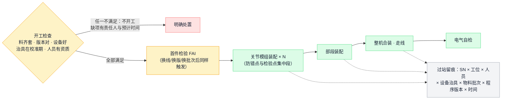

- **SN 主键而非批次主键**：机器人每台的配置、标定参数、测试曲线都不同，追溯必须建立在整机 SN 与关键件 SN 的装配关系上——哪台整机装了哪只关节（它自己的 SN、标定参数、组件测试记录）必须可查。组件拆换关闭旧关系、保留历史。
- **过站留痕的目的不是监工**：当一台机器在成品测试失败时，能回答"它和通过的机器在制造过程上有什么不同"。
- **受控返工/返修**：独立路线、强制复测、履历保留原始失败记录——否则质量分析无法区分制造缺陷与误测；返工品绕过复测混回正常流是经典断点。
- **异常闭环**：呼叫 → 响应（谁、多久）→ 处置 → 关闭 → 统计。异常没人接走，现场就会停止上报；长期滞留的 WIP 往往挂着没人处理的异常——在制数量、停留位置、停留时长要可见。
- **报工只有一个过账入口**：完工数量由唯一入口单向过账给账务系统，两边都能报＝必然重复记账；报工滞后几天，计划与经营数字就失真几天。
- **倒冲的边界**：只适合用量稳定的低值料；超耗、报废、替代必须有显式补录通道——倒冲省掉的扫码动作，是用"掩盖超耗"的风险换来的。
- **在发生点记录，补录带双时间**：数据在动作发生的时间地点录入；事后补录必须区分"发生时间"与"录入时间"两个字段——补录冒充实时，履历的可信度整体归零。

**走读：一台机器成品测试失败之后**。拉出它的过站履历，和同批通过的机器逐项对比五元组：换过操作员吗（人）？设备或治具不同吗（机）？用料批次不同吗（料）？SOP 或程序版本不同吗（法）？过站时间有异常吗——某站停留了 4 小时，中间发生了什么（环，看异常记录）？**十五分钟内完成这组对比，是履历体系的及格线**；做不到，说明留痕有断点。履历的价值从来不在"有记录"，在"能回答差异"。

## 14. 标定：参数属于个体，不属于型号

> 📌 **本章要点**：同型号的电机每只装配角度不同、同型号的关节每个零位不同——**标定流程的终点是"这台机器自己的参数包"**，挂 SN 档案、换件必重标、放行必校验。


- **标定分级**：关节级（电角度偏移、机械零位、电流—力矩）→ 感知级（内参、外参）→ 整机级（运动学参数、手眼）。越往整机级，单台差异越大、耗时越长——产线标定节拍的优化主战场在整机级，自动化标定工站（靶标自动呈现、流程自动执行、结果自动判定入档）是量产的必要投入。
- **标定流程与参数集本身是版本对象**（标定步骤、治具、环境条件、补偿模型按版本管理），而每台实测写入的参数是事实（按 SN 归档）——这正是第 7 章"定义与事实分界"的实例。
- **"写入成功"不等于"性能达标"**：参数写入要回读校验，放行判定依据标定后的复测结果。

### 检测、校准与溯源是三件事

**检测**回答"被测产品是否达到要求"；**校准**回答"测量设备与参考基准的偏差多大"；**调整**是改变设备或产品的参数。三者常被混为一谈，由此有两条硬规则：量具与台架有**校准有效期**，过期设备测出的"合格"不作数——校准到期要自动拦截并联动开工检查（第 13 章）；**溯源属于测量结果而非设备**——一条有效的测量记录背后是连续的校准链与测量不确定度，"设备贴过校准标签"只是起点，不是证明。

**走读：售后换了一只关节之后**。拆旧件（装配关系关闭、旧件 SN 与失效记录留档）→ 装新件（关节级标定参数随件入档）→ **整机级重标**（装配变了，运动学参数、手眼/零位重新辨识）→ 参数包更新并回读校验 → 复测通过 → 重新放行。最容易被省略的是整机重标——漏掉它的后果：单关节一切正常、整机精度莫名变差，排查方向还会被带偏到算法上。**换件触发重标，是"参数属于个体"的直接推论，也是售后 SOP 里最该加粗的一行。**

## 15. 测试体系：分级拦截与质量放行

> 📌 **本章要点**：问题拦在哪一级，返工成本就停在哪一级；每条测试记录要能回答**哪台、哪版配置、哪版限值、什么条件、原始值多少**——只存 PASS 的测试系统在批量漂移面前毫无价值。

### 四级测试架构

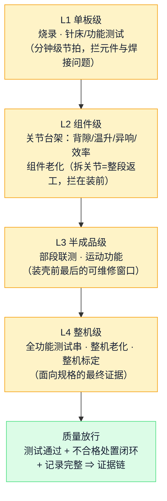

### 组件台架与老化的方法论

设计验证期的台架要素：被测件 + 可控负载（陪测件/测功机）+ 独立测量（称重传感器测扭矩、功率板测输入）+ **测量系统自身的交叉验证**（用另一套known-good 控制器复测对照，排除测试系统偏差）。老化（burn-in）时长是统计决策，用试产失效数据定；老化中连续采集曲线（电流、温度、振动/声音），**中途定期复测看趋势**而不是只看终点——背隙、效率随时间的变化曲线比单点结论值钱得多。一致性验证要覆盖**制造来源**（不同设备/不同供应商的件同台架对比）。

```mermaid
flowchart LR
    DUT["被测件<br/>（扭矩模式）"] <-->|"机械对抗"| LOADG["可控负载<br/>陪测件/测功机（速度模式）"]
    DUT --> MEASG["独立测量<br/>称重传感器测扭矩<br/>功率板测电输入"]
    MEASG --> JUDG["效率 / 刚度 / 背隙判定"]
    XVG["已知良好系统交叉验证<br/>（排除测试系统自身偏差，<br/>测量系统分析 MSA 的朴素形态）"] -.校准.-> MEASG
    JUDG -->|"中途定期复测"| TRD["耐久趋势曲线<br/>效率与背隙随时间的变化"]
    class DUT exec
    class LOADG store
    class MEASG,JUDG qa
    class XVG eng
    class TRD flow
    classDef biz fill:#DBEAFE,stroke:#60A5FA,color:#172033;
    classDef eng fill:#EDE9FE,stroke:#A78BFA,color:#172033;
    classDef flow fill:#CCFBF1,stroke:#5EEAD4,color:#172033;
    classDef exec fill:#DCFCE7,stroke:#4ADE80,color:#172033;
    classDef qa fill:#FEF3C7,stroke:#F59E0B,color:#172033;
    classDef risk fill:#FEE2E2,stroke:#F87171,color:#172033;
    classDef cust fill:#FCE7F3,stroke:#F9A8D4,color:#172033;
    classDef store fill:#F3F4F6,stroke:#9CA3AF,color:#172033;
```

### 从设计验证到量产放行

从"抽样验证设计"（DVT 性质）到"全数放行产品"（量产性质），变化的不是测试内容而是基础设施：台架节拍化、**限值版本化**（设计验证得到的是均值与分布，产线要的是受控发布的单台合格限）、数据入档（每只组件/每台整机的曲线挂它的 SN）。软件统一测试执行引擎的正确形态：一套引擎管全部工站（读总线/采数据/判限/上传），机型与客户差异收敛为**配置文件**，而不是每个机型另写一套程序。

### 测试记录五要素与典型试验项

每条测试记录要能回答五件事：**哪台（SN）、哪版配置（硬件/固件/标定参数）、哪版程序与限值、什么条件、原始值多少**。只存一个 PASS 标志的测试系统，在出现批量性漂移时毫无分析价值——原始值和曲线是为"下一次异常"存的，不是为这一次放行存的。

DVT 阶段的典型试验项（按产品与合同裁剪）：

| 类别 | 典型项目 |
| --- | --- |
| 环境 | 高低温工作/存储、温度循环、湿热 |
| 机械 | 随机振动、冲击、跌落、运输模拟 |
| 寿命 | 关节寿命（循环 × 载荷谱）、插拔寿命、线缆弯折寿命 |
| 电气 | EMC（辐射/抗扰）、静电、电源拉偏 |
| 安全 | 急停、碰撞检测、断电行为（抱闸自锁） |

过程能力的语言：量产工序用 **Cp/Cpk** 说"这道工序稳不稳"——它是 PVT 阶段门的证据之一，也是把"老师傅手感"翻译成数字的通道。

**走读：一次批量性漂移是怎么被抓住的**。某周起，整机老化的关节温升缓慢上移——台台都在限值内、台台 PASS，只看判定结果什么都不会发生。做周度曲线对比的工程师发现温升分布整体右移了 3℃，拉组件台架数据回溯，定位到某批减速器润滑脂加注量偏低；冻结该批次、供应商整改——**在第一台超限之前拦住了它**。这就是"原始值是为下一次异常存的"的含义：PASS 守的是眼前这一台，曲线守的是整个批次的未来。数字为教学示意。

## 16. 交付：放行、发运与客户验收

> 📌 **本章要点**：**放行≠入库≠发运≠签收≠验收**，五个时点分开留证；随机器发走的数据包（SN 清单、测试报告、标定参数）必须与厂内档案同源同口径。

```mermaid
flowchart LR
    A["质量放行完成<br/>（证据链闭合）"] --> B["包装与标识<br/>外箱标签 × 装箱单 × 箱内 SN 一致<br/>运输锁定与缓冲"]
    B --> C["成品入库"]
    C --> D["发运安排：订单匹配<br/>+ 出货校验（被锁定/未放行 SN 出不了门）"]
    D --> E{"合同要求<br/>客户前置批准？"}
    E -->|"需要"| F["客户批准 / 发运前验收"] --> G
    E -->|"不需要（记录不适用）"| G["出库发运<br/>SN × 订单 × 发运批关联<br/>（售后追溯最后一环）"]
    G --> H["物流跟踪 + 随货数据包<br/>SN 清单 · 测试报告 · 标定参数 · 版本记录"]
    H --> I["客户签收"] --> J["到货验收（如约定）<br/>含现场标定复核"] --> K["订单行关闭"]
    I -.->|"拒收 / 差异"| L["差异处理 → 结案回流"]
    class A exec
    class B,C,G,H flow
    class D,E qa
    class F,I,J cust
    class K exec
    class L risk
    classDef biz fill:#DBEAFE,stroke:#60A5FA,color:#172033;
    classDef eng fill:#EDE9FE,stroke:#A78BFA,color:#172033;
    classDef flow fill:#CCFBF1,stroke:#5EEAD4,color:#172033;
    classDef exec fill:#DCFCE7,stroke:#4ADE80,color:#172033;
    classDef qa fill:#FEF3C7,stroke:#F59E0B,color:#172033;
    classDef risk fill:#FEE2E2,stroke:#F87171,color:#172033;
    classDef cust fill:#FCE7F3,stroke:#F9A8D4,color:#172033;
    classDef store fill:#F3F4F6,stroke:#9CA3AF,color:#172033;
```

- **包装是设计问题**：关节锁定机构（运输时防晃）、定制缓冲、冲击记录标签；运输振动/跌落条件回头进 DVT 试验项。
- **出货校验是误放行的最后防线**：测试放行拦"不合格的机器"，出货校验拦"合格流程之外的机器"。
- **售后闭环**：现场失效 → 远程诊断优先 → 维修记录（现象、根因、拆换件 SN）→ 重新放行；返修机履历接回原 SN 档案，换过的关节更新装配关系与标定参数。现场失效的帕累托图（FRACAS）是下一代可靠性设计最值钱的输入。
- 常见断点：箱单与实物 SN 不符（高频客诉第一名）、未放行品先行发货、分批发运后订单行误关闭、"有条件验收"遗留项无人跟踪、给客户的数据与内部口径不一。

## 17. 支线与售后：返修、委外与影响圈定

> 📌 **本章要点**：主流程之外的支线最容易脱离受控——**返修要接回原 SN 履历、委外不改变所有权、客诉的价值在圈定影响范围的速度**；结案要分履约、质量、成本三本账分别关。

### 17.1 客诉与影响圈定：追溯体系的"用途端"

前面各章花了大量篇幅**建**追溯（SN 绑定、过站留痕、参数包入档）。它的终极用途是回答这个问题：*客户客诉一台三个月前交付的整机——同样的问题还有多少台在外面？*

```mermaid
flowchart LR
    E1["客诉到达<br/>客户 SN + 故障描述"] --> E2["映射厂内 SN，调出单台档案：<br/>版本 · 关键件批次 · 工序履历<br/>· 测试标定数据 · 发运记录"]
    E2 --> E3["反向定位嫌疑源<br/>故障组件 → 组件 SN<br/>→ 物料批次 → 供应商批号"]
    E3 --> E4["正向圈定影响范围<br/>同批次 / 同版本 / 同时段全部 SN：<br/>在库 · 在制 · 已发客户"]
    E4 --> E5["处置：RMA 接收 · 在制拦截<br/>· 在库冻结 · 8D 根因"]
    E5 -.设计/工艺原因.-> V1["变更回路（第 18 章）"]
    E5 -.经验证的经验.-> V2["资产回路（第 18 章）"]
    E5 -.来料原因.-> V3["供应商整改"]
    E2 -.同源同口径 · 带截点.-> V4["给客户的报告与数据"]
    class E1,V4 cust
    class E2 store
    class E3,E5 risk
    class E4 flow
    class V1,V2 eng
    class V3 qa
    classDef biz fill:#DBEAFE,stroke:#60A5FA,color:#172033;
    classDef eng fill:#EDE9FE,stroke:#A78BFA,color:#172033;
    classDef flow fill:#CCFBF1,stroke:#5EEAD4,color:#172033;
    classDef exec fill:#DCFCE7,stroke:#4ADE80,color:#172033;
    classDef qa fill:#FEF3C7,stroke:#F59E0B,color:#172033;
    classDef risk fill:#FEE2E2,stroke:#F87171,color:#172033;
    classDef cust fill:#FCE7F3,stroke:#F9A8D4,color:#172033;
    classDef store fill:#F3F4F6,stroke:#9CA3AF,color:#172033;
```

这条链的速度就是追溯体系的价值刻度：反向定位（故障→嫌疑批次）和正向圈定（嫌疑批次→全部去向）各需要多久、需要几个人翻多少系统——建追溯时的每一分投入，都在这里兑现或露馅。

### 17.2 返修与退货（RMA）

现场失效 → 远程诊断优先 → 返厂/现场维修 → 维修记录（现象、根因、**拆换件 SN**）→ 重新放行。三条纪律：返修走**独立路线**（不混入正常生产流）；履历**接回原 SN**（拆换关闭旧装配关系、保留历史，换过的关节重标定并更新参数包）；**重新放行才出厂**（保留此前失败记录，否则无法区分制造缺陷与误测）。现场失效的帕累托（FRACAS）是下一代可靠性设计最值钱的输入。

### 17.3 委外

机加、表面处理、SMT 委外是机器人制造的常态，原则一句话：**实物出厂，所有权和账不出厂**。

```mermaid
flowchart LR
    W1["委外发料<br/>所有权不变 · 库存记『在外』"] --> W2["外协加工<br/>机加 / 表面处理 / SMT"]
    W2 --> W3["回货检验<br/>合格入库 · 不良责任按约定裁定"]
    W3 --> W4["在外余额对账<br/>损耗与报废显式记账"]
    class W1,W4 flow
    class W2 exec
    class W3 qa
    classDef biz fill:#DBEAFE,stroke:#60A5FA,color:#172033;
    classDef eng fill:#EDE9FE,stroke:#A78BFA,color:#172033;
    classDef flow fill:#CCFBF1,stroke:#5EEAD4,color:#172033;
    classDef exec fill:#DCFCE7,stroke:#4ADE80,color:#172033;
    classDef qa fill:#FEF3C7,stroke:#F59E0B,color:#172033;
    classDef risk fill:#FEE2E2,stroke:#F87171,color:#172033;
    classDef cust fill:#FCE7F3,stroke:#F9A8D4,color:#172033;
    classDef store fill:#F3F4F6,stroke:#9CA3AF,color:#172033;
```

自有料、客供料都可以委外，原所有者不因委外改变；发料、回货、在外余额按所有者分账并定期对账——委外在外的料"账上消失"是呆滞和损耗争议的温床。

### 17.4 结案三分

一张订单的"结束"是三本账分别关闭，三者独立确认、不可互相代替：

| 结案 | 关闭条件 | 常见误区 |
| --- | --- | --- |
| **履约结案** | 数量交齐、验收关闭、遗留项清零 | 分批发运后订单行被误关闭 |
| **质量结案** | 问题闭环、8D 关闭、经验回流资产库 | 工单关闭被当成质量结案 |
| **成本结案** | 实际成本归集、物料消耗对账、客供料对账、呆滞处置有归属 | 超耗和呆滞挂账无人认领 |

## 18. 变更管理与反馈闭环

> 📌 **本章要点**：机器人产品设计在量产后仍持续演进，**ECN 管理能力就是产品迭代速度的上限**；判断反馈闭环是否真的在转，看同一问题跨项目的复发率。

### ECN 闭环

```mermaid
flowchart LR
    D["变更发起<br/>问题/成本/供应驱动"] --> IA["影响分析<br/>在制品 · 在库在途料 · 工装<br/>SOP · 测试程序 · 已出货产品"]
    IA --> AP["批准与生效<br/>断点四形态：按日期 / 按工单<br/>/ 按批次 / 按 SN"]
    AP --> EX["执行与验证<br/>首件验证 · 文档全部换版 · 旧版回收"]
    EX --> CL["关闭条件：旧料处置完<br/>在制处置完 · 现场确认收到新版"]
    CL --> BK["回流：变更起因<br/>转为问题库与检查项"]
    BK -.预防.-> D
    class D risk
    class IA,AP qa
    class EX exec
    class CL flow
    class BK eng
    classDef biz fill:#DBEAFE,stroke:#60A5FA,color:#172033;
    classDef eng fill:#EDE9FE,stroke:#A78BFA,color:#172033;
    classDef flow fill:#CCFBF1,stroke:#5EEAD4,color:#172033;
    classDef exec fill:#DCFCE7,stroke:#4ADE80,color:#172033;
    classDef qa fill:#FEF3C7,stroke:#F59E0B,color:#172033;
    classDef risk fill:#FEE2E2,stroke:#F87171,color:#172033;
    classDef cust fill:#FCE7F3,stroke:#F9A8D4,color:#172033;
    classDef store fill:#F3F4F6,stroke:#9CA3AF,color:#172033;
```

- **生效断点必须可重现**：给定任何一台产品的身份，不询问任何人就能判定它适用哪一版——"大概十月中旬切的"不算断点。
- **批准 ≠ 关闭**：旧料处置完、在制处置完、现场确认收到新版，三件事都留痕之后变更才关闭——最容易丢的留痕恰好在批准与关闭之间。
- **试产与量产分轨**：试产走轻量快速通道、量产走完整流程；"轻量"轻的是审批层级，**不是记录**——试产不留变更记录，到设计验证结束时没人说得清当前配置是什么。

**影响盘点的对象清单**（每次 ECN 逐项过一遍）：在制工单、在库与在途物料、已交付产品、工装治具、SOP、测试程序与限值、标定流程、采购在途订单、已发给客户的数据与文档。漏盘一类对象，就在那类对象上埋一颗雷——影响分析是 ECN 里工作量最大的一步，也最值得工具辅助（第 22 章）。

**版本快照 vs 重新展开**：主数据变更后，已下达的工单是保持原快照做完，还是跟随新版重新展开？必须显式定义（通行做法：已开工保快照、未开工重展开），不能由"谁先发现谁决定"。

**走读：一张客户 ECN 到达后的 24 小时**（时间与数字为教学示意）。第 0 小时，登记——关联旧版、新版与正式依据，口头通知只登记不执行；第 2 小时，工程核对实际变化（图纸/BOM/固件/测试限值哪些动了）；第 4 小时，影响盘点跑完对象清单——在制 3 张工单、在库旧料 400 件、在途 200 件、已交付 150 台、测试程序 1 版待改；第 8 小时，双批准（客户批设计决策、厂内批执行方案）；第 24 小时，裁定断点并发布带回执——在制保快照做完、新工单起用新版、旧料用尽、已交付不追溯，四句话每句都是钱。**变更管理的功力不体现在流程图上，体现在这 24 小时里每个数字都有人算过。**

### 反馈闭环：让教训变成资产

| 反馈路径 | 从 | 到 |
| --- | --- | --- |
| 试产问题 → 检查项 | NPI 问题库 | DFM 检查表、IQC 检验项、SOP、测试项 |
| 测试数据 → 设计余量 | 产线测试统计分布 | 规格限值修订、降本减配依据 |
| 现场失效 → 可靠性设计 | RMA/FRACAS | 下一代试验项、关键件选型 |
| 工时/良率 → DFA | 产线实绩 | 下一代结构与装配设计 |

反馈要变成**受控资产**（检查项、工艺模块、测试模块）而不只是文档，守三条纪律：**未经验证的个案不得发布为资产**（原因假设 ≠ 已验证根因）；**资产发布即冻结版本**，采用方固定版本快照；**第二个项目采用仍需独立验证**——资产给的是起点，不是免检凭证。客户项目沉淀的资产要脱敏或保留原权限，源项目资料不随资产开放。

## 19. 度量：用统一口径说这条链好不好

> 📌 **本章要点**：没有统一口径的指标，反馈闭环就没有仪表盘；**先讲分母再谈良率，先分时点再谈交期**——口径本身是受控对象，先有基线再定目标。

### 19.1 全链指标地图

```mermaid
flowchart LR
    K1["计划段<br/>承诺达成率<br/>计划改期次数"] --> K2["物料段<br/>齐套率 · 急料四段时长<br/>（到货/身份/检验/仓配）"]
    K2 --> K3["制造段<br/>直通率 FPY · 节拍达成<br/>过站异常率"]
    K3 --> K4["测试段<br/>一次通过率 · 复测率<br/>老化失效率"]
    K4 --> K5["交付段<br/>OTD/OTIF · 放行→发运周期<br/>验收遗留项数"]
    K5 --> K6["质量闭环<br/>同一问题跨项目复发率<br/>8D 关闭周期"]
    K6 -.指标回流驱动改进.-> K1
    class K1 biz
    class K2 flow
    class K3 exec
    class K4,K6 qa
    class K5 cust
    classDef biz fill:#DBEAFE,stroke:#60A5FA,color:#172033;
    classDef eng fill:#EDE9FE,stroke:#A78BFA,color:#172033;
    classDef flow fill:#CCFBF1,stroke:#5EEAD4,color:#172033;
    classDef exec fill:#DCFCE7,stroke:#4ADE80,color:#172033;
    classDef qa fill:#FEF3C7,stroke:#F59E0B,color:#172033;
    classDef risk fill:#FEE2E2,stroke:#F87171,color:#172033;
    classDef cust fill:#FCE7F3,stroke:#F9A8D4,color:#172033;
    classDef store fill:#F3F4F6,stroke:#9CA3AF,color:#172033;
```

两个最有判别力的指标：**急料四段时长**（能分解才知道优化哪段，第 11 章）和**同一问题跨项目复发率**（它不降，说明经验仍在人脑不在体系，第 18 章）。

两类容易缺席的口径：**设备侧**用 OEE（时间开动率 × 性能开动率 × 合格品率）看台架与关键设备的真实产出——老化房和标定工站的 OEE 常常才是整线瓶颈的真相；**库存侧**看库存准确率（账实相符的行数比例，由循环盘点驱动，差异重点是查原因而不是调平数字）与库存周转——周转骤降通常是呆滞正在堆积的前兆。

**同一条线的三个"良率"**（教学示意）：某月投入 100 台——首次通过 82 台，返工后再通过 13 台，报废 5 台。于是"良率 95%"（最终合格）和"良率 82%"（首次通过 FPY）同时为真，而返工那 13 台吃掉的工时与台架时间全藏在 95% 里。管直通率看 82，核算产出看 95——**两个数字都要，谁也不能冒充谁**；报表上只给一个"良率"的产线，返工成本永远在暗处。

### 19.2 口径纪律

| 口径陷阱 | 正确做法 |
| --- | --- |
| "良率 95%" | 先讲分母：首次投入、**首次通过（FPY）**、最终合格、返工后通过是四个不同的数——只报最终合格率会把返工成本藏起来 |
| "按时交付了" | 交期分五个时点：计划完工、实际完工、质量放行、出库、客户签收——统计交付、确认收入、启动质保各挂不同时点（第 16 章） |
| "库存还有 N" | 回答不了任何问题——按五维报：所有者 × 位置 × 质量状态 × 分配状态 × 批次（第 11 章） |
| 先定目标后找基线 | **先取得业务基线，责任人确认口径与观察周期，再定目标值**——没有基线的数字目标只会催生口径操纵 |
| 口径随手改 | 指标口径的变更也是受控变更：改了分母要广播，历史数据标注断点 |

## 20. OEM 模式：设计与制造的分工

> 📌 **本章要点**：OEM 的边界是**设计决策权归客户、制造决策权归制造方**，两者通过受控的数据包、DFM 建议与双版本映射交接；交接面的质量直接决定导入周期。

设计与制造分属两家公司时，全流程在交接面一分为二：

```mermaid
flowchart LR
    subgraph CUST["客户域（设计方）"]
        direction TB
        c1["需求定义 · 系统架构<br/>· 子系统设计（第 1—6 章）"]
        c2["工程发布：数据包<br/>（第 7 章清单）"]
        c3["设计决策与批准<br/>· ECN 发起"]
    end
    subgraph HAND["交接面"]
        direction TB
        h1["导入数据包评审<br/>完整性 + DFM 可制造性"]
        h2["客户版本 ↔ 厂内版本<br/>双版本映射，映射本身受控"]
        h3["DFM 建议<br/>（制造方提出，客户决策）"]
    end
    subgraph MFG["制造域（制造方）"]
        direction TB
        m1["工程导入：EBOM→MBOM<br/>工艺路线 · 测试方案（第 8—15 章）"]
        m2["供料与执行<br/>（客供/代采按合同裁定）"]
        m3["厂内批准与质量放行<br/>· 交付数据包（第 16 章）"]
    end
    CUST --> HAND --> MFG
    MFG -. "试产问题 · 测试数据 · DFM 发现" .-> HAND
    HAND -. "变更与升版" .-> CUST
    class c1,c2,c3 cust
    class h1,h3 qa
    class h2 eng
    class m1,m2,m3 exec
    classDef biz fill:#DBEAFE,stroke:#60A5FA,color:#172033;
    classDef eng fill:#EDE9FE,stroke:#A78BFA,color:#172033;
    classDef flow fill:#CCFBF1,stroke:#5EEAD4,color:#172033;
    classDef exec fill:#DCFCE7,stroke:#4ADE80,color:#172033;
    classDef qa fill:#FEF3C7,stroke:#F59E0B,color:#172033;
    classDef risk fill:#FEE2E2,stroke:#F87171,color:#172033;
    classDef cust fill:#FCE7F3,stroke:#F9A8D4,color:#172033;
    classDef store fill:#F3F4F6,stroke:#9CA3AF,color:#172033;
```

### 交接面的四个机制

- **数据包成熟度分级**：按"真源化程度"评估客户资料——是否单一设计真源、发布物是否由源自动导出、工艺文件是否按可执行工程交付、是否有带日期的变更记录。分级结论用于预估导入周期与风险；缺口（公差图纸、检验标准、测试限值表）由制造方在导入时补齐并确认。
- **双版本映射**：同一份资料有客户版本（批准权在客户）与厂内版本（批准权在厂内工程）两个受控身份，**并存且映射可查**，不允许"反正内容一样"合并——客户升版厂内未切、厂内优化客户未批，是 OEM 最常见的两类版本事故。
- **DFM 建议权与设计决策权分离**：制造方基于试产问题库与检查表输出 DFM 建议，客户保留设计决策；厂内评审通过不代替客户批准。
- **供料模式按合同裁定**：客供料（客户所有权、独立台账、定期对账）、代采（呆滞风险归属要约定）、客户直发料（例外通道，留痕与责任约定）并存时，每种模式的所有权、检验责任、不良与损耗处理都在合同层面写清。

### 客户触点与数据边界

客户不是只在两端出现——触点贯穿制造全程，每个触点都要约定形式与时限：

| 触点 | 内容 | 常见约定 |
| --- | --- | --- |
| 资料交付与升版 | 数据包、ECN | 接收登记、双版本映射 |
| DFM 建议回复 | 制造方建议，客户决策 | 回复时限；不回复的默认规则 |
| 首件确认 | 部分客户要求首件批准后才能批量 | 确认形式与节点 |
| 制程变更批准 | 影响产品的工艺变更 | 哪些制程变更需报客户 |
| 见证测试 / 驻厂检验 | 关键试验客户到场或远程见证 | 范围与排期 |
| 验收与数据包 | 发运前/到货后验收、随货数据 | 位置、格式、截点 |
| 对账 | 客供料、交付数量、质量指标 | 周期与口径 |

数据边界两条铁律：**客户之间严格隔离**（多租户思想——A 客户永远看不到 B 客户的任何对象）；**跨项目复用的是脱敏后的方法资产，不是客户资料**（检查项可以复用，源项目的图纸和数据不随资产开放）。

### 角色分工速查

| 环节 | 主导角色 | 关键协作 |
| --- | --- | --- |
| 需求与架构 | 产品经理、系统架构师 | 各子系统负责人 |
| 子系统设计 | ME（结构）/ EE（电子）/ SW（软件）/ 算法 | 通过 ICD 协作 |
| DFM 与工程导入 | PE / NPI 工程师 | 设计团队、采购 |
| 试产 | NPI 项目经理 | PE / TE / QE / 产线 |
| 测试与标定 | TE（测试工程师） | 设计（规格来源）、QE（放行标准） |
| 质量 | QE / SQE | 贯穿：来料、过程、放行、售后 |
| 计划与物料 | PMC / 采购 | 销售、供应商 |
| 变更 | 变更委员会（CCB） | 发起方 + 全部受影响职能 |

无论设计制造是否同属一家公司，最容易没人认领的三件事是：**版本一致性的总负责、测试规格的唯一出处、问题闭环的跟踪**——组织设计时要显式指派。

---

## 21. AI 在全流程中的位置

> 📌 **本章要点**：AI 的正确位置是**辅助起草、人工签核**——知识库先行、确定性计算与 AI 解释分离、每条输出带出处、信息不足明确说未知、不直接过账。

全流程里大量工作是"把分散的事实和知识组织成一个判断的草稿"：评审一份数据包、分析一次缺料影响、盘点一次 ECN 波及面、归因一次测试异常。这类工作是 AI 辅助的主场——前提是把工作方式设计对：

```mermaid
flowchart LR
    A1["在具体业务对象上发起<br/>（评审 / 急料 / 变更 / 问题）"] --> A2["按发起人授权读取<br/>受控知识库 + 权威事实"]
    A2 --> A3["确定性工具计算<br/>BOM 比对 · 缺口 · 影响清单<br/>（数量与限值不由模型生成）"]
    A3 --> A4["草案输出<br/>每条结论带出处与版本"]
    A4 --> A5{"人工审阅签核"}
    A5 -->|"确认/修改"| A6["成为业务结论<br/>走与人相同的<br/>权限 · 审计路径"]
    A5 -->|"发现真实问题"| A7["问题登记<br/>→ 回流检查项（第 18 章）"]
    A4 -.信息不足.-> A8["明确标识未知<br/>不编造根因与建议"]
    class A1 biz
    class A2,A4 eng
    class A3 flow
    class A5 qa
    class A6,A7 exec
    class A8 risk
    classDef biz fill:#DBEAFE,stroke:#60A5FA,color:#172033;
    classDef eng fill:#EDE9FE,stroke:#A78BFA,color:#172033;
    classDef flow fill:#CCFBF1,stroke:#5EEAD4,color:#172033;
    classDef exec fill:#DCFCE7,stroke:#4ADE80,color:#172033;
    classDef qa fill:#FEF3C7,stroke:#F59E0B,color:#172033;
    classDef risk fill:#FEE2E2,stroke:#F87171,color:#172033;
    classDef cust fill:#FCE7F3,stroke:#F9A8D4,color:#172033;
    classDef store fill:#F3F4F6,stroke:#9CA3AF,color:#172033;
```

### 典型场景形态

| 场景 | AI 做什么 | 人保留什么 |
| --- | --- | --- |
| 导入评审辅助 | 图纸/BOM 自动比对问题库与 DFM 检查表，列缺项、冲突与待确认项 | 工程确认适用性；设计决策权在客户 |
| 物料与交付影响分析 | 汇总缺口、受影响工单、责任岗位与下一步建议 | 缺口数字来自规则计算，AI 只组织与解释 |
| ECN 影响分析 | 按新旧版本差异自动生成影响清单草案（在制/在库/SN/程序/治具） | 影响范围与生效边界由工程和业务责任人核定 |
| 测试异常归因 | 归纳异常模式、检索历史同类、提出待验证的假设 | 区分相关性与已验证根因；以真实复测确认 |
| 工艺/知识问答 | 带版本、来源与适用条件的回答 | 过期或不适用资料不作为现行执行依据 |
| 复盘与 8D 草稿 | 整理已知事实与证据引用、起草材料、标出缺项 | 经验证的结论才能发布为复用资产 |

### 四条落地原则

1. **辅助起草、人工签核**：AI 输出停在草案态，签核后才进入业务对象，动作走与人相同的授权、幂等与审计路径——AI 不直接过账。
2. **知识库先行**：问题库、检查表、SOP 的结构化建设就是 AI 的训练场；没有受控知识，AI 只能漂亮地复述猜测。
3. **确定性计算与 AI 解释分离**：数量、齐套、限值判定、库存可用量先约定规则和权威输入、由确定性工具计算并保留依据，AI 引用这些结果做解释，不代替计算。
4. **诚实边界**：每条输出带出处可回溯原文；信息不足明确标识未知；规则实现与模型实现持续区分——没有模型调用就不宣称 AI 生成。

## 结语：同一个闭环，两种维持方式

需求、设计、发布、采购、制造、标定、测试、交付、迭代——这个闭环在一个人的工作台上和在千台规模的工厂里是同一个闭环。区别只在维持方式：单台原型靠一个人的自觉（他同时是设计、采购、质检和追溯系统），量产靠版本中枢、齐套闸口、过站留痕、SN 档案和 ECN 断点让闭环在"×1000 台 × 多机种 × 多班组"的规模下不断裂。**先看懂最小闭环，再理解工厂，顺序不能反**——这也是本文与[BHL 实战案例](robot-design-manufacturing-walkthrough-bhl.md)配套阅读的用意：那份文档展示最小闭环长什么样，本文说明把它放大一千倍需要什么。
