# 机器人设计与制造全流程实战：以 Berkeley Humanoid Lite 为例

用一个真实开源人形机器人项目，把"从一个想法到一台能走路的机器人"的完整链路走一遍：需求定义 → 系统架构 → 执行器/电子/软件设计 → CAD 与工程发布 → 物料采购 → 制造 → 装配 → 烧录标定 → 测试验证 → 联调部署 → 迭代变更。每一章先讲**这个项目实际是怎么做的**（真实文件、真实数字、真实采购链接），结尾用一段「量产视角」说明同一件事放到工厂量产时会变成什么。量产侧的机制、公司系统的能力现状与 EX001 机器人试产的实际教训都已融入对应章节，本文可独立阅读。

- 模拟对象：**Berkeley Humanoid Lite（BHL）**，UC Berkeley Hybrid Robotics 实验室的全开源人形机器人。选它的理由：人形整机（与我们业务形态同构）、自研关节执行器（设计深度够）、BOM/CAD/固件/装配/训练全链路开放且经过验证、2026 年仍在活跃维护。
- 调研方式：实际 clone 了它的 4 个代码仓库、下载了全部 27 页官方文档、BOM 表格和 arXiv 论文（[2504.17249](https://arxiv.org/abs/2504.17249)），本文全部数字和文件路径均来自这些一手材料，核验日期 2026-11-06。
- 许可证：代码 MIT，硬件资产 CC BY-SA 4.0——意味着可以合法地复刻、改造甚至商用（需署名+相同方式共享）。
- 阅读提示：**重点是阶段、思维、流程和架构**，具体参数只是让每个阶段"落地有声"的锚点，不必记忆。每章三层：开头的「📌 本章要点」给结论，图承载骨架，文字是图的注解——只读要点和图即可建立全貌。

## 全流程总览

五个阶段、一条回流。每个阶段回答一个问题，产出一类资产：

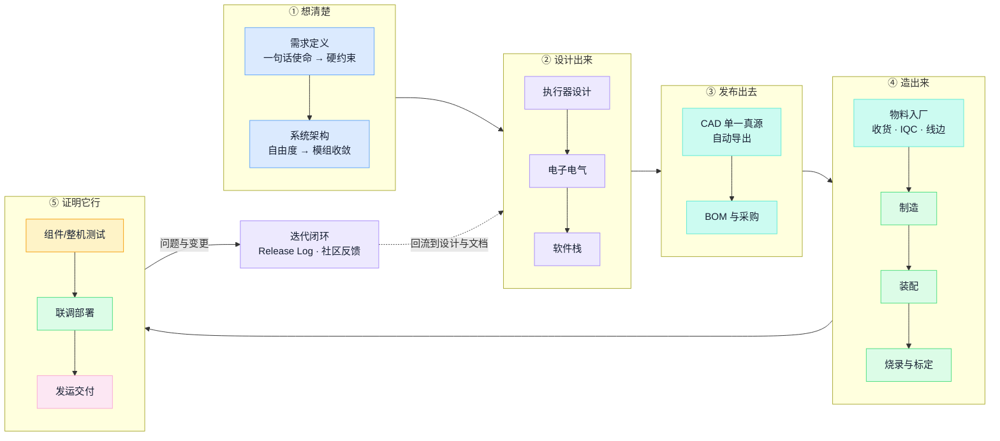

| 阶段 | 回答的问题 | 产出的资产 | 本文章节 |
| --- | --- | --- | --- |
| ① 想清楚 | 为谁做、做到什么程度、受什么约束 | 需求约束表、系统架构 | 2—3 |
| ② 设计出来 | 每个子系统怎么实现、自研还是外购 | 执行器/电气/软件设计 | 4—6 |
| ③ 发布出去 | 别人（含未来的自己）凭什么能复现 | CAD 真源、BOM、文档 | 7—8 |
| ④ 造出来 | 料和图纸怎么变成实物 | 物料闭环、工艺参数、SOP、参数包 | 9—12 |
| ⑤ 证明并交付 | 凭什么说合格、怎么交到客户手里 | 测试数据、检查单、发运与验收记录 | 13—15 |
| 回流 | 错误怎么不再犯第二次 | 变更记录、检查项 | 16 |
| 放大 | 这台机器放进工厂和我们的系统里是什么样 | 原型→量产迁移表、系统承接架构（五路裁定） | 17—18 |

## 目录

1. [项目资产地图：一个"导入数据包"的实例](#1-项目资产地图一个导入数据包的实例)
2. [需求定义：它的"产品规格书"只有一句话](#2-需求定义它的产品规格书只有一句话)
3. [系统架构：22 个自由度怎么收敛成两种模组](#3-系统架构22-个自由度怎么收敛成两种模组)
4. [关节执行器设计：一条真实的选型决策链](#4-关节执行器设计一条真实的选型决策链)
5. [电子电气设计：电源树、总线与一次真实的设计变更](#5-电子电气设计电源树总线与一次真实的设计变更)
6. [软件栈：从电机固件到强化学习](#6-软件栈从电机固件到强化学习)
7. [CAD 与工程发布：Onshape 单一真源](#7-cad-与工程发布onshape-单一真源)
8. [物料与采购实战：三张 BOM 表](#8-物料与采购实战三张-bom-表)
9. [物料到厂之后：一颗急料的厂内之旅](#9-物料到厂之后一颗急料的厂内之旅)
10. [制造实战：全部结构件出自一台桌面 3D 打印机](#10-制造实战全部结构件出自一台桌面-3d-打印机)
11. [装配实战：工具、工序与可预见的坑](#11-装配实战工具工序与可预见的坑)
12. [烧录与标定：每台机器自己的参数包](#12-烧录与标定每台机器自己的参数包)
13. [测试与验证：一个自建的"测试标定平台"雏形](#13-测试与验证一个自建的测试标定平台雏形)
14. [系统联调与部署：开工检查的民间版本](#14-系统联调与部署开工检查的民间版本)
15. [放行之后：包装、发运与客户验收](#15-放行之后包装发运与客户验收)
16. [迭代与变更：Release Log 就是一部 ECN 史](#16-迭代与变更release-log-就是一部-ecn-史)
17. [终章：从 1 台到 1000 台，每个环节会变成什么](#17-终章从-1-台到-1000-台每个环节会变成什么)
18. [我们的系统如何承接这台机器人](#18-我们的系统如何承接这台机器人)

---

## 1. 项目资产地图：一个"导入数据包"的实例

> 📌 **本章要点**：客户能交出什么样的数据包，决定导入从哪里开始。BHL 是满分样本，而它缺的三样（公差图纸、检验标准、测试限值表）正是原型与量产产品的距离。

假设 BHL 团队是我们的客户，把这台机器人交给我们代工——他们能交出什么？这正是 OEM 导入评审时要客户提交的"数据包"，BHL 的开源资产恰好构成一份完整样本：

| 资产 | 载体 | 内容 |
| --- | --- | --- |
| 机械 CAD | [Onshape 云文档](https://cad.onshape.com/documents/fc6443b1d89dcba950e85b60/w/94a26479973a4098a5884426/e/be3fe37849edbeadc95b9bf8)（整机）+ 执行器、USB-CAN 外壳各一份 | 全参数化装配体，**单一真源** |
| 打印工程文件 | [Bambu MakerWorld .3mf 工程](https://makerworld.com/en/models/1327260-berkeley-humanoid-lite)（整机 + 两种执行器各一份） | 不只是 STL——含摆放、参数、切片配置的完整打印工程 |
| BOM | [Google 表格](https://docs.google.com/spreadsheets/d/1AQEHcH_nPkXYfor2-h7bwNIUMmsePtAm53epnsWgZXc)，3 个 sheet | 每项带规格、数量、美元/人民币双价格、Amazon/淘宝双采购链接 |
| 仿真描述 | [Berkeley-Humanoid-Lite-Assets](https://github.com/HybridRobotics/Berkeley-Humanoid-Lite-Assets) | 从 Onshape 自动导出的 URDF / MJCF / USD + 视觉网格 |
| 电机固件 | [Recoil-Motor-Controller-BESC](https://github.com/T-K-233/Recoil-Motor-Controller-BESC) | 自研 FOC 固件，STM32CubeIDE 完整工程 |
| 底层控制 | [Berkeley-Humanoid-Lite-Lowlevel](https://github.com/HybridRobotics/Berkeley-Humanoid-Lite-Lowlevel) | 实时 C 代码 + Python 工具（标定、连通性检查、遥控） |
| 训练与部署 | [Berkeley-Humanoid-Lite](https://github.com/HybridRobotics/Berkeley-Humanoid-Lite)（主仓库） | Isaac Lab 训练环境、sim2sim、sim2real、遥操作、已训练的 ONNX 策略 |
| 工艺文档 | [GitBook 文档站](https://berkeley-humanoid-lite.gitbook.io/docs)，27 页 | BOM、打印参数、装配视频、烧录流程、标定、深度技术笔记 |
| 设计依据 | [arXiv 论文](https://arxiv.org/abs/2504.17249) | 设计决策理由 + 执行器完整测试数据 |

这九类资产不是并列清单，底层是一条**数字线程**：左边是对"这一型"的定义，中间是制造把定义变成实物的转换，右边是"这一台"独有的事实——全文 18 章就是沿这条线走：

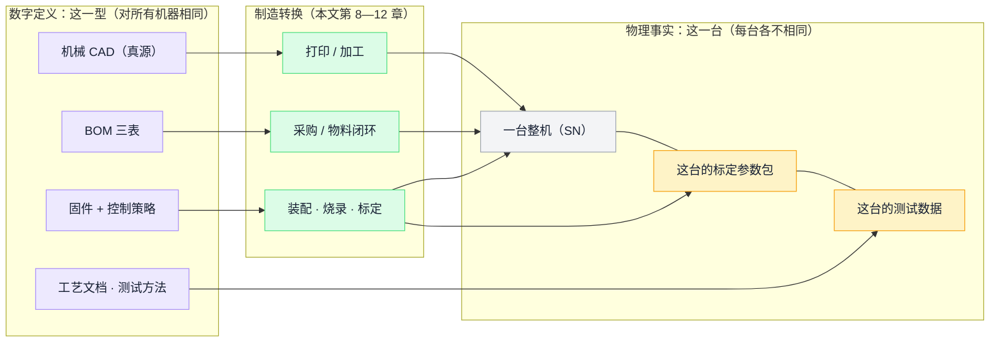

**定义与事实的分界是全文最重要的一条线**：定义（左）按版本管理、改一处全型号生效；事实（右）按 SN 归档、一台一份、只增不改。把每台的参数当版本管，版本号按台爆炸；把限值塞进台账按台存，"当时按什么标准判的"就没了答案。

注意这份数据包里**有**什么、**没有**什么：有 CAD、BOM、固件、装配指引、测试方法；没有 2D 工程图（公差标注）、没有来料检验标准、没有正式的测试限值表。这个差距正是"研究原型"和"可量产产品"的距离，后面每章都会碰到它。

> **量产视角**：客户若只交得出这个水平的数据包，工程导入时制造方要补的是：图纸公差化、EBOM→MBOM（按工厂实际领料与装配结构重排层级、补辅料包材）、来料检验项、测试限值表。《客户导入数据包规范》的作用就是在签约时把这张表变成对客户的硬性要求。

## 2. 需求定义：它的"产品规格书"只有一句话

> 📌 **本章要点**：需求定义的本质是**用可验证的硬约束砍掉选项**——每条指标必须与验证方法成对出现，否则只是愿望。

BHL 没有传统意义的 PRD，但论文里的设计目标陈述是一份极简又完整的需求定义，核心一句话：**让任何研究者、教师和爱好者，不依赖专业制造设施就能造出一台能跑强化学习的人形机器人**。

这个阶段的思维方式：一句使命 → 展开成几条**可验证的硬约束** → 每条约束明确地**否决一批方案、框定一批决策**。约束不是限制创造力，而是帮后面所有章节砍掉选项：

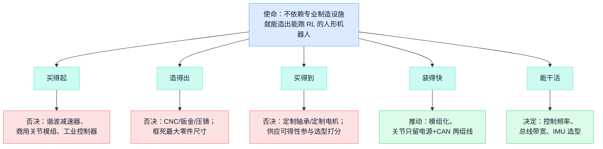

从这句话推导出的硬指标：

| 需求 | 量化指标 | 它如何约束后面所有设计 |
| --- | --- | --- |
| 买得起 | 整机硬件 **< $5,000**（实测美国 $4,312 / 中国 ¥约 23,000 即 $3,236） | 否决了谐波减速器、商用关节模组、工业控制器 |
| 造得出 | 所有非标件在 **200×200×200 mm** 桌面打印机上用 PLA 打印 | 否决了 CNC、钣金、激光切割；连最大零件尺寸都被这个数字框死 |
| 买得到 | 所有外购件来自 Amazon/淘宝/Digikey/Mouser，**一周内到货** | 否决了定制轴承、定制电机；选型时"供应可得性"权重高于性能 |
| 装得快 | 整机装配约 **3 天**，坏了的执行器可整体快换 | 推动模组化：关节只需电源 + CAN 两组线 |
| 能干活 | 跑 RL 行走（sim2real 零样本迁移）+ 双臂遥操作 | 决定了控制频率、总线带宽、IMU 选型 |

值得学的一点：这份"规格书"的每一条都**写明了验证方式**——成本有两国 BOM 实价对照表，性能定义了可比指标（各关节峰值扭矩均值按身高体重归一，即论文的 performance factor），耐久有 60 小时台架试验。

> **量产视角**：我们的客户（全栈机器人公司）给的规格书往往反过来——性能指标很细，可制造性指标全空。导入评审要替客户把"造得出、测得了"的那一半补上：最大件尺寸 vs 工艺能力、节拍目标 vs 测试时长、目标成本 vs BOM 实价。

## 3. 系统架构：22 个自由度怎么收敛成两种模组

> 📌 **本章要点**：架构的核心动作是**收敛**：22 个关节收敛成 2 种模组、四肢收敛成四条对称总线。模组种类每减一种，后端的 BOM/SOP/工装/备件全部按倍数减少。

BHL 的架构答卷可以用一张图讲完——计算、通信、执行三层，外加承载一切的型材躯干：

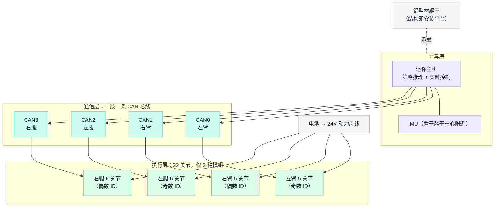

这张图里藏着四个架构思维：**模组收敛**（种类越少，后面的 BOM/SOP/工装/备件全部按倍数减少）、**对称切分**（肢体即总线分区，故障隔离和装配分工都按肢走）、**协议层防错**（左奇右偶的 ID 规则，让人一眼判断左右）、**结构与功能分离**（精密件打印、平台件用型材——躯干要的是扩展性不是曲面）。

**整机参数**：身高 0.8 m，自重 16 kg，22 个自由度 = 2 条 6 自由度腿 + 2 条 5 自由度臂 + 2 个舵机夹爪。躯干不是打印件，而是**铝型材框架**（250/200/150/100 mm 四种长度 + 角码拼装）——因为躯干需要的是安装扩展性而非复杂曲面，型材比打印件更便宜、更刚、更好改。

架构上最值得抄的一个决策：**22 个关节只用两种执行器规格**。

| 规格 | 电机 | 用在哪 | 数量 |
| --- | --- | --- | --- |
| 6512 执行器 | MAD M6C12 150KV 无框电机 | 髋、膝、肩（大扭矩轴） | 10 |
| 5010 执行器 | MAD 5010 110KV 无刷电机 | 踝、肘、腕（小扭矩轴） | 12 |

两种模组共享同一套机械构型（摆线 15:1）、同一块驱动板、同一个编码器、同一份固件（宏切换电机参数）。这意味着：BOM 种类减半、装配 SOP 只写两份、备件只备两种、任何关节坏了拆下换新即可。每个关节自成模块、无外部连杆，改肢体长度只需换打印的连接件（论文演示了用碳管把腿加长到成人尺寸的变体）。

**电气拓扑**同样按"肢"为单位切分：一条肢体一条 CAN 总线（CAN0=左臂, CAN1=右臂, CAN2=左腿, CAN3=右腿），4 个 USB-CAN 适配器汇聚到一台迷你主机（Beelink N95，$129，Ubuntu 22.04）。CAN ID 的分配规则也有讲究：左侧关节用奇数 ID、右侧用偶数——人在产线和调试时一眼能判断左右，这是"防错设计"在协议层的体现。

> **量产视角**：制造侧把成熟工艺沉淀为"工艺模块库"、新机型按"拼装 80% + 定制 20%"承接——这个构想的设计侧源头就在这里：客户设计阶段收敛的模组种类，直接决定制造侧的工装/测试台架/SOP 数量。导入评审时"你们几种关节模组、共享多少物料"应该是第一批问题。EX001 六轴臂 44 项问题里结构类占一半，模组收敛做得好坏是根因之一。

## 4. 关节执行器设计：一条真实的选型决策链

> 📌 **本章要点**：部件设计是**约束下的决策链**：让工艺和供应链参与设计（先选买得到的轴承再画图）；make-vs-buy 可以拆开硬件与软件分别决策。

设计一个部件不是"画一个最好的"，而是**在约束下走一条决策链**——每一步的输出是下一步的输入，每个分叉都有被否决的选项和否决理由。BHL 执行器的决策链完整可考：

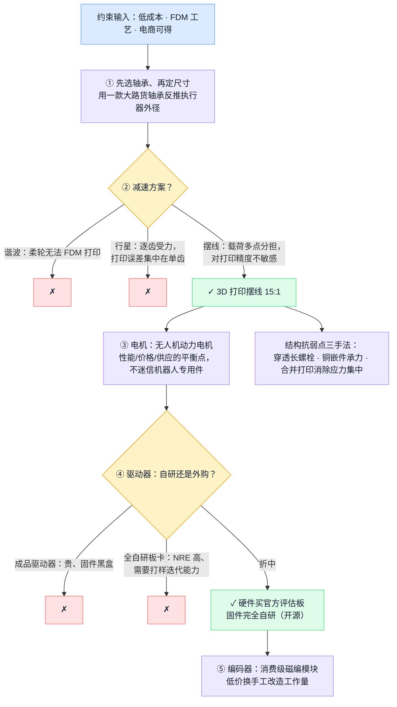

注意两个思维模式：**让工艺和供应链参与设计**（第①步先选"买得到的轴承"再画图，第②步的否决理由全部来自制造工艺而非性能），以及**make-vs-buy 不是二选一**（第④步拆开硬件和固件分别决策）。

这是全项目设计含量最高的部分。一只 6512 执行器 = 7 类零件，总成本 **$188.69**（美国价）/ 约 **$157**（中国价）：

| 组成 | 选型 | 价格（美） | 决策理由 |
| --- | --- | --- | --- |
| 电机 | MAD M6C12 150KV 无刷电机（无人机动力电机） | $129 | 扭矩密度/价格/供应的平衡点；不是"机器人专用"电机 |
| 减速器 | **3D 打印摆线减速器，15:1** | 含在打印件里（约 $4） | 见下文——整个项目的技术核心 |
| 驱动器 | ST **B-G431B-ESC1** 官方评估板 | $18.97 | 候选有 Moteus、ODrive、VESC；选它因为最便宜且 Digikey/Mouser 常年有货 |
| 编码器 | AS5600 磁编模块（12 位，I2C） | $3.30 | 消费级模块，需手工改板上电阻换配置 |
| 轴承 | 6811ZZ（主输出）+ MR106×13 + 6701×2 | $23 | **先选轴承再定尺寸**：6811 是便宜大路货，整个执行器外径围绕它设计 |
| 紧固件 | M3 螺栓 + 铜螺纹嵌件 + 六角铜柱 | $5 | 嵌件和穿透螺栓是打印件的"钢筋" |
| 线缆 | 14 AWG 动力 + 30 AWG 信号硅胶线 | $5 | — |

一只执行器的内部架构——左边电气链、右边机械传动链，交汇在电机：

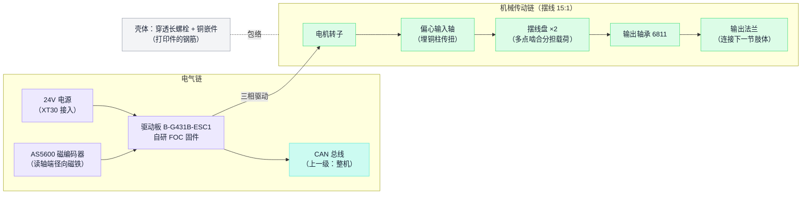

### 为什么是摆线，不是行星/谐波？

这是一个教科书级的"设计迁就工艺"案例。约束是：减速器必须能在桌面 FDM 打印机上用 PLA 打出来且能用。

- **谐波**：柔轮根本无法 FDM 打印，且违背成本约束，排除。
- **行星**：齿面小、逐齿啮合，FDM 的层纹和尺寸误差集中在单齿上，磨损快、背隙大（已有开源项目用树脂打印才做成），排除。
- **摆线**：载荷同时分布在多个"齿"（摆线盘与销轴多点接触）上，对打印精度不敏感、耐冲击，缺点（结构厚、略重）在这个尺寸下可接受——采用，减速比 15:1。

对抗 FDM 材料弱点的三个结构手法，全部能在 CAD 里看到：**穿透长螺栓**（M3×55 贯穿壳体，让受力走螺栓不走层间粘接）、**嵌入铜件**（输入轴里埋 M4 六角铜柱传扭矩，螺纹全部打在铜嵌件上而非塑料上）、**合并打印**（把多个零件合并成单件打印，消除紧固件孔周围的应力集中）。

### 自研 vs 外购的真实账本

BHL 的驱动器方案是一个精妙的中间态：**硬件外购（ST 评估板 $19），固件自研（Recoil，开源）**。对比三条路线：

| 路线 | 代表 | 单关节驱动成本 | 代价 |
| --- | --- | --- | --- |
| 全外购成品驱动器 | Moteus、ODrive | $50–$150 | 受制供应商、成本下不来、固件黑盒 |
| 评估板 + 自研固件（BHL 选择） | B-G431B-ESC1 + Recoil | **$19** | 要自己写 FOC、扛固件全部问题；评估板非为量产设计 |
| 全自研板卡 | MIT Mini Cheetah 驱动器 | 物料更低，NRE 高 | 需要电子设计与打样迭代能力 |

这个选择与它"研究平台"的定位完全自洽；换一个定位答案就不同（见终章）。

> **量产视角**：组件选型表里"供应可得性"作为一列显式存在，这正是 EX001 物料 21 项问题的预防方式。而"先选轴承再定尺寸"这种以大路货件反推设计的做法，是 DFM 的最高形态——不是画完图再评审可制造性，而是让可采购性参与设计。

## 5. 电子电气设计：电源树、总线与一次真实的设计变更

> 📌 **本章要点**：电气架构两条主线：**电源只做两级变换**；**安全内建在协议层**（心跳看门狗），不靠应用程序自觉。IMU 换型是一次教科书式的小型 ECN。

### 电源树

6S 锂电池（约 24 V，$70）为根，整机只做两级变换：

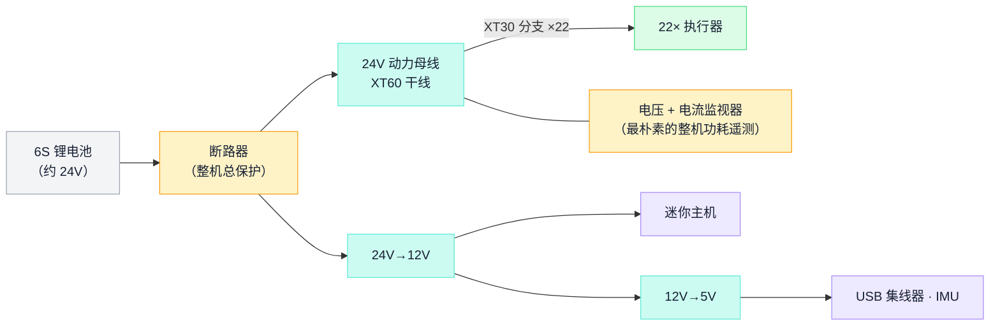

接头策略分阶段：**调试期用 WAGO 免焊端子**（快速接拆每只执行器，排障方便），**定型后改焊接 + XT30/XT60**。动力线 14 AWG 硅胶线，信号线 30 AWG——线规也是 BOM 的一部分，写进了文档。

### CAN 总线与协议

通信协议的架构思想：**按用途分帧型，把"安全"内建在协议层**而不是靠应用程序自觉：

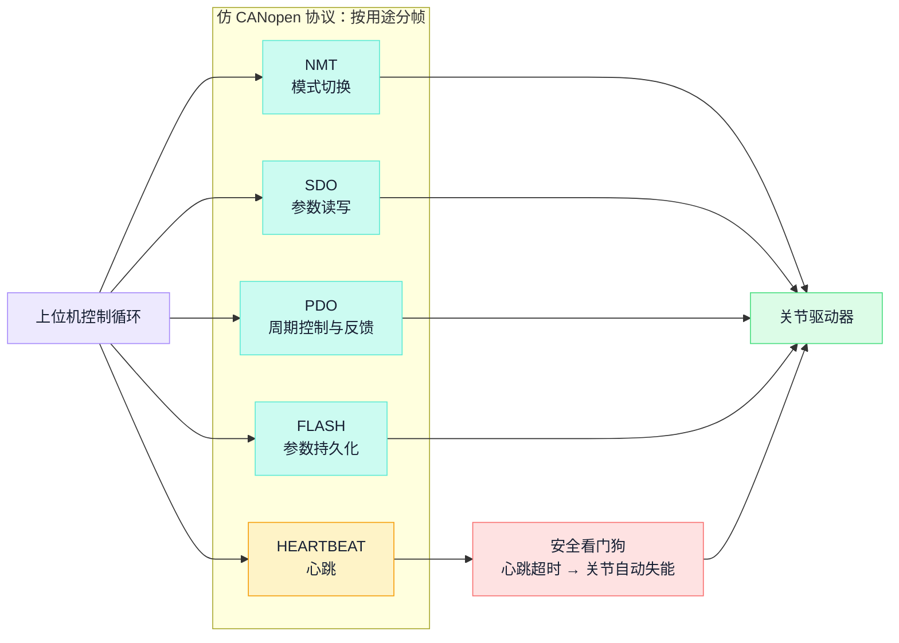

1 Mbps CAN，自定义了一套**仿 CANopen** 的精简协议（文档有完整帧定义）：NMT 帧切换运行模式、SDO 帧读写参数、PDO2/PDO3 帧做周期控制（目标位置+速度 / 位置+前馈扭矩，fp32）、FLASH 帧存取参数、**HEARTBEAT 帧喂安全看门狗**——主机停止心跳，关节自动失能。这是安全设计嵌在协议层的例子。文档甚至给了 CAN 噪声抑制的工程笔记（分离式终端电阻、共模扼流圈），这类"打过仗才写得出"的内容正是知识沉淀。

### 一次真实的设计变更：IMU

初版用 BNO085（$13）——但它是 I2C 接口，得**用一块 Arduino Nano 当转接桥**焊线连到主机，装配要手焊 4 根信号线。团队后来找到自带 USB 的 IM10A（$90），直接插线即用，于是：文档更新、**BOM 同步更新**、并补了一页两款 IMU 的性能对照表（加计/陀螺的量程、分辨率、噪声、零漂逐项列出）作为变更依据。一次完整的小型 ECN：动因（装配性）、验证（性能对照）、影响面（BOM+文档）、留痕（文档站 2025-06-28 的 release log）。

> **量产视角**：IMU 这个案例按标准 ECN 流程走就是：变更申请（降低装配工时与焊接不良率）→ 影响分析（BOM、SOP、测试程序、在制品）→ 验证（性能对照）→ 生效断点。研究项目靠自觉做到了前三步；量产体系的差别只在"断点管理"——哪台 SN 之前是 BNO085、之后是 IM10A，必须可查。

## 6. 软件栈：从电机固件到强化学习

> 📌 **本章要点**：软件分层的边界即接口；**策略上实机前必须换一个仿真引擎复验**（sim2sim）——这是软件版的首件验证。

软件架构是经典的分层：越往下实时性越强、越接近硬件；越往上迭代越快、越接近任务。每层独立成仓库，边界即接口：

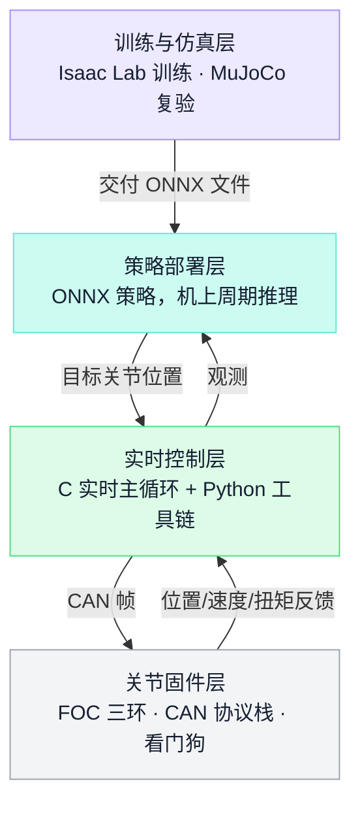

策略从训练到真机的交付流程，中间有一道强制的"换引擎复验"工序：

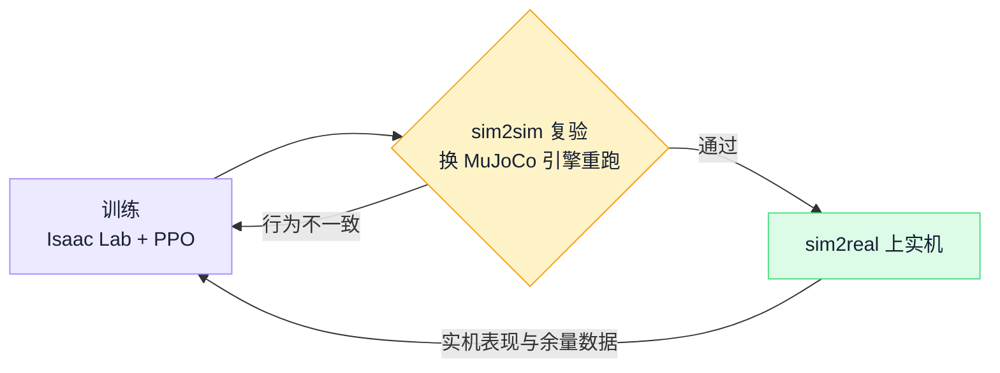

四层的载体与内容：

| 层 | 载体 | 内容 |
| --- | --- | --- |
| 关节固件 | Recoil（STM32G431，自研） | FOC 电流/速度/位置三环、CAN 协议栈、参数 Flash 持久化、看门狗。版本号用日期编码（`0x20250226`） |
| 实时控制 | Lowlevel 仓库 | C 代码跑运动控制（实时性要求高，推荐 xanmod 实时内核），Python 代码做工具链（标定、连通检查、遥控接收） |
| 训练与仿真 | 主仓库 | Isaac Lab + PPO 训练行走策略；**sim2sim**（MuJoCo 复验）→ **sim2real**；观测只用本体感知（IMU 角速度、重力投影、关节位置速度） |
| 部署 | 主仓库 checkpoints/ | 已训练策略以 **ONNX 发布**（policy_biped_25hz.onnx 等），机上 25 Hz 推理 |

两个对制造最有启发的细节：

1. **sim2sim 是道工序**。策略在 Isaac Lab 训练后，先在另一个物理引擎（MuJoCo）里复验，确认不是"过拟合某个仿真器"，再上真机。这相当于软件版的"首件验证"——换个环境还成立，才算数。
2. **实机只用了 30% 扭矩上限**就实现了行走。这个数字是性能余量的直接证据，也是"同款执行器可以撑起更大机器人"论断的依据。量产语境里，这类余量数据决定能否降本减配。

> **量产视角**：ONNX 文件 + 固件 bin + 每台的参数 JSON，共同构成一台机器人的"软件配置"。量产体系要为此设一个"版本中枢"：工单下达时冻结的是硬件 BOM、固件（含策略文件）、测试程序与限值、标定流程、工艺文件这几条版本轴的**组合快照**——任何一轴错位（新固件配旧限值、新结构配旧治具），产品就错了，而且在产线上看不出来。

## 7. CAD 与工程发布：Onshape 单一真源

> 📌 **本章要点**：设计数据管理只有一条原则：**一切发布物都是单一真源的自动导出产物**，改设计只改源头，下游永不手工维护。

BHL 把这条原则执行到了教科书程度——所有形态的发布物都从同一个源头自动导出：

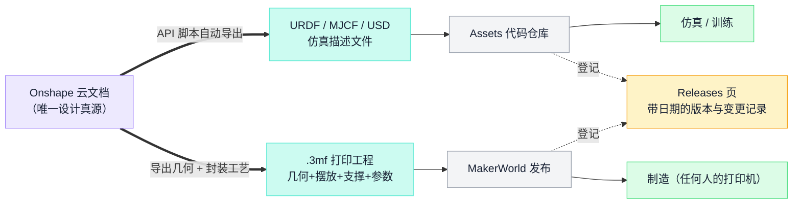

两个关键设计：仿真模型与 CAD **不可能漂移**（它们是同一个源的两种输出，不存在"改了图忘了改模型"）；打印文件按**工程**而非裸几何发布（接收方拿到的是"可直接执行的工艺"，而不是"还要自己定工艺的形状"）。

BHL 的设计数据管理值得逐条抄写：

- **单一真源**：机械设计只存在于 Onshape 云文档（免费公开），GitHub 上的 STL/URDF 全部是**导出产物**，不手工维护。改设计只改 Onshape。
- **自动化导出**：Assets 仓库里是 `export_onshape_to_urdf.py` / `export_onshape_to_mjcf.py` 脚本，通过 Onshape API 自动生成 URDF/MJCF/USD。仿真模型与 CAD 永不漂移——因为它们是同一个源的两种输出。
- **打印文件按"工程"发布**：不发裸 STL，发 MakerWorld 的 .3mf 工程文件——摆放方向、支撑、打印参数都封装在内。接收方（哪怕是爱好者）拿到的是"可直接执行的工艺"而不是"还需要自己定工艺的几何"。
- **发布有版本记录**：文档站 Releases 页维护完整的 release log（详见第 16 章）。

> **量产视角**：这套"单一真源 + 自动导出 + 按工程发布"正是 EBOM→MBOM、图纸→SOP 转换想达到的状态。客户如果 CAD 和 BOM 是两套手工维护的东西，导入评审就要把"对不上"列为风险项——EX001 的"螺牙深度图纸 7.5mm 实测 7.0mm"这类问题，源头常常就是多源维护。

## 8. 物料与采购实战：三张 BOM 表

> 📌 **本章要点**：读 BOM 先读结构：**执行器占整机成本 81%**，本体降本的主战场一目了然；零长周期物料是被设计出来的，不是运气。

BOM 是一个 Google 表格，3 个 sheet：6512 执行器、5010 执行器、整机。**每一行都有：规格、用途说明、数量、美元价+Amazon 链接、人民币价+淘宝/天猫链接**。这是实际下载核对过的数据：

### 执行器 BOM（×10 / ×12 = 全机 22 份）

| 分类 | 6512（美国价） | 5010（美国价） |
| --- | --- | --- |
| 电机 | M6C12 150KV，$129 | 5010 110KV，$84 |
| 驱动板 | B-G431B-ESC1，$18.97 | 同左 |
| 编码器 | AS5600，$3.30 | 同左 |
| 轴承 | MR106×13 + 6701×2 + 6811ZZ×2，$23.19 | 小一号，$18 |
| 紧固件 | M3 螺栓/嵌件/铜柱，$6.11 | $4 |
| 打印件 | PLA 约 0.12 kg | 约 0.1 kg |
| 线缆接插件 | $5 | $5 |
| **合计** | **$188.69**（中国价约 $157） | **$136.36**（中国价约 $94） |

### 整机 BOM（论文 Table III，美国/中国双价）

| 分类 | 美国价 | 中国价 |
| --- | ---: | ---: |
| 6512 执行器 ×10 | $1,880 | $1,563 |
| 5010 执行器 ×12 | $1,632 | $1,130 |
| 迷你主机 | $129 | $223 |
| USB-CAN 适配器 ×4 | $68 | $43 |
| 6S 锂电池 | $70 | $81 |
| IMU（BNO085） | $13 | $12 |
| 夹爪 ×2 | $72 | $44 |
| 铝型材 + 角码 | $39 + $16 | $3 + 少量 |
| 打印耗材（整机结构） | $200 | $84 |
| 电源/监控/断路器等电子杂项 | $123 | $28 |
| USB 集线器 ×2 等 | $36 | $11 |
| **整机合计** | **$4,312** | **$3,236** |

成本结构一图看懂——**机器人本体的成本就是关节的成本**：

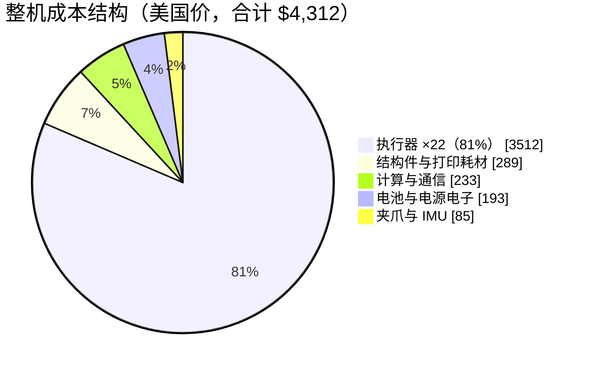

读这三张表能读出的供应链事实：

- **成本结构**：22 只执行器占整机成本 81%——机器人本体的成本就是关节的成本，降本主战场一目了然。
- **中国供应链便宜 25%**，其中机械件（轴承 $23→$4、紧固件、型材 $39→$3）差距最大，电子件反而接近甚至倒挂（迷你主机 $129→$223）。
- **零长周期物料**：全部一周内到货，这是被设计出来的（第 2 章的需求约束），不是运气。对照之下，真实机器人产品里谐波减速器、定制压铸件动辄 8–16 周，是计划的第一约束。
- BOM 里**辅料也计价**（热熔胶、热缩管算在 Misc 里）——"缺一颗螺丝和缺一个减速器对产线的阻塞效果相同"。

> **量产视角**：这张表到了工厂要再展开三层：每个料号挂 AVL（至少一个替代来源）、挂来料检验项（EX001 的教训：压铸件挑料、来料螺牙检测）、挂采购提前期进 MRP。齐套检查对象是全表而不是关键件——料到厂之后的完整链路见第 9 章。

## 9. 物料到厂之后：一颗急料的厂内之旅

> 📌 **本章要点**：料到厂后的每一步交手都是闸口；**例外通道的质量（无编码、带料、不合格怎么留痕锁定）决定整条链的可信度**；急料考验的是传递，不是能力。

BHL 的"仓库"是一个货架：Amazon 的箱子到了就放上去，开箱看一眼就算 IQC，伸手拿走就算发料，工作台就是线边仓。单人闭环里这些动作不需要名字——因为做的人、知道的人、负责的人是同一个人。工厂里这条链被拆给**仓库、IQC、物流、产线四拨人**，每一次交手都必须变成有状态、有责任人、有时间戳的闸口——这正是公司 15 条已报告物料痛点（P01—P15）的主场。

这一章让一颗急料当主角走完全程：设 EX001 式场景——M6C12 电机晚到，缺它 10 只大扭矩执行器齐不了套，整机工单已经在等（第 8 章讲过，执行器占整机成本 81%，这类高值关键件晚到是最典型的急料）。

### 9.1 同一个动作，两种世界

| 动作 | BHL 的做法 | 工厂里它变成什么 | 它要回答的问题 |
| --- | --- | --- | --- |
| 收货 | 签收快递、拆箱 | 核对送货单、身份核实、SAP 收货记账 | 这是什么料、多少、谁送的、对应哪张采购单 |
| 判断能不能用 | 开箱看一眼 | IQC 检验任务（标准来自检验建模：工序+物料+上下限+量具） | 能不能用、按什么标准、谁判的 |
| 放哪 | 上货架 | 上架入库：库位 × 批次 × 质量状态 × 所有权 | 在哪、是谁的、什么状态、能不能动 |
| 用 | 伸手去拿 | 配料下架 → 交接 → 线边仓 → 工位领用 | 谁拿走的、给了哪张工单、线边还剩多少 |
| 急 | 自己盯物流页面 | 急料标识随任务全程传递、每段等待可分解 | 还要等多久、现在卡在哪一段、谁在处理 |

### 9.2 主线：从卸货到上线的九道闸口

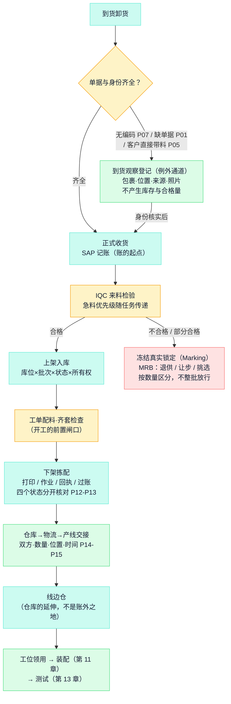

读图要点：**左边一列是正常路，右边的分支全是例外通道**——而例外通道的质量（无编码怎么留痕、带料怎么补账、不合格怎么锁死）才真正决定这条链的可信度。BHL 没有例外通道，因为它没有"例外"的概念：任何异常都由同一个人当场消化，也当场消失，不留任何记录——这正是单人项目和工厂的本质区别。

### 9.3 急料：考验的不是能力，是传递

急料的定义很朴素：**缺口已经或即将阻塞工单的料**。急料难管不是因为哪个环节做不了，而是"急"这个信息要穿过四拨人的交接，每个闸口都得知道它该插队：

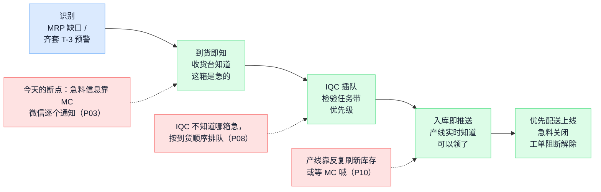

目标状态一句话：**急料标签跟着料走完全程，从识别到可用的总时长可以分解成四段等待**（到货等待 / 身份等待 / 检验等待 / 仓配等待）——能分解才能知道该优化哪一段。这就是急料闭环的验收判准。

### 9.4 库存五维："仓库还有 N 个"回答不了任何问题

工厂库存的每一批料要同时回答五个维度，缺一个维度就有一类事故：

| 维度 | 回答 | 缺了它的事故 |
| --- | --- | --- |
| 所有者 | 自有料还是客供料（OEM 特有：客户所有权、独立台账、定期对账） | 客供与代采混账，和客户对不上 |
| 位置 | 厂内库位 / 线边 / 在途 / 委外在外 / 隔离区 | 账上有货、现场找不到（P04：待检区没库位） |
| 质量状态 | 待验 / 合格 / 冻结 / 让步 | 不良料被产线领用——判了冻结照常发料等于没有质量控制 |
| 分配状态 | 可用 / 已预留 / 已拣配 | 两张工单抢同一批料，齐套检查失真 |
| 批次身份 | 供应商批号在收货时留存 | **事后补不回来**——追溯链从源头就断 |

状态流转是单行道加闸口，每一步都改变"这批料能不能动"：

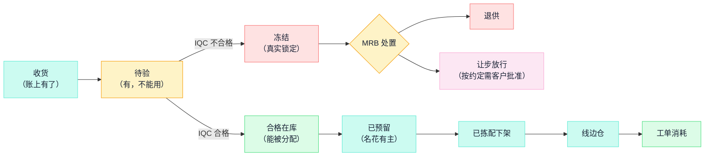

记住三个不等号：**收货 ≠ 合格入库 ≠ 可投料**。BHL 的货架上这五个维度全部坍缩成一维（在不在架上），因为所有者永远是自己、状态存在脑子里——一个人的记忆是免费的，四拨人的共识必须靠系统。

### 9.5 线边仓与拿料：最容易变成"账外之地"的一段

线边仓是**仓库的延伸**，不是脱离账目的缓冲堆。料从仓库到工位有三种受控方式，按料的价值和消耗特性分配：

| 发料方式 | 适用 | BHL 的料怎么对号 |
| --- | --- | --- |
| 按单发料（逐单扫码，账最准） | 高值关键件 | M6C12/5010 电机、驱动板、轴承——按工单数量发，多一只都要有说法 |
| 倒冲（完工反算，省事但掩盖超耗） | 用量稳定的低值料 | M3 螺栓、热缩管——但超耗/报废必须留显式补录通道 |
| 线边补给（定额补货） | 通用辅料 | 焊锡、热熔胶棒 |

一个 BHL 里藏着的真实制造工程细节：AS5600 编码器模块上线前要**手工改贴片电阻**（第 11 章）——改制之后它严格说已经不是原来那个料号了，是一颗经过厂内工序的半成品。量产时这类"改制料"必须有自己的料号和工序记录，否则"线边那盒 AS5600"有的改过有的没改，装错一只就是一台标定异常——相似件防错从料号设计就开始了。

最后是这一段最重要的纪律：**未经仓库的料不能上线**。P05（客户带料直接上产线）、P06（生产直接去仓库拿料）是现状里真实存在的绕行——绕行一次，这台机器的追溯链就断一段，日后客诉查到这里就查不下去了。卡控要系统做（MES 投料校验拦截）+ 制度兜底（例外必须批准留痕），缺一边都拦不住。

> **量产视角**：这一章的九道闸口分别由不同系统承接——SAP 管收货记账与三方匹配、MES 管 IQC/冻结/投料校验、WMS 管库位与拣配、到货观察与交接确认走协同工具——谁承接哪一段的完整裁定见第 18 章。

## 10. 制造实战：全部结构件出自一台桌面 3D 打印机

> 📌 **本章要点**：制造的核心思维是**按零件功能给工艺分级**：精度档给啮合面、强度档给受力件、速度档给其余——不是所有零件都配得上最高精度。

BHL 的"工厂"就是一台 Bambu Lab X1C（官方另验证过 Creality Ender-3 V3 SE，约 ¥1500 的入门机）。一个零件该用哪档工艺，一棵决策树就能判定：

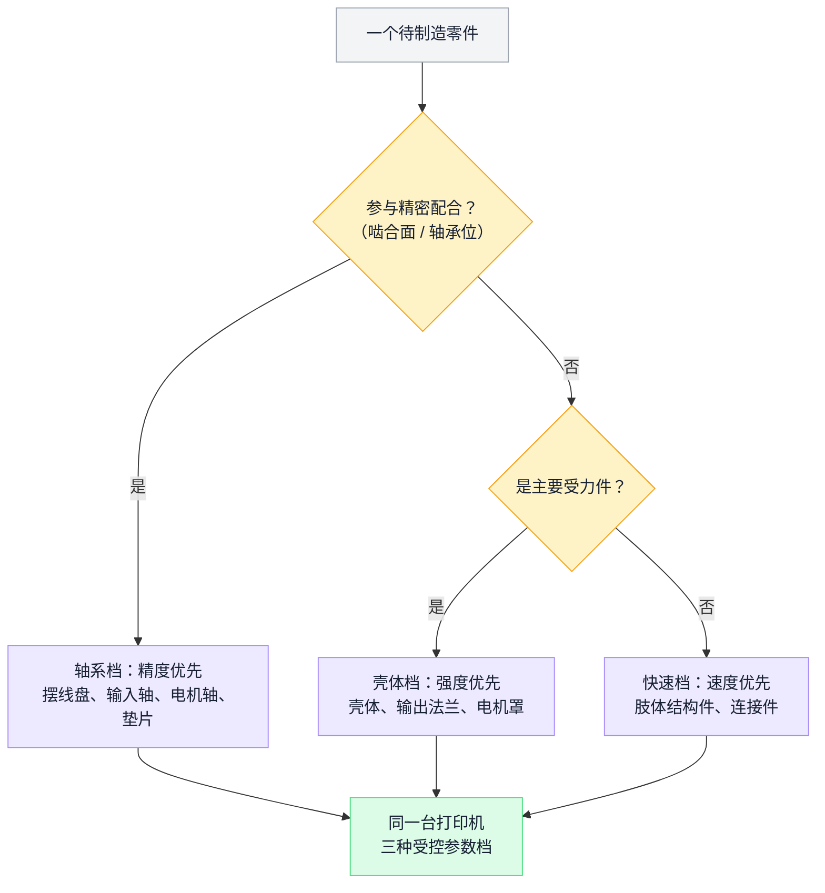

文档里的**两套打印参数档**（加上普通快速档共三级）：

| 参数档 | 适用零件 | 逻辑 |
| --- | --- | --- |
| **Actuator Shaft 档**（高精度） | 摆线盘、输入轴、电机轴、垫片 | 啮合与配合面，尺寸精度直接决定背隙和效率 |
| **Actuator Housing 档**（强度） | 壳体、输出法兰、电机罩 | 受力件，优先层间结合与强度 |
| 普通快速档 | 四肢结构件、连接件 | 不参与精密配合，速度优先 |

另有两条工艺纪律：四肢零件**镜像打印**（左右件同一文件镜像出图，不维护两套模型）；所有零件装入 200³ mm 打印体积（设计时就框死）。整机打印耗材约 $200（美国价）/ $84（中国价），一周内可打完全部零件。

这里要诚实标注本项目的边界：**BHL 的制造只有增材一种工艺**。它没有 CNC、钣金、压铸、注塑，也就没有开模决策、模具周期、首件检验（FAI）这些量产制造的核心议题——这是"研究原型"的特权。但它的两档参数思想（按功能定工艺等级）与量产完全相通。

> **量产视角**：放大到千台，第一批要换工艺的就是执行器壳体和摆线盘（见终章的工艺迁移表）。而"打印参数档"在工厂的对应物是工艺规程+工艺参数卡：哪个零件用哪台设备哪组参数，是受控文件而不是口头传承。EX001 的"老化中轴承异响"类问题，很多源于装配参数（压装力、预紧）没有参数卡化。

## 11. 装配实战：工具、工序与可预见的坑

> 📌 **本章要点**：装配把防错点压在重复度最高的工序段（执行器 ×22）；量产要把"文档警告"升级为**物理防错与工位检测**。

装配流程的结构：**先模组、后部段、再整机**——22 只执行器是重复性最高、也最容易出质量问题的"节拍瓶颈"工序，所以把防错点和检验点都压在这一段：

```mermaid
flowchart LR
    subgraph ACT["执行器装配 ×22（节拍瓶颈段）"]
        direction LR
        a1["改编码器板"] --> a2["粘装磁铁<br/>⚠ 径向充磁防错点"] --> a3["装摆线减速器<br/>与轴承"] --> a4["焊接电机/编码器<br/>⚠ 焊盘保护点"]
    end
    ACT --> B1["部段装配<br/>臂 ×2 · 腿 ×2（镜像件）"]
    B1 --> B2["铝型材躯干合装"]
    B2 --> B3["整机走线<br/>动力干线/分支 + 信号焊接"]
    B3 --> B4["电气自检"]
    class a1,a3 exec
    class a2,a4 qa
    class B1,B2,B3 exec
    class B4 qa
    classDef biz fill:#DBEAFE,stroke:#60A5FA,color:#172033;
    classDef eng fill:#EDE9FE,stroke:#A78BFA,color:#172033;
    classDef flow fill:#CCFBF1,stroke:#5EEAD4,color:#172033;
    classDef exec fill:#DCFCE7,stroke:#4ADE80,color:#172033;
    classDef qa fill:#FEF3C7,stroke:#F59E0B,color:#172033;
    classDef risk fill:#FEE2E2,stroke:#F87171,color:#172033;
    classDef cust fill:#FCE7F3,stroke:#F9A8D4,color:#172033;
    classDef store fill:#F3F4F6,stroke:#9CA3AF,color:#172033;
```

### 工装清单（文档"Preparing the Tools"页）

3D 打印机、烙铁（推荐 SUGON A9）、**热嵌件压台**（保证铜嵌件垂直压入——这就是最小的"工装治具"）、热熔胶枪（粘编码器磁铁）、M2–M6 内六角扳手。总投入不到 ¥2000。

### 执行器装配（×22 次）

1. **改编码器板**：AS5600 模块要手工更换几个贴片电阻改配置，再焊 VCC/GND/SDA/SCL 四线——消费级模块拿来当工业件用的代价。
2. **装磁铁**：热熔胶把磁铁粘到电机轴端。文档用警告框强调：**必须用编码器配套的径向充磁磁铁**，普通轴向充磁磁铁装上去"看起来一样"，但编码器读不出角度——典型的"相似件防错"场景，靠文档警告拦截。
3. 装配摆线减速器与轴承（视频 SOP）。
4. **焊接**：驱动板的 CAN 焊盘"非常脆弱、易从基板脱落"，文档特别提醒焊接和理线时不要对焊盘施力——评估板不是为整机装配设计的，这是 $19 板子的隐性成本。

### 整机装配

臂、腿、整机三段各一部视频 SOP + 一张整机接线图。装配顺序：先 22 只执行器 → 部段（臂/腿）→ 铝型材躯干合装 → 走线（干线 XT60、分支 XT30、信号线焊接+热缩管）→ 电气自检。全程约 3 天（熟练后）。

注意 BHL 的 SOP 形态是**视频**——对单人复刻友好，但不可检索、不可 diff、改版成本高（第 16 章的 release log 里多次补充视频与说明）。

> **量产视角**：视频 SOP → 结构化电子 SOP（工位级、带关键参数和照片、受 ECN 管控）；"文档警告框"→ 物理防错（磁铁做成只能装对的形状）或工位检测（装后即测角度读数）；"焊盘易脱落"这类已知弱点 → 来料检验项 + 过程检验项。量产线上这些统称**过站留痕**——履历是生产时记出来的，不是出事后补出来的：哪台执行器谁装的、嵌件压了多深、磁铁装前有没有核对型号。

## 12. 烧录与标定：每台机器自己的参数包

> 📌 **本章要点**：**参数属于个体，不属于型号**。标定流程的终点是"这台机器自己的参数包"，换件必重标、放行必校验。

同型号的电机，每只的磁铁装配角度都不同；同型号的关节，每个的机械零位都不同——所以标定流程的终点必须是"这台机器自己的参数包"：


这是全项目离"产线"最近的环节，流程完全可以照搬成工位作业指导：

### 烧录（每块驱动板三次下载）

工具是 STM32CubeIDE（板载 ST-LINK，Micro-USB 直连）：

1. **首次烧录**：置 `FIRST_TIME_BOOTUP=1`，配置 Flash 选项字节（解除页保护），断电重启；
2. **写参数**：设定该关节的 `DEVICE_CAN_ID`（按关节映射表，1–14，左奇右偶）、选择电机型号宏，烧录把默认参数写入 Flash；
3. **定版**：改回从 Flash 读参数，再烧一次。

### 标定

每只执行器跑 `calibrate_electrical_offset.py`——电机以约 1 A 电流空转，辨识**电角度偏移（flux offset）**存入 Flash；方向反了就交换任意两相线或置 `MOTOR_PHASE_ORDER=-1`。装机后再做关节零位标定（position offset）。

### 参数包

最关键的制度性设计：整机 22 个关节的全部参数固化为一个 JSON（`robot_configuration.json`），逐关节记录减速比（-15）、极对数（14）、扭矩常数、PID 增益、**该只电机实测的 flux_offset、该个关节的 position_offset**、固件版本（`0x20250226`，日期编码）。看两个真实片段就明白"参数属于个体而非型号"：左肩 pitch 关节 `flux_offset: 68.04`，另一关节 `37.84`——同型号电机，每只的装配角度都不同，**参数必须跟着个体走**。

> **量产视角**：这个 JSON 就是"SN 级标定参数包"的原型——量产体系的原则是**标定参数与测试曲线是一等数据对象**，意思就是把这个文件从"仓库里的一个 backup 文件"升级为"挂在整机 SN 档案下、换件必更新、放行必校验"的受控数据。EX001 的"电机标定信息异常"问题，本质是这条链上的某一环断了。

## 13. 测试与验证：一个自建的"测试标定平台"雏形

> 📌 **本章要点**：测试体系的架构是**分级拦截**：问题拦在哪一级，返工成本就停在哪一级；测量系统自身也要被交叉验证。

BHL 的测试覆盖映射到标准四级架构——问题拦在哪一级，返工成本就停在哪一级：

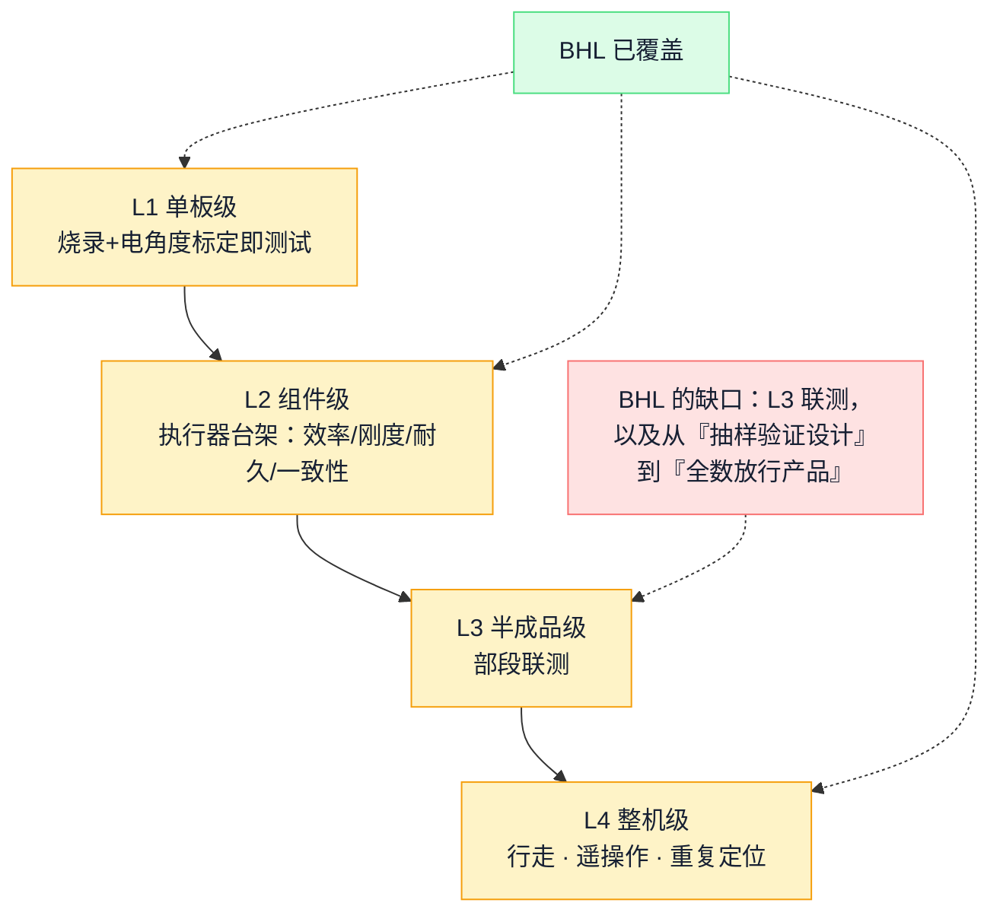

组件级台架本身也是一个闭环架构——被测件、负载、测量、交叉验证四个角色缺一不可：

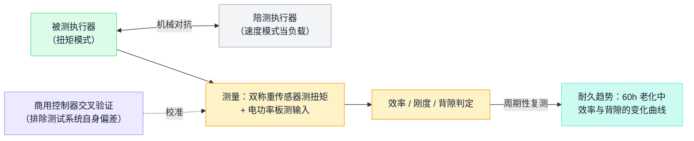

BHL 团队为验证"塑料减速器能不能用"，自建了一套组件级测试体系（论文第 IV 节），方法论完整得可以直接当测试平台的需求输入：

| 测试 | 方法 | 结果 |
| --- | --- | --- |
| **效率** | 自制测功机：双称重传感器测扭矩 + 一只陪测执行器作负载（速度模式恒速），同步记录电功率 | 减速器机械效率约 **90%**；高扭矩高速下因发热下降 |
| **传动刚度** | 锁死输出端，扭矩 0→20 Nm 往复，测电机端位移 | **319.49 Nm/rad**（对照研究用 PA-CF 材料打印的同构减速器 1468 Nm/rad——材料决定刚度上限） |
| **耐久（老化）** | **60 小时**连续摆动 0.5 kg×0.5 m 摆锤，−45°~+90°，0.5 Hz；前 12 小时每小时、之后每 12 小时下台架复测效率与背隙 | 效率先降后回稳；背隙随磨损缓增但全程在可接受范围 |
| **一致性** | 两台不同打印机打 6 只执行器，同台架复测 | 扭矩跟踪误差全程 **±0.5 Nm** 内——证明设计对制造来源波动鲁棒 |
| **精度** | 6 只新执行器测背隙：最大 **0.0229 rad**（σ=0.0042）；5 自由度臂重复到达 4 个空间点各 100 次（SteamVR 动捕测量） | 末端重复定位标准差 **3.4 mm** |
| **交叉验证** | 自研驱动器+固件的结果，用商用 Moteus 控制器复测对照 | 排除"测试系统本身"的偏差 |

这张表有三点超出一般开源项目的成熟度：**老化测试带中途复测**（看的是趋势不是终点）；**一致性测试覆盖制造来源**（两台打印机=两个"供应商"）；**测试设备自身被验证**（Moteus 交叉验证=测量系统分析 MSA 的朴素版）。

对照量产的四级测试架构（公司在 EX001 试产中验证过 40 站的同构实例），BHL 覆盖了：L1 单板（烧录+标定即测试）、L2 组件（上述台架）、L4 整机的功能验证（行走、遥操作）；缺的是 L3 半成品联测和**量产意义上的全数测试**——它的台架测试是抽样做设计验证（DVT 性质），不是每只必过的产线工序（PVT/量产性质）。

> **量产视角**：从"抽样验证设计"到"全数放行产品"，变化的不是测试内容而是基础设施：台架要节拍化（60 小时老化变成抽样制度+产线短时老化）、限值要版本化（319 Nm/rad 是均值，产线要的是单只合格限）、数据要入档（每只执行器的效率曲线挂它的 SN）。EX001 老化环境晚 18 天导致达成率掉到 84% 的教训，对应到这里就一句话：这套台架必须在首台量产机之前就绪。

## 14. 系统联调与部署：开工检查的民间版本

> 📌 **本章要点**：联调的纪律是**自底向上逐层点亮**，每层有通过条件和失败出口，绝不带着下层疑点往上走——量产版就叫开工检查。

BHL 的联调顺序是一张标准的逐层点亮图：

```mermaid
flowchart LR
    S1["装系统<br/>与依赖"] --> S2["拉起 4 路 CAN"] --> S3{"逐关节点名<br/>22 个全在线？"}
    S3 -->|"有关节失联"| X["排障：总线错误统计<br/>/ 抓帧分析"] --> S3
    S3 -->|"全部在线"| S4["IMU / 手柄连通"]
    S4 --> S5{"sim2sim 复验通过？"}
    S5 -->|否| T["回训练/配置环节"]
    S5 -->|是| S6["上实机运行"]
    class S1,S2,S4,S6 exec
    class S3,S5 qa
    class X risk
    class T eng
    classDef biz fill:#DBEAFE,stroke:#60A5FA,color:#172033;
    classDef eng fill:#EDE9FE,stroke:#A78BFA,color:#172033;
    classDef flow fill:#CCFBF1,stroke:#5EEAD4,color:#172033;
    classDef exec fill:#DCFCE7,stroke:#4ADE80,color:#172033;
    classDef qa fill:#FEF3C7,stroke:#F59E0B,color:#172033;
    classDef risk fill:#FEE2E2,stroke:#F87171,color:#172033;
    classDef cust fill:#FCE7F3,stroke:#F9A8D4,color:#172033;
    classDef store fill:#F3F4F6,stroke:#9CA3AF,color:#172033;
```

上位机部署流程（文档"The On-board Computer"页）本质上是一份联调检查单：

1. 装 Ubuntu 22.04，装依赖（`can-utils` 等）；
2. `start_can_transports.sh` 拉起 4 路 CAN（1 Mbps）；
3. **逐关节 ping**（`ping.py --port can0 --id 1`）或一键全查（`anyonehere.py`——脚本名直译"都在吗"）；
4. 测 IMU 连通、测手柄广播；
5. 跑 C 版实时控制（遇到 USB-CAN 掉频率就换 xanmod 实时内核——性能问题有预案）；
6. 先 sim2sim（MuJoCo 里跑同一策略），再上真机。

"开机先点名"（anyonehere）+ "仿真先复验再上实机"，就是开工检查（版本对、设备在、环境就绪才允许开工）的工程师本能版。文档还给了排障工具箱：`ip -details -statistics link show can0` 看总线错误计数、`candump` 抓帧，以及 CAN 噪声的三篇参考文献。

> **量产视角**：量产的开工检查与此同构——料齐套、版本对、设备好、治具在校准有效期内、人员有资质、文件是新版，任一不满足不开工。差别只在"检查结果有没有留痕、有没有拦截力"：脚本谁都能跑，但量产线上"ping 不通还继续装"必须被系统拦住。

## 15. 放行之后：包装、发运与客户验收

> 📌 **本章要点**：**放行≠入库≠发运≠签收≠验收**，五个时点分开留证；随机器发走的数据包必须与厂内档案同源同口径。

BHL 的"交付"是机器人从工作台走到演示场地——没有箱子、没有签收、没有验收单。工厂的交付是一条有**五个独立时点**的链，每个时点挂着不同的业务后果：

**质量放行 ≠ 成品入库 ≠ 发运 ≠ 客户签收 ≠ 客户验收。**统计交付看发运，确认收入看签收/验收（按合同），启动质保期又可能是另一个时点——五个时点混成一个，财务、销售和质量三边的数字就永远对不上。

### 15.1 发运主线：最后一道防线和最后一环追溯

```mermaid
flowchart LR
    A["质量放行完成<br/>（第 13 章证据链闭合）"] --> B["包装与标识<br/>外箱标签 × 装箱单 × 箱内 SN<br/>三者一致并留电子记录"]
    B --> C["成品入库"]
    C --> D["发运安排：订单匹配<br/>+ 出货校验（Marking）<br/>被锁定的 SN 出不了门"]
    D --> E{"合同要求<br/>客户前置批准？"}
    E -->|"需要"| F["取得客户批准 /<br/>发运前验收"] --> G
    E -->|"不需要（记录不适用）"| G["出库发运<br/>SN × 订单 × 发运批关联<br/>（售后追溯的最后一环）"]
    G --> H["物流跟踪<br/>+ 随货客户数据包"]
    H --> I["客户签收"] --> J["到货验收（如约定）"] --> K["订单行关闭"]
    I -.->|"拒收 / 差异"| L["差异处理 → 回流 S9 结案"]
    class A exec
    class B,C,G,H flow
    class D,E qa
    class F,I,J cust
    class K exec
    class L risk
    classDef biz fill:#DBEAFE,stroke:#60A5FA,color:#172033;
    classDef eng fill:#EDE9FE,stroke:#A78BFA,color:#172033;
    classDef flow fill:#CCFBF1,stroke:#5EEAD4,color:#172033;
    classDef exec fill:#DCFCE7,stroke:#4ADE80,color:#172033;
    classDef qa fill:#FEF3C7,stroke:#F59E0B,color:#172033;
    classDef risk fill:#FEE2E2,stroke:#F87171,color:#172033;
    classDef cust fill:#FCE7F3,stroke:#F9A8D4,color:#172033;
    classDef store fill:#F3F4F6,stroke:#9CA3AF,color:#172033;
```

两个容易被低估的闸口：**出货校验是误放行的最后防线**——第 13 章测试放行拦住的是"不合格的机器"，这里拦的是"合格流程之外的机器"（被 Marking 锁定、让步未批准、SN 不在放行清单里的，扫码即拦）；**SN×订单×发运批的关联在出库时建立**——客诉和召回时"哪些机器发给了哪个客户的哪一批"只能从这里查，错过就补不回来。

### 15.2 随机发走的不只是机器：客户数据包

BHL 视角下这一章最有意思的问题是：一台机器人发出去时，随行的"软资产"是什么？对照第 12 章的参数包就清楚了：

| 随货交付物 | 来源 | 为什么客户需要 |
| --- | --- | --- |
| SN 清单与装箱对应 | 出库记录 | 收货核对、资产入账 |
| 测试报告 | 第 13 章的测试证据链 | 验收依据（合同约定项目与格式） |
| **标定参数包** | 第 12 章的逐关节 JSON | 客户现场维修、换件后复标定都要用——它不只是产线工具，也是交付物 |
| 固件/策略版本记录 | 版本快照 | 客户 OTA 和售后诊断的基线 |

一条铁律：**给客户的数据与厂内 SN 档案同源同口径**，允许的差异只能来自导出时点——客户拿着数据包来对数时，两边对不上是信任事故，不是技术事故。

### 15.3 这一段的常见断点

| 断点 | 后果 |
| --- | --- |
| 箱单与箱内实物 SN 不符 | 高频客诉第一名；错标比缺货更伤信任 |
| 未放行品被先行发货 | 出货校验存在的理由；一次就足以召回 |
| 分批发运后订单行被误关闭 | 剩余数量"消失"，客户催货时查无此单 |
| "有条件验收"的遗留项无人跟踪 | 条件永远挂着，款收不回，责任说不清 |
| 客户带着数据包来对数，与内部口径不一 | 第 15.2 的铁律被违反，通常源于两套手工维护 |

> **量产视角**：公司的发货追溯层级已有设计——发货通知→外箱→内箱→SN→模组 SN→原材料批次→供方批次，正向可从销售订单查到供方批次、反向亦然；这一段的系统承接见第 18 章。

## 16. 迭代与变更：Release Log 就是一部 ECN 史

> 📌 **本章要点**：好团队与差团队的区别不是不出错，而是**每个错误被记录、修复、广播，并回流成下一轮的检查项**。

迭代不是"偶尔修 bug"，而是一个常设的闭环——问题从两个入口进来（自测与社区复刻），从一个出口出去（带日期的发布记录），并回流成下一轮的检查项：

```mermaid
flowchart LR
    D["问题发现<br/>自测 · 社区复刻反馈"] --> R["记录与归因"]
    R --> F["修复<br/>改设计源 / BOM / 文档 / SOP"]
    F --> V["验证<br/>（如 IMU 换型附性能对照表）"]
    V --> P["发布 + 广播<br/>Release Log 带日期留痕"]
    P --> K["回流：错误模式<br/>变成下一轮检查项"]
    K -.预防.-> D
    class D risk
    class R flow
    class F exec
    class V qa
    class P eng
    class K flow
    classDef biz fill:#DBEAFE,stroke:#60A5FA,color:#172033;
    classDef eng fill:#EDE9FE,stroke:#A78BFA,color:#172033;
    classDef flow fill:#CCFBF1,stroke:#5EEAD4,color:#172033;
    classDef exec fill:#DCFCE7,stroke:#4ADE80,color:#172033;
    classDef qa fill:#FEF3C7,stroke:#F59E0B,color:#172033;
    classDef risk fill:#FEE2E2,stroke:#F87171,color:#172033;
    classDef cust fill:#FCE7F3,stroke:#F9A8D4,color:#172033;
    classDef store fill:#F3F4F6,stroke:#9CA3AF,color:#172033;
```

文档站 Releases 页维护着逐条带日期的变更记录。摘几条真实条目，每条都能按 ECN 五要素（动因/影响/验证/生效/回流）解读：

| 日期 | 原文（意译） | ECN 视角 |
| --- | --- | --- |
| 2025-05-23 | 修正 BOM 轴承描述错误（MR106-2RS 与 6701-2RS 写反） | 文档缺陷会直接变成**采购错料**——BOM 勘误必须广播 |
| 2025-05-21 | 修复 MakerWorld 上 6512 执行器的 .3mf 错误 | 发布产物与设计源不一致＝按错版生产 |
| 2025-08-23 | **替换错误的 5010-5010 壳体打印件**、补缺失的限位挡块、补磁铁安装说明 | 一次打包变更：错件召回 + 漏项补齐 + SOP 增强 |
| 2025-06-28 | IMU 升级为 IM10A，更新 BOM 与接线说明 | 第 5 章讲的完整小型 ECN |
| 2025-11-10 | 修正关节限位表的错误数值 | 参数表错误影响的是**控制安全**，不只是文档质量 |

这部 log 诚实地记录了一个事实：**即使是精心设计的项目，发布后仍会持续发现 BOM 错项、发错文件、漏零件、参数错误**。它的可贵不在少出错，而在每个错误都有日期、有修复、有广播。社区生态是另一条反馈回路：GitHub 上已有衍生臂、重力补偿、SDK、ROS2 移植等多个二次开发仓库（berkeley-humanoids 组织），相当于几十个"外部试产点"在持续回报问题。论文"局限"一节还预告了下一轮验证重点（长时间运行的热效应未充分研究）——已知未知也被管理着。

> **量产视角**：量产体系把这件事制度化为**结案回流**：项目结案强制交付资产包、复盘必答"评审为什么没拦住"。BHL 的 release log 若逐条转成检查项，就是《导入评审检查表》的雏形——"BOM 双人核对""发布产物与 CAD 源一致性校验""变更必须附生效断点"全都能从上表反推出来。EX001 的 89 项问题库走的正是同一条路。

## 17. 终章：从 1 台到 1000 台，每个环节会变成什么

> 📌 **本章要点**：从 1 台到 1000 台，**闭环本身不变，变的是维持闭环的方式**：一个人的自觉，换成系统兜底。

先看总图——同一个闭环，1 台时靠一个人的自觉维持，1000 台时靠系统让它不断裂：

```mermaid
flowchart TB
    subgraph PROTO["同一个闭环 · 1 台（靠人的自觉维持）"]
        direction LR
        p1["需求"] --> p2["设计"] --> p3["发布"] --> p4["采购"] --> p5["制造装配"] --> p6["标定测试"] --> p7["部署"] --> p8["迭代"]
        p8 -.-> p2
    end
    PROTO ==>|"× 1000 台 × 多机种 × 多班组"| PROD
    subgraph PROD["同一个闭环 · 1000 台（靠系统维持不断裂）"]
        direction LR
        q1["版本中枢<br/>（按哪一版做）"] --> q2["MRP / 齐套<br/>（料齐才开工）"] --> q3["MES 过站留痕<br/>（怎么做的可查）"] --> q4["SN 档案 + 标定/测试工站<br/>（每台的证据）"] --> q5["ECN 断点管理<br/>（变更可追）"]
        q5 -.-> q1
    end
    class p1,p2,p3,p4,p5,p6,p7,p8 flow
    class q1 eng
    class q2 biz
    class q3 exec
    class q4 qa
    class q5 eng
    classDef biz fill:#DBEAFE,stroke:#60A5FA,color:#172033;
    classDef eng fill:#EDE9FE,stroke:#A78BFA,color:#172033;
    classDef flow fill:#CCFBF1,stroke:#5EEAD4,color:#172033;
    classDef exec fill:#DCFCE7,stroke:#4ADE80,color:#172033;
    classDef qa fill:#FEF3C7,stroke:#F59E0B,color:#172033;
    classDef risk fill:#FEE2E2,stroke:#F87171,color:#172033;
    classDef cust fill:#FCE7F3,stroke:#F9A8D4,color:#172033;
    classDef store fill:#F3F4F6,stroke:#9CA3AF,color:#172033;
```

BHL 的每个设计决策都在"单台复刻"语境下最优。把目标换成"千台量产交付"，逐环节推演要换什么——这张表就是开源原型与量产产品之间的完整距离，也是 OEM 制造方的工作清单：

| 环节 | BHL 的做法（单台最优） | 千台量产的做法 | 迁移动因 |
| --- | --- | --- | --- |
| 结构件 | PLA FDM 打印（$4/执行器） | 壳体/法兰→铝压铸+机加，摆线盘→粉末冶金或机加钢件，连接件→注塑 | 刚度（319→1000+ Nm/rad）、耐热（PLA 60°C 软化）、单件成本随量反超、一致性 |
| 减速器 | 自打印摆线 15:1 | 保留摆线构型金属化，或切谐波（臂）/行星（腿） | 寿命从 60 小时级到 10000 小时级 |
| 驱动器 | ST 评估板 $19 + 自研固件 | **自研驱动板**：评估板的脆弱焊盘、接插件、尺寸、供货批次都不为整机设计；自研后加接插件防呆、上位烧录接口、产测点 | 可靠性、装配性、DFT；固件资产直接继承 |
| 编码器 | AS5600 模块手工改阻 + 热熔胶粘磁铁 | 编码器芯片直接上自研板，磁铁压装入轴（工装定深） | 手工改阻和热熔胶是两个最大的过程波动源 |
| 线束 | 现场裁线、WAGO/焊接 | 线束成为正式料号：线表图纸、定长、端子压接、防呆接插件，委外线束厂 | EX001 经验：线束是装配异常高发区 |
| BOM | Google 表格 3 sheet | EBOM→MBOM 入系统，逐料号挂 AVL/检验项/提前期，齐套检查驱动开工 | 表格不拦截任何错误 |
| SOP | 三部视频 + 文档警告框 | 工位级电子 SOP + 物理防错（磁铁形状防错、接插件防呆）+ 关键参数采集（嵌件深度、压装力） | 视频不可检索、警告靠自觉 |
| 烧录标定 | STM32CubeIDE 点三次 Run + Python 脚本 | 产线烧录工站（一键三步+自动写 CAN ID）+ 自动标定工位，结果直写 SN 档案 | 节拍与防错（手工流程 22 次/台，必出错） |
| 测试 | 抽样台架做设计验证 | 四级架构：板级针床 → 执行器全数台架（效率/背隙/异响限值判定）→ 部段联测 → 整机老化+标定 | 从"证明设计可行"到"放行每一台" |
| 参数管理 | robot_configuration.json 放仓库 | 参数包挂整机 SN 档案，换件触发重标定与档案更新，放行校验参数完整性 | 追溯与售后 |
| 变更 | Release log 人工维护 | ECN 流程：影响分析（在制/在库/已出货）+ 生效断点按 SN 记录 | 千台在制时"换个壳体文件"是一场战役 |
| 验收指标 | "能走路、能遥操作" | 合同化的验收标准 + 测试限值表 + 放行证据链 | 交付统计、收入确认与质保起算分别挂在不同时点（第 15 章） |

三条贯穿性的结论：

1. **设计阶段的每个"省"都会在量产阶段"还"**——$19 评估板省掉的板卡设计，在量产时以脆弱焊盘的不良率偿还；热熔胶省掉的压装工装，以标定异常偿还。原型期这样取舍是对的，关键是切换量产前要把这笔账逐项清算（这正是 DFM/导入评审的工作内容）。
2. **最值钱的可继承资产不是零件而是方法**：固件与协议（含看门狗安全设计）、标定流程、测功机测试方法论、"两种模组打天下"的架构思想、release log 的变更纪律——这些迁移到量产几乎零折旧。评估一个客户设计的量产成熟度，看的也是这些。
3. **BHL 用 $4,312 和一台打印机证明了全流程闭环可以多小**——需求、设计、制造、装配、标定、测试、部署、迭代，一个不缺。量产体系所有复杂度（MRP、MES、SN 档案、ECN 系统）都只是在"每个环节×1000 台×多机种"的规模下，维持这个闭环不断裂的手段。先看懂最小闭环，再理解工厂，顺序不能反。

---

## 18. 我们的系统如何承接这台机器人

> 📌 **本章要点**：承接一台机器人，公司现有系统能覆盖七成以上；判断用**五路裁定**（沿用/配置/集成/扩展/新建），新建是最后选项。

第 17 章讲的是"量产一般需要什么"；这一章回答更具体的问题：**假设 BHL 团队就是我们的客户，把这台机器人交给公司代工，现有各系统分别接住哪一段、缺口在哪里**。

两条口径纪律（与公司系统现状材料的核实口径一致）：

- 系统能力分三种状态标注：**在用**（IT 材料所述，OEM 覆盖待核实）、**规划**（如 SRM、客户门户）、**待核实**（能力有证据但深度/启用范围未确认）。名称不等于能力，结论随核实更新。
- 关于 MES 的 SN 能力，早期汇报材料（2026-10）称"批次主键老 MES"，更新的 IT 系统现状核实则确认 **SN 级追溯已有界面证据**（工单→整机 SN→部件 SN→原材料批次→供方批次，含操作者与秒级时间），"只有批次能力"的旧前提不成立。**本章以更新核实为准**——待核实的不是"有没有 SN"，而是数据深度：原始测试曲线、拆换历史、多层递归、OEM 项目覆盖。

### 18.1 总承接架构：三个域，一条横向回流

BHL 的角色是客户（而且是"单一真源+自动导出+有变更记录"的满分客户样本——真实全栈客户大概率是它的减配版）。公司把 OEM 交付主流程切成九个节点：S1 承接评审、S2 工程导入、S3 需求与供应计划、S4 物料与产能准备、S5 工单下达与开工检查、S6 生产执行、S7 测试标定与放行、S8 发运与验收、S9 结案与反馈回流。承接架构分三个域，交接面对应 S1—S2，我方系统域覆盖 S3—S9：

```mermaid
flowchart LR
    subgraph CUST["客户域（BHL 扮演的角色）"]
        direction TB
        c1["CAD 单一真源<br/>（Onshape）"]
        c2["BOM · 固件 · 策略<br/>· 参数包 · 文档"]
        c3["变更记录<br/>（Release Log）"]
    end
    subgraph HAND["交接面（S1 承接 · S2 导入）"]
        direction TB
        h1["导入数据包评审<br/>〔新建候选〕"]
        h2["客户版本→厂内受控版本<br/>〔待裁定：PDM 扩展<br/>还是版本中枢〕"]
    end
    subgraph OURS["我方系统域（S3—S9）"]
        direction TB
        s1["SAP：料号/BOM/MRP<br/>/采购/库存账〔沿用〕"]
        s2["WMS + MES 线边仓：<br/>收料/急料/齐套〔沿用+扩展〕"]
        s3["MES：工单/过站/SN 绑定<br/>/防错〔沿用+核实深度〕"]
        s4["产测平台：烧录/标定/测试<br/>〔扩展为测试引擎〕"]
        s5["MES Marking：隔离与放行<br/>〔配置〕"]
        s6["客户门户〔新建候选·规划〕"]
    end
    CUST --> HAND --> OURS
    subgraph CROSS["横向：能力复用与 AI 层（规划）"]
        direction LR
        k1["问题库→检查项/SOP 回流"] --- k2["工艺模块库"] --- k3["AI Agent：导入评审 ·<br/>物料侦探 · 测试归因 · ECN 分析"]
    end
    OURS -. "S9 结案回流" .-> CROSS
    CROSS -. "赋能下一次导入" .-> HAND
    class c1,c2,c3 cust
    class h1,h2 eng
    class s1 biz
    class s2 flow
    class s3 exec
    class s4,s5 qa
    class s6 cust
    class k1,k2,k3 eng
    classDef biz fill:#DBEAFE,stroke:#60A5FA,color:#172033;
    classDef eng fill:#EDE9FE,stroke:#A78BFA,color:#172033;
    classDef flow fill:#CCFBF1,stroke:#5EEAD4,color:#172033;
    classDef exec fill:#DCFCE7,stroke:#4ADE80,color:#172033;
    classDef qa fill:#FEF3C7,stroke:#F59E0B,color:#172033;
    classDef risk fill:#FEE2E2,stroke:#F87171,color:#172033;
    classDef cust fill:#FCE7F3,stroke:#F9A8D4,color:#172033;
    classDef store fill:#F3F4F6,stroke:#9CA3AF,color:#172033;
```

### 18.2 逐环节承接表（五路裁定）

判断方法是**五路裁定**——每项能力先问"现状里谁在管这个对象"，再裁定**沿用 / 配置 / 集成 / 扩展 / 新建**，新建是最后选项：

| BHL 环节（本文章节） | 承接系统（现状） | 裁定 | 依据与待核实 |
| --- | --- | --- | --- |
| 导入数据包评审（第 1 章） | MES 工程&NPI 有试产管理模块；"评审"对象本身无承载 | **新建**候选 | 不与现有系统争权威；先与 MES 试产模块核实边界 |
| 客户版本管理：CAD+固件+ONNX+参数包（第 6、7 章） | PDM 管研发资料与 ECN/ECR | **待裁定** | PDM 为自研产品而设；"软件配置三件套"的归宿是 PDM 扩展还是新建版本中枢（见第 6 章量产视角），是最大的架构裁定项 |
| EBOM→MBOM、需求展开（第 8 章） | SAP：主数据、BOM、生产计划/MRP | **沿用** | 在用；建码时效是已报告痛点（P07 无编码来料） |
| 采购与收货（第 8—9 章） | SAP 采购 + OA 请购 + WMS | **沿用+集成** | 能力在，断点在传递：急料靠人工传（P03/P08/P10）、打单与仓库作业脱节（P11—P13） |
| 来料检验，含问题库回流的检验项（第 9、16 章） | MES 质量模块：检验建模与标准维护有真实界面 | **配置** | 载体现成；OEM 客户规范是否已维护待核实 |
| 齐套检查、开工拦截（第 9、14 章） | MES 过站/队列校验、五类预警；急料与 WIP 标注"深化" | **扩展** | IT 侧已有相同判断；拦截力待核实（带料绕行 P05/P06 说明防错未闭合） |
| 装配过站、关节 SN→整机 SN 绑定（第 11 章） | MES SN/组件追溯（界面证据：至少两层组件正反向） | **沿用+核实深度** | 机器人需要整机→关节→电机/驱动板的层深与拆换历史，待按实际样本核实 |
| 烧录/标定工站、测试数据（第 12、13 章） | **产品测试平台**（与 MES 双向集成，传测试结果） | **扩展** | 核心待核实项：标定参数与原始曲线今天存在哪、能否按 SN 查回——这决定规划中的统一测试执行引擎是扩展它还是替代它 |
| 隔离与质量放行（第 13 章） | MES Marking 四类锁定 + 出货校验 | **配置** | 机制现成；OEM 适用与解除权限待核实 |
| 包装、出库与发运（第 15 章） | WMS 包装/拣货出库 + SAP 发运单/出库过账 + MES SN 出货关联与 Marking 出货校验 | **沿用+配置** | 发货追溯层级已有设计（发货通知→外箱→内箱→SN→供方批次，正反向可查）；OEM 客户的标签/箱单/数据包要求待核实 |
| 交付与客户自查（第 15 章） | 无承载 | **新建**候选（规划） | 客户门户/多租户，只读聚合不动核心系统 |
| 变更管理：Release Log→ECN（第 16 章） | PDM（ECN/ECR）→SAP→MES 链路在集成图上存在 | **沿用+扩展** | 增量是试产轻通道与生效断点按 SN 记录 |
| 问题库与 8D 回流（第 16 章） | MES 质量异常管理 + OA 部分质量流程 | **待裁定** | 完整 8D/CAPA 链路材料未详述——"未详述不等于无人承担"，逐对象核实；EX001 89 项问题库是候选素材 |

### 18.3 收敛结论：七成能接住，增量只有四个点

把 BHL 全流程在现有系统上走一遍，结论是**现有格局能覆盖七成以上**，真正的增量收敛为：

1. **客户工程域的版本归宿**——BHL 证明一台机器人的出厂定义 = 机械版本 × 硬件版本 × 固件 × 策略文件 × 标定参数包。SAP 管料号、MES 管工单，但"软件配置三件套"（固件 bin / ONNX / 参数 JSON）与硬件版本的兼容矩阵在现有系统中没有归宿。PDM 扩展还是版本中枢新建，是第一优先的架构裁定。
2. **测试标定的数据深度**——第 12 章的参数包（逐关节 flux_offset 各不相同）就是"标定参数属于个体"的实物证据。先核实产测平台现状："原始曲线和标定参数今天存在哪、能不能按 SN 查回"，答案决定测试引擎的建设量级。
3. **两处"深化"对齐**——MES 的急料管理与 WIP 管理已标注深化，与规划中的轻量收料端、急料标签、齐套看板指向同一批痛点（P03/P08/P10/P13），要对齐成一件事，不能平行建设。
4. **三个真新建**——导入评审对象、复用资产库、客户门户。共同点：都不与现有系统争权威，符合"新建不夺权"的纪律。


---

## 附：一手资料清单

本文全部事实来源（核验于 2026-11-06）：
[主仓库](https://github.com/HybridRobotics/Berkeley-Humanoid-Lite) · [Assets](https://github.com/HybridRobotics/Berkeley-Humanoid-Lite-Assets) · [Lowlevel](https://github.com/HybridRobotics/Berkeley-Humanoid-Lite-Lowlevel) · [Recoil 固件](https://github.com/T-K-233/Recoil-Motor-Controller-BESC) · [文档站](https://berkeley-humanoid-lite.gitbook.io/docs) · [BOM 表格](https://docs.google.com/spreadsheets/d/1AQEHcH_nPkXYfor2-h7bwNIUMmsePtAm53epnsWgZXc) · [整机 Onshape](https://cad.onshape.com/documents/fc6443b1d89dcba950e85b60/w/94a26479973a4098a5884426/e/be3fe37849edbeadc95b9bf8) · [MakerWorld 打印工程](https://makerworld.com/en/models/1327260-berkeley-humanoid-lite) · [论文 arXiv:2504.17249](https://arxiv.org/abs/2504.17249) · [项目主页](https://lite.berkeley-humanoid.org/)

