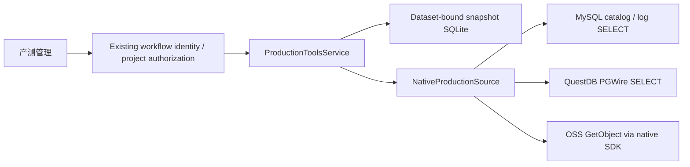

# Current scope update
The user approved independent source-project queries without manufacturing project mappings. The [standalone production tools design](2026-11-10-standalone-production-tools-design.md) supersedes this document's binding, project-member authorization and snapshot scope requirements; native transport/read-only limits remain in force. Historical deployment receipts are unchanged.

# Native production tools / 产测管理 design

页面重做方案见[产测管理页面与用户旅程设计](2026-11-10-production-test-workbench-product-design.md)，以角色、核心看板和逐层调查替代本文原页面安排；原生读取边界及历史接入记录保留。新页面方案尚未实施。

Date: 2026-11-10. Implementation base: `552f653`, branch `codex/production-tools-readonly`. This design supersedes the old `/23790` API bridge draft. The user has authorized this design and native implementation; no additional design approval is required.

## Product boundary

Add an actual left navigation entry **产测管理** to the manufacturing workbench. A project member selects an authorized manufacturing project and inspects four read-side capabilities:

1. **SN 测试与过站**: native QuestDB `productionlog` test observations and `stopoverlog` passage observations, preserving repeated rows and raw source values.
2. **工具与配置**: MySQL tool catalog, tool versions, configuration catalog, configuration versions and **工具配置审核单**. Source `orderid` is a tool/config review-order identifier; it is not an established manufacturing/MES work order.
3. **日志证据**: MySQL log index plus authenticated, bounded, same-origin OSS download.
4. **记录统计**: record count, distinct nonempty SN count, PASS records, FAIL records, unknown-status records and PASS-record / all-record ratio. These are not FPY, OEE or completed goods. Repeated testing contributes repeated records. If recent device activity is displayed it is labeled **近 5 分钟有记录的设备**, never a heartbeat/online guarantee.

Default time range is the last 24 hours, shown in the user's local timezone and sent as timezone-aware ISO timestamps. Maximum source time window is 31 days. Exact SN search is supported; a broad fuzzy-search engine is unnecessary. Catalogs show metadata and version history only. Omit and visibly mark `data`, `updatedata`, `launcherdata` and all URL-bearing fields; arbitrary configuration JSON is not exposed or persisted. Future configuration comparison requires explicitly allowlisted fields. Source-side writes, uploads, audit/release/force-release actions, schema changes, SAP/WMS/MES interfaces and deployment are outside this change.

## Native architecture

New implementation lives in `src/manufacturing_platform/production_tools/`. It does not import or vendor the third-party repository and does not call the old API, Go process, login service or JWT. The third-party code is semantic evidence only. Existing `build_workflow_router` gains optional `production_tools: ProductionToolsConfig | None = None`. The workflow router keeps its existing identity/error route wrapper and passes the already-created `WorkflowStore` to the new service. Register production routes directly on that router, preserving its `PrivateRoute`; do not accidentally use an unprotected child router's route class.

Keep native adapters small and synchronous, invoked by FastAPI synchronous handlers/threadpool. Use injected `SqlReader` and `ObjectReader` interfaces for tests. Ship native dependencies in an optional `production-tools` extra: `PyMySQL>=1.1,<2`, `psycopg[binary]>=3.2,<4`, `oss2>=2.19,<3`. Pin the resolved versions in the host's existing deployment dependency mechanism during host integration. Lazy SDK imports allow an unconfigured platform to start without these extras. MySQL driver settings explicitly disable local infile and multiple statements; bounded connect/read/write timeouts are mandatory. OSS construction must not create a bucket, alter ACL/CORS or call source initialization code.

The host supplies trusted configuration; browser payloads contain no database address, credentials, table, SQL, source project mapping, OSS URL or bucket. Mappings are one explicit external source project per platform project in v1. Each binding includes dataset ID, platform project UUID, source namespace, source project ID string and a revision/fingerprint. The namespace distinguishes source installations. Reconfiguration invalidates cached snapshot access. Source integer IDs and symbol strings never become platform UUIDs.

## Source evidence and query semantics

Read-only source evidence: `public/databases/tables.go`; `end/service/operate/{production,stopover,software,config,order,toolslogs,dashboard,stationDashboard}.go`; `public/myquestdb/read.go`; `public/ali/oss.go`. Do not run those packages: initialization includes migrations and object-storage mutation.

| Capability | Tables / source fields | Native behavior |
|---|---|---|
| Test / passage | `productionlog`, `stopoverlog`; `timestamp`, `projuectid`, `orderid`, `workstagesid`, `configlogsid`, `cversion`, `softwareid`, `workselectid`, `version`, `devicename`, `sn`, `barcode`, `status`, `errorcode`, dynamic measurement columns | Required mapped project and `[start,end)` UTC interval, optional exact SN/order/device/status, fixed table names. Preserve dynamic columns, nulls and source spelling. `status='1'` means source PASS; `'2'` FAIL; anything else unknown. |
| Tools | `softwarelists`, `softwareversions`; `id`, `projuectid`, `name`, `versions`, `softwareid`, `state`, `orderid`, `workselectid`, `del` | Always `del=0 AND projuectid=%s`; integer ID descending keyset; optional parent software ID. URLs are withheld, not clickable. |
| Configs | `configlists`, `configlogs`; `id`, `projuectid`, `configid`, `versions`, `state`, `fatherid`, `fversions`, `cversions`, `data` | Same scope and deletion predicate. Keep version type/value. `configlists` has no documented `state` field despite a buggy old filter; do not port it. Arbitrary config payload fields are omitted before persistence and marked in `redacted_fields`. |
| Review orders | `orderlists`; `id`, `projuectid`, `softwarelist`, `configlogsid`, `configid`, `state`, `workstagesid` | Source state 4/5 is shown as source-approved/force-approved, never platform release. Do not collapse 5 into 4 or map these records into work orders. URL1/2/3 are withheld in initial catalog. |
| Evidence | `toolslogs`; `id`, `projuectid`, `orderid`, `toolsname`, `devicename`, `csn`, `state`, `createtime`, `url` | Scoped log metadata. Time fields are epoch milliseconds according to source `tools.GetTimes`; verify units with real rows before enablement. Access re-reads the row by ID and project. |
| Statistics | `productionlog` or `stopoverlog` | One fixed aggregate query, same mapped filters and interval. Return aggregate counts separately from row snapshots. A query failure is not an empty result. |

All source business SQL is fixed parameterized bounded SELECT. No user-selected identifier or SQL fragment is accepted. Query builder maps enums to constant tables and fixed optional predicate fragments. Omit old arbitrary dynamic item-column filtering. Bound text length to 200, source IDs to positive decimal text of at most 20 digits, page size to 100, source capture to 1000 rows plus one truncation sentinel and snapshot payload to 2 MiB. Use a 5-second connect timeout and 10-second statement/read timeout; maximum concurrent source queries is 4 per worker, with immediate 503 when capacity is exhausted. No automatic retry in a request.

MySQL uses `START TRANSACTION READ ONLY`, executes approved SELECT, and always rolls back/closes. These transaction-control statements are the sole non-SELECT exceptions. QuestDB is PGWire-compatible, not PostgreSQL feature-identical: use autocommit, psycopg bound parameters and supported `options='-c statement_timeout=10000'`. Do not assume `SET TRANSACTION READ ONLY` or `default_transaction_read_only` is implemented. Enforce the independent fixed query registry and prefer the server-configured `pg.readonly.user`; record whether server-side read-only identity was verified. A supplied write-capable source account does not grant permission to issue writes. No destructive probe is allowed to test permissions. QuestDB PGWire TLS is not supported by the documented protocol. Endpoints come only from trusted server configuration; record the actual transport limitation without claiming encryption or assuming a private network. Production network controls follow the organization’s approved connection requirements. Timestamp values without tzinfo returned by QuestDB are interpreted as UTC; aware input is converted to UTC before binding.

Driver references: [QuestDB PGWire](https://questdb.com/docs/connect/compatibility/pgwire/overview/), [PyMySQL connection controls](https://pymysql.readthedocs.io/en/latest/modules/connections.html), [OSS Python streaming downloads](https://www.alibabacloud.com/help/en/oss/developer-reference/streaming-download-1). These support the adapter selection and compatibility limits, not claims about the actual source deployment.

## Observations, snapshots and correctness

A `SourceResult` contains `items`, `captured_at`, `complete`, `truncation_reason`, `next_before_id`, `source_kind` and normalized effective filters. Returned rows retain source fields and a source-kind discriminator. Raw URL-bearing fields and arbitrary configuration payload fields (`data`, `updatedata`, `launcherdata`) are omitted before persistence; a `redacted_fields` list makes the omission explicit. Evidence URLs exist only transiently during a fresh scoped evidence lookup. Dynamic observation columns whose normalized names contain credential markers (`password`, `passwd`, `secret`, `token`, `credential`, `accesskey`, `privatekey`, `authorization`, `connectionstring`) are likewise omitted and marked; normalization casefolds and removes punctuation. Never inspect or persist redacted values to infer business meaning. Source values are not HTML. Malformed data produces a typed schema error; do not silently skip rows or coerce unknown statuses to PASS.

A source query GET may create an incidental local cache snapshot. This is not a domain command and must remain usable by read-only project members. The snapshot records dataset ID/mode/label, platform project UUID, binding fingerprint, source namespace/kind, effective filters, query version, captured-at UTC, checksum, bounded raw observations, redactions and completeness. It never persists signed URLs, tokens or credentials. Generate snapshot UUIDs locally. Use a separate SQLite metadata file, independently versioned at v1; published workflow schema24 and authority schemas remain untouched. Validate path separation from domain/authority/legacy stores, including symlink and hardlink aliases, and dataset metadata on every open. A reusable validator takes explicit protected paths: MF supplies its domain/authority paths; the host supplies its actual legacy/domain/authority and secret config paths before injecting the optional connector. Invalid optional configuration disables this feature while preserving the workflow.

MySQL supports `id < before_id ORDER BY id DESC LIMIT cap+1`. `next_before_id` means a fresh subsequent source slice, not a cross-page transactional snapshot. QuestDB has no demonstrated unique key: capture one bounded query, preserve duplicate rows and page only within that immutable captured set. Never timestamp-keyset through equal timestamps, hash-deduplicate rows, or present offset pages across changing source queries as complete history. When over cap, return `complete=false`, `truncation_reason='row_limit'` and no QuestDB source continuation; ask the user to narrow the interval/SN. Byte cap gives `byte_limit`, retaining only a prefix with explicit incompleteness. If the snapshot provenance envelope trims again, MySQL continuation is derived from its final retained prefix; it must not lose continuation or reuse a boundary that skips discarded rows. A malformed retained ID is a sanitized schema error. QuestDB continuation remains absent. Snapshot paging uses index offsets and limit within its immutable local data. Empty successful result is complete; unavailable or failed source is 503, not cached as a successful empty snapshot.

Snapshot lifetime is 24 hours, checked on access. Purge expired rows opportunistically on write with a bounded cleanup batch. Cap retained snapshots at 100 per mapped project and reject further captures with a specific unavailable message until expiry; do not delete an unexpired snapshot unexpectedly. Snapshot reads reauthorize live project membership and require exact current dataset and binding fingerprint. Revocation/remapping makes old snapshots inaccessible. No snapshot or aggregate enters `TestRun`, `test.record`, calibration, quality release, evidence resolver, work-order completion or inventory calculations.

Record statistics are source aggregates over the requested interval, not aggregates of a truncated page. Use `count(*)`, `count_distinct` of nonempty SN and CASE counts for `'1'` and `'2'`; unknown = total - pass - fail, ratio = pass / total or null if total=0. Report query/capture time and `consistency='single_query'`; independent source reads are not a cross-database atomic snapshot. Do not supply totals when the aggregate fails. In v1 no trend/group-by framework is required.

## Authorization and evidence access

Use existing `Actor`, `require_project(tx, actor, project_id)` and live grants. Authorize before source I/O and again after a potentially slow read before returning/persisting data. Unknown and unauthorized projects/snapshots/evidence return uniform 404. Configuration absence is visible only after project authorization. API errors use stable codes: `PRODUCTION_TOOLS_UNCONFIGURED`, `SOURCE_UNAVAILABLE`, `SOURCE_SCHEMA_INVALID`, `SOURCE_LIMIT_EXCEEDED`, `SNAPSHOT_EXPIRED`. Validation is 422. Source exception messages, connection strings and SQL are never sent to the user or printed in traceback through the outer workflow handler: adapters translate them to sanitized `DomainError`s.

Evidence GET resolves `toolslogs.id` under current mapped `projuectid` and `del=0`. Parse the stored URL only to identify an object on the configured exact HTTPS host; reject userinfo, port overrides, query, fragment, backslashes, dot segments and unsafe decoded paths. Require the decoded key to be beneath a configured project-specific prefix. The browser never supplies a URL or object key. Fetch using a configured SDK bucket/endpoint and GetObject-only credentials. Do not perform a generic HTTP GET or follow source URL redirects. Stream as `application/octet-stream`, `Content-Disposition: attachment`, `X-Content-Type-Options: nosniff`, private/no-store; no HTML inline preview. Use bounded GET, reject content length over 10 MiB, enforce the same byte cap during read even if length is missing, close SDK streams on success/failure/disconnect. Reauthorize before opening the object and immediately before emitting its first bytes. Existing public-read source ACLs are outside this integration's control; controlled access describes this platform route only.

## HTTP/UI contract

Prefix is `/api/v1/manufacturing/workflow/projects/{project_id}/production-tools`.

| Method/path | Input | Output |
|---|---|---|
| GET `/status` | project only | `configured`, per-capability availability and sanitized reason codes; no host/credentials |
| GET `/observations` | `kind=production|stopover`, required start/end, optional sn/order_id/device/status | snapshot page |
| GET `/catalog/{kind}` | kind=`software|software_versions|configs|config_versions|review_orders`, optional parent_id/before_id | snapshot page |
| GET `/evidence` | required start/end, optional sn/order_id/before_id | snapshot page, evidence source IDs, no URLs |
| GET `/evidence/{source_log_id}/content` | decimal source log ID only | controlled attachment |
| GET `/statistics` | kind=production|stopover, required start/end, optional sn/order_id/device/status | one statistics object in snapshot page |
| GET `/snapshots/{snapshot_id}` | UUID, offset>=0, limit 1..100 | cached immutable page after live reauthorization |

Page JSON: `{snapshot_id, project_id, source_kind, captured_at, complete, truncation_reason, next_before_id, filters, redacted_fields, items, offset, limit, captured_count, has_more, expires_at}`. Initial limit is 50.

`ProductionQuery.parent_id` / `before_id` and `SourceResult.next_before_id` remain exact Python integers. Parent/before input is a positive decimal ID with at most 20 digits (maximum `99999999999999999999`); API query text is validated before exact server-side integer conversion, and the direct query model enforces the same range. TypeScript filters, input state and source cursors keep decimal strings throughout URL encoding. No JavaScript `Number` conversion is permitted in source ID, parent or continuation paths.

Canonical persisted snapshot JSON retains exact integer observations, filters and cursor values and its existing checksum. `SnapshotStore.get` produces a deterministic public projection without rewriting that payload: row primary integer `id` and non-null `next_before_id` are decimal strings, including small IDs; existing row string/null IDs remain unchanged. Effective `filters.parent_id` / `before_id` are decimal strings. All other integers with absolute value above `9007199254740991`, recursively including dynamic measurements and aggregate counts, become exact decimal text. Booleans, nulls, floats and safe non-ID integers retain their JSON types. Bounded `offset`, `limit` and `captured_count` remain numbers. Statistics counts therefore have public `number | string` types; `record_pass_ratio` remains the server-derived number or null.

When the snapshot provenance envelope imposes additional byte/row trimming, MySQL catalog/evidence continuation is the last actually retained positive integer row ID, never the source's earlier boundary. A malformed retained ID is a sanitized `SOURCE_SCHEMA_INVALID`; QuestDB trimming never invents continuation. Captured time, effective filters, incompleteness, retention and immutable local paging remain unchanged.

Evidence integer-millisecond `createtime` predicates preserve the exact accepted `[start,end)` interval: both bounds use the mathematical ceiling of epoch microseconds divided by 1000, computed with integer datetime arithmetic (including pre-epoch values). SQL templates, parameter types and the existing time-window limit remain unchanged.

Error envelope follows workflow `DomainError` (`code`, `message`, `fields`, `blocking_reasons`). No new authentication format.

Add `production_tools` to `ConsoleView`, icon paths and the explicit `WorkflowApp` navigation array. Render its dedicated workspace before the generic business-ledger branch; do not add it to `businessModules` or reuse laboratory domain object kinds. The workspace takes `projects`, the existing API object and an optional project ID; it owns selection/filters. Keep the existing **测试与标定** controlled workflow separate. Tabs: SN 测试与过站 / 工具与配置 / 日志证据 / 记录统计. Show selected project, source type, capture time, applied range, completeness and records. Allowlisted metadata details use escaped text/JSON; no raw URL anchors. An authorized unconfigured project displays **当前项目尚未配置产测数据源**. Handle loading, empty, partial, revoked/404, expired, source error and retry distinctly. Abort and clear data on project/tab/filter changes, and ignore superseded results so a slow prior project cannot repopulate the next project. Snapshot pages preserve filters and capture time.

## Host integration and acceptance

PF `master` was rechecked at `3187f834842fcadb50dcbf73a0da918bb4985afb`; this is the development baseline, not a claim about the running production revision. It has a strict `WORKFLOW_ROUTES` set in `backend/app/manufacturing_paths.py`, optional loader in `backend/app/manufacturing.py`, and `authorize_workflow_identity` uses platform identity with read-only constraints. Task 4 must update all seven exact routes in the host whitelist and unavailable behavior, pass trusted native config by an explicitly supported router parameter, and test regular project members plus platform management. Read host `master` while planning; implement in an isolated host worktree at execution time. Do not loosen the route whitelist or modify PF production checkout.

New host settings names: `PLATFORM_MANUFACTURING_PRODUCTION_TOOLS_CONFIG_PATH` (absolute secret-file path) and `PLATFORM_MANUFACTURING_PRODUCTION_TOOLS_SNAPSHOT_PATH` (absolute isolated metadata path). Config JSON contains native MySQL/QuestDB connection objects, OSS endpoint/bucket/allowed host, project bindings and per-binding object prefixes. Secrets stay in the permission-restricted host file/environment, excluded from source, documentation, logs and screenshots. Unconfigured source functionality remains unavailable without disabling the rest of the workflow. The native source exposes immutable per-query capabilities based on its configured readers; protected status additionally disables evidence content for bindings without a verified object prefix. Missing backends are reported per capability before source I/O.

Acceptance combines injected unit tests, HTTP authorization tests, frontend component tests, host whitelist tests, a local real HTTP socket walkthrough and separate bounded read-only source probes. PF root `AGENTS.md` assigns browser/page acceptance to the user; provide the final walkthrough checklist without autonomously opening a browser unless newer user authorization explicitly overrides that instruction. Real-source unavailable credentials or unverified object prefixes are reported as capability-specific limitations, never replaced with demo success. Do not deploy or alter source ACLs/accounts. Required live checks: native MySQL scoped catalog and log metadata SELECT; native QuestDB scoped observations and aggregate SELECT with UTC interval; one scoped OSS object read only if the verified mapped prefix and credentials permit it; local host HTTP identity, revocation, snapshot paging and failure states, plus component-tested navigation and a user browser checklist. Keep evidence sanitized. Review the four tasks independently before integration.

## Source probe evidence available at handoff

Root reports successful direct authenticated bounded SELECT probes for both configured MySQL and QuestDB environments, including MySQL read-only transactions and QuestDB `autocommit=True`, `prepare_threshold=None`, supported statement timeout. The more recent source contains production records on 2026-11-10 and 244 production columns; the other environment has older test-like data. This validates native connectivity and motivates the byte cap/redaction, but does not authorize guessing platform-project mappings. Runtime configuration is our own trusted file, never a dependency on `analysis-repos` or the old TOML. Probe counts and raw row data are not needed in product UI. Root also verified OSS HEAD HTTP200 for one database-linked object in each configured bucket; this establishes metadata access, not a downloaded-object or protected-route acceptance. Full controlled download verification remains separate.
