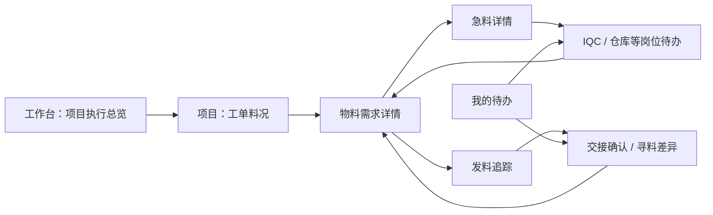

# 机器人 OEM 物料协同工作台设计

日期：2026-11-11；更新：2026-11-12。产品设计v1，作为已获方向与分批开发授权的工作基线；本次补记授权依据、最新环境约束及评审待修正项。

首期面向当前已承接的机器人 OEM 代工代料项目，帮助负责人掌握项目现状，帮助计划、采购、仓库、IQC、物流与产线完成物料保障和异常交接。业务范围及问题依据见[需求底稿][baseline]第1节。A 类首次导入与 B 类成熟重复生产均适用，从项目当前在制状态进入。

用户已提出在设计完成后开发，并按这个方向重构线上制造平台。本设计明确目标行为与分批改造范围；页面方案、办理规则、真实接口能力及生产发布分别核验。

**授权依据与范围**：本次接续会话中，用户先要求“很好，开始设计吧”，随后明确“可以开始开发了”“按照完整的工作流 打通数据 真实测试闭环”“看下我们的设计 拆分任务书 继续开发”。据此记录产品方向与分批实施授权；没有独立的逐页/逐字段签批记录，本文不补造签批日期。2026-11-12的[Claude评审](../../reviews/2026-11-12-robot-oem-product-review-claude.md)已按代码核对，修订和验收归属见[处置记录](../../reviews/2026-11-12-robot-oem-product-review-response.md)。用户随后明确开始实施，M4本轮料况来源契约已完成本地开发及隔离验证，见[验证记录](../../verification/material-quantity-provenance-2026-11-12.md)；M1/M2/M3/M5/M6按任务书接续。

## 1. 首期交付与产品组织

首期用户应能沿同一需求完成：**看项目 → 查工单料况 → 判断急料 → 交给相应岗位 → 核对结果 → 追到线边实收与差异处理**。

评审后收敛要求：交出、实收用途核对、短收查料及补签在料况内选中需求就地办理；交接台账作为核查视图保留。“计划与物料”默认进入项目料况选择/直达，而非先选业务台账；“事项”完整覆盖当前有权处理的物料检验、查料、待签收及待处理差异。复用已有页面和命令，保留原工单、筛选、页码和草稿行为。来源身份与任务引用的前置要求见第8节及T1—T6。

用户追加的交互要求：以实际功能使用为中心。主页面围绕缺什么、谁处理、现在怎么办组织；IQC 直接接单检验，仓库办理发料，产线确认收料，异常直接发起查料。来源、审计和技术校验在后台保留，按需查看。内部的待核对、回执或采集步骤不堆成用户必经流程；无法办理时用一句具体原因和可执行下一步解释。

| 产品组织方式 | 收益 | 代价 |
| --- | --- | --- |
| 项目与岗位待办双入口，共用业务对象，本设计推荐 | 负责人看影响和全貌；现场人员直接接手；双方能回到同一需求 | 需要保持筛选、对象和数据时点一致 |
| 所有工作都从项目逐层进入 | 项目上下文明确 | IQC、仓库跨项目办理时反复找项目 |
| 所有工作都按岗位任务进入 | 待处理事项容易定位 | 难以判断项目整体准备、共享物料及交付影响 |

沿用现有制造管理壳、企业身份、项目授权、订单、工单和历史记录。工作台增加当前项目执行视图；“计划与物料”承载工单料况、急料和发料追踪；“我的待办”提供岗位直达。项目、客户及实际授权范围贯穿所有入口。

### 页面关系

这些是业务视图，不要求新增同等数量的顶级导航。详情和办理完成后返回原项目、工单、筛选及页码；岗位入口返回对应待办上下文。

## 2. 页面一：项目执行总览

**主要用户**：制造负责人、项目负责人、计划/MC。

### 页面内容

1. 顶部选择授权项目和计划范围，显示当前范围与最近读取时间。默认查看有未完成生产或交付事项的授权项目；缺少可判定状态的项目单独标识。
2. 主区是项目/订单执行清单，显示客户与机型、交付承诺、计划与实际进展、受影响工单、物料阻断、待接手事项，以及负责人。
3. 当前需处理的事项可筛为“物料影响生产”“急料待检”“已发未实收”“资料待核实”，分别下钻到准确对象。
4. 选中项目后，查看工单列表及适用版本、生产数量、需要时间、实际执行状态和准备缺项；“查料况”进入该工单。

进度以有来源的阶段事实分别展示：计划生产、实际执行、测试/质量、入库及发运。数量使用本对象单位，多个机型或单位不强行合计；缺数据处显示未取得及影响。

### 汇总规则

- “急料需求数”按在办需求去重，“待检批次数”按检验对象去重，“待接收笔数”按交接分笔统计，名称和分母不混用。
- 已确认风险、时间风险建议、待核实分别表达，不产生无依据的项目健康分。
- 分页列表可显示本页记录数；全项目统计必须来自覆盖完整范围的汇总。采集或查询不完整时显示范围限制，不用已取样数据代替全量。
- 能定位受影响工单和交付安排；缺少产能或排程依据时，不自行计算新的承诺交期。

**主要操作**：查工单料况、查看急料、跟进未接收、进入责任事项。页面不直接办理库存调整或生产放行。

## 3. 页面二：工单料况

**主要用户**：计划/MC、仓库、生产负责人。

页面固定显示项目、工单、适用版本、计划及剩余生产范围、物料需要时间。变更或调整范围后重新核对料况，原判断保留其依据。

### 料况表

| 主列 | 展示规则 |
| --- | --- |
| 物料 | 编码、名称、适用替代关系；编号保留原形式 |
| 剩余需求 | 对应工单/工序及单位，标明源口径已扣除的消耗、取消或已满足部分；已净扣的数量不得再次扣减 |
| 本单已确认满足 | 仅使用能证明归属于本需求且符合状态的数量；跨工单共享储备不能重复计入 |
| 待补齐/待核实 | 可计算时显示剩余缺口，否则说明具体缺少的需求、分配、质量或数量依据 |
| 需要时间 | 来源于确认计划；未提供则显示未提供，不能推断不急 |
| 当前卡点 | 采购到货、身份、检验、仓配、交接或数据核实；一项需求可有多个问题 |
| 负责人及行动 | 对应实际责任或待分派，显示下一项可办理的任务 |

默认显示需要处理的需求，可切换全部、急料、待检、未实收、待核实；支持按物料或工单查找。宽表冻结物料列，数量始终带单位。窄屏先显示物料、缺口/待核实、卡点及操作，明细展开。

### 物料详情

同一侧栏/详情页依次展示需求依据、储备与占用、供应承诺、收货与质量、分配和发料、线边实收、相关案件及证据。每类数量标明来源、范围和时间。

账面库存、合格量、预留量、发料量和实收量属于不同维度或里程碑，不相加成为总供应。首期引用 SAP MRP、MES 欠料及实际分配事实分别解释；不新建未经业务确认的净需求算法。需求和满足量先核对为同一范围与口径；源结果已经净扣分配或发料时，不再重复扣减。不能证明数量含义或换算关系时，保留原字段及待核实。需要完整证据才能给出料套结论的需求，在证据不足时保持待核实。

**主要操作**：标记急料、关联到货/检验、查看发料、分派核实、查看已有处理。对象和上下文由当前需求带入，用户不填写来源编号或内部技术字段。

## 4. 页面三：急料详情

**主要用户**：MC、采购及相关处理岗位。

### 识别与建案

- 保留 MES 已发布急料和 MC 人工标记的来源；时间与数量分析给出风险建议，建议不冒充已确认处置。
- 人工建案默认带入项目、工单和物料需求；填写“急在哪里”“影响什么”。需要时间已存在时复用，缺少时可补充带来源的计划说明并进入核实。
- 同一有效需求只保留一个在办急料案件；已有案件直接打开。不同工单共用物料仍保留各自需求、需要时间与分配关系。

### 页面内容与操作

顶部显示缺口/待核实、需要时间、影响、协调负责人、当前案件状态。中部显示采购到货、身份、IQC、仓配、交接的实际里程碑及对应数量；无证据的节点保留未确认。下部是当前待办与处理历史。

| 操作 | 必需业务输入 | 结果 |
| --- | --- | --- |
| 交给采购/仓库/IQC 等岗位 | 对应卡点、可办理对象、责任岗位/人、需要完成什么 | 形成或关联协同待办，并保留发起记录 |
| 记录进展或阻断 | 说明、预计完成时间（可核实时）、依据 | 更新协同进展，不改变源库存或质量结果 |
| 转交协调责任 | 当前可授权接手人及原因 | 保留交出、接手和未完成事项 |
| 申请核对解决结果 | 对应数量、质量、分配/接收依据 | 检查剩余问题，列出满足与未满足的条件 |
| 有原因结束案件 | 已解决、误报、需求取消/替代及相应依据 | 保留结论和历史，未解决的独立差异继续跟踪 |

首期沿用急料“在办/已结束”的案件层状态，卡点与岗位任务另行表达，避免用一个串行阶段覆盖并行问题。已检验、已发料或一次接收不能单独自动关闭案件。

协调责任转交在新责任人接手前保留原负责人，转交请求和实际接手分别留痕；该责任变化不改变物料实物保管事实。

## 5. 页面四：岗位待办与 IQC 接手

**主要用户**：IQC、仓库、采购、物流、产线及协调负责人。

“我的待办”按当前授权和责任筛选，可从项目进入同一对象。每条显示项目、工单、物料/批次、需要完成的事、影响和需要时间、当前责任、进展及实际操作。

### IQC 待办

急料未到货时提供准备提示；实际到货、批次和检验对象可核实时，关联对应收货及 MES 检验单。身份或实物位置不明时，先形成核实任务。已有检验单直接引用。

任务详情包含：待检对象及数量、适用检验依据、实际待检位置、现场联系人、影响工单和需要时间、来源急料，以及已有结果。关联多个需求时，仅展示当前用户有权查看的关联。

| 协同状态 | 用户可以做什么 | 转出条件 |
| --- | --- | --- |
| 待分派 | 有权负责人分派；无可用接手人时显示待协调 | 明确当前责任人 |
| 待接手 | 指定人员接手，或说明对象/职责不符并退回协调 | 实际有权人员确认接手 |
| 处理中 | 更新预计完成、实际进展和阻断；打开已核实的原检验入口 | 有对应结果或需要核实的完成依据 |
| 待核对 | 对照正式结果及本次要求核对数量和对象 | 满足本任务范围，或将未解决部分继续办理 |
| 已完成/有原因撤销 | 查看结果及历史 | 完成依据可查；撤销有原因，急料影响另行核对 |

“受阻”是处理中可附带的事实和原因，不是完成状态。协同进度与 MES 检验状态分别显示；人员接手不等于源系统已开始检验。

正式检验结果包括合格、不合格和待处理数量及依据。部分合格可把对应结果交给仓库继续办理：仍待检的数量继续保留 IQC 任务，已检拒收造成的缺口转给适用处置/补料岗位；该次检验范围已经全部检完且结果可核对时，可完成检验协同。不能把“补到合格料”误设成 IQC 已完成检验的关闭条件。检验协同完成不意味着该需求已齐套、库存已上架或允许放行。

### 通知与去重

- 首期形成站内待办，关联准确对象；重新提醒复用同一任务。
- 同项目、同次实际检验对象可关联多项急料，避免重复要求 IQC 做同一批检验；不同检验批次或独立处理范围分别办理。
- 需要时间变化、人员转交及检验结果变化保留历史并刷新相关视图。撤销其中一项需求不能误撤销仍服务其他需求的任务。
- 企业消息作为可选提醒通道，待确认连接与适用规则后接入；通知送达、人员接手及正式结果分别记录。
- 未接手、预计迟于需要时间或处理中受阻，进入负责人待协调清单；具体提醒时限采用现行职责和班次规则。

## 6. 页面五：发料追踪与寻料

**主要用户**：仓库、物流、线边接收人、MC。

可从工单、物料、急料或待办进入，按发料单、批次、交接号查找。上部显示需求、批次、数量、去向及对应单据；中部同时保留两组事实：

- **作业与账务**：打印、实际拣配/交出、作业回执、SAP 过账，各有来源及数量。
- **实物流转**：仓库交出、物流领取、线边送达、指定人实收，按实际路径和分笔记录。

直接仓库到产线的交接使用实际路径。不能根据缺少物流步骤认定漏单，也不能根据账务过账推断已经领取。

### 分笔追踪

每笔显示交出与实收数量/位置、双方和时间、最后确认节点、未确认接收，以及当前差异。同批物料可能分布在多个位置；最后一笔记录不代表整批位置。所有“最后确认”都显示确认时间。

“确认接收”带出交出数量和目的位置供指定人员核对；可如实记录部分、短收、零接收或错位，差异须说明。该动作沿用现有指定接收人约束，管理权限不能代签。

### 寻料办理

在未实收、数量不符或位置不符的具体分笔上发起追查，默认关联原需求及交接。同项目、同分笔的同一问题范围已有在办追查时直接打开，不重复建立；不同分笔或独立差异分别办理。

1. 发起时显示最后确认事实、缺口数量、预期去向及影响；填写问题说明和追查负责人。
2. 负责人核对仓库、物流、线边证据及现场实物。追查责任、最后经手人和当前实物保管人分别表达，未知字段保持未知。
3. 记录找到的数量、实际位置、核实人、时间与依据；后续接收由真实接收人确认。
4. 根据事实办理正确接收、退回/转交、更正误关联或真实缺失处置；原事实不覆盖，补录保留发生与登记时间。
5. 部分查明后，剩余数量及问题继续保留。处理说明完成不自动等于缺少数量已收齐。

追查状态为“待分派 → 待接手 → 处理中 → 待核对 → 已结束”，受阻作为办理原因显示。有权负责人可有原因撤销误发任务；真实差异在其他正式处置中继续存在时保留关联，不用撤销掩盖缺失。

结束时区分“已找到并有接收依据”“已退回/转交并有对应依据”“误关联已更正”“已完成正式差异处置”。“暂时找不到”保持在办，不能通过补写实收或直接调库存结束。

## 7. 贯通一次急料与寻料的走查

以下数量为说明交互的示意，不是实际项目记录。

1. 工单某关节物料剩余需求20件。已到厂20件，其中合格12件、待检8件；本单确认分配12件。这三组数量有重叠关系，不能相加为32或44件。
2. 需要时间明确，待检8件影响该工单计划。MC 在需求上确认急料，关联实际检验对象，交给 IQC；负责人看到案件及待接手状态。
3. IQC 接手并反馈预计完成。检验后8件全部合格，正式结果关联回原任务；仓库继续完成适用的仓配与本单分配。此时还不能因检验完成就表示已到线。
4. 仓库实际交出20件，物流确认领取20件，线边只实收18件并说明差异。页面保留该分笔原数量及实收，展示剩余2件实收待核实。
5. MC/物料协调负责人发起追查。剩余2件最后确认经手人为物流，当前位置待核实；线边已收到18件的位置不能套给剩余2件。
6. 找到2件后记录实际位置及核实依据，指定接收人确认相应接收。追查核对结束，工单料况重新依据实际分配、质量及接收计算；急料再按对应需求的解决条件核对结束。

同一物料同时服务其他工单时，其他需求的数量和优先级独立核对。本工单解决不使其他工单自动显示齐套。

## 8. 事实、分析与业务操作的边界

| 层次 | 承担内容 | 对用户的表现 |
| --- | --- | --- |
| 原始事实 | 订单、工单组件、供应、收货、质量、分配、发料与接收，保留来源和环境 | 可打开依据、查询范围、发生/读取时间及覆盖情况 |
| 对象关联 | 外部单据、物料、批次与平台项目/需求的核实映射 | 未关联及冲突有明确待核实事项，不按相似编号猜关联 |
| 料况与风险分析 | 同一需求范围内的数量核对、时间影响、未完成交接及数据缺失 | 每项判断能说明输入和缺少条件；源系统缺口与平台核对分别标识 |
| 协同办理 | 急料案件、岗位接手、寻料差异、现有人工交接 | 有实际操作者、当前责任、完成条件和不可覆盖历史 |

首期源系统读取与平台内协同分别授权。SAP 的经营账、MES 的质量与执行、现有仓储作业仍提供相应事实；新增协同记录不自动产生库存、质量批准或 SAP 过账。

**逐项来源**：数量需要带来源方式、环境、事实角色、原对象/版本、发生与读取时间、覆盖及派生输入引用。平台确认、原生观察与模拟不是互斥分类：模拟事实被平台确认后仍标为模拟。已有页级来源汇总不替代逐项依据，历史未知身份保留未知。详见[SAP契约mock设计第4节](2026-11-12-sap-mrp-contract-mock-design.md)。

**任务引用与本地登记**：已有原生单据经核实时，用户可直接引用持久观察建立协同，不重新填写一份正式原账。只有到场包裹或身份不足时先形成核实任务；`arrival.record`没有物料/批次/待检数量，不能据此登记正式收货或关闭检验。原生收货与IQC结果的准确关系仍按T3准入。本地登记保留为有依据的例外声明，不是所有协同的必经前置。

### 数据不完整时的行为

- 断开连接、查询失败、真实空结果、超限/未取全、数据过时和无权限分别表达。
- 需要数量或范围没有取得时，显示不可判断及缺项；已存在有时间的事实可继续查看，不伪装为最新。
- 小样本读取和分页上限不构成完整项目覆盖。未取得完整需求清单或对应状态时，禁止把缺失行视作无需物料。
- 工单、版本、批次或单位不匹配时不自动合并；同单位名称相似不能替代批准的换算。
- 写入等待回执或失败时保留草稿及当前状态，先查询操作结果再决定重试。重复提醒、重复点击及源事实重放不重复建案或生成交接。

## 9. 职责与操作权限

| 职责 | 可办理内容 | 需要的限制 |
| --- | --- | --- |
| 项目负责人/计划 MC | 查看影响、确认人工急料、分派协调任务、核对结束 | 当前项目授权；需要可追问的需求与依据 |
| IQC/质量岗位 | 接手适用检验协同、反馈阻断、关联正式结果 | 协同接手不赋予新的质量放行或库存权限 |
| 仓库 | 查看急料和需求、处理适用仓配任务、提供实际交出和差异依据 | 已有源作业权限及实际回执要求继续适用 |
| 物流/产线接收人 | 接手实际领取、送达或接收任务，确认本人实际接收 | 仅指定且当前有权的人员可签收；部分接收如实保留 |
| 追查负责人 | 组织核对、登记查明事实、提交结束依据 | 不替实际接收人签收，不直接修改库存余额 |
| 管理员 | 按现有完整管理权限协调业务并核对历史 | 仍需满足业务条件，指定接收不被管理身份替代 |
| 只读用户 | 查询当前授权的事实、分析与历史 | 不显示可提交动作，服务端同样拒绝写入 |

岗位名称表示职责，沿用企业用户和项目授权。新增 IQC 协同及追查动作明确登记权限，不通过放宽全部急料或管理员接口取得能力。

## 10. 现有能力复用与新增范围

本轮已核对现有[供应工作区][supply-ui]、[工作台][home-ui]、[责任事项][tasks-ui]、[急料模型][expedite-model]、[交接模型][handoff-model]及发料状态记录。以下区分已有实现与本轮目标，不表示真实现场已经覆盖。

| 能力 | 当前基础 | 本轮重构方向 |
| --- | --- | --- |
| 项目与工作台 | 授权项目、待办及交付概况 | 增加当前项目执行与物料风险视图，明确数据覆盖 |
| 工单物料 | 需求、供应承诺、收货、检验、预留及余额展示 | 围绕工单和需要时间聚合，补足真实来源、分配及未实收关联 |
| 急料 | 在办/结束、原因、影响、进展及部分里程碑 | 补齐页面、协调责任、岗位任务、解决条件及时间风险解释 |
| IQC | 检验结果及部分“已检验”读侧提示 | 新增可接手的检验协同待办；接手进度与正式检验分开 |
| 发料 | 打印/作业/回执/过账记录 | 与实际单据、分笔交接及线边实收聚合核对 |
| 交接 | 指定接收、差异处理、取消、历史和返回上下文 | 继续复用，补足连续流转关联和未确认数量的追查 |
| 寻料 | 当前通用交接差异说明可留痕 | 新增明确责任、分笔查明、完成依据及剩余问题的办理 |

不把旧记录“差异已处理”直接迁移为新设计的“数量全部实收”。历史急料自由文本结案保留原性质，不补造新完成证据。

## 11. 联调环境与数据准备

用户最初指定MES测试环境，历史读取见[联调记录](../../reviews/2026-11-11-robot-oem-material-integration.md)；随后明确真实闭环不使用测试库验收，并要求MES/WMS与SAP/MRP生产源只能查询。**当前以根目录[AGENTS.md](../../../AGENTS.md)只读规则为准**。历史测试地址保留其测试身份，不再作为当前生产验收地址。

当前生产MES已有受控只读样本：一张工单12行组件、3页完整读取；还未证明其属于目标机器人OEM项目或与SAP同单。原始证据在本机私有受控位置，不随文档公开。MES/WMS以现行仓储职责和真实接口核对，不预设独立WMS实例。

SAP现有S4D/Client300测试接口及WSDL读取证据，暂无生产SAP配置。用户已同意按真实测试契约、自建数据先开发，具体由[SAP MRP契约mock设计](2026-11-12-sap-mrp-contract-mock-design.md)和T1扩展承载；mock尚未实现。MRP属于SAP内能力；已有业务模拟器不等同该原生BAPI的契约mock。

试点逐项核对项目/工单映射、完整组件、需要时间、库存质量与分配、收货/IQC对象、发料及指定实收。`SHOP_ORDER`、`AUFNR`不能按同号推断同一对象。模拟SAP和生产MES保持独立身份，不合成生产齐套；真实接口、隔离场景和现场验收分别记证。凭据与原始业务证据仅留受控配置及私有目录。

## 12. 分批开发与线上切换

| 批次 | 开发结果 | 进入下一批的依据 |
| --- | --- | --- |
| 一：项目现状与工单料况 | 已核实的试点映射与读取投影、项目执行总览、工单物料明细、覆盖和缺项展示 | 同一实际测试工单能核对完整需求、状态及数量；无数据和不完整不冒充齐套 |
| 二：急料与 IQC 协同 | 急料页面、岗位接手/转交/阻断、正式检验结果关联与回传 | 一项急料跨 MC 与 IQC 完成接手、结果核对和部分数量处理 |
| 三：发料追踪与寻料 | 四状态与实物流转聚合、分笔接收、寻料及差异完成依据 | 仓库已发未领、物流已领未收、短收和部分找到均能走通 |
| 四：现场试点与线上切换 | 对应真实业务样本、岗位账号验收、旧入口转接及运行核对 | 操作者能完成实际任务；重复登记退出范围、回退路径和当前发布基线明确 |

每批复用现有认证、项目授权、业务命令、幂等、并发检查与审计。数据结构采用可迁移方式保留原始身份与历史；新来源关联按核实结果建立，不批量把人工或模拟记录改成真实来源。

新视图覆盖对应旧任务后，原入口转到同一业务对象，保留深链接及返回上下文。源系统已有的同类正式事实在试点核对后明确停录范围；人工记录仍可补充例外证据，不能长期重复维护同一原账。

生产切换前核对当前宿主、制造版本、数据结构、其他应用与配置基线，并完成有恢复依据的备份。发布与回退面向同一批次，回退新入口不能删除已发生的业务事实。现有生产数据、共享宿主及其他应用的变化以切换时的实际基线处理。

## 13. 验收与完成判定

以[需求底稿][baseline]第1.7节的九项首期样本为业务基线，增加以下产品验证：

| 验证 | 必须看到的结果 |
| --- | --- |
| 双入口接续 | 项目进入 IQC/寻料与岗位直接进入指向同一对象，返回时筛选和草稿行为正确 |
| 范围与汇总 | 分页、未取全、不同单位、共享储备与跨工单分配不造成错误总数或重复满足 |
| IQC 接手竞争 | 一个待办的接手结果明确，转交有历史；重复提醒不生成多个同项目同范围任务 |
| 原结果与协同进度 | 接手或人工进展不伪装为正式检验；部分合格不关闭剩余实际缺口 |
| 分笔寻料 | 实收18/20和后续找到2的示意流程可核对；最后位置与确认时间按剩余分笔说明 |
| 权限与责任 | 撤权、只读、跨项目访问被拒绝；管理员不能代替指定人接收 |
| 失败与重放 | 重复提交、超时、重启、旧响应及旧源事件不重复生成案件，不覆盖当前上下文和新事实 |
| 历史兼容 | 既有订单、急料、交接及差异历史可查；旧说明结案不被补造成实收证据 |
| 真实测试链 | SAP/MES 取数、身份关联和业务核对分别留证；测试环境成功不升级为生产业务验收 |
| 实际工作效果 | 记录 MC 人工传话、IQC 等待、发料未实收和寻料差异的处理过程；基线后再确定目标 |

软件验证、真实接口联调、现场角色走查和生产切换分别记录完成状态。已授权的方向按任务书分批实施；本次M1—M6修订及专项mock分别展开实施计划、验证与交付记录，文档修订不表示功能已完成。

## 来源与代码索引

- [首期需求、原始痛点映射及全流程背景][baseline]。
- [OEM 业务设计][business] §3、§7—9、§20、§26—28。
- [物料交接复盘][handoff-review]中的事实边界、指定接收与简化原则。
- [现有工作台][home-ui]、[供应工作区][supply-ui]、[我的待办][tasks-ui]及[交接工作区][handoff-ui]。
- [急料模型][expedite-model]、[物料交接模型][handoff-model]及[发料状态模型][issue-model]。

[baseline]: ../../reviews/2026-11-11-robot-oem-requirements-baseline.md
[business]: ../../oem-ai-manufacturing-platform-discussion.md
[handoff-review]: ../../oem-material-handoff-iteration-2026-11-03.md
[sap-access]: ../../sap-system-access-layer.md
[mes-access]: ../../mes-system-access-layer.md
[home-ui]: ../../../webui/src/workflow/WorkflowHome.tsx
[supply-ui]: ../../../webui/src/workflow/SupplyWorkspace.tsx
[tasks-ui]: ../../../webui/src/workflow/GlobalTasks.tsx
[handoff-ui]: ../../../webui/src/workflow/MaterialHandoffWorkspace.tsx
[expedite-model]: ../../../src/manufacturing_platform/workflow/expedite_models.py
[handoff-model]: ../../../src/manufacturing_platform/workflow/material_handoff_models.py
[issue-model]: ../../../src/manufacturing_platform/workflow/issue_mark_models.py
