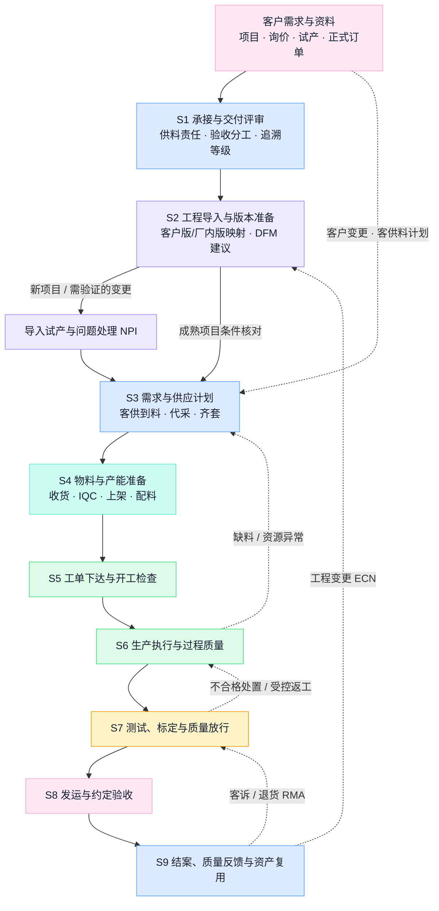
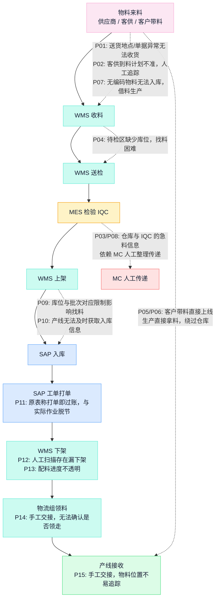

# OEM 制造业务流程总览

版本：工作底稿 v0.3。整理日期：2026-11-03。本稿按最新业务决定将主线统一为 **OEM 代工制造**，梳理从客户承接到交付结案的业务管理流程、物料链路的材料所述现状与候选目标，供结合真实订单、工单和现场记录核对修订，尚未作为现行作业规程发布。节点编号 S1—S9 与[《OEM 制造数字化系统手册》](../manufacturing-system-handbook.md)保持一致。

## 历史版本说明（保留，不改写历史事实）

- **v0.2（2026-10-27）**：按"内部自有产品（相机、数采相机、3D 打印机）＋外部 OEM 两个业务入口、共用制造管理主流程"的当时业务口径梳理。该口径已被 2026-11 的业务决定取代：**平台与本稿只面向 OEM**；自有产品相关软件能力转为复用资产评估，不再作为并列业务入口。
- **2026-10-29 软件候选实现状态（历史记录）**：软件候选已按固定工程版本、权威回执、可用库存、开工与测试放行、分批交付和独立结案实现 S1—S9 业务对象，并完成[原 36 例的本地隔离 mock 合成验收](../testing/manufacturing-full-workflow-results-D4-20261028.md)；后续 OEM 能力发布见[2026-10-30 发布记录](../release-oem-capabilities-2026-10-30.md)。阶段标签/事项完成不代替业务条件，履约、质量、成本分别判断；真实公司部门权限、外部系统连接和现场作业规程仍需真实业务验证，测试数据不是公司生产事实。

## 已确认业务与本稿假设

- **只做 OEM**：按客户提供产品定义、制造方承接制造展开。客户设计决策及批准、制造方 DFM 建议、厂内批准和质量放行分别表达。
- **供料模式按合同／项目表达**：此前明确过代工代料；物料痛点表同时涉及客供料、代采及客户直接带料，采购责任、物料所有权、验收和损耗结算需逐项目确认，不从"OEM"名称推定。
- **机器人是主要材料案例**：是否只做机器人、是否覆盖其他 OEM 品类、首批客户及产线尚未确定，本稿不写成已批准范围。
- **系统现状待核实**：公司已有 SAP、MES、WMS、PDM、产测、BI 等系统（见手册第 2 章现状图）；OEM 业务在各系统中的实际覆盖、启用与绕行情况是本稿最重要的待核对事项。

## 业务流程与产品工艺分开梳理

业务管理流程回答：客户需求如何受理、版本如何确认、物料与产能如何准备、工单如何执行、质量如何放行、产品如何交付。产品工艺回答：具体先做哪道工序，采用什么设备、工装、参数、方法和限值。本稿统一前一层；后一层按客户产品、配置和产线展开——机器人的部件装配、四级测试与标定排布是适用模板（来自 EX001 材料），不同 OEM 产品不能直接复制。

## OEM 业务入口与承诺程度

| 需求形态 | 进入制造前需要说清什么 | 允许触发的动作 |
| --- | --- | --- |
| 客户项目／询价 | 代工范围、技术资料完整性、设计与采购责任、供料方式、验收分工的初步判断 | 评估与报价，不触发采购与投产 |
| 试产（NPI） | 固定资料修订、试产数量、测试与验收条件、问题处理责任 | 按批准的试产范围准备与执行 |
| 正式订单／滚动预测 | 数量、交期、价格、供料与损耗责任、追溯等级承诺、验收位置 | 按合同触发采购、排产与交付承诺 |

受理需求不代表批准投产；新客户、首次导入、重大变更触发工程导入与试产，成熟项目重复订单核对现行有效条件。

## OEM 制造主流程

下图表达业务交接与反馈关系，不代表各步骤必须全串行，也不规定对应软件。粉色节点为客户触点。

### 各环节需要明确的交接

以下为职责类型和记录范围的梳理建议；实际部门、岗位、系统及批准权限尚待现场核对。

| 阶段 | 主要工作 | 关键输入 | 主要输出与交接条件 | 应参与的职责类型 |
| --- | --- | --- | --- | --- |
| S1 承接与交付评审 | 确认代工范围、数量、交期、供料与验收责任 | 客户资料、技术要求、合同条款 | 有来源的制造承诺、责任边界、追溯等级承诺和未决条件 | 客户项目、制造、计划、工程、质量 |
| S2 工程导入与版本准备 | 客户资料转化为厂内可执行版本；DFM 评审与试产 | 客户图纸/BOM/规范、制造范围 | 客户版与厂内版映射、MBOM、路线、SOP、测试规范；试产问题结论 | 客户技术接口、制造工程、质量、生产 |
| S3 需求与供应计划 | 需求展开，区分客供／代采，核对供应与能力 | 订单、BOM、库存、客供到料计划、提前期 | 缺口与急料清单、供应行动、排产方案 | 计划、MC、采购、客户接口、仓储 |
| S4 物料与产能准备 | 收货、身份核实、检验、上架、配料与资源准备 | 供应安排、客供料声称、物料要求 | 可使用物料及其身份、状态、所有权、位置；资源就绪 | 采购、客户接口、仓储、IQC、物流、生产 |
| S5 工单下达与开工检查 | 任务落实到明确数量、版本和执行条件 | 排产、有效版本、齐套与配料结果 | 允许执行的工单、发料与交接记录；缺项有明确处置 | 计划、生产、工艺、仓储、质量 |
| S6 生产执行与过程质量 | 按路线完成装配、过站、用料与报工 | 工单、作业要求、物料、资源 | 实际用料、工序、批次/SN、异常与返工记录 | 生产、工艺、质量、设备 |
| S7 测试、标定与质量放行 | 按客户测试规范执行、标定写入与回读、处置不合格 | 实物、测试规范与限值、原始数据 | 测试与标定证据关联 SN、放行记录；客户确认条件单独保留 | 测试、质量、工程，按约定涉及客户 |
| S8 发运与约定验收 | 包装标识、发运、签收与约定验收 | 放行结果、订单、客户标签与数据要求 | 箱—SN—客户关联、交付数据包、验收及遗留事项 | 仓储、物流、客户项目、质量 |
| S9 结案、反馈与资产复用 | 核对消耗与产出，处理质量反馈，沉淀经验 | 用料、工时、交付、客诉与服务记录 | 代工费口径结案、客供料对账、8D、经验证的复用资产 | 制造、计划、财务、质量、工程、客户接口 |

合同规定客户在发运前验收的，该验收必须成为发运前置条件。工单成本结案、客户验收和付款分别发生，不合并为一个完成标记。

## 物料链路现状（材料所述，待现场核对）

[OEM 业务物料痛点表](<../../OEM业务物料痛点.xlsx>)"问题痛点"工作表记录了 15 条已报告问题（讨论编号 P01—P15，定位见[设计文档 §3.2](../oem-ai-manufacturing-platform-discussion.md)）。原表流程形状为：物料来料 → WMS 收料 → WMS 送检 → MES 检验 → WMS 上架 → SAP 入库 → SAP 工单打单 → WMS 下架 → 物流组领料 → 产线接收。下图按材料如实呈现该现状及问题位置——**人工传递、绕行、打单与实际作业脱节是现状的一部分，不能用目标流程覆盖**；实际单据、系统事务和操作仍需核对（痛点表未经业务责任人共同签认和现场逐条复核）。

### 需要展开的分支（候选目标，经核实后才升级为规范）

| 分支 | 现状问题 | 候选走法 | 升级为目标前需核实 |
| --- | --- | --- | --- |
| 客供料到货 | P02 计划不准、人工追踪 | 客户提供到料计划并登记；代采经 SRM（规划中）获取在途 | 客户计划的来源、更新频率与责任；SRM 实际上线范围 |
| 客户直接带料 | P05/P06 绕过仓库上线，信息断层 | 原表建议"未经过仓库物料无法上线"（MES 卡控）；带料先观察登记再核实身份 | 卡控位置、例外批准机制、现场执行纪律与业务制度 |
| 无编码来料 | P07 无法入库，急用时借料生产 | 提前取得客户物料清单并建码；紧急用料走例外批准并留痕 | 主数据建码流程时效、例外批准权与追溯补账方式 |
| 急料传递 | P03/P08/P10 依赖 MC 人工传递 | 急料关联工单需求与交付影响，状态变化推送到仓库、IQC 与产线 | 急料优先级的判断依据、各岗位任务载体与闭环条件 |
| 待检与库位 | P04/P09 待检无库位、库位批次限制 | 待检区增加库位码；原表建议"一库位多物料" | 现有 WMS 库位/容器/批次模型的实际配置与样本 |
| 部分合格与冻结 | 未在原表单列，为通用风险 | 按数量区分合格、待检、冻结，不整批绿标；冻结真实锁定可用量 | MES/WMS 的质量状态模型与 Marking 隔离的实际联动 |
| 配料与过账 | P11/P12/P13 打单脱节、漏扫、进度不透明 | 原表建议"WMS 先发料，再在 SAP 扣账"；配料区分打印、实物作业、回执与过账四个状态 | SAP 单据类型、实际事务与触发点；WMS 发料回执；例外与补偿 |
| 交接与线边 | P14/P15 手工交接、位置不可追 | PDA 扫码交接同步发料看板；物料与产线工位绑定 | 交接双方的作业端、设备条件与线边管理责任 |

原表改善建议（右列"候选走法"中注明"原表建议"者）均为候选方案，需检查业务对象、系统配置和例外机制后才能写成目标规范。

## 异常与变更回到哪个环节

| 事件 | 优先回到的业务环节 | 应核对的影响 |
| --- | --- | --- |
| 客户需求增减、取消或改期 | S1 承接确认与 S3 计划 | 已有承诺、采购、客供安排、工单、在制和交付 |
| 客户资料、BOM、固件或测试要求变化（ECN） | S2 工程导入 | 生效范围、在途、旧料、在制、已交产品、客户与厂内各自批准 |
| 缺料、客供延迟或来料不合格 | S3/S4 计划与准备 | 受影响工单、责任归属（客供/代采）、替代与交期重确认 |
| 设备、治具、测试环境不足 | S3/S4 计划与准备 | 替代资源、排程、试产启动前置条件（测试环境就绪） |
| 制造或测试不合格 | S6/S7 执行与质量处置 | 隔离、返工复测、报废或让步（按约定需客户批准）及履历 |
| 试产问题 | S2 导入与问题验证 | 现象、风险、临时措施、对策验证；经验证后形成复用资产 |
| 客户拒收或交付后质量问题（RMA） | S8/S9 交付与反馈 | 实际产品履历、合同责任、8D 与改进分流 |

## 岗位、系统与记录载体（待核实清单）

每个节点需补充：现行单据、实际角色、使用系统、输入输出、记录载体（系统/纸单/Excel/微信）和未完成交接。重点核实：

1. OEM 项目在现有 MES/WMS/SAP 中的实际账号、模块与工单样本——区分未上线、未启用、绕行和接口问题。
2. SAP 打单、过账与 WMS 实际作业的单据类型、事务和触发点（P11—P13 的根）。
3. 客供料、代采与带料在收货、检验、所有权和对账上的实际处理。
4. 急料从识别到可用的实际传递链与各岗位载体。
5. 客户及厂内工程版本的实际发布、ECN 与接收记录。

操作规程未经确认前，本稿各节不作为正式 SOP。

## 下一轮细化顺序

先选定一个实际 OEM 客户项目（或 EX001 类试产项目的真实记录），沿 S1—S9 对照：谁提出需求、谁确认技术、谁安排物料、谁准许开工、谁放行、谁接收交付。优先走查 S3—S6 物料链路（与 15 条痛点逐条对照实际单据），再扩展工程导入与测试标定。每个节点补充现行单据、实际角色、使用系统、输入输出和异常样本。

## 相关资料

- [OEM 制造数字化系统手册](../manufacturing-system-handbook.md)：业务与系统主手册，S1—S9 逐节点展开。
- [OEM AI 制造平台设计](../oem-ai-manufacturing-platform-discussion.md)：完整设计文档，含 P01—P15、R01—R13 与待决策项。
- [制造过程知识](../../knowledge/01-foundations/01-manufacturing-process.md)、[主数据和工程变更](../../knowledge/01-foundations/05-master-data-and-engineering-change.md)、[计划体系](../../knowledge/01-foundations/02-planning-and-control.md)与[系统边界](../../knowledge/02-systems/02-process-and-system-boundaries.md)。
- 业务范围来自 2026-11 用户说明；物料链路现状来自痛点表原生流程形状；主流程、角色类型和待核对项为梳理建议，尚未经现场业务样本核验。
