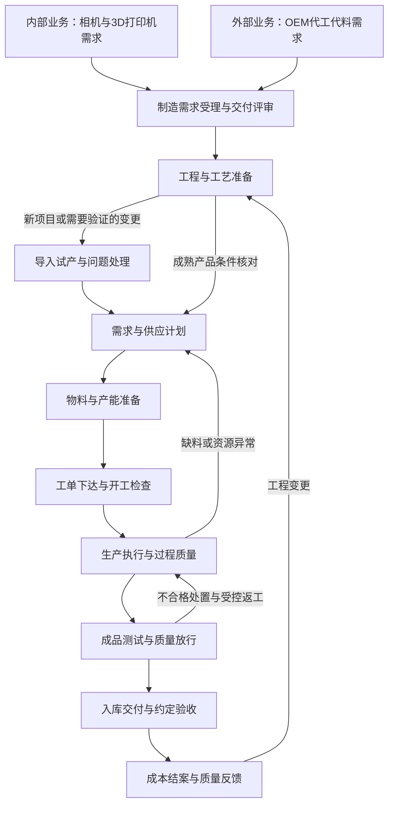

# 内部业务与外部 OEM 制造流程总览

版本：工作底稿 v0.2。整理日期：2026-10-27。本稿从业务管理流程开始梳理，供后续结合真实订单、工单和现场记录修订，尚未作为现行作业规程发布。

## 已知业务与本稿假设

用户最新明确：内部业务包括自研相机（含数采相机）和 3D 打印机，外部业务为 OEM 代工代料。机器人是此前提到的外部场景，不限制其他代工品类。内部/外部是一级业务分组，业务线可继续调整。

本稿据此采用“两个业务入口、共用制造管理主流程、按产品与项目保留差异”的梳理方式。共用程度是需要核对的工作假设，不能由此认定相机与机器人具有相同工艺、相同产线或相同客户验收要求。OEM 的供应商供料、客户设计/BOM、奥比制造承接与已有 ERP/MRP/MES 等系统的责任和交接需逐项梳理；具体系统产品及接口尚待确认。

## 业务流程与产品工艺分开梳理

业务管理流程回答：需求如何受理、版本如何确认、物料与产能如何准备、工单如何执行、质量如何放行、产品如何交付。产品工艺回答：具体先做哪道工序，采用什么设备、工装、参数、方法和限值。

本稿优先统一前一层；后一层按产品、配置和制造地点展开。例如“生产执行”和“测试放行”可以作为共同环节，相机的装调与标定、机器人的部件装配与整机测试则需要分别核实，不能直接复制。

官方产品文档也提供了这种区分的实例：生产订单可基于 BOM 与路线组织，路线再定义工序、资源和时间，并可按产品或版本变化。这是模型参考，不表示奥比采用该产品或现有系统具有相同配置。[生产流程实例](https://learn.microsoft.com/en-us/dynamics365/supply-chain/production-control/production-process-overview)、[工艺路线实例](https://learn.microsoft.com/en-us/dynamics365/supply-chain/production-control/routes-operations)

## 两类业务入口

| 入口 | 需求从哪里来 | 进入制造前需要说清什么 | 当前确认程度 |
| --- | --- | --- | --- |
| 内部自有产品 | 产品计划、销售订单、预测或备货等候选来源 | 产品型号与配置、适用版本、数量、交期、需求依据；新产品的工程与量产准备 | 相机（含数采相机）及 3D 打印机业务已由用户确认；具体需求来源和审批仍需核对 |
| 外部 OEM 代工代料 | 客户项目、询价、试产或正式订单等候选来源 | 代工范围、技术资料、客户要求、设计与采购责任、供料方式、数量、交期及验收分工 | 外部 OEM 代工代料已由用户确认；具体客户、设计方与供料范围仍需核对 |

询价、预测和正式订单具有不同承诺程度。受理制造需求不代表已经批准采购或允许投产；需要明确它处于评估、准备、试产还是正式执行阶段。自有产品也可能按客户订单生产，OEM 项目也可能有滚动预测，不能按业务名称直接推定备货策略。

新产品、首次代工、制造转移或重大变更可以触发工程导入与试产；成熟机型的重复订单则核对现行有效条件，不必每单重做完整开发。具体触发条件由后续流程访谈确认。

## 共用制造主流程

下图表达业务交接与反馈关系，不代表各步骤必须全串行，也不规定对应的软件。需求评估、工程准备、供应和能力评估可以交叉进行；正式开工仍要检查适用版本、物料、资源和授权。

### 各环节需要明确的交接

以下为建议的职责类型和记录范围，实际部门、岗位、系统及批准权限尚未确认。阶段编号用于讨论；采购、质量和成本活动可能贯穿多个阶段。

| 阶段 | 主要工作 | 关键输入 | 主要输出与交接条件 | 应参与的职责类型 |
| --- | --- | --- | --- | --- |
| S1 需求受理与交付评审 | 确认做什么、做多少、何时交、承担哪些责任 | 内部需求或客户资料、产品范围与交付要求 | 有来源的制造需求、承诺状态、责任边界和未决条件 | 产品/销售或客户项目、制造、计划、工程、质量 |
| S2 工程与工艺准备 | 确认产品定义与制造方法；按需开展导入试产 | 有效技术资料、制造范围、质量要求 | 可用的制造 BOM、路线、作业与测试要求、版本及生效条件；试产问题的处理结论 | 研发或客户技术接口、制造工程、质量、生产 |
| S3 需求与供应计划 | 展开物料需求，核对供应和能力，安排交期 | 需求、BOM、库存、未结供应、提前期、资源日历 | 物料与能力缺口、供应行动、排产方案和需重新确认的承诺 | 计划、采购、仓储、生产、项目 |
| S4 物料与产能准备 | 采购或协调客供、收货检验、准备资源与工装 | 已授权供应安排、物料要求、资源需求 | 可使用物料及其身份、状态、所有权；可用设备、工装、人员及剩余缺口 | 采购/客户接口、仓储、质量、设备、生产 |
| S5 工单下达与开工检查 | 将任务落实到明确数量、版本和执行条件 | 排产、有效资料、物料与资源准备结果 | 允许执行的工单、备料领料与版本记录；未满足条件的项目有明确处置 | 计划、生产、工艺、仓储、质量 |
| S6 生产执行与过程质量 | 按产品路线完成加工装配、过程检查和报工 | 工单、作业要求、物料、资源 | 实际用料、工序、批次/序列号、数量、工时、异常与返工记录 | 生产、工艺、质量、设备 |
| S7 成品测试与质量放行 | 核对结果、处置不合格、完成制造方放行 | 实物、测试要求、原始数据、异常处置 | 合格与受限数量、放行记录、追溯资料；需客户确认的条件单独保留 | 测试、质量、工程，按约定涉及客户 |
| S8 入库交付与约定验收 | 包装、收发、运输及相应交付确认 | 放行结果、订单、包装标识和交付要求 | 库存/发运与交付记录、适用的客户验收及遗留事项 | 仓储、物流、销售或客户项目、质量 |
| S9 成本结案与反馈 | 核对消耗、产出和差异，处理后续质量反馈 | 用料、工时、产出、报废、交付与服务记录 | 工单成本及差异、结案状态、反馈与工程改进任务 | 制造、计划、财务、质量、工程及客户接口 |

如果合同规定客户在发运前验收，该验收必须成为相应发运前置条件；不能因主图将“验收”与“交付”并列，就默认为客户确认总在发货之后。工单成本结案、客户验收和付款也可能分别发生，不应合并为一个完成标记。

## 两类业务贯穿全程的差异

入口不同会把一些条件带入后续流程，因此共用主流程仍要保留以下维度。

| 差异维度 | 自有产品需要核对 | 外部 OEM 需要核对 | 对共用流程的影响 |
| --- | --- | --- | --- |
| 产品定义与变更 | 内部研发、产品与制造如何发布和变更 | 客户、奥比或双方分别批准哪些资料与变更 | 工单与现场资料必须指向有权批准的有效版本 |
| 物料来源与所有权 | 自购、外协等实际安排 | 奥比采购、客户供料或混合；余料、损耗与不良如何处置 | 需求计算、催料、仓储、耗料和结算保留来源及所有权 |
| 工艺与资源 | 各型号实际路线、工装与能力 | 客户要求及奥比制造方案如何确认 | 共同工序可以复用，具体路线和作业条件分别维护 |
| 测试与放行 | 内部规格与产品出厂要求 | 客户测试规范、数据回传、见证或放行要求 | 测试通过、制造方放行与客户确认分别记录 |
| 包装与追溯 | 产品标识、关键件与服务追溯要求 | 客户料号、标签、序列号、报告与追溯范围 | 统一追溯框架中保留产品和客户适用规则 |
| 成本与交付责任 | 自有产品成本、库存和销售交付 | 包工包料、来料加工等约定范围及验收、结算责任 | 共用实际消耗记录，核算和结算按业务约定处理 |

“内部自有制造”和“外部 OEM”不直接决定某种固定采购或会计模式。上表是访谈清单，实际安排以业务记录与合同约定核实。

## 共用的制造任务信息

为了把两个入口交给同一制造管理主流程，可以先用一张业务信息表表达任务，后续再映射到实际系统单据，不在这里预设新增软件表或编号规则。

- 业务来源与对象：自有产品或 OEM、来源需求/订单、客户或内部需求方、项目、产品型号与配置。
- 数量与时间：本次需求量、单位、客户要求时间、当前承诺、允许的分批交付条件和变更记录。
- 技术与制造：产品与制造资料版本、BOM、路线、适用工厂、导入阶段和生效条件。
- 供料与责任：各物料供给方、所有权、采购或客供责任、缺料与替代批准方式。
- 质量与交付：测试规范、放行责任、客户确认要求、包装标识和追溯资料范围。
- 当前准备状态：技术、物料、资源与质量条件的完成情况，未决问题、责任角色和处理结论。

## 异常与变更回到哪个环节

| 事件 | 优先回到的业务环节 | 应核对的影响 |
| --- | --- | --- |
| 需求增减、取消或改期 | S1 需求确认与 S3 计划 | 已有承诺、采购、客供、工单、在制和交付 |
| 产品、BOM、固件或测试要求变化 | S2 工程与工艺准备 | 生效范围、在途、旧料、在制、验证与客户批准 |
| 缺料或来料不合格 | S3/S4 计划与准备 | 哪些工单受影响、供应承诺、替代与交期重确认 |
| 设备、工装或人员能力不足 | S3/S4 计划与准备 | 替代资源、排程、质量条件与交付承诺 |
| 制造或测试不合格 | S6/S7 执行与质量处置 | 隔离、返工、复检、报废或其他经批准的处置及履历 |
| 客户拒收或交付后质量问题 | S8/S9 交付与反馈 | 实际产品、合同要求、原制造记录、责任处理与改进 |

## 下一轮细化顺序

先确认各业务线的设计与供料分工，再选一款实际相机、一款 3D 打印机和一个实际代工项目，分别沿 S1—S9 对照：谁提出需求、谁确认技术、谁安排物料、谁准许开工、谁放行、谁接收交付。每个节点补充现行单据、实际角色、使用系统、输入输出和异常样本。

进一步需要核对的是外部代工交付范围、是否首次导入、是否与相机共用制造资源，以及客户验收发生的位置。这些信息用于展开流程差异，不阻碍当前先建立共用主流程草图。

## 相关资料

- [系统学习手册](../manufacturing-system-handbook.md)：通用学习主干；本稿记录公司制造业务的工作底稿。
- [制造过程知识](../../knowledge/01-foundations/01-manufacturing-process.md)与[主数据和工程变更](../../knowledge/01-foundations/05-master-data-and-engineering-change.md)。
- [计划体系](../../knowledge/01-foundations/02-planning-and-control.md)与[系统边界](../../knowledge/02-systems/02-process-and-system-boundaries.md)。
- 公司业务分类来自本次用户说明；主流程、角色类型和待核对项为梳理建议，尚未经现场业务样本核验。
