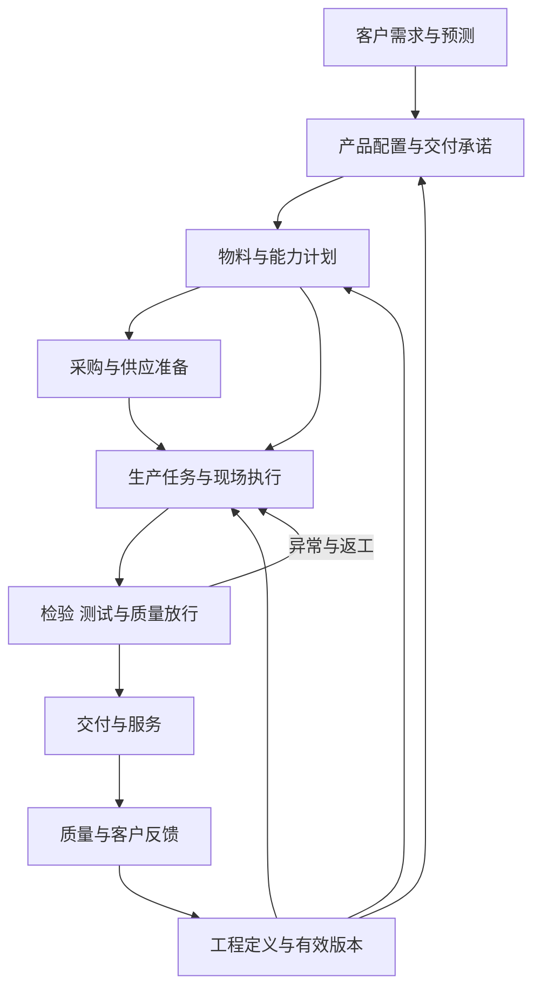

# 大制造信息化知识地图

本知识地图面向刚开始负责制造信息化的人。目标是能够看懂制造业务链、与各职能沟通、判断已有系统解决了什么，并组织后续调研与建设。整理日期：2026-10-27。

这里把“大制造”作为工作范围，涵盖与制造交付相关的研发工程、计划、采购、供应商、仓储、生产、设备、质量、物流和售后。它不是一个所有企业都采用同样边界的标准部门名称；实际组织与职责需要在接手调研中确认。

## 从交付承诺理解制造

客户需求形成订单或预测，企业决定产品配置与交付承诺，再把需求转换成工程、物料、产能和现场工作。采购与生产在不同时间尺度上准备资源，现场加工、装配、检验和测试产生实际记录，合格产品才能进入交付。售后与质量反馈又可能改变产品、工艺或供应选择。

这条链不是固定的单向流水线。工程变更、供应延期、设备故障、质量异常和客户改期都会引发重新决策。信息化的价值在于使决定有正确输入、状态能够传递、责任明确、结果可追溯，而不是单纯增加软件。

下图是学习用的业务关系图，表示需求、工程、供应、执行与反馈的联系，不是特定公司的组织或系统架构。

物料和能力共同支撑执行，工程版本贯穿计划与现场；质量和服务反馈又会推动工程与流程变化。任何一条连接缺少对象、状态或责任，都会影响后续判断。

| 环节 | 需要理解的业务问题 | 典型对象与资料 | 知识库入口 |
| --- | --- | --- | --- |
| 产品定义与新产品导入 | 什么产品可以被制造，何时允许转阶段 | 产品规格、工程版本、试产问题、批准 | [制造过程](01-foundations/01-manufacturing-process.md) |
| 工程发布与变更 | 用哪个设计、物料和工艺，变更何时生效 | EBOM、MBOM、路线、ECO、图纸与程序 | [主数据与工程变更](01-foundations/05-master-data-and-engineering-change.md) |
| 需求与计划 | 做什么、做多少、何时做、资源是否满足 | 预测、销售订单、主计划、物料与能力计划 | [计划与控制](01-foundations/02-planning-and-control.md) |
| 物料需求计算 | 已有供应够不够，缺什么、何时需要 | BOM、库存、未结供应、提前期 | [MRP 演算](01-foundations/03-mrp-worked-example.md) |
| 采购与收货 | 怎样把供应需求变成可信承诺与到货 | 申请、采购订单、承诺、收货与检验 | [ERP 业务交易](01-foundations/04-erp-business-transactions.md) |
| 仓储与配送 | 物料在哪里、能否使用、归谁所有 | 库位、批次、状态、发退料、盘点 | [系统与流程分工](02-systems/02-process-and-system-boundaries.md) |
| 生产与现场执行 | 哪些任务已经实际完成，资源与过程是否合适 | 工单、工序、报工、耗料、设备状态 | [系统全景](02-systems/01-system-landscape.md) |
| 质量与测试 | 能否放行、问题如何定位与追溯 | 原始检验、测试版本、缺陷、处置 | [质量与测试数据](05-fieldwork/04-quality-lean-and-test-data.md) |
| 出货与服务反馈 | 交付是否兑现，现场问题影响哪些产品 | 发货、签收、序列号、返修和客诉 | [业务交易](01-foundations/04-erp-business-transactions.md) |
| 核算与经营改善 | 实际结果怎样被解释，改善是否有效 | 成本与库存记录、指标口径、基线 | [指标与业务验收](03-implementation/02-metrics-and-business-acceptance.md) |

## 学习内容的六个层次

### 业务模式与管理目标

先区分离散制造和流程制造，再理解 MTS、MTO、ATO、ETO 等需求响应方式。不同模式影响库存放在哪里、工程何时完成、客户承诺依据和计划稳定性。不要用一个企业的订单模式解释所有制造问题。

管理目标需要在交付、质量、成本、库存、柔性与风险之间共同讨论。例如提高某设备利用率，可能伴随更大的批量和在制积压；减少库存也可能让不稳定供应直接影响交期。指标必须回到整条业务链。

### 业务对象与规则

物料、BOM、路线、工单、批次、序列号、采购订单和检验记录构成系统之间的共同对象。理解对象之间的关系，通常比先记住软件模块更有用。一个名称相同的字段，在不同系统可能具有不同时间点、单位或状态范围。

### 系统职责与连接

ERP、PLM、MES/MOM、APS、WMS、SRM、QMS 和设备层软件各有常见职责，但产品功能可能重叠。实际分工必须落到具体对象和字段：谁维护、谁批准、何时同步、如何处理失败、怎样确认一致。详见[系统全景](02-systems/01-system-landscape.md)及[集成](02-systems/03-integration-and-digital-thread.md)。

### 现场与数据可信度

记录是否及时、对象是否唯一、工程版本是否一致、质量状态是否正确，会直接影响计划、执行和分析。学习时同时看系统记录和真实作业，避免把“数据存在”误当成“数据可信且足以作决策”。

### 建设与验收

调研、流程确认、数据治理、配置集成、演练、业务验收、切换和持续维护相互依赖。买系统只是其中一部分。知识库提供[建设方法](03-implementation/01-assessment-and-roadmap.md)和[现场模板](05-fieldwork/01-takeover-interviews.md)，供后续结合公司情况细化。

### 行业案例与适用条件

案例帮助理解问题与方法，但复制前要比较订单粒度、产品复杂度、批量、设备条件、数据基础和组织能力。先理解嘉立创、海尔、三一和施耐德各自面对什么业务，再比较数字化措施与可迁移部分，见[案例比较](04-cases/05-comparison-and-transfer.md)。

## 阅读的依赖关系

这些顺序用于解释依赖，不限制资料范围。读者可以按手头问题跳转。

1. 先用[制造过程](01-foundations/01-manufacturing-process.md)建立对象关系，同时查[术语表](glossary.md)。
2. 读[计划体系](01-foundations/02-planning-and-control.md)，再手算[MRP](01-foundations/03-mrp-worked-example.md)，理解数量与日期从哪里来。
3. 结合[ERP 交易](01-foundations/04-erp-business-transactions.md)与[主数据](01-foundations/05-master-data-and-engineering-change.md)，理解业务状态和输入质量。
4. 进入[系统分工](02-systems/01-system-landscape.md)与[集成](02-systems/03-integration-and-digital-thread.md)，避免按软件名拼架构。
5. 阅读案例并比较条件，再用[调研问题](05-fieldwork/01-takeover-interviews.md)核对本公司的事实。
6. 以[建设路线](03-implementation/01-assessment-and-roadmap.md)和[指标](03-implementation/02-metrics-and-business-acceptance.md)组织下一阶段工作。

## 公司专属知识应当怎样补充

公共知识与公司事实分开维护。公司专属部分首先需要确认已采购系统的产品与使用范围，然后补充组织与职责、产品制造模式、流程、数据对象、系统台账、接口、实际问题和验收记录。不要把公开年报中的经营模式，自动推导为当前工厂的系统现状。

用户已说明内部有自研相机（含数采相机）、3D 打印机，外部有 OEM 代工代料业务，相关流程在[制造流程工作底稿](../docs/workflows/manufacturing-process-overview.md)中梳理。用户也提到 IT 部采购过 MRP 相关系统，具体产品信息尚未确认，可使用[已采购系统核查清单](05-fieldwork/03-purchased-mrp-review.md)准备材料。公共知识库的学习和扩充可以继续进行，不需要等公司专属数据齐备。
